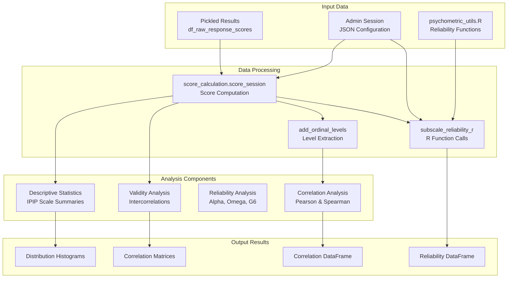
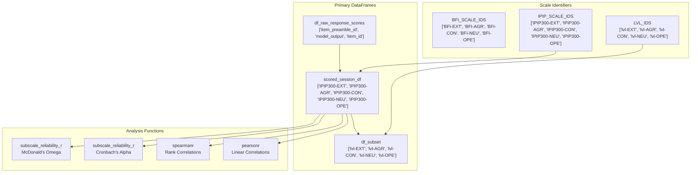
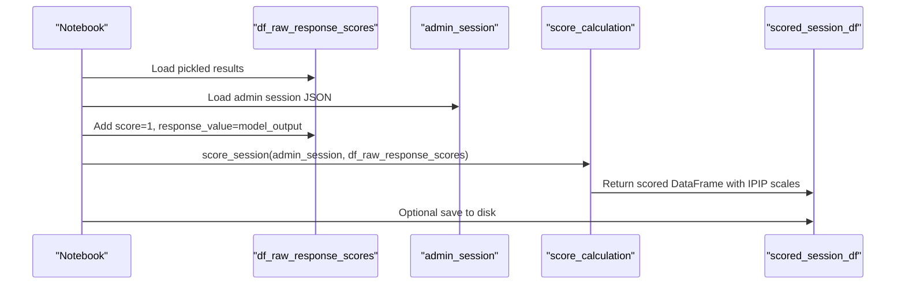
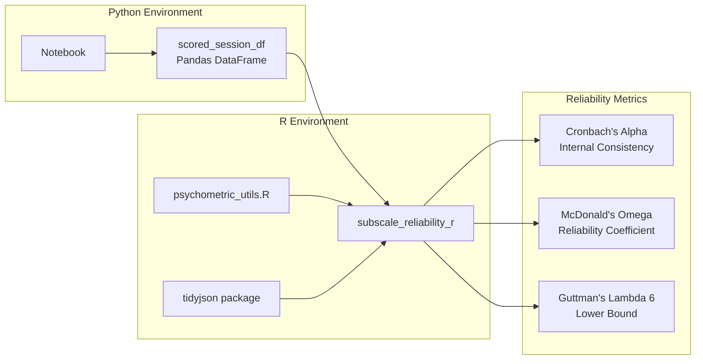

<!-- source: DeepWiki mcp.deepwiki.com · repo google-deepmind/personality_in_llms · page 5.1 Trait Shaping Analysis · fetched 2026-10-26 -->

# Trait Shaping Analysis

<details>
<summary>Relevant source files</summary>

The following files were used as context for generating this wiki page:

- [analysis/requirements.txt](analysis/requirements.txt)
- [analysis/trait_shaping_analysis_template.ipynb](analysis/trait_shaping_analysis_template.ipynb)

</details>


This page documents the trait shaping analysis system, which evaluates the effectiveness of personality trait shaping in Large Language Models through psychometric analysis. The system processes model responses to personality questionnaires and computes reliability metrics, validity measures, and correlations between intended trait levels and observed personality scores.

For information about construct validity analysis across different measures, see [Construct Validity Analysis](#5.3). For downstream task correlation analysis, see [Downstream Task Analysis](#5.2).

## Overview

The trait shaping analysis system consists of a Jupyter notebook template that performs comprehensive psychometric evaluation of LLM personality trait shaping experiments. It processes pickled response data, computes personality test scores using the PsyBORGS framework, and evaluates shaping effectiveness through correlation and reliability analysis.

## Analysis Pipeline

### Data Flow Architecture



Sources: [analysis/trait_shaping_analysis_template.ipynb:1-706]()

### Core Data Structures



Sources: [analysis/trait_shaping_analysis_template.ipynb:92-101](), [analysis/trait_shaping_analysis_template.ipynb:584-637]()

## Configuration and Setup

### Required Parameters

The analysis requires several configuration parameters set at the beginning of the notebook:

| Parameter | Purpose | Example Value |
|-----------|---------|---------------|
| `PKL_PATH` | Path to pickled results file | `"../results/your_results_here.pkl"` |
| `ADMIN_SESSION_PATH` | Path to admin session JSON | `"../admin_sessions/ablation01_ind_big5_9lvls_50desc_admin_session_rating.json"` |
| `MULTI_SHAPING` | Enable multi-trait analysis mode | `False` |
| `SAVE_SCORES_FILENAME` | Optional filename for saving scores | `False` |

Sources: [analysis/trait_shaping_analysis_template.ipynb:24-44]()

### Dependencies

The system requires Python packages for data analysis and R integration:

```python
# Core data analysis
pandas, numpy, matplotlib

# PsyBORGS framework
psyborgs.score_calculation, psyborgs.survey_bench_lib

# Statistical analysis
scipy.stats (spearmanr, pearsonr)

# R integration
rpy2.robjects, rpy2.robjects.pandas2ri
```

Sources: [analysis/trait_shaping_analysis_template.ipynb:61-82](), [analysis/requirements.txt:1-6]()

## Data Processing Pipeline

### Score Calculation Process



Sources: [analysis/trait_shaping_analysis_template.ipynb:178-208]()

### Level Extraction for Correlation Analysis

The `add_ordinal_levels` function extracts trait level information from `item_preamble_id`:

```python
# Example preamble_id: "ext3-agr0-con0-neu0-ope0-d36-ev2"
# Extracted levels: lvl-EXT=3, lvl-AGR=0, lvl-CON=0, lvl-NEU=0, lvl-OPE=0
```

Sources: [analysis/trait_shaping_analysis_template.ipynb:621-637]()

## Analysis Components

### Descriptive Analysis

The system computes descriptive statistics and visualizations for personality scale scores:

#### Scale Statistics
- Mean, median, standard deviation for IPIP-NEO-300 scales
- Distribution histograms with range [1,5]
- Descriptives by prompted personality levels (extreme low vs. high)

#### Helper Functions
- `get_domain_fragments()`: Generate preamble ID fragments for trait domains
- `get_big5_lvl_fragments()`: Generate fragments for all Big Five domains
- `describe_by_preambles()`: Compute statistics grouped by preamble fragments

Sources: [analysis/trait_shaping_analysis_template.ipynb:235-275](), [analysis/trait_shaping_analysis_template.ipynb:292-307]()

### Validity Analysis

#### Intercorrelation Analysis
The system computes Pearson correlations between IPIP-NEO-300 scales to assess construct validity:

```python
# Expected pattern: EXT should correlate moderately negatively with NEU
scored_session_df[IPIP_SCALE_IDS].corr()
```

#### P-Value Calculation
The `calculate_pvalues()` function computes significance levels for all pairwise correlations.

Sources: [analysis/trait_shaping_analysis_template.ipynb:352-392]()

### Reliability Analysis

#### R Integration Architecture



Sources: [analysis/trait_shaping_analysis_template.ipynb:451-535]()

#### Reliability Computation Functions

- `launch_r_instance()`: Initialize R environment and load psychometric utilities
- `load_r_scored_session()`: Convert pandas DataFrame to R format
- `compute_reliability_indices_per_scale()`: Calculate Alpha, Omega, and G6 for each scale
- `run_reliability_analysis_in_r()`: Main orchestration function

Sources: [analysis/trait_shaping_analysis_template.ipynb:476-534]()

### Correlation Analysis

#### Trait Level vs. Score Correlations

The main correlation analysis evaluates shaping effectiveness by computing correlations between intended trait levels and observed psychometric scores:

```python
# For each Big Five domain:
# - Extract intended level (1-9) from preamble_id
# - Compute Spearman and Pearson correlations with IPIP scores
# - Filter out non-shaping conditions (level = 0)
```

#### Analysis Functions
- `main()`: Primary correlation computation function
- Support for both single-trait (`MULTI_SHAPING=False`) and multi-trait modes
- Outputs correlation coefficients and p-values

Sources: [analysis/trait_shaping_analysis_template.ipynb:586-682]()

## Operating Modes

### Independent Trait Shaping Mode
- `MULTI_SHAPING = False`
- Analyzes effectiveness of shaping one trait at a time
- Computes correlations between intended levels and observed scores
- Uses admin sessions from independent trait shaping experiments

### Multi-Dimensional Trait Shaping Mode
- `MULTI_SHAPING = True`
- Analyzes simultaneous control of multiple traits
- Disables correlation analysis (not meaningful for multi-trait conditions)
- Uses admin sessions from multiple trait shaping experiments

Sources: [analysis/trait_shaping_analysis_template.ipynb:8-16](), [analysis/trait_shaping_analysis_template.ipynb:646-682]()

## Output and Results

### Generated Artifacts

| Output Type | Description | Location |
|-------------|-------------|----------|
| Reliability DataFrame | Alpha, Omega, G6 coefficients by scale | In-notebook display |
| Correlation DataFrame | Pearson/Spearman correlations with p-values | In-notebook display |
| Distribution Histograms | IPIP scale score distributions | Matplotlib figures |
| Correlation Matrices | Scale intercorrelations | Pandas correlation tables |
| Descriptive Statistics | Scale means, medians, std by condition | Pandas summary tables |

### Optional Data Export
- Scored session DataFrame can be saved to disk if `SAVE_SCORES_FILENAME` is specified
- Enables downstream analysis and result sharing

Sources: [analysis/trait_shaping_analysis_template.ipynb:205-207]()

---

