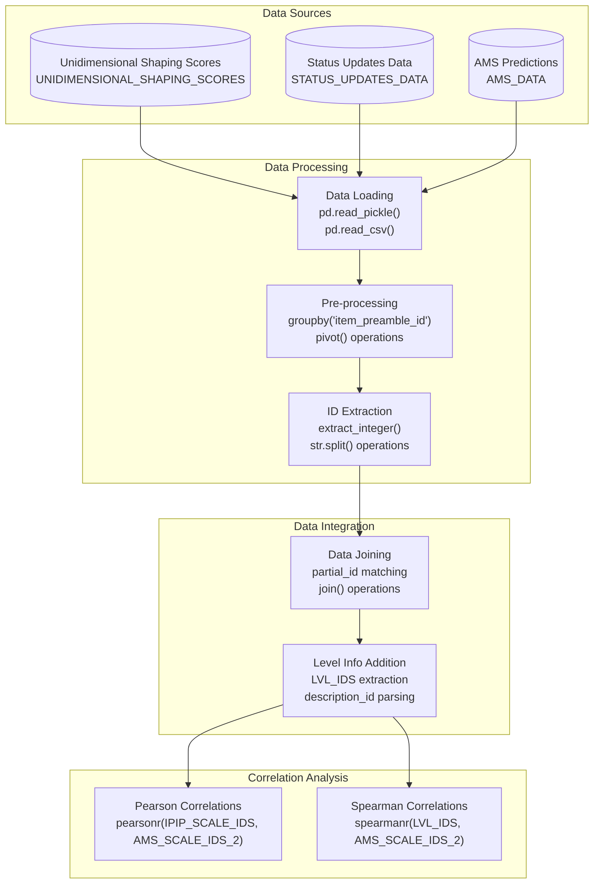
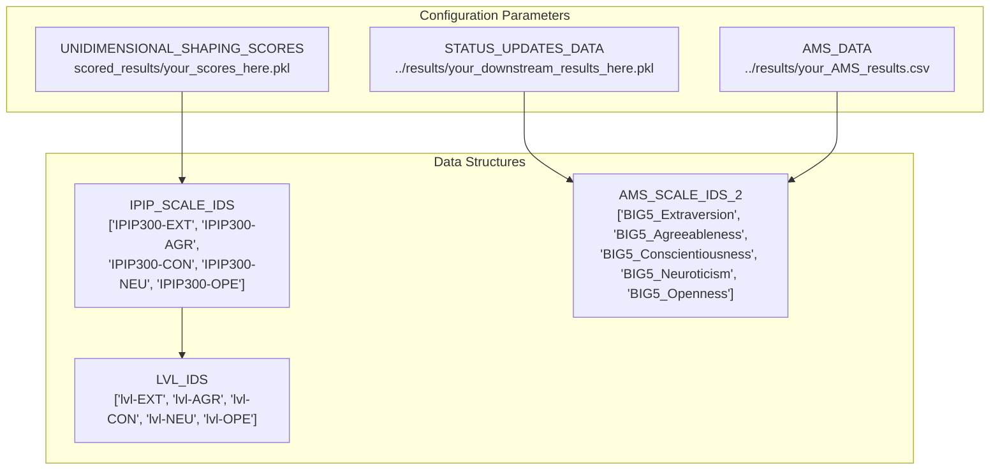
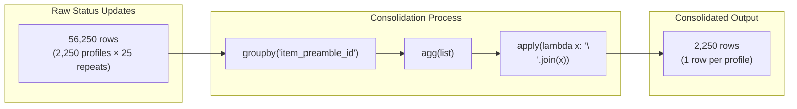
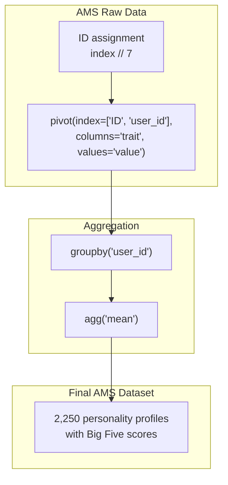
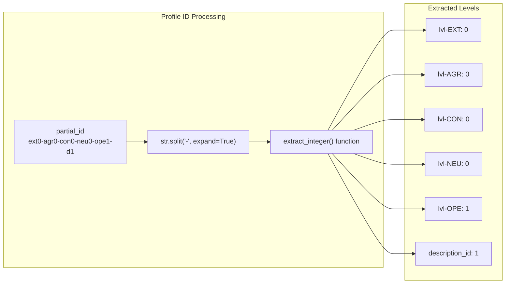

<!-- source: DeepWiki mcp.deepwiki.com · repo google-deepmind/personality_in_llms · page 5.2 Downstream Task Analysis · fetched 2026-10-26 -->

# Downstream Task Analysis

<details>
<summary>Relevant source files</summary>

The following files were used as context for generating this wiki page:

- [analysis/downstream_task_analysis_template.ipynb](analysis/downstream_task_analysis_template.ipynb)
- [analysis/requirements.txt](analysis/requirements.txt)

</details>


This document covers the downstream task analysis system used to evaluate how personality traits measured through standardized psychometric tests correlate with personality traits inferred from LLM-generated content in downstream tasks. The analysis determines whether personality profiles established through direct testing are reflected in the model's behavior when performing creative or expressive tasks.

For information about evaluating personality trait shaping effectiveness, see [Trait Shaping Analysis](#5.1). For psychometric validation and reliability assessment, see [Construct Validity Analysis](#5.3).

## Purpose and Scope

The downstream task analysis examines the relationship between three key data sources:

1. **Direct personality measurements** from standardized psychometric tests (IPIP-300 scales)
2. **Inferred personality traits** from downstream task outputs using automated personality prediction systems
3. **Intended personality levels** specified in the experimental design

The analysis computes correlation coefficients to validate that personality traits measured directly through surveys are consistently expressed in the model's downstream behavior, such as generating social media status updates.

## Analysis Workflow

The downstream task analysis follows a systematic data processing and correlation pipeline:



**Sources:** [analysis/downstream_task_analysis_template.ipynb:22-36](), [analysis/downstream_task_analysis_template.ipynb:112-123](), [analysis/downstream_task_analysis_template.ipynb:475-490]()

## Data Input Requirements

The analysis requires three primary data sources that must be configured before running:

| Data Source | Variable | Description | Format |
|-------------|----------|-------------|---------|
| Personality Test Scores | `UNIDIMENSIONAL_SHAPING_SCORES` | Direct IPIP-300 scale measurements | Pickled DataFrame |
| Downstream Task Output | `STATUS_UPDATES_DATA` | Social media status updates generated by LLM | Pickled DataFrame |
| Automated Predictions | `AMS_DATA` | AMS personality predictions from status updates | CSV file |



**Sources:** [analysis/downstream_task_analysis_template.ipynb:28-35](), [analysis/downstream_task_analysis_template.ipynb:72-94]()

## Data Processing Pipeline

### Status Updates Consolidation

The system processes raw status update data by consolidating multiple generated updates per personality profile:



**Sources:** [analysis/downstream_task_analysis_template.ipynb:144-150]()

### AMS Data Processing

The Automated Personality Measurement System (AMS) data undergoes pivot transformation and aggregation:



**Sources:** [analysis/downstream_task_analysis_template.ipynb:186-200]()

### Personality Level Extraction

The system extracts intended personality levels from profile identifiers using the `extract_integer()` function:



**Sources:** [analysis/downstream_task_analysis_template.ipynb:512-530](), [analysis/downstream_task_analysis_template.ipynb:500-503]()

## Correlation Analysis Methods

The system computes two types of correlations to validate personality consistency:

### Pearson Correlations

Measures linear relationships between directly tested personality scores and AMS-inferred personality traits:

```python
for ipip_scale, ams_scale in zip(IPIP_SCALE_IDS, AMS_SCALE_IDS_2):
    corr_coef, p_value = pearsonr(group[ipip_scale], group[ams_scale])
```

**Sources:** [analysis/downstream_task_analysis_template.ipynb:318-320]()

### Spearman Correlations

Measures rank-order relationships between intended personality levels and downstream personality expression:

```python
for prompted_level, observed_level in zip(LVL_IDS, AMS_SCALE_IDS_2):
    subset = group[group[prompted_level] > 0]
    corr_coef, p_value = spearmanr(subset[prompted_level], subset[observed_level])
```

**Sources:** [analysis/downstream_task_analysis_template.ipynb:363-367]()

## Key Analysis Components

### Scale Mapping

The analysis maps between different personality measurement systems:

| IPIP-300 Scales | AMS Big Five Scales | Level Identifiers |
|-----------------|-------------------|------------------|
| `IPIP300-EXT` | `BIG5_Extraversion` | `lvl-EXT` |
| `IPIP300-AGR` | `BIG5_Agreeableness` | `lvl-AGR` |
| `IPIP300-CON` | `BIG5_Conscientiousness` | `lvl-CON` |
| `IPIP300-NEU` | `BIG5_Neuroticism` | `lvl-NEU` |
| `IPIP300-OPE` | `BIG5_Openness` | `lvl-OPE` |

**Sources:** [analysis/downstream_task_analysis_template.ipynb:72-94]()

### Data Integration

The final integrated dataset contains 2,250 rows with 1,824 columns, combining:

- Model-generated status updates (`model_output`)
- Individual IPIP-300 item responses (`ipip1`, `ipip2`, ..., `ipip300`)
- Computed personality scale scores (`IPIP300-EXT`, `IPIP300-AGR`, etc.)
- AMS-predicted personality traits (`BIG5_Extraversion`, `BIG5_Agreeableness`, etc.)
- Extracted personality levels (`lvl-EXT`, `lvl-AGR`, etc.)

**Sources:** [analysis/downstream_task_analysis_template.ipynb:995-997]()

## Usage Instructions

To run the downstream task analysis:

1. **Configure Data Paths**: Update the three filepath variables at the top of the notebook
2. **Load Dependencies**: Execute the imports section with `pandas` and `scipy.stats`
3. **Run Data Processing**: Execute all data loading and preprocessing cells
4. **Compute Correlations**: Run the correlation analysis sections to generate results

The analysis outputs correlation coefficients and p-values that quantify the relationship strength between different personality measurement approaches.

**Sources:** [analysis/downstream_task_analysis_template.ipynb:16-19](), [analysis/downstream_task_analysis_template.ipynb:53-54](), [analysis/downstream_task_analysis_template.ipynb:314-376]()

---

