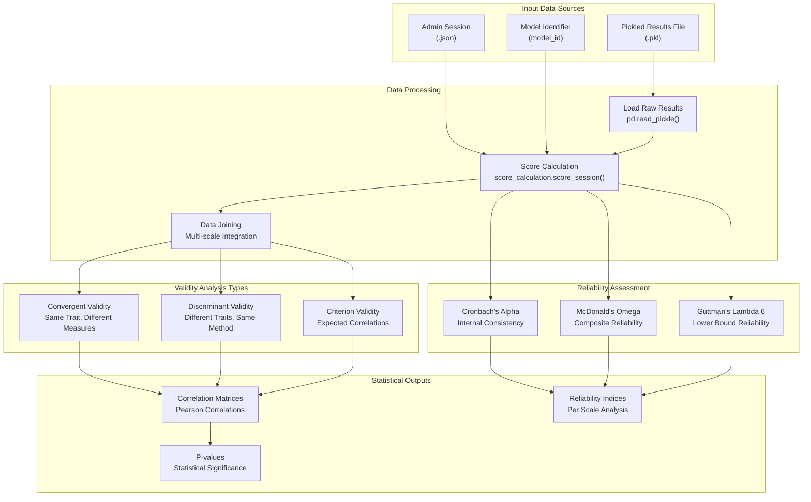
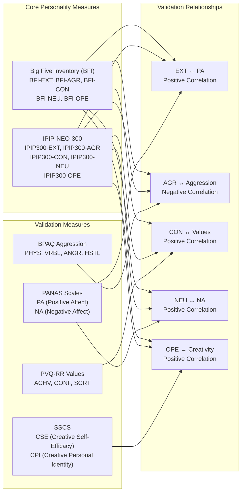
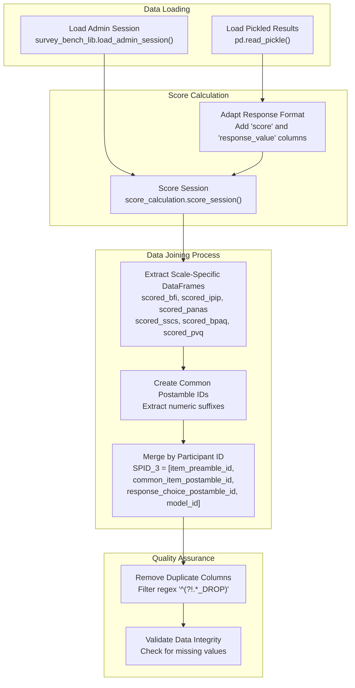
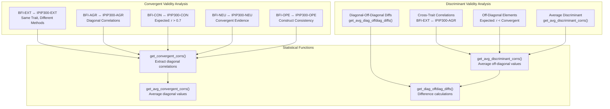
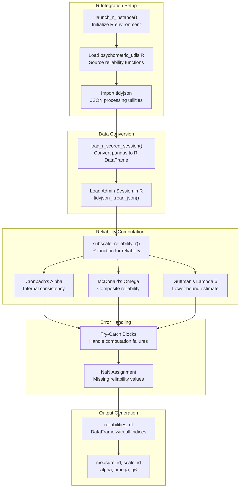

<!-- source: DeepWiki mcp.deepwiki.com · repo google-deepmind/personality_in_llms · page 5.3 Construct Validity Analysis · fetched 2026-10-26 -->

# Construct Validity Analysis

Relevant source files

The following files were used as context for generating this wiki page:

- [analysis/construct_validity_analysis_template.ipynb](analysis/construct_validity_analysis_template.ipynb)
- [analysis/requirements.txt](analysis/requirements.txt)

This document covers the construct validity analysis template, which provides comprehensive psychometric validation for personality test data collected from Large Language Models. The template evaluates the reliability and validity of personality measurements across multiple psychological instruments.

For information about trait shaping effectiveness analysis, see [Trait Shaping Analysis](#5.1). For correlational analysis between personality profiles and generated content, see [Downstream Task Analysis](#5.2).

## Purpose and Scope

The construct validity analysis template serves as a standardized framework for evaluating the psychometric properties of personality test responses from LLMs. It performs multiple types of validity analysis including convergent validity, discriminant validity, and criterion validity, along with comprehensive reliability assessment using multiple statistical indices.

## Analysis Framework Overview

The construct validity analysis operates on scored personality test data to assess whether the psychological constructs measured by different instruments are consistent and meaningful. The template integrates multiple validation approaches to provide a comprehensive assessment of measurement quality.

Sources: [analysis/construct_validity_analysis_template.ipynb:1-1299]()

## Template Configuration

The template requires several configuration parameters to specify the analysis scope and data sources:

| Parameter | Purpose | Example |
|-----------|---------|---------|
| `PKL_PATH` | Path to pickled results file | `"../results/your_results_here.pkl"` |
| `ADMIN_SESSION_PATH` | Admin session configuration | `"../admin_sessions/prod_run_01_external_rating.json"` |
| `MODEL_POINTER` | Model identifier for analysis | `"mistralai/Mixtral-8x7B-Instruct-v0.1"` |
| `PSYCHOMETRIC_UTILS_PATH` | R utilities for reliability | `"../psyborgs/psychometric_utils.R"` |
| `SAVE_SCORES_FILENAME` | Optional score export path | `False` or filename string |

Sources: [analysis/construct_validity_analysis_template.ipynb:26-46]()

## Personality Scales and Measures

The template analyzes multiple personality instruments to enable comprehensive construct validation:

Sources: [analysis/construct_validity_analysis_template.ipynb:120-123](), [analysis/construct_validity_analysis_template.ipynb:994-1016]()

## Data Processing Workflow

The template follows a systematic data processing pipeline to prepare data for validity analysis:

Sources: [analysis/construct_validity_analysis_template.ipynb:173-176](), [analysis/construct_validity_analysis_template.ipynb:185-190](), [analysis/construct_validity_analysis_template.ipynb:663-720]()

## Validity Analysis Methods

### Convergent and Discriminant Validity

The template implements multitrait-multimethod (MTMM) analysis to assess convergent and discriminant validity:

Sources: [analysis/construct_validity_analysis_template.ipynb:795-921](), [analysis/construct_validity_analysis_template.ipynb:932-979]()

### Criterion Validity Assessment

The template evaluates criterion validity by examining theoretically expected correlations between personality traits and validation measures:

| Personality Trait | Expected Correlations | Validation Logic |
|------------------|---------------------|------------------|
| **Extraversion** | Positive: PA; Negative: NEU, NA | Extraverts experience more positive emotions |
| **Agreeableness** | Negative: PHYS, VRBL, ANGR, HSTL; Positive: CONF | Agreeable individuals are less aggressive |
| **Conscientiousness** | Positive: ACHV, CONF, SCRT | Conscientious individuals value achievement and security |
| **Neuroticism** | Positive: NA, Aggression; Negative: EXT, PA | High neuroticism associated with negative emotions |
| **Openness** | Positive: CSE, CPI | Open individuals have higher creative self-efficacy |

Sources: [analysis/construct_validity_analysis_template.ipynb:1019-1111]()

## Reliability Analysis Implementation

The template integrates R-based psychometric functions to compute multiple reliability indices:

Sources: [analysis/construct_validity_analysis_template.ipynb:1164-1248](), [analysis/construct_validity_analysis_template.ipynb:1189-1225]()

## Statistical Analysis Functions

The template provides several utility functions for statistical analysis:

### Correlation Analysis Functions

- `calculate_pvalues()`: Computes p-values for correlation matrices using Pearson correlation
- `get_convergent_corrs()`: Extracts convergent validity correlations between BFI and IPIP scales
- `get_avg_convergent_corrs()`: Calculates average convergent correlations across traits
- `get_avg_discriminant_corrs()`: Computes average discriminant correlations (off-diagonal elements)

### Reliability Integration Functions

- `run_reliability_analysis_in_r()`: Master function orchestrating R-based reliability analysis
- `compute_reliability_indices_per_scale()`: Iterates through all scales to compute reliability indices
- `load_r_scored_session()`: Converts pandas DataFrame to R format for analysis

Sources: [analysis/construct_validity_analysis_template.ipynb:440-448](), [analysis/construct_validity_analysis_template.ipynb:1227-1247]()

## Output Interpretation

The template generates several types of output for construct validity assessment:

### Correlation Matrices
- **Intercorrelations**: Within-instrument correlations (BFI scales, IPIP scales)
- **Cross-method correlations**: Between-instrument correlations for construct validation
- **Criterion correlations**: Relationships with validation measures

### Reliability Indices
- **Cronbach's Alpha**: Traditional internal consistency measure
- **McDonald's Omega**: Composite reliability accounting for factor loadings
- **Guttman's Lambda 6**: Lower bound reliability estimate

### Validity Metrics
- **Average convergent correlation**: Strength of same-trait, different-method relationships
- **Average discriminant correlation**: Strength of different-trait relationships
- **Diagonal-off-diagonal differences**: Discriminant validity evidence

Sources: [analysis/construct_validity_analysis_template.ipynb:455-578](), [analysis/construct_validity_analysis_template.ipynb:1258-1274]()

---

