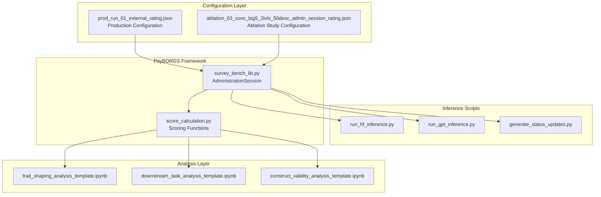
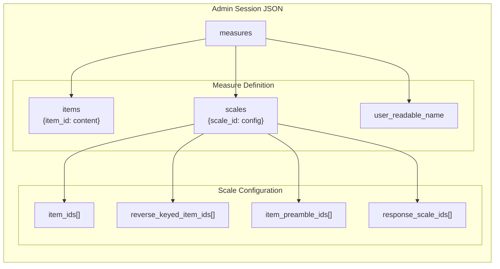
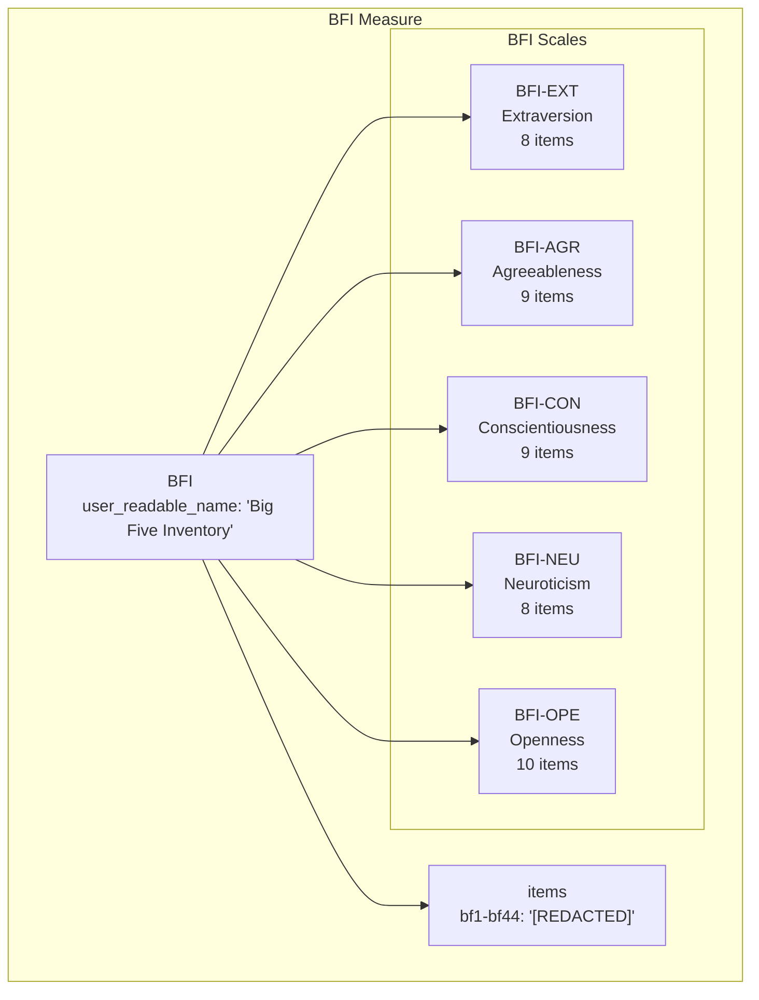
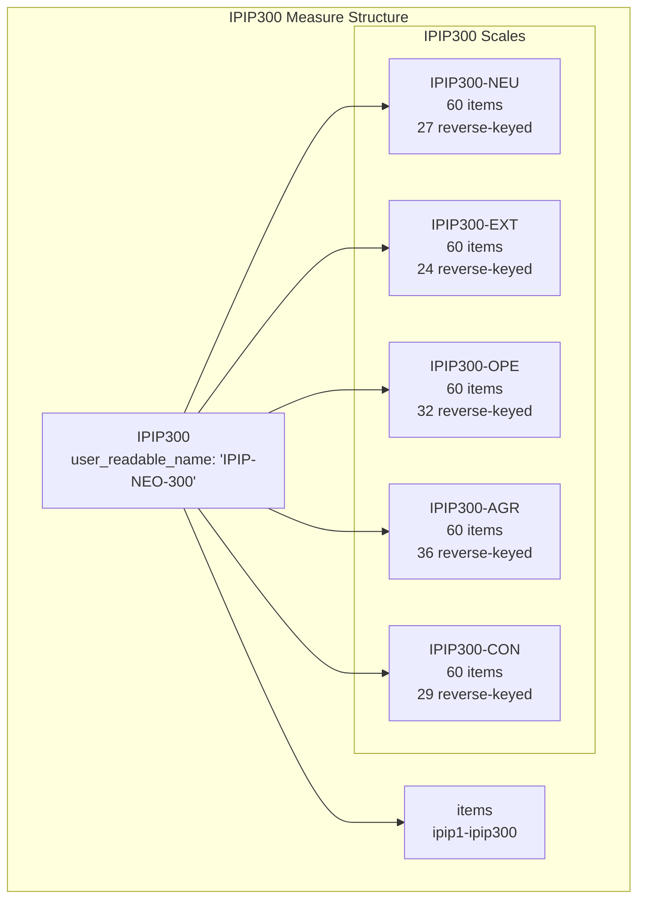
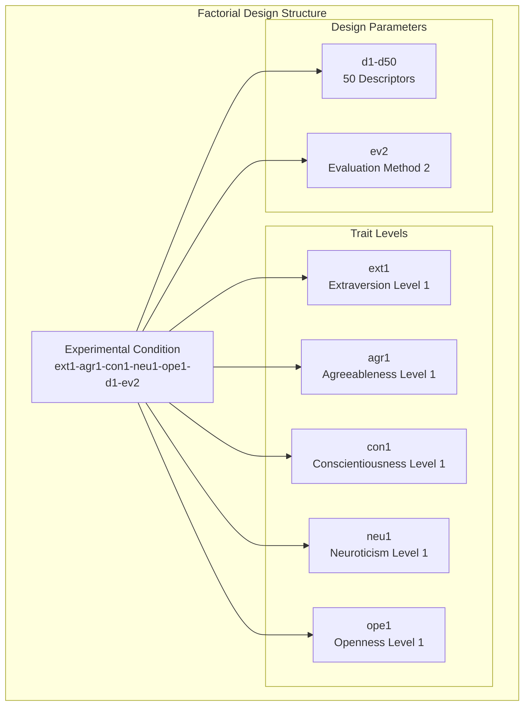
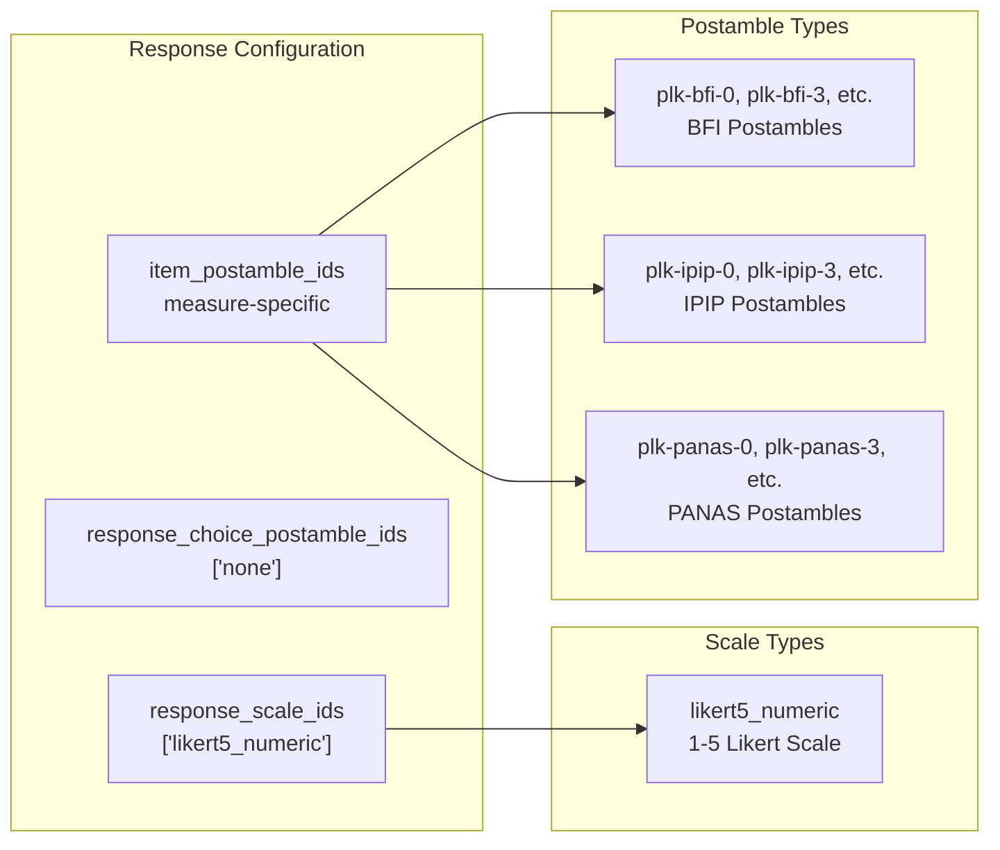
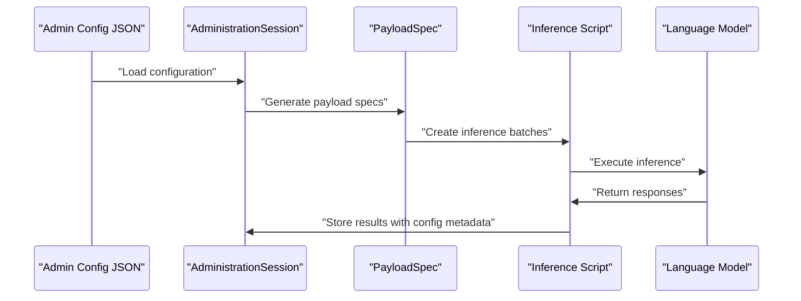

<!-- source: DeepWiki mcp.deepwiki.com · repo google-deepmind/personality_in_llms · page 6 Configuration and Experiment Setup · fetched 2026-10-26 -->

# Configuration and Experiment Setup

Relevant source files

The following files were used as context for generating this wiki page:

- [admin_sessions/ablation01_ind_big5_9lvls_50desc_admin_session_rating.json](admin_sessions/ablation01_ind_big5_9lvls_50desc_admin_session_rating.json)
- [admin_sessions/ablation_03_conc_big5_2lvls_50desc_admin_session_rating.json](admin_sessions/ablation_03_conc_big5_2lvls_50desc_admin_session_rating.json)
- [admin_sessions/prod_run_01_external_rating.json](admin_sessions/prod_run_01_external_rating.json)

This document provides an overview of the configuration system used to define and manage experiments in the personality traits research framework. It covers the structure of admin session files, experimental design patterns, and how configurations integrate with the inference and analysis pipeline.

For detailed information about admin session file structure and parameters, see [Admin Session Configuration](#6.1). For specific ablation study design patterns, see [Ablation Study Configurations](#6.2).

## Configuration System Overview

The experiment configuration system is built around JSON-based admin session files that define the complete experimental setup including psychological measures, item combinations, and experimental conditions. These configurations serve as the single source of truth for experiment parameters and are consumed by inference scripts and analysis notebooks.

**Sources:** [admin_sessions/prod_run_01_external_rating.json](), [admin_sessions/ablation_03_conc_big5_2lvls_50desc_admin_session_rating.json]()

## Admin Session File Structure

Admin session files follow a standardized JSON structure with three main components: measures definitions, experimental conditions, and response specifications. The `measures` object contains all psychological instruments used in the study, while additional sections define experimental manipulations and data collection parameters.

| Component | Purpose | Key Fields |
|-----------|---------|------------|
| `measures` | Psychological instrument definitions | `items`, `scales`, `user_readable_name` |
| `items` | Individual test items/questions | Item ID to content mapping |
| `scales` | Scoring subscales | `item_ids`, `reverse_keyed_item_ids`, `item_preamble_ids` |

**Sources:** [admin_sessions/prod_run_01_external_rating.json:1-50](), [admin_sessions/ablation_03_conc_big5_2lvls_50desc_admin_session_rating.json:1-50]()

## Psychological Measures Configuration

The system supports multiple standardized psychological instruments, each with specific item sets and scoring rules. The most commonly used measures include the Big Five Inventory (BFI), IPIP-NEO-300, PANAS, and specialized scales for creativity and aggression.

### Big Five Inventory (BFI) Configuration

**Sources:** [admin_sessions/prod_run_01_external_rating.json:2-97]()

### IPIP-NEO-300 Configuration

The IPIP-NEO-300 provides a more comprehensive personality assessment with 300 items across five major domains, each containing 60 items with specific reverse-keying patterns.

**Sources:** [admin_sessions/prod_run_01_external_rating.json:99-449](), [admin_sessions/ablation_03_conc_big5_2lvls_50desc_admin_session_rating.json:3-448]()

## Experimental Design Patterns

### Factorial Design Configuration

The ablation study configuration demonstrates a factorial experimental design where personality traits are manipulated at different levels. The `item_preamble_ids` encode experimental conditions using a structured naming convention.

**Sources:** [admin_sessions/ablation_03_conc_big5_2lvls_50desc_admin_session_rating.json:401-1400]()

### Multi-Level Trait Manipulation

The system supports manipulation of personality traits at different intensity levels (e.g., `neu1` vs `neu9` for low vs high neuroticism), allowing researchers to study the effects of varying personality trait strengths.

| Trait | Level 1 | Level 9 | 
|-------|---------|---------|
| Extraversion | `ext1` | `ext9` |
| Agreeableness | `agr1` | `agr9` |
| Conscientiousness | `con1` | `con9` |
| Neuroticism | `neu1` | `neu9` |
| Openness | `ope1` | `ope9` |

**Sources:** [admin_sessions/ablation_03_conc_big5_2lvls_50desc_admin_session_rating.json:401-1800]()

## Response Scale Configuration

All measures utilize standardized response scales and postamble configurations. The `response_scale_ids` and `response_choice_postamble_ids` fields specify how responses should be collected and processed.

**Sources:** [admin_sessions/prod_run_01_external_rating.json:57-59](), [admin_sessions/ablation_03_conc_big5_2lvls_50desc_admin_session_rating.json:1748-1750]()

## Integration with Inference Pipeline

Admin session configurations are loaded by the PsyBORGS framework and used to generate inference payloads for different model backends. The configuration system ensures consistent experimental conditions across all inference runs.

**Sources:** [admin_sessions/prod_run_01_external_rating.json](), [admin_sessions/ablation_03_conc_big5_2lvls_50desc_admin_session_rating.json]()

---

