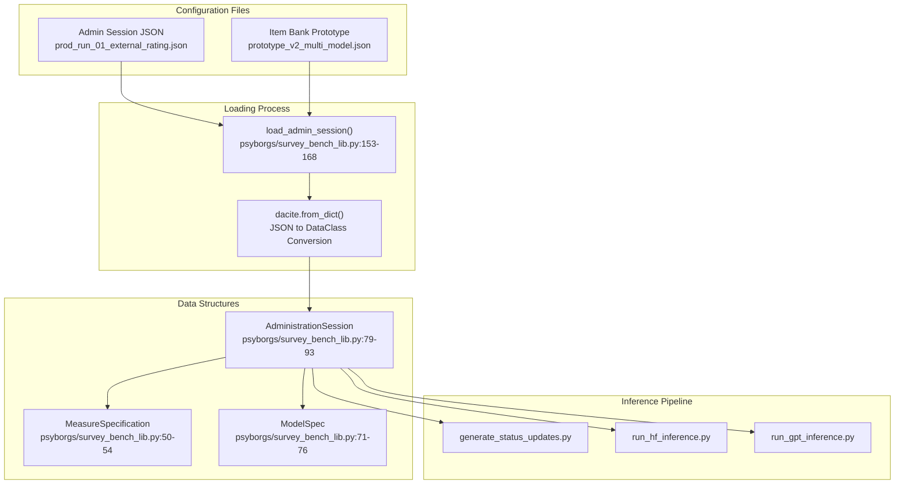
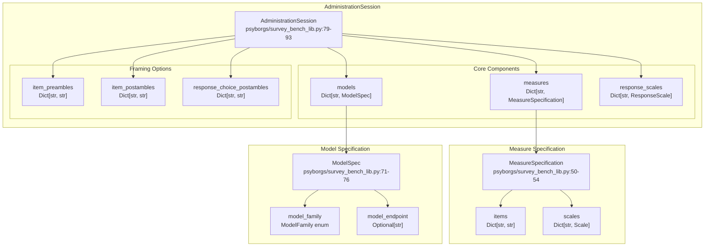
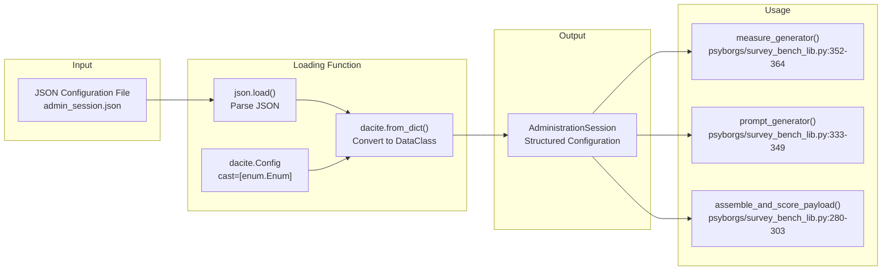
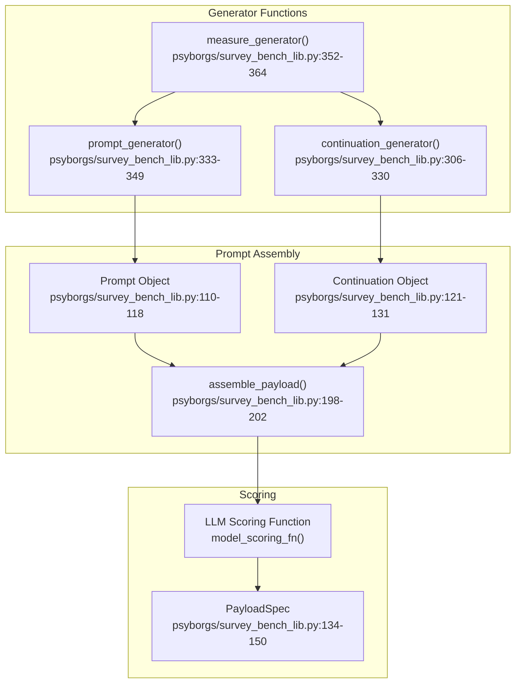

<!-- source: DeepWiki mcp.deepwiki.com · repo google-deepmind/personality_in_llms · page 6.1 Admin Session Configuration · fetched 2026-10-26 -->

# Admin Session Configuration

<details>
<summary>Relevant source files</summary>

The following files were used as context for generating this wiki page:

- [admin_sessions/prod_run_01_external_rating.json](admin_sessions/prod_run_01_external_rating.json)
- [psyborgs/survey_bench_lib.py](psyborgs/survey_bench_lib.py)

</details>


This document explains the admin session configuration system, which defines experimental parameters for personality trait assessment in Large Language Models. Admin sessions are JSON configuration files that specify psychometric measures, response scales, item framing options, and target models for inference experiments.

For information about psychometric measures and scales, see [PsyBORGS Framework](#3). For guidance on running inference with these configurations, see [Inference System](#4).

## Overview

Admin sessions serve as the central configuration mechanism for personality trait experiments. They define comprehensive experiment specifications that are loaded by inference scripts to generate structured prompts and score LLM responses according to established psychometric instruments.

The admin session system bridges the gap between human-readable JSON configuration files and the complex dataclass structures required by the PsyBORGS framework. Each admin session encapsulates all necessary information to reproduce an experiment, including measure definitions, response scales, prompt framing options, and target model specifications.

**Admin Session Configuration Flow**



Sources: [psyborgs/survey_bench_lib.py:153-168]()

## JSON Configuration Structure

Admin session JSON files contain six primary configuration categories that define the complete experimental setup:

| Configuration Category | Purpose | Data Class |
|------------------------|---------|------------|
| `measures` | Psychometric instruments and their items | `MeasureSpecification` |
| `item_preambles` | Text that precedes survey items | `Dict[str, str]` |
| `item_postambles` | Text that follows survey items | `Dict[str, str]` |
| `response_scales` | Available response options | `ResponseScale` |
| `response_choice_postambles` | Text following response choices | `Dict[str, str]` |
| `models` | Target LLM specifications | `ModelSpec` |

**Admin Session Data Structure**



Sources: [psyborgs/survey_bench_lib.py:79-93](), [psyborgs/survey_bench_lib.py:50-54](), [psyborgs/survey_bench_lib.py:71-76]()

## Key Data Classes

### AdministrationSession

The `AdministrationSession` class serves as the root container for all experimental configuration. It provides a `n_measures` property that returns the number of psychometric measures included in the session.

```python
@dataclasses.dataclass(frozen=True)
class AdministrationSession:
  measures: Dict[str, MeasureSpecification]
  item_preambles: Dict[str, str]
  item_postambles: Dict[str, str]
  response_scales: Dict[str, ResponseScale]
  response_choice_postambles: Dict[str, str]
  models: Dict[str, ModelSpec]
```

### MeasureSpecification

Each `MeasureSpecification` defines a psychometric instrument with its constituent items and scales. The `items` dictionary maps item IDs to their text content, while `scales` defines how items are grouped and scored.

### ModelSpec

The `ModelSpec` class represents target LLMs with their family classification and optional endpoint information. The `ModelFamily` enum supports `PALM`, `LLAMA2`, `MISTRAL`, `MIXTRAL`, and `OTHER` model types.

### Scale

The `Scale` dataclass defines how survey items are organized, including:
- `item_ids`: List of items belonging to this scale
- `reverse_keyed_item_ids`: Items requiring reverse scoring
- `item_preamble_ids`: Compatible preamble options
- `response_scale_ids`: Applicable response scales

Sources: [psyborgs/survey_bench_lib.py:39-48](), [psyborgs/survey_bench_lib.py:50-54](), [psyborgs/survey_bench_lib.py:71-76]()

## Configuration Loading Process

The `load_admin_session` function converts JSON configuration files into structured dataclass objects using the `dacite` library. This process enables type-safe configuration loading with automatic enum casting.

**Configuration Loading Workflow**



The loading process involves:

1. **JSON Parsing**: Standard JSON file loading using Python's `json` module
2. **Type Conversion**: `dacite.from_dict()` converts dictionary data to dataclass instances
3. **Enum Casting**: Automatic conversion of string values to enum types (e.g., `ModelFamily`)
4. **Validation**: Dataclass field validation ensures configuration integrity

Sources: [psyborgs/survey_bench_lib.py:153-168]()

## Prompt Assembly and Scoring Integration

Admin sessions integrate with the scoring pipeline through generator functions that iterate through all possible combinations of measures, prompts, and continuations. The system generates structured prompts by combining:

- **Item Preambles**: Introductory text before survey items
- **Survey Items**: The actual psychometric questions
- **Item Postambles**: Concluding text after survey items
- **Response Choices**: Available response options from scales
- **Response Choice Postambles**: Text following response selections

**Prompt Generation Pipeline**



The `PayloadSpec` dataclass captures complete specification information for each scored prompt-continuation pair, enabling full reproducibility of experimental results.

Sources: [psyborgs/survey_bench_lib.py:352-364](), [psyborgs/survey_bench_lib.py:333-349](), [psyborgs/survey_bench_lib.py:306-330](), [psyborgs/survey_bench_lib.py:134-150]()

## Creating New Configurations

When creating new admin session configurations, ensure JSON structure aligns with the expected dataclass fields:

1. **Measures**: Define psychometric instruments with complete item banks and scale specifications
2. **Response Scales**: Include all response options with numeric values as string keys
3. **Framing Options**: Provide comprehensive preamble and postamble variations
4. **Model Specifications**: Use correct `ModelFamily` enum values and appropriate endpoints
5. **ID Consistency**: Ensure all reference IDs exist in their respective dictionaries

The configuration system supports complex experimental designs through flexible combinations of measures, framing options, and model specifications, enabling comprehensive personality trait assessment across diverse LLM architectures.

Sources: [psyborgs/survey_bench_lib.py:153-168](), [psyborgs/survey_bench_lib.py:79-93]()

---

