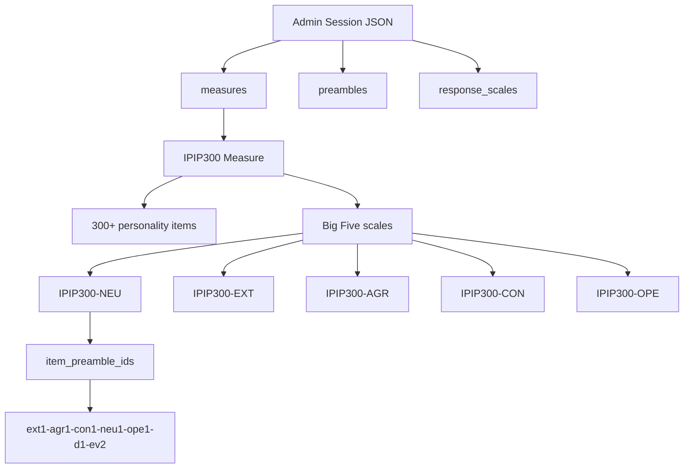
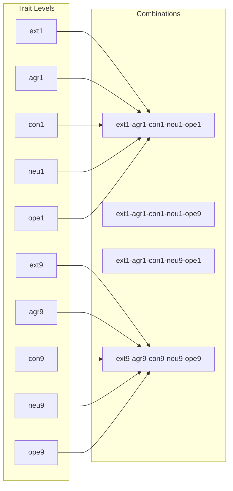
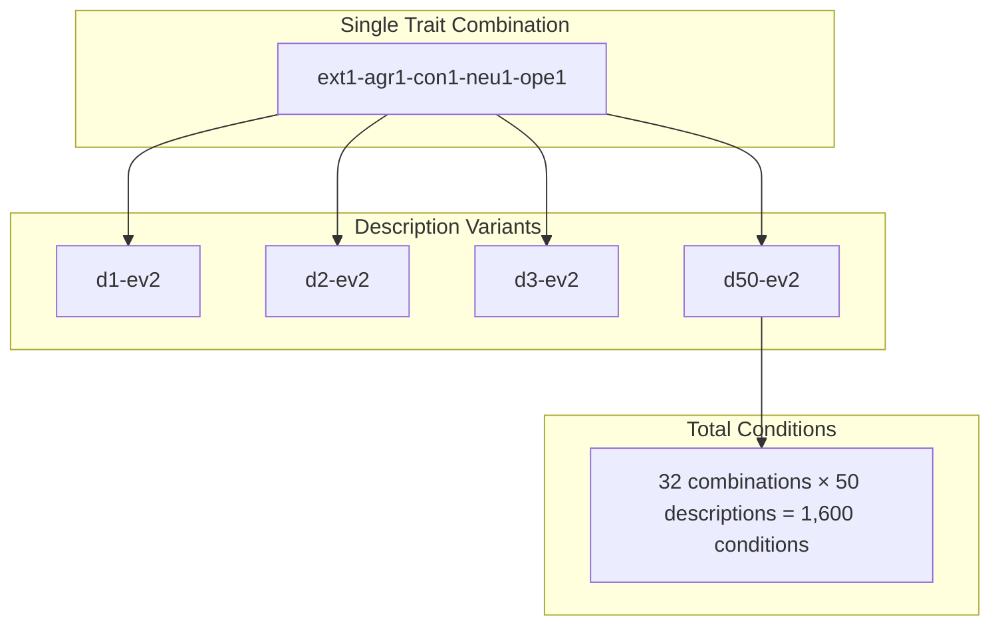
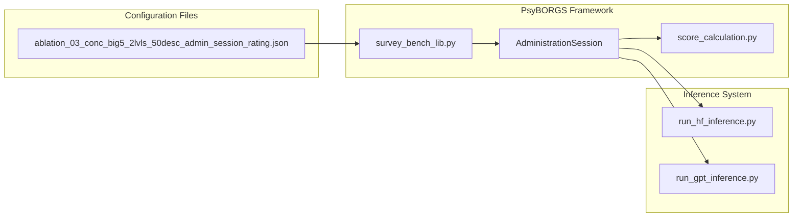

<!-- source: DeepWiki mcp.deepwiki.com · repo google-deepmind/personality_in_llms · page 6.2 Ablation Study Configurations · fetched 2026-10-26 -->

# Ablation Study Configurations

<details>
<summary>Relevant source files</summary>

The following files were used as context for generating this wiki page:

- [admin_sessions/ablation01_ind_big5_9lvls_50desc_admin_session_rating.json](admin_sessions/ablation01_ind_big5_9lvls_50desc_admin_session_rating.json)
- [admin_sessions/ablation_03_conc_big5_2lvls_50desc_admin_session_rating.json](admin_sessions/ablation_03_conc_big5_2lvls_50desc_admin_session_rating.json)

</details>


This document describes how to configure ablation studies for systematic personality trait shaping experiments in the LLM personality research system. Ablation studies in this context involve systematically varying personality trait levels to isolate the effects of individual traits or trait combinations on model behavior.

For general admin session configuration structure, see [Admin Session Configuration](#6.1). For analysis of ablation study results, see [Trait Shaping Analysis](#5.1).

## Overview of Ablation Studies

Ablation studies in this system are designed to test the independent and interactive effects of personality traits by creating experimental conditions that systematically vary trait levels. The system supports full factorial designs where each of the Big Five personality traits can be set to different levels (typically low=1 or high=9) across multiple experimental conditions.

**Key Components:**
- **Trait Combinations**: Systematic variation of Big Five traits (Extraversion, Agreeableness, Conscientiousness, Neuroticism, Openness)
- **Level Encoding**: Binary levels (1=low, 9=high) for each trait
- **Description Variants**: Multiple personality descriptions per trait combination
- **Evaluation Versions**: Different experimental protocols or evaluation methods

## Configuration Structure

Ablation study configurations follow the standard admin session format but include specialized encoding for systematic trait variation:



Sources: [admin_sessions/ablation_03_conc_big5_2lvls_50desc_admin_session_rating.json:1-50]()

## Trait Encoding System

The system uses a structured encoding scheme for trait combinations within the `item_preamble_ids` arrays:

### Encoding Format
```
ext{X}-agr{Y}-con{Z}-neu{W}-ope{V}-d{N}-ev{E}
```

**Parameters:**
- `ext`: Extraversion level (1=low, 9=high)
- `agr`: Agreeableness level (1=low, 9=high)  
- `con`: Conscientiousness level (1=low, 9=high)
- `neu`: Neuroticism level (1=low, 9=high)
- `ope`: Openness level (1=low, 9=high)
- `d`: Description variant (1-50)
- `ev`: Evaluation version (typically 2)

### Full Factorial Design

The ablation study generates all possible combinations of trait levels:



Sources: [admin_sessions/ablation_03_conc_big5_2lvls_50desc_admin_session_rating.json:401-2001]()

## Scale Configuration

Each personality dimension is configured as a separate scale within the IPIP300 measure:

### Neuroticism Scale Example
```json
"IPIP300-NEU": {
  "user_readable_name": "IPIP-NEO-300 Neuroticism",
  "item_ids": ["ipip1", "ipip6", "ipip11", ...],
  "reverse_keyed_item_ids": ["ipip151", "ipip156", ...],
  "item_preamble_ids": [
    "ext1-agr1-con1-neu1-ope1-d1-ev2",
    "ext1-agr1-con1-neu1-ope1-d2-ev2",
    ...
  ],
  "item_postamble_ids": ["plk-ipip-0"],
  "response_scale_ids": ["likert5_numeric"],
  "response_choice_postamble_ids": ["none"]
}
```

**Key Elements:**
- `item_ids`: Core personality assessment items
- `reverse_keyed_item_ids`: Items requiring reverse scoring
- `item_preamble_ids`: Trait combination encodings for experimental conditions
- `response_scale_ids`: Likert scale configuration

Sources: [admin_sessions/ablation_03_conc_big5_2lvls_50desc_admin_session_rating.json:307-2012]()

## Experimental Design Patterns

### Binary Level Design
The most common ablation pattern uses binary trait levels:
- **Low Level (1)**: Minimal expression of trait
- **High Level (9)**: Maximum expression of trait

This creates 2^5 = 32 unique trait combinations.

### Description Variants
Each trait combination includes multiple description variants (d1 through d50) to:
- Reduce prompt-specific effects
- Increase statistical power
- Test consistency across different phrasings



Sources: [admin_sessions/ablation_03_conc_big5_2lvls_50desc_admin_session_rating.json:401-2001]()

## Implementation Details

### File Structure
Ablation study configurations are stored as JSON files in the `admin_sessions/` directory with descriptive naming:
- `ablation_03_conc_big5_2lvls_50desc_admin_session_rating.json`
  - `ablation_03`: Study identifier
  - `conc_big5`: Concurrent Big Five manipulation
  - `2lvls`: Binary level design
  - `50desc`: 50 description variants
  - `rating`: Rating-based evaluation

### Integration with PsyBORGS Framework
The configuration integrates with the core PsyBORGS framework through:
- Standard `AdministrationSession` structure
- Compatible with `survey_bench_lib.py` loading mechanisms
- Supports automated scoring via `score_calculation.py`



Sources: [admin_sessions/ablation_03_conc_big5_2lvls_50desc_admin_session_rating.json:1-10]()

## Creating Custom Ablation Studies

### Step 1: Define Trait Levels
Determine which personality traits to manipulate and at what levels:
```json
{
  "extraversion": [1, 9],
  "agreeableness": [1, 9], 
  "conscientiousness": [1, 9],
  "neuroticism": [1, 9],
  "openness": [1, 9]
}
```

### Step 2: Generate Trait Combinations
Create systematic combinations using the encoding format:
- Full factorial: All possible combinations
- Partial factorial: Subset of combinations
- Blocked design: Systematic subsets

### Step 3: Configure Scales
For each personality dimension, specify:
- Item pools from IPIP300 inventory
- Reverse-keyed items for balanced scoring
- Preamble IDs for each experimental condition
- Response scales and postambles

### Step 4: Validation
Verify configuration completeness:
- All trait combinations represented
- Consistent encoding across scales
- Proper item mapping
- Valid response scale references

Sources: [admin_sessions/ablation_03_conc_big5_2lvls_50desc_admin_session_rating.json:2-2743]()

---

