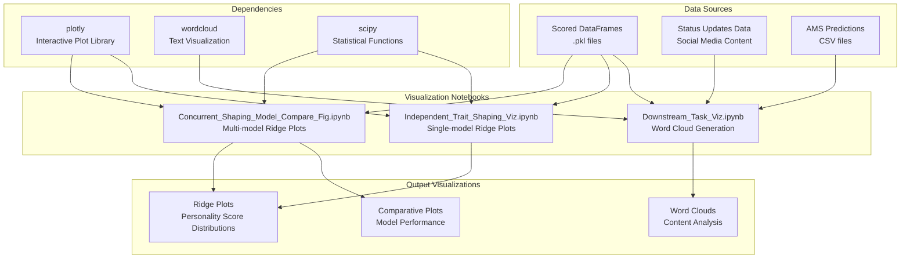
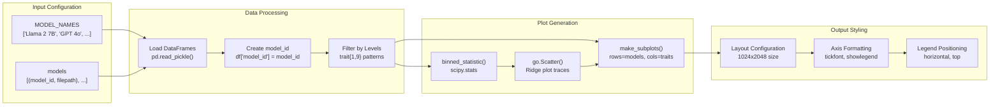
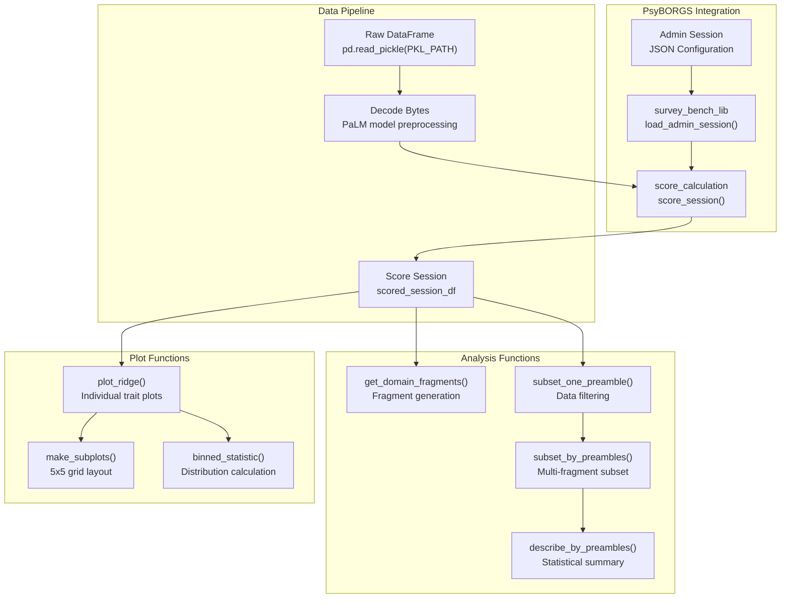
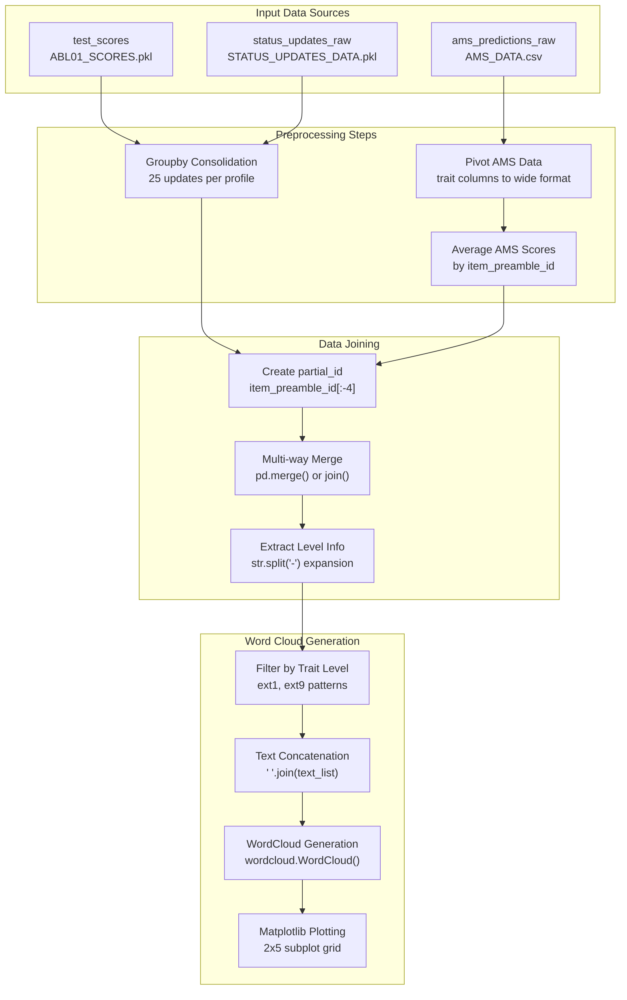
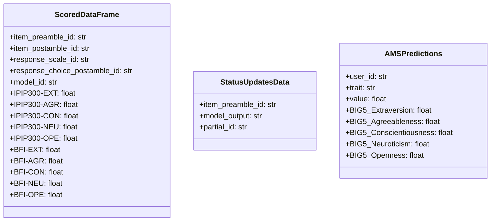

<!-- source: DeepWiki mcp.deepwiki.com · repo google-deepmind/personality_in_llms · page 7 Visualization and Reporting · fetched 2026-10-26 -->

# Visualization and Reporting

Relevant source files

The following files were used as context for generating this wiki page:

- [Concurrent_Shaping_Model_Compare_Fig.ipynb](Concurrent_Shaping_Model_Compare_Fig.ipynb)
- [Downstream_Task_Viz.ipynb](Downstream_Task_Viz.ipynb)
- [Independent_Trait_Shaping_Viz.ipynb](Independent_Trait_Shaping_Viz.ipynb)

This document covers the visualization and reporting components of the personality traits in LLMs system. The system provides specialized Jupyter notebooks for generating ridge plots, word clouds, and comparative visualizations from personality assessment results and downstream task outputs. For information about the underlying analysis frameworks, see [Analysis System](#5). For details about data generation and scoring, see [PsyBORGS Framework](#3).

## Overview

The visualization system consists of three main Jupyter notebooks that transform scored personality data into publication-ready visualizations. Each notebook serves a specific experimental paradigm and generates distinct visualization types optimized for different research questions.

Sources: [Concurrent_Shaping_Model_Compare_Fig.ipynb:1-283](), [Independent_Trait_Shaping_Viz.ipynb:1-543](), [Downstream_Task_Viz.ipynb:1-453]()

## Ridge Plot Visualization System

Ridge plots represent the primary visualization method for displaying personality score distributions across different trait levels and models. The system provides two specialized notebooks for different experimental contexts.

### Concurrent Trait Shaping Visualization

The `Concurrent_Shaping_Model_Compare_Fig.ipynb` notebook generates comparative ridge plots across multiple LLM models for concurrent trait shaping experiments.

The notebook uses several key data structures and functions:
- `PLOT_COLUMNS = ['IPIP-NEO EXT', 'IPIP-NEO AGR', 'IPIP-NEO CON', 'IPIP-NEU', 'IPIP-NEO OPE']` for trait organization
- `get_domain_fragments()` and `get_big5_lvl_fragments()` for personality level filtering
- `scipy.stats.binned_statistic()` for histogram generation [Concurrent_Shaping_Model_Compare_Fig.ipynb:211-211]()

Sources: [Concurrent_Shaping_Model_Compare_Fig.ipynb:170-249]()

### Independent Trait Shaping Visualization

The `Independent_Trait_Shaping_Viz.ipynb` notebook focuses on single-model analysis with detailed trait-by-trait visualization capabilities.

Key configuration parameters include:
- `DIMENSION_PREFIXES = ['ext', 'agr', 'con', 'neu', 'ope']` for trait identification
- `PLOT_SPACE = np.linspace(1., 5.1)` for score binning
- `IS_PALM_MODEL` flag for model-specific preprocessing [Independent_Trait_Shaping_Viz.ipynb:107-107]()

Sources: [Independent_Trait_Shaping_Viz.ipynb:71-81](), [Independent_Trait_Shaping_Viz.ipynb:298-339](), [Independent_Trait_Shaping_Viz.ipynb:423-455]()

## Word Cloud Visualization System

The `Downstream_Task_Viz.ipynb` notebook generates word cloud visualizations from social media status updates produced by personality-shaped LLMs.

### Data Integration Pipeline

The joining process handles different model types through the `IS_PALM_MODEL` flag:
- Non-PaLM models: Group status updates by `item_preamble_id` [Downstream_Task_Viz.ipynb:190-194]()
- PaLM models: Use raw status updates directly
- AMS data requires pivoting from long to wide format [Downstream_Task_Viz.ipynb:224-233]()

Sources: [Downstream_Task_Viz.ipynb:166-177](), [Downstream_Task_Viz.ipynb:268-285](), [Downstream_Task_Viz.ipynb:394-424]()

### Word Cloud Configuration

The word cloud generation uses specific parameters and layout:

| Parameter | Value | Purpose |
|-----------|-------|---------|
| `width` | 800 | Word cloud image width |
| `height` | 400 | Word cloud image height |
| `background_color` | 'white' | Background color |
| `stopwords` | `wordcloud.STOPWORDS` | Words to exclude |

The visualization creates a 5x2 grid showing personality extremes:
- Rows represent personality dimensions: `['ext', 'agr', 'ope', 'con', 'neu']`
- Columns represent extreme levels: `[1, 9]` (low vs high)
- Text filtering uses `group['partial_id'].str.contains(f'{dimension}{level}')` patterns

Sources: [Downstream_Task_Viz.ipynb:404-414]()

## Data Format Requirements

### Scored DataFrame Structure

All visualization notebooks expect scored DataFrames with specific column structures:

Key identifiers used across notebooks:
- `SPID = ['item_preamble_id', 'item_postamble_id', 'response_scale_id', 'response_choice_postamble_id', 'model_id']`
- `BFI_SCALE_IDS = ['BFI-EXT', 'BFI-AGR', 'BFI-CON', 'BFI-NEU', 'BFI-OPE']`
- `IPIP_SCALE_IDS = ['IPIP300-EXT', 'IPIP300-AGR', 'IPIP300-CON', 'IPIP300-NEU', 'IPIP300-OPE']`

Sources: [Concurrent_Shaping_Model_Compare_Fig.ipynb:76-84](), [Independent_Trait_Shaping_Viz.ipynb:122-131](), [Downstream_Task_Viz.ipynb:122-144]()

## Output Configuration and Styling

### Ridge Plot Styling

Ridge plots use consistent styling parameters across both notebooks:

| Property | Concurrent Shaping | Independent Shaping |
|----------|-------------------|-------------------|
| Width | 1024px | 1024px / 800px |
| Height | 2048px | 1024px / 400px |
| Legend | Horizontal, top | None |
| Font Size | 16-22px | 16-22px |
| Colors | ['red', 'blue'] | Default |

Layout configurations:
- `vertical_spacing=0.02, horizontal_spacing=0.01` for tight subplot arrangement
- `shared_xaxes=True, shared_yaxes=True` for consistent scaling
- Custom axis labeling through `tickvals` and `ticktext` arrays

Sources: [Concurrent_Shaping_Model_Compare_Fig.ipynb:221-247](), [Independent_Trait_Shaping_Viz.ipynb:385-410]()

### File I/O Patterns

All notebooks follow consistent file management patterns:
- Input files specified through parameterized cells with `@param` annotations
- Pickle files for DataFrame persistence using `pd.read_pickle()` and `df.to_pickle()`
- Optional save functionality controlled by filename parameters
- Model-specific preprocessing flags (`IS_PALM_MODEL`) for format compatibility

The system supports both local filesystem and cloud storage through configurable file paths, enabling flexible deployment across different computing environments.

Sources: [Concurrent_Shaping_Model_Compare_Fig.ipynb:170-183](), [Independent_Trait_Shaping_Viz.ipynb:92-110](), [Downstream_Task_Viz.ipynb:79-100]()

---

