# Page: Overview

# Overview

<details>
<summary>Relevant source files</summary>

The following files were used as context for generating this wiki page:

- [CITATION.cff](CITATION.cff)
- [LICENSE](LICENSE)
- [README.md](README.md)

</details>


## Purpose and Scope

This repository provides a comprehensive research platform for studying personality traits in Large Language Models (LLMs). The system enables researchers to administer psychometric tests to various LLM backends, collect and analyze responses, and validate the reliability of personality measurements in artificial intelligence systems.

The codebase implements the experimental framework described in the research paper "Personality Traits in Large Language Models" and provides all necessary tools to reproduce and extend those results. For specific setup instructions, see [Getting Started](#2). For detailed psychometric framework documentation, see [PsyBORGS Framework](#3).

## Research Context

This work stems from the need to understand whether LLMs exhibit consistent personality-like behaviors that can be measured using established psychological instruments. The repository contains the complete pipeline for:

- Administering standardized personality tests (Big Five Inventory, IPIP-NEO-300, PANAS) to LLMs
- Collecting responses across multiple model backends (OpenAI API, HuggingFace models, vLLM)
- Analyzing psychometric properties including reliability, validity, and consistency
- Generating downstream task content to correlate with personality profiles

**Sources:** [README.md:1-48](), [CITATION.cff:1-17]()

## System Architecture Overview

The system follows a modular architecture with clear separation between inference, analysis, and configuration components:

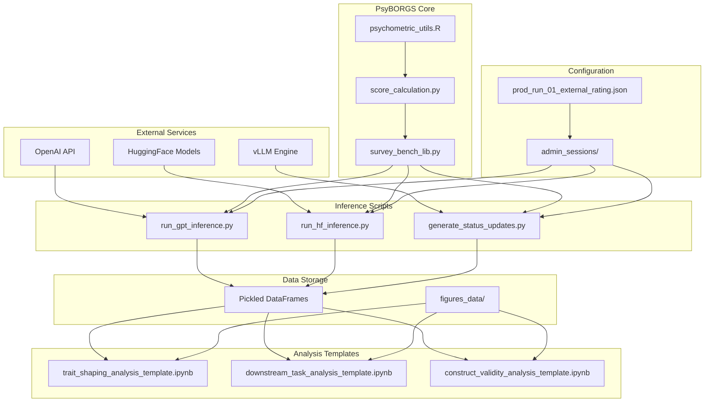

**Sources:** [README.md:8-35]()

## Core Framework Components

The PsyBORGS framework serves as the foundation for all psychometric operations in the system:

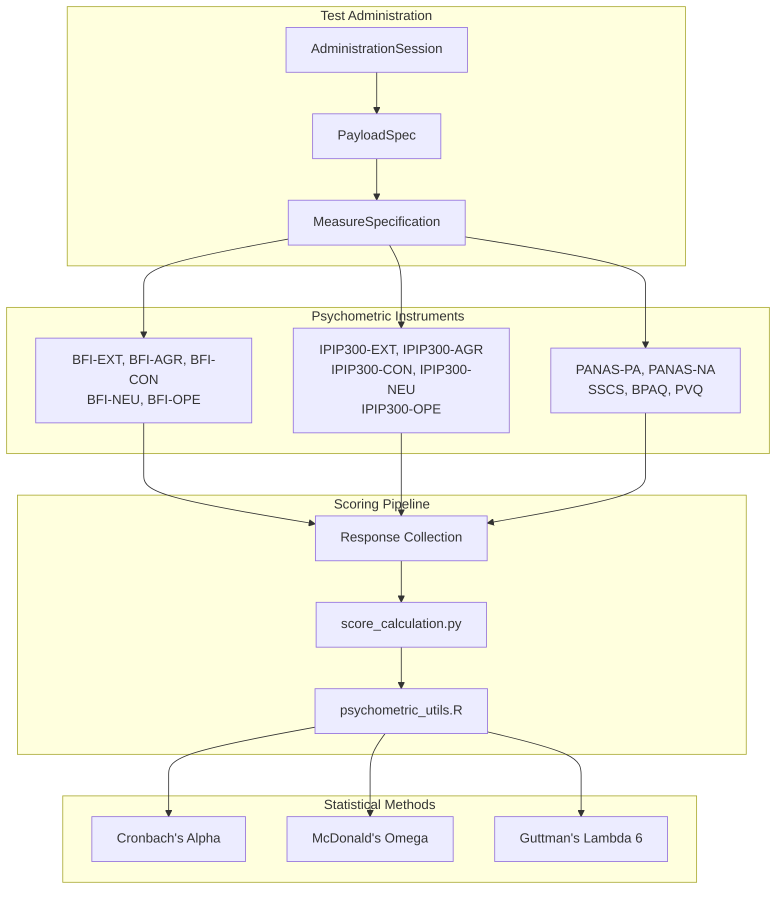

**Sources:** [README.md:17-25]()

## Data Flow Workflow

The complete research workflow follows this sequence:

| Stage | Components | Key Files | Purpose |
|-------|------------|-----------|---------|
| **Configuration** | Admin sessions, test specifications | `admin_sessions/*.json` | Define experimental parameters and test batteries |
| **Inference** | Model backends, response collection | `inference_scripts/*.py` | Generate LLM responses to psychometric items |
| **Scoring** | PsyBORGS framework, statistical analysis | `score_calculation.py`, `psychometric_utils.R` | Convert responses to personality scores |
| **Analysis** | Jupyter notebooks, statistical validation | `analysis/*.ipynb` | Validate reliability and examine correlations |
| **Visualization** | Plotting scripts, publication figures | `figures_data/`, visualization notebooks | Generate research outputs |

The system supports multiple inference backends simultaneously, allowing for comparative studies across different model architectures and providers. Configuration files in `admin_sessions/` define the experimental setup, while analysis templates provide standardized statistical evaluation procedures.

**Sources:** [README.md:28-34]()

## Key Technical Concepts

### AdministrationSession Structure
Each experiment is defined by an `AdministrationSession` containing:
- Test battery specifications (`MeasureSpecification` objects)
- Prompt templates and response formats (`PayloadSpec` objects)  
- Model configuration and inference parameters

### Psychometric Scoring
The `score_calculation.py` module implements standardized scoring algorithms for:
- **Big Five Inventory (BFI)**: 44-item personality assessment
- **IPIP-NEO-300**: Comprehensive 300-item personality inventory
- **PANAS**: Positive and Negative Affect Schedule
- **Additional measures**: SSCS, BPAQ, PVQ scales

### Statistical Validation
The `psychometric_utils.R` component provides reliability analysis using:
- **Cronbach's Alpha**: Internal consistency measurement
- **McDonald's Omega**: Alternative reliability coefficient
- **Guttman's Lambda 6**: Lower-bound reliability estimate

**Sources:** [README.md:17-25]()

## Navigation Guide

This repository is organized into distinct functional areas:

- **[Getting Started](#2)**: Installation, dependencies, and basic usage
- **[PsyBORGS Framework](#3)**: Core psychometric testing infrastructure
- **[Inference System](#4)**: LLM response collection across multiple backends
- **[Analysis System](#5)**: Statistical validation and correlation analysis
- **[Configuration](#6)**: Experimental setup and admin session management
- **[Visualization](#7)**: Research output generation and plotting

For researchers looking to reproduce paper results, start with [Getting Started](#2) then proceed to [Analysis System](#5). For those implementing new experiments, begin with [Configuration](#6) and [Inference System](#4).

**Sources:** [README.md:8-16]()

---

# Page: Getting Started

# Getting Started

<details>
<summary>Relevant source files</summary>

The following files were used as context for generating this wiki page:

- [.gitignore](.gitignore)
- [README.md](README.md)
- [inference_scripts/requirements.txt](inference_scripts/requirements.txt)

</details>


This document provides a comprehensive guide for setting up and running the Personality Traits in Large Language Models system. It covers initial installation, basic configuration, and your first experiments with the psychometric testing framework.

This page focuses on the fundamental setup and basic usage patterns. For detailed dependency management and environment configuration, see [Dependencies and Environment Setup](#2.1). For advanced configuration of experiments, see [Configuration and Experiment Setup](#6).

## Purpose and Scope

The Getting Started guide walks you through:
- Setting up the development environment
- Understanding the core system components
- Running your first psychometric test with LLMs
- Basic data collection and analysis workflows
- Connecting to the broader analysis pipeline

## System Overview

The personality testing system consists of three main operational layers that work together to collect and analyze personality data from Large Language Models.

### Core System Architecture

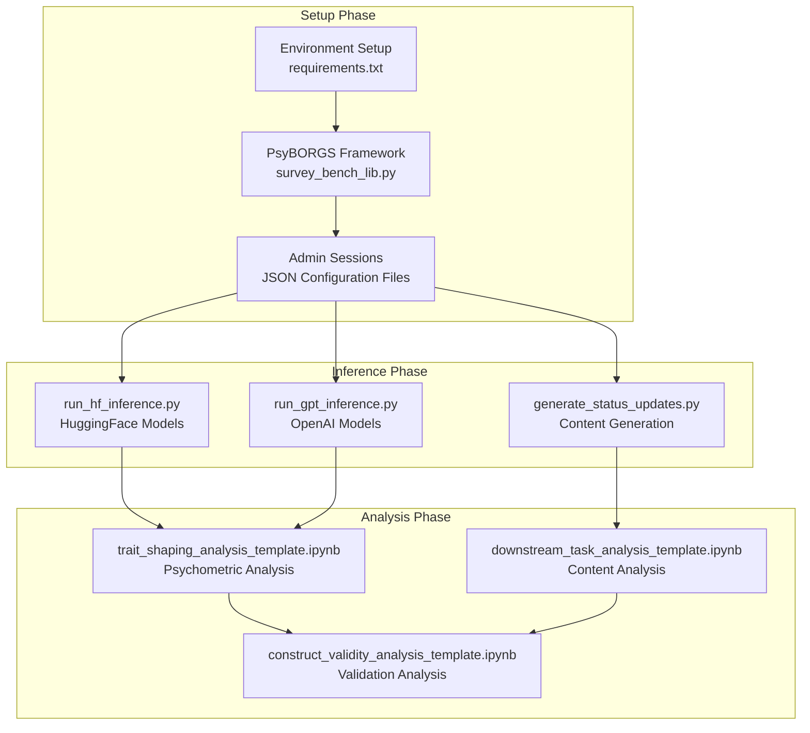

Sources: [README.md:8-26](), [inference_scripts/requirements.txt:1-10]()

## Initial Setup

### Environment Installation

The system requires Python with specific dependencies for LLM inference and psychometric analysis. Install the core inference dependencies:

```bash
pip install -r inference_scripts/requirements.txt
```

The main packages include:
- `vllm==0.8.5` for local model inference
- `openai==1.17.1` for OpenAI API access  
- `outlines==0.0.46` for structured generation
- `pandas==2.2.1` for data manipulation
- `numpy==1.26.4` for numerical operations

### PsyBORGS Framework Setup

The system includes its own version of the PsyBORGS psychometric testing framework. The core components are:

| Component | File Path | Purpose |
|-----------|-----------|---------|
| Test Administration | `psyborgs/survey_bench_lib.py` | Core testing framework |
| Score Calculation | `psyborgs/score_calculation.py` | Response scoring algorithms |
| Psychometric Utils | `psyborgs/psychometric_utils.R` | Statistical analysis functions |

Sources: [README.md:18-25](), [inference_scripts/requirements.txt:1-10]()

## Basic Usage Workflow

### Getting Started Flow

```mermaid
flowchart TD
    START["Start Here"]
    
    subgraph "Phase_1" ["Phase 1: Setup"]
        INSTALL["Install Dependencies<br/>pip install -r requirements.txt"]
        VERIFY["Verify PsyBORGS<br/>survey_bench_lib.py"]
        ADMIN["Choose Admin Session<br/>admin_sessions/*.json"]
    end
    
    subgraph "Phase_2" ["Phase 2: Data Collection"] 
        CHOOSE_MODEL["Choose Model Backend"]
        HF_PATH["HuggingFace Local<br/>run_hf_inference.py"]
        OPENAI_PATH["OpenAI API<br/>run_gpt_inference.py"]
        COLLECT_DATA["Collect Responses<br/>Pickled DataFrames"]
    end
    
    subgraph "Phase_3" ["Phase 3: Analysis"]
        LOAD_NOTEBOOK["Load Analysis Template<br/>*.ipynb"]
        RUN_ANALYSIS["Run Statistical Analysis<br/>score_calculation.py"]
        GENERATE_RESULTS["Generate Visualizations<br/>Results Output"]
    end
    
    START --> INSTALL
    INSTALL --> VERIFY
    VERIFY --> ADMIN
    ADMIN --> CHOOSE_MODEL
    
    CHOOSE_MODEL --> HF_PATH
    CHOOSE_MODEL --> OPENAI_PATH
    
    HF_PATH --> COLLECT_DATA
    OPENAI_PATH --> COLLECT_DATA
    
    COLLECT_DATA --> LOAD_NOTEBOOK
    LOAD_NOTEBOOK --> RUN_ANALYSIS
    RUN_ANALYSIS --> GENERATE_RESULTS
```

Sources: [README.md:8-16](), [README.md:28-34]()

### Your First Experiment

1. **Select a Test Configuration**
   
   Choose from pre-configured admin sessions in the `admin_sessions/` directory. These JSON files define the psychometric tests and model configurations.

2. **Run Inference**
   
   For HuggingFace models:
   ```bash
   python inference_scripts/run_hf_inference.py --admin_session admin_sessions/your_config.json
   ```
   
   For OpenAI models:
   ```bash
   python inference_scripts/run_gpt_inference.py --admin_session admin_sessions/your_config.json
   ```

3. **Analyze Results**
   
   Open one of the analysis templates:
   - `analysis/trait_shaping_analysis_template.ipynb` for basic personality analysis
   - `analysis/downstream_task_analysis_template.ipynb` for content generation analysis
   - `analysis/construct_validity_analysis_template.ipynb` for psychometric validation

### Data Flow and Key Components

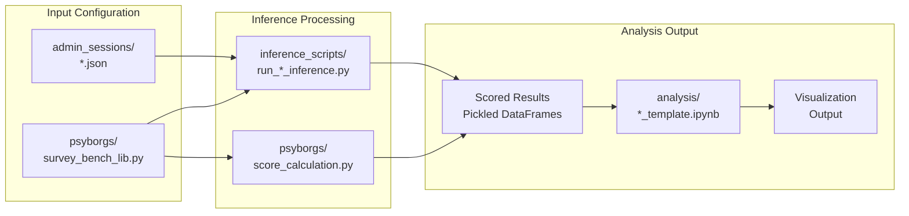

Sources: [README.md:28-34](), [.gitignore:26-28]()

## Common Usage Patterns

### Personality Assessment Workflow

1. **Configure Test Battery**: Select personality measures (Big Five, IPIP-NEO-300, etc.) via admin session files
2. **Model Selection**: Choose between local HuggingFace models or OpenAI API models
3. **Batch Processing**: Run inference across multiple personality dimensions
4. **Statistical Analysis**: Calculate reliability metrics and trait scores
5. **Validation**: Assess construct validity and measurement consistency

### Content Generation Analysis

1. **Generate Social Media Content**: Use `generate_status_updates.py` for personality-driven content
2. **Correlate with Traits**: Link generated content to personality profiles
3. **Downstream Analysis**: Evaluate how personality shapes language use

Sources: [README.md:10-16]()

## Next Steps

Once you have completed the basic setup:

- **Advanced Configuration**: See [Configuration and Experiment Setup](#6) for creating custom admin sessions
- **Detailed Analysis**: Explore [Analysis System](#5) for comprehensive statistical analysis options
- **Framework Deep Dive**: Review [PsyBORGS Framework](#3) for understanding the psychometric foundation
- **Inference Optimization**: See [Inference System](#4) for performance tuning and batch processing

## Data and Results Storage

The system generates several types of output data:

| Data Type | Location | Description |
|-----------|----------|-------------|
| Raw Results | Generated during inference | Pickled DataFrame files with model responses |
| Scored Results | `analysis/scored_results/` | Processed data with personality scores |
| Admin Sessions | `admin_sessions/` | Test configurations and experimental setups |
| Visualization Data | `figures_data/` | Pre-computed data for paper figures |

Note that `results/` and `analysis/scored_results/` are excluded from version control as specified in [.gitignore:26-28]().

Sources: [README.md:27-34](), [.gitignore:26-28]()

---

# Page: Dependencies and Environment Setup

# Dependencies and Environment Setup

<details>
<summary>Relevant source files</summary>

The following files were used as context for generating this wiki page:

- [analysis/requirements.txt](analysis/requirements.txt)
- [inference_scripts/requirements.txt](inference_scripts/requirements.txt)
- [psyborgs/requirements.txt](psyborgs/requirements.txt)

</details>


This document provides a comprehensive guide to the dependencies and environment configuration required for the Personality Traits in Large Language Models research system. It covers the three main subsystems and their specific requirements, dependency management strategies, and environment setup procedures.

For information about running specific inference tasks, see [Inference System](#4). For details about analysis workflows, see [Analysis System](#5). For core framework usage, see [PsyBORGS Framework](#3).

## System Architecture and Dependency Layers

The system is structured into three primary dependency layers, each with distinct requirements and purposes:

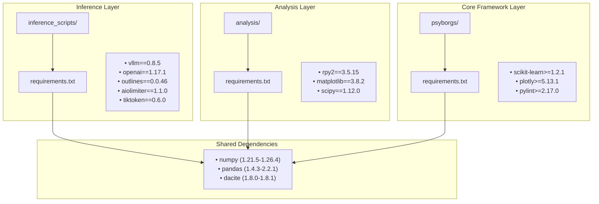

**Sources:** [inference_scripts/requirements.txt:1-10](), [analysis/requirements.txt:1-6](), [psyborgs/requirements.txt:1-7]()

## Inference System Dependencies

The inference layer supports multiple LLM backends and requires specialized dependencies for each:

| Package | Version | Purpose | Used By |
|---------|---------|---------|---------|
| `vllm` | 0.8.5 | Local GPU inference engine | `generate_status_updates.py`, `run_hf_inference.py` |
| `openai` | 1.17.1 | OpenAI API client | `run_gpt_inference.py` |
| `outlines` | 0.0.46 | Constrained generation | HuggingFace inference workflows |
| `aiolimiter` | 1.1.0 | Async rate limiting | API request management |
| `tiktoken` | 0.6.0 | Tokenization utilities | Token counting and processing |
| `tqdm` | 4.66.3 | Progress tracking | Batch inference monitoring |

### Backend-Specific Dependency Mapping

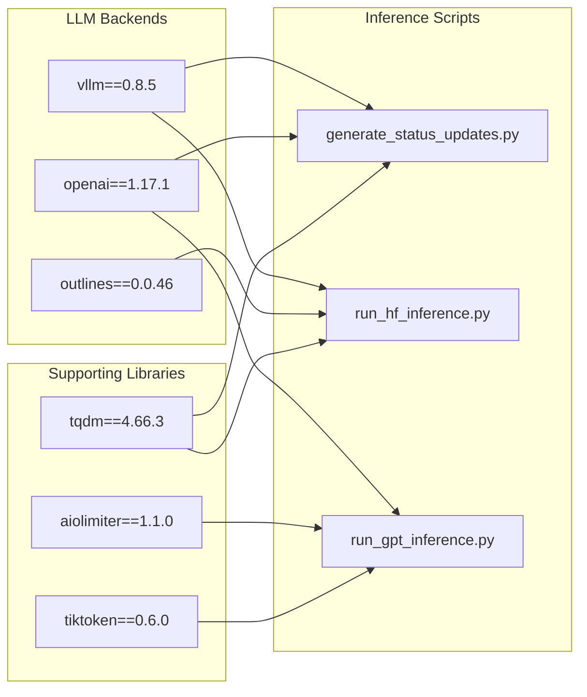

**Sources:** [inference_scripts/requirements.txt:1-10]()

## Analysis System Dependencies

The analysis layer integrates Python scientific computing with R statistical functions:

| Package | Version | Purpose | Integration Point |
|---------|---------|---------|------------------|
| `rpy2` | 3.5.15 | Python-R bridge | `psychometric_utils.R` functions |
| `matplotlib` | 3.8.2 | Static plotting | Jupyter notebook visualizations |
| `scipy` | 1.12.0 | Statistical computing | Correlation analysis, hypothesis testing |

### R Integration Architecture

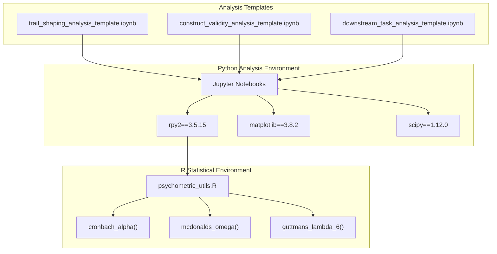

**Sources:** [analysis/requirements.txt:1-6]()

## Core Framework Dependencies

The PsyBORGS framework uses flexible version constraints to support broader compatibility:

| Package | Version Constraint | Purpose | Core Components |
|---------|-------------------|---------|-----------------|
| `scikit-learn` | >=1.2.1 | Machine learning utilities | Classification, clustering |
| `plotly` | >=5.13.1 | Interactive visualizations | Web-based plotting |
| `pylint` | >=2.17.0 | Code quality assurance | Development workflow |
| `dacite` | >=1.8.0 | Dataclass utilities | Type-safe data structures |

### Framework Component Dependencies

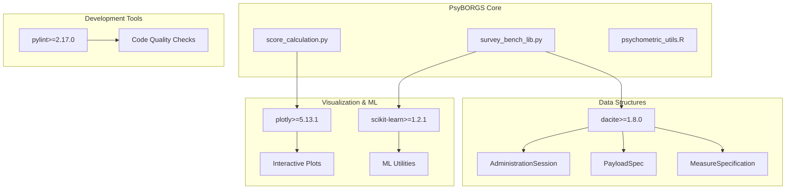

**Sources:** [psyborgs/requirements.txt:1-7]()

## Shared Dependencies and Version Management

All three subsystems share core scientific computing dependencies with overlapping version requirements:

| Package | Inference | Analysis | PsyBORGS | Version Strategy |
|---------|-----------|----------|----------|------------------|
| `numpy` | 1.26.4 | 1.26.4 | >=1.21.5 | Exact match preferred |
| `pandas` | 2.2.1 | 2.2.1 | >=1.4.3 | Exact match preferred |
| `dacite` | 1.8.1 | - | >=1.8.0 | Compatible versions |

### Dependency Compatibility Matrix

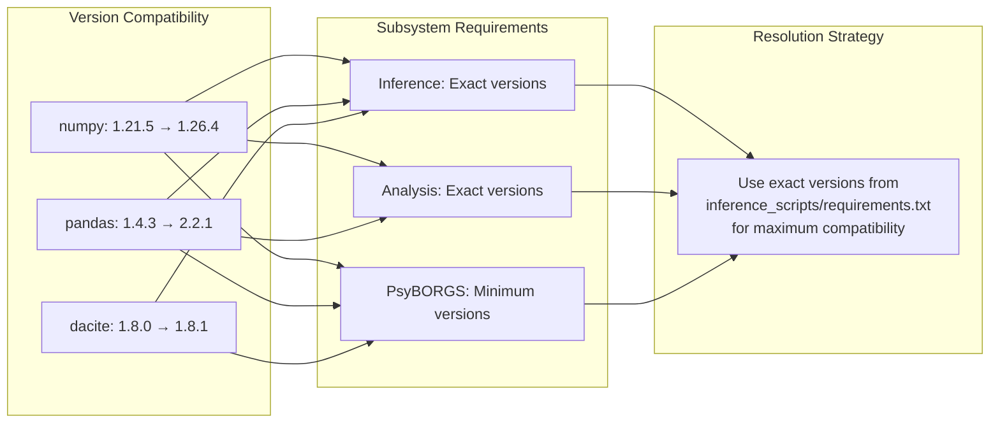

**Sources:** [inference_scripts/requirements.txt:2-7](), [analysis/requirements.txt:2-3](), [psyborgs/requirements.txt:2-4]()

## Environment Setup Procedures

### Installation Sequence

1. **Create isolated environment:**
   ```bash
   python -m venv personality_llm_env
   source personality_llm_env/bin/activate  # Linux/Mac
   # or
   personality_llm_env\Scripts\activate  # Windows
   ```

2. **Install dependencies by subsystem:**
   ```bash
   # Core framework (install first)
   pip install -r psyborgs/requirements.txt
   
   # Inference capabilities
   pip install -r inference_scripts/requirements.txt
   
   # Analysis tools
   pip install -r analysis/requirements.txt
   ```

3. **Verify R integration:**
   ```bash
   python -c "import rpy2.robjects as robjects; print('R integration ready')"
   ```

### System Requirements

- **Python:** 3.8+ (tested with 3.10)
- **R:** Required for psychometric analysis functions
- **GPU:** Optional but recommended for vLLM inference
- **Memory:** Minimum 16GB RAM for local inference

**Sources:** [inference_scripts/requirements.txt:1-10](), [analysis/requirements.txt:1-6](), [psyborgs/requirements.txt:1-7]()

---

# Page: PsyBORGS Framework

# PsyBORGS Framework

<details>
<summary>Relevant source files</summary>

The following files were used as context for generating this wiki page:

- [psyborgs/__init__.py](psyborgs/__init__.py)
- [psyborgs/score_calculation.py](psyborgs/score_calculation.py)
- [psyborgs/survey_bench_lib.py](psyborgs/survey_bench_lib.py)

</details>


## Purpose and Scope

The PsyBORGS Framework is the core psychometric testing system that enables systematic administration of personality assessments to Large Language Models. This framework provides the foundational data structures, survey administration logic, and scoring mechanisms that underpin the entire personality research pipeline.

This page covers the framework's architecture, core data structures, and administration workflow. For detailed implementation of the survey administration library, see [Survey Administration Library](#3.1). For scoring algorithms and psychometric analysis functions, see [Score Calculation and Psychometric Analysis](#3.2). For testing and validation procedures, see [Testing and Validation](#3.3).

## Framework Architecture

The PsyBORGS Framework operates as the central orchestration layer between survey configuration and LLM inference systems. It transforms human-readable survey specifications into structured prompts and continuations that can be systematically administered to language models.

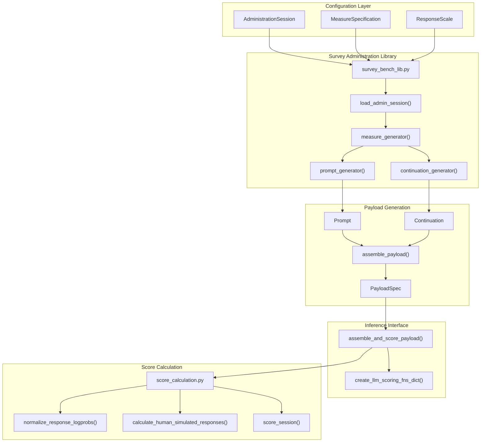

**Sources:** [psyborgs/survey_bench_lib.py:1-435](), [psyborgs/score_calculation.py:1-251]()

## Core Data Structures

The framework is built around a hierarchy of immutable dataclasses that represent survey configurations, individual test items, and response specifications. These structures ensure reproducible and traceable survey administration.

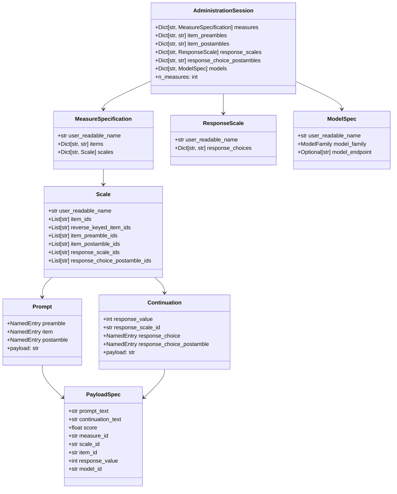

**Sources:** [psyborgs/survey_bench_lib.py:39-87](), [psyborgs/survey_bench_lib.py:96-151]()

## Survey Administration Workflow

The framework implements a systematic workflow that transforms survey configurations into scored responses through iterative payload generation and LLM scoring. This process ensures comprehensive coverage of all survey items across different framing conditions.

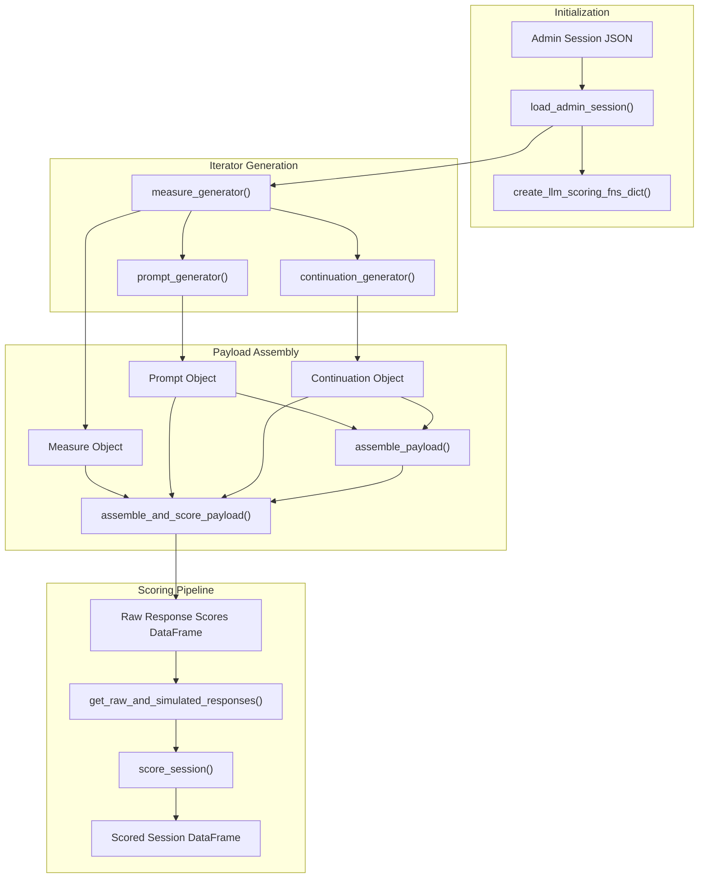

**Sources:** [psyborgs/survey_bench_lib.py:153-168](), [psyborgs/survey_bench_lib.py:352-434](), [psyborgs/score_calculation.py:150-251]()

## Response Processing Pipeline

The framework implements a sophisticated response processing pipeline that converts raw LLM scores into normalized probabilities and human-simulated responses. This enables both fine-grained analysis of response patterns and traditional psychometric scoring.

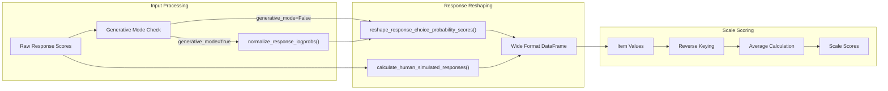

**Sources:** [psyborgs/score_calculation.py:26-58](), [psyborgs/score_calculation.py:61-96](), [psyborgs/score_calculation.py:98-147](), [psyborgs/score_calculation.py:179-251]()

## Integration Points

The PsyBORGS Framework serves as the central coordination layer that interfaces with multiple system components. It standardizes survey administration while remaining agnostic to specific LLM backends or analysis methods.

| Component | Interface | Purpose |
|-----------|-----------|---------|
| **Inference Systems** | `model_scoring_fn` callbacks | Abstracts LLM scoring implementations |
| **Configuration Files** | `load_admin_session()` | Loads JSON admin session specifications |
| **Analysis Templates** | Scored DataFrames | Provides structured data for downstream analysis |
| **Validation Systems** | PayloadSpec objects | Enables reproducible experiment tracking |

The framework's design ensures that survey configurations remain portable across different LLM backends while maintaining strict control over prompt construction and response interpretation. This separation of concerns enables researchers to focus on psychometric validity without being constrained by implementation details of specific language models.

**Sources:** [psyborgs/survey_bench_lib.py:179-196](), [psyborgs/survey_bench_lib.py:280-304](), [psyborgs/score_calculation.py:179-204]()

---

# Page: Survey Administration Library

# Survey Administration Library

<details>
<summary>Relevant source files</summary>

The following files were used as context for generating this wiki page:

- [psyborgs/survey_bench_lib.py](psyborgs/survey_bench_lib.py)
- [psyborgs/tests/test_admin_session.json](psyborgs/tests/test_admin_session.json)

</details>


## Purpose and Scope

The Survey Administration Library (`survey_bench_lib.py`) is the core component of the PsyBORGS framework that handles the systematic administration of psychological survey instruments to Large Language Models. This library provides the foundational data structures, configuration loading, and execution logic needed to present survey items to LLMs in a standardized, reproducible manner.

This page covers the data structures, configuration management, and survey administration workflow. For information about score calculation and psychometric analysis, see [Score Calculation and Psychometric Analysis](#3.2). For details on setting up experiment configurations, see [Admin Session Configuration](#6.1).

## Core Data Structures

The library defines a hierarchical set of data classes that represent all aspects of a psychological survey administration session.

### Administration Session Hierarchy

```mermaid
classDiagram
    class AdministrationSession {
        +Dict measures
        +Dict item_preambles
        +Dict item_postambles  
        +Dict response_scales
        +Dict response_choice_postambles
        +Dict models
        +int n_measures
    }
    
    class MeasureSpecification {
        +str user_readable_name
        +Dict items
        +Dict scales
    }
    
    class Scale {
        +str user_readable_name
        +List item_ids
        +List reverse_keyed_item_ids
        +List item_preamble_ids
        +List item_postamble_ids
        +List response_scale_ids
        +List response_choice_postamble_ids
    }
    
    class ResponseScale {
        +str user_readable_name
        +Dict response_choices
    }
    
    class ModelSpec {
        +str user_readable_name
        +ModelFamily model_family
        +str model_endpoint
    }
    
    AdministrationSession ||--o{ MeasureSpecification : contains
    AdministrationSession ||--o{ ResponseScale : contains
    AdministrationSession ||--o{ ModelSpec : contains
    MeasureSpecification ||--o{ Scale : contains
```

**Sources:** [psyborgs/survey_bench_lib.py:39-94]()

### Payload Construction Data Structures

The library uses specialized data classes for constructing and tracking individual survey items during administration:

```mermaid
classDiagram
    class NamedEntry {
        +str entry_id
        +str text
    }
    
    class Prompt {
        +NamedEntry preamble
        +NamedEntry item
        +NamedEntry postamble
        +str payload
    }
    
    class Continuation {
        +int response_value
        +str response_scale_id
        +NamedEntry response_choice
        +NamedEntry response_choice_postamble
        +str payload
    }
    
    class PayloadSpec {
        +str prompt_text
        +str continuation_text
        +float score
        +str measure_id
        +str measure_name
        +str scale_id
        +str item_preamble_id
        +str item_id
        +str item_postamble_id
        +str response_scale_id
        +int response_value
        +str response_choice
        +str response_choice_postamble_id
        +str model_id
    }
    
    class Measure {
        +str measure_id
        +MeasureSpecification measure
        +str scale_id
        +Scale scale
    }
    
    Prompt ||--o{ NamedEntry : composed_of
    Continuation ||--o{ NamedEntry : composed_of
    PayloadSpec --> Prompt : generated_from
    PayloadSpec --> Continuation : generated_from
```

**Sources:** [psyborgs/survey_bench_lib.py:96-151]()

## Configuration Loading

### JSON Configuration Structure

The `load_admin_session()` function loads survey configurations from JSON files using the `dacite` library for robust data class instantiation:

| Component | Purpose | JSON Key |
|-----------|---------|----------|
| Measures | Psychological instruments and their items | `measures` |
| Item Preambles | Text that precedes survey items | `item_preambles` |
| Item Postambles | Text that follows survey items | `item_postambles` |
| Response Scales | Available response options | `response_scales` |
| Response Choice Postambles | Text after response choices | `response_choice_postambles` |
| Models | LLM specifications for testing | `models` |

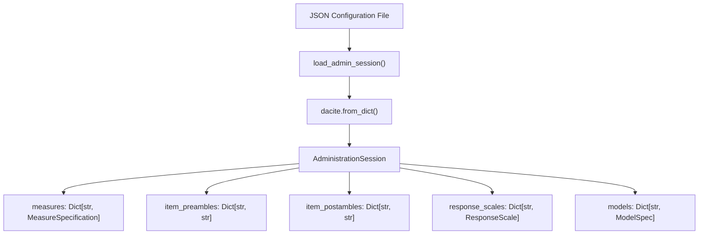

**Sources:** [psyborgs/survey_bench_lib.py:153-168](), [psyborgs/tests/test_admin_session.json:1-47]()

## Survey Administration Process

### Main Administration Flow

The `administer_session_serially()` function orchestrates the complete survey administration process:

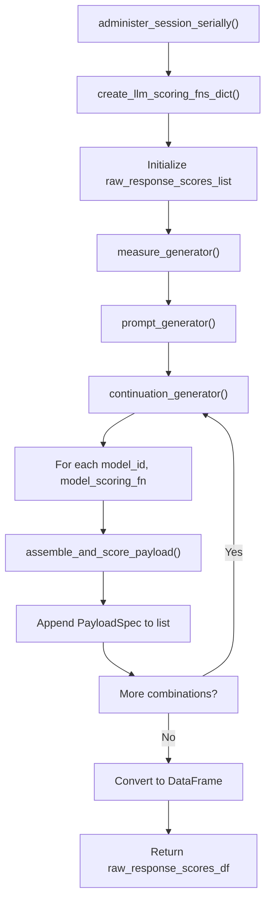

**Sources:** [psyborgs/survey_bench_lib.py:367-434]()

### Generator Functions Workflow

The library uses three nested generator functions to systematically create all possible survey item combinations:

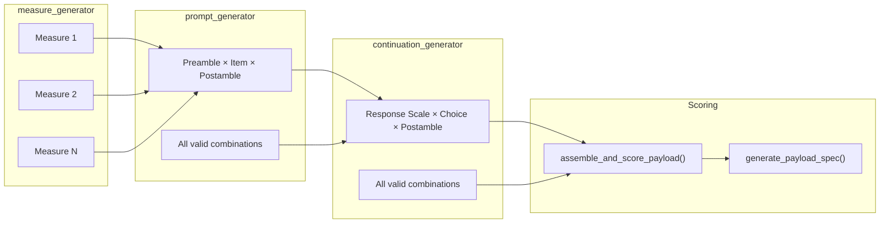

**Sources:** [psyborgs/survey_bench_lib.py:352-364](), [psyborgs/survey_bench_lib.py:333-349](), [psyborgs/survey_bench_lib.py:306-330]()

## Payload Generation and Scoring

### Prompt and Continuation Assembly

The library constructs survey items by combining text components according to a standardized format:

**Prompt Format:**
```
{item_preamble} + {item} + {item_postamble}
```

**Continuation Format:**  
```
{response_choice} + {response_choice_postamble}
```

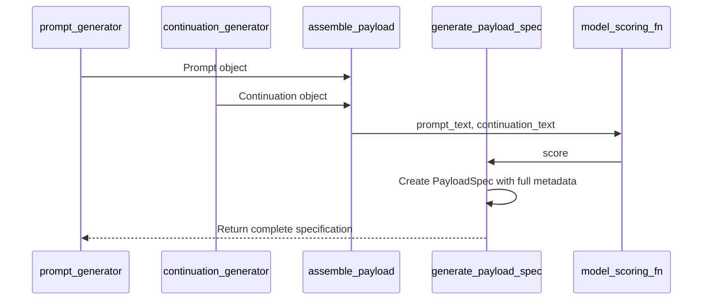

**Sources:** [psyborgs/survey_bench_lib.py:198-203](), [psyborgs/survey_bench_lib.py:280-303]()

### PayloadSpec Generation

The `generate_payload_spec()` function creates comprehensive metadata for each scored item, enabling full reproducibility:

| Field | Source | Purpose |
|-------|--------|---------|
| `prompt_text` | Assembled prompt | Full text sent to LLM |
| `continuation_text` | Assembled continuation | Response option text |
| `score` | LLM scoring function | Model's preference score |  
| `measure_id`, `scale_id` | Measure object | Psychometric identifiers |
| `item_id`, `item_preamble_id`, `item_postamble_id` | Prompt object | Item construction details |
| `response_scale_id`, `response_value`, `response_choice_postamble_id` | Continuation object | Response construction details |
| `model_id` | Function parameter | Model identification |

**Sources:** [psyborgs/survey_bench_lib.py:205-256]()

## Model Integration

### ModelSpec and Scoring Functions

The library defines model specifications through the `ModelSpec` data class and `ModelFamily` enum:

```mermaid
classDiagram
    class ModelFamily {
        <<enumeration>>
        PALM
        LLAMA2
        MISTRAL
        MIXTRAL
        OTHER
    }
    
    class ModelSpec {
        +str user_readable_name
        +ModelFamily model_family
        +Optional[str] model_endpoint
    }
    
    ModelSpec --> ModelFamily : uses
```

The `create_llm_scoring_fns_dict()` function converts model specifications into callable scoring functions for use during survey administration.

**Sources:** [psyborgs/survey_bench_lib.py:63-77](), [psyborgs/survey_bench_lib.py:179-195]()

---

# Page: Score Calculation and Psychometric Analysis

# Score Calculation and Psychometric Analysis

<details>
<summary>Relevant source files</summary>

The following files were used as context for generating this wiki page:

- [psyborgs/psychometric_utils.R](psyborgs/psychometric_utils.R)
- [psyborgs/score_calculation.py](psyborgs/score_calculation.py)
- [psyborgs/tests/score_calculation_test.py](psyborgs/tests/score_calculation_test.py)

</details>


This document covers the core scoring and psychometric analysis functionality of the PsyBORGS framework. It explains how raw LLM response probabilities are converted to human-simulated survey responses and how these responses are transformed into psychometric scale scores with reliability analysis.

For information about survey administration and data collection, see [Survey Administration Library](#3.1). For information about testing and validation procedures, see [Testing and Validation](#3.3).

## Purpose and Scope

The score calculation and psychometric analysis system performs three primary functions:

1. **Response Scoring**: Converts raw LLM log probabilities into normalized response choice probabilities and simulated human responses
2. **Scale Scoring**: Aggregates item-level responses into scale-level scores, handling reverse-keyed items appropriately  
3. **Psychometric Analysis**: Calculates reliability metrics (Cronbach's α, McDonald's ω, Guttman's λ6) and validity statistics

## Core Data Structures and Constants

### Simulated Participant ID (SPID)

The system uses a composite identifier called SPID to uniquely identify each experimental condition:

```python
SPID = ['item_preamble_id',
        'item_postamble_id', 
        'response_scale_id',
        'response_choice_postamble_id',
        'model_id']
```

Each SPID represents a unique combination of prompt configuration and model, treating each as a simulated participant for psychometric analysis.

### Data Flow Architecture

```mermaid
graph TD
    subgraph "Raw LLM Data"
        RLD["Raw Response Scores DataFrame"]
        GEN["Generative Mode Data"]
        REG["Regular Mode Data"]
    end
    
    subgraph "score_calculation.py Processing"
        NLP["normalize_response_logprobs()"]
        RSH["reshape_response_choice_probability_scores()"]
        HSR["calculate_human_simulated_responses()"]
        SCR["score_session()"]
    end
    
    subgraph "Intermediate Results"
        WDF["Wide Format DataFrame"]
        SIM["Simulated Response Values"]
        CMB["Combined Raw + Simulated Data"]
    end
    
    subgraph "psychometric_utils.R Analysis"
        KEY["admin_session_to_nested_key()"]
        REL["subscale_reliability()"]
        SCO["score_subscale()"]
        COM["compute_reliabilities()"]
    end
    
    subgraph "Final Outputs"
        SSC["Scaled Scores"]
        ALF["Cronbach's Alpha"]
        OMG["McDonald's Omega"]
        G6R["Guttman's Lambda 6"]
    end
    
    RLD --> NLP
    GEN --> NLP
    REG --> RSH
    NLP --> RSH
    RSH --> WDF
    RLD --> HSR
    HSR --> SIM
    WDF --> CMB
    SIM --> CMB
    CMB --> SCR
    SCR --> SSC
    
    CMB --> KEY
    KEY --> REL
    KEY --> SCO
    KEY --> COM
    REL --> ALF
    REL --> OMG
    REL --> G6R
    SCO --> SSC
    COM --> ALF
    COM --> OMG
    COM --> G6R
```

Sources: [psyborgs/score_calculation.py:7-11](), [psyborgs/score_calculation.py:179-251](), [psyborgs/psychometric_utils.R:109-118](), [psyborgs/psychometric_utils.R:261-295]()

## Score Calculation Pipeline

### Log Probability Normalization

For generative mode data, raw log probabilities must be normalized before scoring:

```mermaid
graph LR
    subgraph "normalize_response_logprobs()"
        GRP["Group by SPID + item_id + model_output"]
        SUM["Sum log probabilities"]
        NRM["Apply normalize_logprobs()"]
        RST["Restructure to standard format"]
    end
    
    RAW["Raw Generative Data"] --> GRP
    GRP --> SUM
    SUM --> NRM
    NRM --> RST
    RST --> OUT["Normalized Probability Scores"]
```

The `normalize_logprobs()` function uses the logsumexp trick for numerical stability:

- `logsumexp(x)`: Computes log(sum(exp(x))) avoiding overflow
- `normalize_logprobs(x)`: Converts log probabilities to normalized probabilities

Sources: [psyborgs/score_calculation.py:14-21](), [psyborgs/score_calculation.py:26-57]()

### Response Choice Probability Reshaping

The `reshape_response_choice_probability_scores()` function converts long-format probability data to wide format:

```mermaid
graph TD
    subgraph "reshape_response_choice_probability_scores()"
        PIV["pivot_table(index=SPID, columns=['item_id', 'response_value'])"]
        COL["Flatten column names to 'item_id_response_value'"]
        RST["reset_index()"]
    end
    
    LONG["Long Format Data<br/>Multiple rows per SPID"] --> PIV
    PIV --> COL
    COL --> RST
    RST --> WIDE["Wide Format Data<br/>One row per SPID<br/>Columns: bfi1_1, bfi1_2, etc."]
```

Sources: [psyborgs/score_calculation.py:61-95]()

### Human-Simulated Response Calculation

The `calculate_human_simulated_responses()` function selects the most probable response choice for each item:

```mermaid
graph TD
    subgraph "calculate_human_simulated_responses()"
        GRP["Group by SPID + item_id"]
        MAX["Find idxmax() of score column"]
        PIV["Pivot to wide format"]
        REN["Rename columns to item_ids"]
    end
    
    PROB["Response Choice Probabilities"] --> GRP
    GRP --> MAX
    MAX --> SEL["Selected Response Values"]
    SEL --> PIV
    PIV --> REN
    REN --> SIM["Simulated Human Responses<br/>Integer values per item"]
```

Sources: [psyborgs/score_calculation.py:99-146]()

## Scale Scoring and Reverse Keying

### Session Scoring Process

The `score_session()` function orchestrates the complete scoring pipeline:

```mermaid
graph TD
    subgraph "score_session() Pipeline"
        GET["get_raw_and_simulated_responses()"]
        ITR["Iterate through measures and scales"]
        REV["Handle reverse_keyed_item_ids"]
        AVG["Calculate scale averages"]
        ASN["Assign scores to DataFrame"]
    end
    
    subgraph "Reverse Keying Logic"
        CHK["Check if item_id in reverse_keyed_item_ids"]
        REV_CALC["scale_point_range - original_values + 1"]
        ORIG["Keep original_values"]
    end
    
    RAW["Raw Response Scores"] --> GET
    ADMIN["AdministrationSession"] --> ITR
    GET --> ITR
    ITR --> REV
    REV --> CHK
    CHK --> REV_CALC
    CHK --> ORIG
    REV_CALC --> AVG
    ORIG --> AVG
    AVG --> ASN
    ASN --> SCORED["Scored Session DataFrame"]
```

The reverse keying formula transforms disagreement items: `new_value = scale_range - original_value + 1`

Sources: [psyborgs/score_calculation.py:179-251](), [psyborgs/score_calculation.py:232-237]()

## Psychometric Analysis Functions (R)

### Key Creation and Item Management

The R utilities handle psychometric key creation for proper item scoring:

```mermaid
graph TD
    subgraph "Key Creation Pipeline"
        EXT["extract_all_and_reversed_item_ids()"]
        KEY["key_item_ids()"]
        CRT["create_keys()"]
        ADM["admin_session_to_nested_key()"]
    end
    
    subgraph "Keying Logic"
        CHK["Check if item_id in reverse_keyed_item_ids"]
        PRE["Prepend '-' to item_id"]
        KEEP["Keep item_id unchanged"]
    end
    
    ADMIN_SESSION["AdministrationSession JSON"] --> EXT
    EXT --> KEY
    KEY --> CHK
    CHK --> PRE
    CHK --> KEEP
    PRE --> CRT
    KEEP --> CRT
    CRT --> ADM
    ADM --> NESTED_KEY["Nested Key Structure<br/>measure -> subscale -> keyed_items"]
```

Sources: [psyborgs/psychometric_utils.R:44-118](), [psyborgs/psychometric_utils.R:82-96]()

### Reliability Analysis

The system calculates three reliability metrics using the `psych` package:

```mermaid
graph TD
    subgraph "subscale_reliability() Function"
        VAL["Validate metric parameter"]
        GET_KEY["Get nested_key from admin_session"]
        GET_IDS["Get item_ids for subscale"]
        SEL["Select relevant columns from DataFrame"]
    end
    
    subgraph "Reliability Calculations"
        ALPHA["psych::scoreItems() for alpha"]
        G6["psych::scoreItems() for G6"] 
        OMEGA["psych::omega() for omega.tot"]
    end
    
    INPUTS["admin_session, df, measure, subscale, metric"] --> VAL
    VAL --> GET_KEY
    GET_KEY --> GET_IDS
    GET_IDS --> SEL
    SEL --> ALPHA
    SEL --> G6
    SEL --> OMEGA
    ALPHA --> RESULT["Reliability Coefficient"]
    G6 --> RESULT
    OMEGA --> RESULT
```

The `compute_reliabilities()` function calculates all three metrics simultaneously for all scales:

- **Cronbach's α**: Internal consistency reliability
- **McDonald's ω**: Composite reliability accounting for factor loadings  
- **Guttman's λ6**: Lower bound reliability estimate

Sources: [psyborgs/psychometric_utils.R:139-192](), [psyborgs/psychometric_utils.R:261-295]()

## Key Algorithm Details

### Log Probability Normalization Algorithm

The normalization process ensures numerical stability when working with log probabilities:

1. **Group responses** by SPID + item_id + model_output
2. **Sum log probabilities** for each group
3. **Apply logsumexp normalization** within each item_id group
4. **Convert to standard DataFrame format**

### Scale Scoring Algorithm

The scale scoring process handles both regular and reverse-keyed items:

1. **Extract item_ids and reverse_keyed_item_ids** from scale specification
2. **For each item in the scale:**
   - If item_id in reverse_keyed_item_ids: `new_value = scale_range - original_value + 1`
   - Otherwise: `new_value = original_value`
3. **Calculate scale score** as mean of processed item values

### Test Coverage

The system includes comprehensive tests covering:

- `test_reshape_response_choice_probability_scores()`: Validates wide-format conversion
- `test_score_session()`: Validates end-to-end scoring pipeline with test admin session

Sources: [psyborgs/tests/score_calculation_test.py:7-44](), [psyborgs/tests/score_calculation_test.py:47-91]()

---

# Page: Testing and Validation

# Testing and Validation

<details>
<summary>Relevant source files</summary>

The following files were used as context for generating this wiki page:

- [psyborgs/tests/__init__.py](psyborgs/tests/__init__.py)
- [psyborgs/tests/score_calculation_test.py](psyborgs/tests/score_calculation_test.py)
- [psyborgs/tests/test_admin_session.json](psyborgs/tests/test_admin_session.json)

</details>


This page documents the test suite and validation procedures for the PsyBORGS framework, focusing on unit tests for core scoring functionality and test data structures used to validate the psychometric analysis pipeline. The testing framework ensures correctness of score calculations, data transformations, and psychometric measures.

For information about the core scoring algorithms being tested, see [Score Calculation and Psychometric Analysis](#3.2). For broader framework documentation, see [PsyBORGS Framework](#3).

## Test Suite Overview

The testing system provides unit tests for critical components of the PsyBORGS framework, with particular emphasis on validating score calculation functions and data transformation operations. The test suite is located in the `psyborgs/tests/` directory and follows standard Python testing conventions.

### Test Architecture

```mermaid
graph TB
    subgraph "Test Suite Structure"
        TI["__init__.py<br/>Test Package Init"]
        SCT["score_calculation_test.py<br/>Unit Tests"]
        TAS["test_admin_session.json<br/>Test Configuration"]
    end
    
    subgraph "Core Modules Under Test"
        SC["score_calculation.py<br/>Scoring Functions"]
        SBL["survey_bench_lib.py<br/>Survey Administration"]
    end
    
    subgraph "Test Functions"
        TRCPS["test_reshape_response_choice_probability_scores()<br/>Data Transformation Test"]
        TSS["test_score_session()<br/>End-to-End Scoring Test"]
    end
    
    subgraph "Test Data"
        PDF["Pandas DataFrames<br/>Mock Response Data"]
        EDF["Expected DataFrames<br/>Validation Targets"]
    end
    
    SCT --> TRCPS
    SCT --> TSS
    TAS --> TSS
    
    TRCPS --> SC
    TSS --> SC
    TSS --> SBL
    
    TRCPS --> PDF
    TSS --> PDF
    TRCPS --> EDF
    TSS --> EDF
```

**Sources:** [psyborgs/tests/score_calculation_test.py:1-92](), [psyborgs/tests/test_admin_session.json:1-48]()

## Unit Testing Framework

The test suite uses standard Python testing patterns with `pandas.testing` utilities for DataFrame validation. Tests focus on ensuring data integrity through score calculation pipelines.

### Test Functions

| Function | Purpose | Input | Output |
|----------|---------|--------|--------|
| `test_reshape_response_choice_probability_scores()` | Validates response probability reshaping | Mock DataFrame with response scores | Reshaped DataFrame with probability columns |
| `test_score_session()` | End-to-end scoring validation | Mock responses + test admin session | Scored DataFrame with calculated measures |

### Core Test Components

The testing framework validates two primary functions from `score_calculation.py`:

1. **`reshape_response_choice_probability_scores()`** - Tests data transformation logic that converts response choice probabilities from long to wide format
2. **`score_session()`** - Tests complete scoring pipeline including measure calculation and probability score integration

```mermaid
graph LR
    subgraph "Test Data Flow"
        ID["Input DataFrame<br/>Raw Response Data"]
        TRCPS["reshape_response_choice_probability_scores()<br/>Transform Function"]
        TSS["score_session()<br/>Scoring Function"]
        OD["Output DataFrame<br/>Scored Results"]
    end
    
    subgraph "Validation Process"
        EXP["Expected Results<br/>Predefined DataFrames"]
        AFC["assert_frame_equal()<br/>Pandas Testing"]
        PASS["Test Pass/Fail<br/>Boolean Result"]
    end
    
    ID --> TRCPS
    TRCPS --> TSS
    TSS --> OD
    
    OD --> AFC
    EXP --> AFC
    AFC --> PASS
```

**Sources:** [psyborgs/tests/score_calculation_test.py:7-44](), [psyborgs/tests/score_calculation_test.py:47-91]()

## Test Data Structures

### Mock Response Data

The test suite uses carefully constructed mock DataFrames that simulate the structure of actual LLM response data. Key columns include:

- `prompt_text` - Survey prompt content
- `continuation_text` - LLM response options
- `score` - Response choice probabilities  
- `item_preamble_id`, `item_id`, `item_postamble_id` - Survey item identifiers
- `response_scale_id`, `response_value`, `response_choice` - Response format specifications
- `model_id` - LLM model identifier

### Expected Output Validation

Test validation uses `assert_frame_equal()` from `pandas.testing` to ensure exact matches between computed and expected results. The validation process checks:

- DataFrame structure and column names
- Numerical accuracy of score calculations
- Data type consistency (with `check_dtype=False` for flexibility)

**Sources:** [psyborgs/tests/score_calculation_test.py:10-25](), [psyborgs/tests/score_calculation_test.py:54-69]()

## Test Configuration Files

### Test Admin Session

The `test_admin_session.json` file provides a minimal but complete configuration for testing the scoring pipeline. This configuration includes:

```mermaid
graph TD
    subgraph "Test Admin Session Structure"
        M["measures<br/>Test Measure Definition"]
        IP["item_preambles<br/>Prompt Templates"]
        IPOST["item_postambles<br/>Response Instructions"]
        RS["response_scales<br/>Likert Scale Definition"]
        RCP["response_choice_postambles<br/>Additional Text"]
        MOD["models<br/>Test Model Configuration"]
    end
    
    subgraph "Test Measure Components"
        TM["TM (Test Measure)<br/>Simple 2-item Scale"]
        I1["itemid1<br/>I like ice cream"]
        I2["itemid2<br/>I dislike ice cream (reversed)"]
    end
    
    subgraph "Response Configuration"
        L2["likert2<br/>2-Point Likert Scale"]
        R1["1: strongly disagree"]
        R5["5: strongly agree"]
    end
    
    M --> TM
    TM --> I1
    TM --> I2
    RS --> L2
    L2 --> R1
    L2 --> R5
```

### Configuration Elements

| Element | Purpose | Test Value |
|---------|---------|------------|
| `measures.TM` | Test measure with 2 items | "Test Measure" |
| `item_preambles.a2-r1-g2-cs6` | Survey context prompt | "You are a middle-aged White man..." |
| `response_scales.likert2` | Simplified 2-point scale | Values 1 and 5 only |
| `models.test_model` | Mock model configuration | PaLM family test endpoint |

**Sources:** [psyborgs/tests/test_admin_session.json:1-48]()

## Validation Procedures

### Score Calculation Validation

The test suite validates score calculations through multiple steps:

1. **Data Reshaping Validation** - Ensures response choice probabilities are correctly pivoted from long to wide format
2. **Measure Scoring Validation** - Verifies that scale scores are computed correctly, including reverse-keyed items
3. **Integration Validation** - Confirms that probability scores and calculated measures are properly merged

### Test Execution Pattern

Tests follow a consistent pattern:
1. Define input mock data matching production data structure
2. Define expected output with precise numerical values
3. Execute function under test
4. Use `assert_frame_equal()` for comprehensive validation

```mermaid
sequenceDiagram
    participant T as "Test Function"
    participant SC as "score_calculation Module"
    participant SBL as "survey_bench_lib Module"
    participant PD as "pandas.testing"
    
    T->>T: "Create Mock Input DataFrame"
    T->>T: "Define Expected Output DataFrame"
    T->>SC: "Call Function Under Test"
    SC->>SBL: "Load Admin Session (if needed)"
    SBL-->>SC: "Return Configuration"
    SC-->>T: "Return Computed DataFrame"
    T->>PD: "assert_frame_equal(computed, expected)"
    PD-->>T: "Validation Result"
```

**Sources:** [psyborgs/tests/score_calculation_test.py:40-44](), [psyborgs/tests/score_calculation_test.py:87-91]()

## Test Coverage and Scope

The current test suite provides focused coverage of:

- **Data Transformation Logic** - Response probability reshaping functions
- **Core Scoring Algorithms** - Scale calculation with reverse-keyed item handling  
- **Configuration Loading** - Admin session parsing and validation
- **End-to-End Integration** - Complete scoring pipeline from raw responses to final measures

The tests ensure that the fundamental scoring operations produce mathematically correct and structurally consistent results, providing confidence in the reliability of psychometric calculations performed by the PsyBORGS framework.

**Sources:** [psyborgs/tests/score_calculation_test.py:1-92](), [psyborgs/tests/test_admin_session.json:1-48]()

---

# Page: Inference System

# Inference System

<details>
<summary>Relevant source files</summary>

The following files were used as context for generating this wiki page:

- [inference_scripts/__init__.py](inference_scripts/__init__.py)
- [inference_scripts/generate_status_updates.py](inference_scripts/generate_status_updates.py)
- [inference_scripts/run_gpt_inference.py](inference_scripts/run_gpt_inference.py)
- [inference_scripts/run_hf_inference.py](inference_scripts/run_hf_inference.py)

</details>


## Purpose and Scope

The Inference System provides a unified interface for running Large Language Model inference across multiple backends to administer PsyBORGS personality tests. This system supports three primary model backends: vLLM for high-throughput local inference, OpenAI API for cloud-based models, and HuggingFace Transformers with Outlines for constrained generation.

This document covers the inference orchestration layer that bridges experiment configurations to model outputs. For detailed information about the underlying psychometric framework, see [PsyBORGS Framework](#3). For analysis of inference results, see [Analysis System](#5).

## System Architecture

The inference system consists of three main scripts that handle different model backends and use cases, all built around the PsyBORGS framework's `AdministrationSession` configuration format.

```mermaid
graph TB
    subgraph "Configuration Layer"
        AS["AdministrationSession<br/>(JSON config)"]
        PL["Payload Generation<br/>generate_payload_df()"]
    end
    
    subgraph "Inference Scripts"
        GSU["generate_status_updates.py<br/>Social Media Generation"]
        RHF["run_hf_inference.py<br/>HuggingFace + Outlines"]
        RGI["run_gpt_inference.py<br/>OpenAI API + Outlines"]
    end
    
    subgraph "Model Backends"
        VLLM["vLLM Engine<br/>High-throughput GPU"]
        OPENAI["OpenAI API<br/>GPT Models"]
        OUTLINES["Outlines Library<br/>Constrained Generation"]
        HF["HuggingFace Transformers<br/>Local Models"]
    end
    
    subgraph "Processing Modes"
        BULK["bulk_inference()<br/>Parallel Processing"]
        SERIAL["Serial Processing<br/>Sequential Calls"]
        ASYNC["AsyncOpenAI<br/>Rate-limited Calls"]
    end
    
    subgraph "Output Formats"
        PICKLE["Pickle Files<br/>.pkl Results"]
        CSV["CSV Files<br/>.csv Results"]
    end
    
    AS --> PL
    PL --> GSU
    PL --> RHF
    PL --> RGI
    
    GSU --> VLLM
    GSU --> OPENAI
    RHF --> VLLM
    RHF --> OUTLINES
    RHF --> HF
    RGI --> OPENAI
    RGI --> OUTLINES
    
    VLLM --> BULK
    OPENAI --> ASYNC
    OUTLINES --> SERIAL
    HF --> SERIAL
    
    BULK --> PICKLE
    SERIAL --> PICKLE
    ASYNC --> PICKLE
    PICKLE --> CSV
```

Sources: [inference_scripts/generate_status_updates.py:1-357](), [inference_scripts/run_hf_inference.py:1-431](), [inference_scripts/run_gpt_inference.py:1-363]()

## Model Backend Integration

### vLLM Backend

The vLLM backend provides high-throughput GPU inference through the `vllm.LLM` class. It supports distributed inference across multiple GPUs using tensor parallelism.

```mermaid
graph LR
    subgraph "vLLM Integration"
        VLLM_MODEL["vllm.LLM<br/>tensor_parallel_size=n_gpus"]
        SAMPLING["vllm.SamplingParams<br/>seed=42, temperature"]
        LOGITS["RegexLogitsProcessor<br/>Outlines FSM"]
    end
    
    subgraph "Functions"
        BULK_VLLM["bulk_inference_vllm()<br/>generate_status_updates.py"]
        PROCESS_VLLM["process_payload_group_vllm()<br/>run_hf_inference.py"]
    end
    
    VLLM_MODEL --> SAMPLING
    SAMPLING --> BULK_VLLM
    LOGITS --> PROCESS_VLLM
    VLLM_MODEL --> PROCESS_VLLM
```

The vLLM integration occurs in two contexts:

- **Status Update Generation**: Uses `bulk_inference_vllm()` for unconstrained text generation with configurable temperature and max_tokens
- **Constrained Survey Responses**: Uses `process_payload_group_vllm()` with Outlines' `RegexLogitsProcessor` to enforce response choice constraints

Sources: [inference_scripts/generate_status_updates.py:144-165](), [inference_scripts/run_hf_inference.py:166-214]()

### OpenAI API Backend

The OpenAI backend uses async processing with rate limiting and exponential backoff retry logic.

```mermaid
graph TB
    subgraph "OpenAI Integration"
        CLIENT["AsyncOpenAI<br/>max_retries=10"]
        LIMITER["AsyncLimiter<br/>rpm_limit (default 50)"]
        RETRY["retry_with_exponential_backoff<br/>decorator"]
    end
    
    subgraph "Processing Functions"
        BULK_OAI["bulk_inference_openai()<br/>asyncio.run()"]
        CALL_API["call_api()<br/>async function"]
        THREAD_EXEC["ThreadPoolExecutor<br/>parallel processing"]
    end
    
    CLIENT --> CALL_API
    LIMITER --> CALL_API
    RETRY --> CALL_API
    CALL_API --> BULK_OAI
    THREAD_EXEC --> BULK_OAI
```

The system implements two different async patterns:
- **generate_status_updates.py**: Uses `asyncio` with `AsyncLimiter` for rate-limited bulk inference
- **run_gpt_inference.py**: Uses `ThreadPoolExecutor` with `as_completed()` for parallel request handling

Sources: [inference_scripts/generate_status_updates.py:167-210](), [inference_scripts/run_gpt_inference.py:107-167]()

### HuggingFace + Outlines Backend

The HuggingFace backend uses Outlines for constrained generation, supporting both local inference and GPU acceleration.

```mermaid
graph LR
    subgraph "Outlines Integration"
        TRANSFORMERS["outlines.models.transformers()<br/>device='auto'"]
        CHOICE["outlines.generate.choice()<br/>constrained generation"]
        SAMPLERS["outlines.samplers<br/>greedy() | multinomial()"]
    end
    
    subgraph "Processing Modes"
        BULK_MODE["bulk=True<br/>list(prompts)"]
        SERIAL_MODE["bulk=False<br/>tqdm(prompts)"]
    end
    
    TRANSFORMERS --> CHOICE
    SAMPLERS --> CHOICE
    CHOICE --> BULK_MODE
    CHOICE --> SERIAL_MODE
```

The Outlines integration ensures that model responses are constrained to valid survey response choices through finite state machine-based logit biasing.

Sources: [inference_scripts/run_hf_inference.py:124-164](), [inference_scripts/run_gpt_inference.py:107-167]()

## Payload Processing Pipeline

### Payload Generation and Transformation

The inference system processes PsyBORGS `AdministrationSession` configurations through a multi-stage pipeline:

```mermaid
flowchart TD
    subgraph "Data Structures"
        AS["AdministrationSession<br/>JSON configuration"]
        REG_PAYLOAD["Regular Payload<br/>N rows per prompt"]
        GEN_PAYLOAD["Generative Payload<br/>1 row per prompt"]
    end
    
    subgraph "Generation Functions"
        GEN_FUNC["generate_payload_df()<br/>Creates prompt-continuation pairs"]
        TO_GEN["to_generative_payload()<br/>Groups continuations by prompt"]
    end
    
    subgraph "Processing Groups"
        GROUP_BY["groupby()<br/>response_scale_id"]
        CONTINUATIONS["continuation_text<br/>List[str] choices"]
    end
    
    AS --> GEN_FUNC
    GEN_FUNC --> REG_PAYLOAD
    REG_PAYLOAD --> TO_GEN
    TO_GEN --> GEN_PAYLOAD
    GEN_PAYLOAD --> GROUP_BY
    GROUP_BY --> CONTINUATIONS
```

### Payload Grouping Strategy

The system groups payloads by `response_scale_id` to ensure that models choose from the correct set of response options for each psychometric scale:

| Processing Step | Function | Purpose |
|-----------------|----------|---------|
| Initial Generation | `generate_payload_df()` | Creates N×M matrix of prompts × continuations |
| Generative Conversion | `to_generative_payload()` | Collapses to 1 row per prompt with continuation lists |
| Response Grouping | `administer_session_via_outlines()` | Groups by `response_scale_id` for constrained generation |
| Model Processing | `process_payload_group()` | Sends grouped prompts to model backends |

Sources: [inference_scripts/run_hf_inference.py:70-96](), [inference_scripts/run_hf_inference.py:97-123](), [inference_scripts/run_gpt_inference.py:52-104]()

## Inference Execution Modes

### Bulk vs Serial Processing

The system supports different execution modes depending on memory constraints and model backend:

```mermaid
graph TB
    subgraph "Execution Modes"
        BULK["Bulk Mode<br/>--bulk flag"]
        SERIAL["Serial Mode<br/>default"]
        VLLM_MODE["vLLM Mode<br/>--vllm flag"]
    end
    
    subgraph "Processing Patterns"
        PARALLEL["Parallel Processing<br/>list(prompts) → model"]
        SEQUENTIAL["Sequential Processing<br/>for prompt in tqdm(prompts)"]
        DISTRIBUTED["Distributed Processing<br/>tensor_parallel_size"]
    end
    
    subgraph "Memory Management"
        HIGH_MEM["High Memory<br/>All prompts in memory"]
        LOW_MEM["Low Memory<br/>One prompt at a time"]
        GPU_MEM["GPU Memory<br/>Distributed across devices"]
    end
    
    BULK --> PARALLEL
    SERIAL --> SEQUENTIAL
    VLLM_MODE --> DISTRIBUTED
    
    PARALLEL --> HIGH_MEM
    SEQUENTIAL --> LOW_MEM
    DISTRIBUTED --> GPU_MEM
```

### Error Handling and Retry Logic

The OpenAI backend implements sophisticated error handling with exponential backoff:

```mermaid
graph TD
    subgraph "Retry Mechanism"
        DECORATOR["@retry_with_exponential_backoff"]
        ERRORS["(RateLimitError, APITimeoutError)"]
        BACKOFF["delay *= exponential_base"]
        MAX_RETRIES["max_retries=10"]
    end
    
    subgraph "Error Flow"
        API_CALL["API Call"]
        ERROR_CHECK{"Error Type?"}
        RETRY_CHECK{"Retries < Max?"}
        SLEEP["time.sleep(delay + 60)"]
        RAISE["raise RuntimeError"]
    end
    
    API_CALL --> ERROR_CHECK
    ERROR_CHECK -->|"Rate/Timeout"| RETRY_CHECK
    ERROR_CHECK -->|"Other"| RAISE
    RETRY_CHECK -->|"Yes"| SLEEP
    RETRY_CHECK -->|"No"| RAISE
    SLEEP --> BACKOFF
    BACKOFF --> API_CALL
```

Sources: [inference_scripts/generate_status_updates.py:59-107]()

## Configuration and Command Line Interface

### Common Arguments

All inference scripts share a common argument structure for consistency:

| Argument | Type | Purpose | Scripts |
|----------|------|---------|---------|
| `--admin_session` | str | Path to AdministrationSession JSON | All |
| `--model_pointer` | str | Model identifier (HF repo or OpenAI model) | All |
| `--job_name` | str | Experiment name for output files | All |
| `--job_id` | str | Job tracking identifier | All |
| `--sample` | bool | Limit to 1000 prompts for testing | All |
| `--payload` | str | Use pre-generated payload chunks | All |

### Backend-Specific Arguments

Each script provides backend-specific configuration options:

**vLLM Arguments:**
- `--n_gpus`: Number of GPUs for tensor parallelism
- `--temperature`: Sampling temperature
- `--enforce_eager`: Disable CUDA graphs

**OpenAI Arguments:**
- `--api_key`: OpenAI API key (defaults to `OPENAI_API_KEY` env var)
- `--rpm_limit`: Requests per minute limit

**Output Arguments:**
- `--csv`: Also output results in CSV format
- `--results_path`: Custom directory for output files

Sources: [inference_scripts/generate_status_updates.py:212-262](), [inference_scripts/run_hf_inference.py:296-339](), [inference_scripts/run_gpt_inference.py:248-281]()

## Output Format and File Naming

### Standardized Output Structure

All inference scripts generate standardized output files using the pattern:
```
results_{job_name}_{MODEL_ID}_{job_id}{chunk_n}.pkl
```

Where:
- `MODEL_ID`: Extracted from `model_pointer` (text after last `/`)
- `chunk_n`: Optional suffix for payload chunks (e.g., `_chunk_0`)

### Result DataFrame Structure

The output DataFrames contain the original payload metadata plus model outputs:

| Column | Type | Description |
|--------|------|-------------|
| `prompt_text` | str | Generated psychometric prompt |
| `continuation_text` | List[str] | Available response choices |
| `model_output` | str | Selected model response |
| `model_id` | str | Model identifier |
| `measure_id` | str | Psychometric measure identifier |
| `scale_id` | str | Scale within measure |
| `item_id` | str | Specific item identifier |

Sources: [inference_scripts/generate_status_updates.py:351-353](), [inference_scripts/run_hf_inference.py:424-427](), [inference_scripts/run_gpt_inference.py:356-359]()

---

# Page: HuggingFace Model Inference

# HuggingFace Model Inference

<details>
<summary>Relevant source files</summary>

The following files were used as context for generating this wiki page:

- [inference_scripts/requirements.txt](inference_scripts/requirements.txt)
- [inference_scripts/run_hf_inference.py](inference_scripts/run_hf_inference.py)

</details>


This document covers the HuggingFace model inference system implemented in `run_hf_inference.py`, which administers PsyBORGS psychological tests to HuggingFace models using constrained generation via the Outlines library. The system supports both local inference and distributed inference using vLLM for high-throughput scenarios.

For OpenAI API-based inference, see [OpenAI API Inference](#4.2). For social media content generation tasks, see [Status Update Generation](#4.3).

## System Architecture

The HuggingFace inference system operates as a key component in the overall inference layer, transforming admin session configurations into scored psychological test results through constrained language model generation.

### Architecture Overview

```mermaid
graph TB
    subgraph "Configuration Layer"
        AS["AdministrationSession<br/>(JSON Config)"]
        PS["PayloadSpec<br/>(Test Prompts)"]
    end
    
    subgraph "run_hf_inference.py"
        GPD["generate_payload_df()"]
        TGP["to_generative_payload()"]
        ASO["administer_session_via_outlines()"]
        PPG["process_payload_group()"]
        PPGV["process_payload_group_vllm()"]
    end
    
    subgraph "Model Backends"
        OUTLINES["outlines.models.transformers"]
        VLLM["vllm.LLM"]
        HF["HuggingFace Models"]
    end
    
    subgraph "Output"
        RESULTS["Scored DataFrame<br/>(Pickle Format)"]
        CSV["Optional CSV Output"]
    end
    
    AS --> GPD
    GPD --> TGP
    TGP --> ASO
    ASO --> PPG
    ASO --> PPGV
    
    PPG --> OUTLINES
    PPGV --> VLLM
    OUTLINES --> HF
    VLLM --> HF
    
    PPG --> RESULTS
    PPGV --> RESULTS
    RESULTS --> CSV
```

Sources: [inference_scripts/run_hf_inference.py:1-431]()

### Core Components

The system consists of several key functions that handle different aspects of the inference pipeline:

```mermaid
graph LR
    subgraph "Data Generation"
        A["generate_payload_df()"]
        B["to_generative_payload()"]
    end
    
    subgraph "Inference Processing"
        C["administer_session_via_outlines()"]
        D["process_payload_group()"]
        E["process_payload_group_vllm()"]
    end
    
    subgraph "Model Integration"
        F["outlines.generate.choice()"]
        G["vllm.SamplingParams()"]
        H["RegexLogitsProcessor()"]
    end
    
    A --> B
    B --> C
    C --> D
    C --> E
    D --> F
    E --> G
    E --> H
```

Sources: [inference_scripts/run_hf_inference.py:70-214]()

## Core Functions

### Payload Generation

The `generate_payload_df()` function creates the initial test payload by iterating through all combinations of measures, prompts, and continuations defined in the admin session.

| Function | Purpose | Input | Output |
|----------|---------|-------|--------|
| `generate_payload_df()` | Generate test prompts | `AdministrationSession`, `model_id` | `pd.DataFrame` with all prompt-continuation pairs |
| `to_generative_payload()` | Collapse continuations | Regular payload DataFrame | DataFrame with continuation lists per prompt |

The function uses the PsyBORGS generators to systematically create all test combinations:

- `survey_bench_lib.measure_generator()` - iterates through psychological measures
- `survey_bench_lib.prompt_generator()` - iterates through prompt variations  
- `survey_bench_lib.continuation_generator()` - iterates through response options

Sources: [inference_scripts/run_hf_inference.py:70-122]()

### Inference Processing

The system provides two main inference processing functions optimized for different scenarios:

#### Standard Processing with Outlines

```mermaid
flowchart TD
    A["process_payload_group()"] --> B{bulk mode?}
    B -->|Yes| C["generator(list(prompts))"]
    B -->|No| D["for prompt in tqdm(prompts)"]
    D --> E["generator(prompt)"]
    C --> F["model_answers"]
    E --> F
    
    G["outlines.generate.choice()"] --> C
    G --> E
    H["outlines.samplers.greedy()"] --> G
```

#### vLLM Processing

```mermaid
flowchart TD
    A["process_payload_group_vllm()"] --> B["RegexLogitsProcessor()"]
    B --> C["vllm.SamplingParams()"]
    C --> D["model.generate()"]
    D --> E["Extract output.outputs[0].text"]
    E --> F["model_answers"]
```

Sources: [inference_scripts/run_hf_inference.py:124-214]()

## Inference Modes

The system supports three distinct inference modes, each optimized for different computational scenarios:

| Mode | Implementation | Use Case | Memory Usage | Speed |
|------|---------------|----------|--------------|-------|
| **Serial** | `bulk=False` | Local development, debugging | Low | Slow |
| **Bulk** | `bulk=True` | Batch processing without vLLM | Medium | Medium |
| **vLLM** | `vllm=True` | High-throughput production | High | Fast |

### Mode Selection Logic

```mermaid
graph TD
    START["Start Inference"] --> CHECK_VLLM{--vllm flag?}
    CHECK_VLLM -->|Yes| VLLM_MODE["Use process_payload_group_vllm()"]
    CHECK_VLLM -->|No| CHECK_BULK{--bulk flag?}
    CHECK_BULK -->|Yes| BULK_MODE["Use process_payload_group(bulk=True)"]
    CHECK_BULK -->|No| SERIAL_MODE["Use process_payload_group(bulk=False)"]
    
    VLLM_MODE --> VLLM_SETUP["vllm.LLM(model, tensor_parallel_size)"]
    BULK_MODE --> OUTLINES_SETUP["outlines.models.transformers()"]
    SERIAL_MODE --> OUTLINES_SETUP
```

Sources: [inference_scripts/run_hf_inference.py:272-286](), [inference_scripts/run_hf_inference.py:390-408]()

## Command Line Interface

The script provides a comprehensive command-line interface with the following key arguments:

### Required Arguments

| Argument | Type | Description |
|----------|------|-------------|
| `--admin_session` | str | Path to admin session JSON configuration |
| `--model_pointer` | str | HuggingFace model identifier (e.g., `meta-llama/Llama-2-7b-chat-hf`) |

### Execution Control Arguments

| Argument | Type | Default | Description |
|----------|------|---------|-------------|
| `--sample` | flag | False | Process only 1,000 prompts for testing |
| `--bulk` | flag | False | Enable batched inference with Outlines |
| `--vllm` | flag | False | Use vLLM for distributed inference |
| `--n_gpus` | int | 1 | Number of GPUs for tensor-parallel inference |
| `--temperature` | float | 1.0 | Sampling temperature |

### Job Management Arguments

| Argument | Type | Default | Description |
|----------|------|---------|-------------|
| `--job_name` | str | 'hf-run' | Experiment identifier for output files |
| `--job_id` | str | '999' | Job tracking ID for HPC systems |
| `--payload` | str | None | Path to pre-generated payload chunk |

Sources: [inference_scripts/run_hf_inference.py:296-339]()

## Data Flow Pipeline

The complete data transformation pipeline processes admin sessions through multiple stages:

```mermaid
flowchart TD
    subgraph "Input Stage"
        A["admin_session.json"] --> B["survey_bench_lib.load_admin_session()"]
    end
    
    subgraph "Payload Generation Stage"
        B --> C["generate_payload_df()"]
        C --> D["to_generative_payload()"]
        D --> E["DataFrame with continuation_text lists"]
    end
    
    subgraph "Model Setup Stage"
        F{vLLM mode?} -->|Yes| G["vllm.LLM()"]
        F -->|No| H["outlines.models.transformers()"]
    end
    
    subgraph "Inference Stage"
        E --> I["Group by response_scale_id"]
        I --> J["For each continuation group"]
        J --> K["process_payload_group()"]
        K --> L["outlines.generate.choice()"]
        L --> M["Model generates constrained response"]
    end
    
    subgraph "Output Stage"
        M --> N["Scored DataFrame with model_output column"]
        N --> O["results/results_job-name_model-id_job-id.pkl"]
    end
    
    G --> K
    H --> K
```

### Payload Transformation

The system transforms data through two key format conversions:

1. **Regular Payload**: N rows per prompt (one for each continuation option)
2. **Generative Payload**: 1 row per prompt (continuations stored as lists)

This transformation is handled by `to_generative_payload()` which groups by the SPID (Simulated Participant ID) columns:

```python
SPID = ['item_preamble_id', 'item_postamble_id', 'response_scale_id', 
        'response_choice_postamble_id', 'model_id']
```

Sources: [inference_scripts/run_hf_inference.py:97-122](), [inference_scripts/run_hf_inference.py:61-65]()

## Constrained Generation

The system uses Outlines to ensure models only generate valid psychological test responses through constrained generation:

### Constraint Mechanism

```mermaid
graph TD
    A["continuation_text list"] --> B["outlines.generate.choice()"]
    B --> C["outlines.samplers.greedy()"]
    C --> D["Model logits biased to valid continuations"]
    D --> E["Generated response ∈ continuation_text"]
    
    F["vLLM Mode"] --> G["RegexLogitsProcessor()"]
    G --> H["r'(' + r'|'.join(continuations) + r')'"]
    H --> I["vllm.SamplingParams(logits_processors=[processor])"]
    I --> D
```

The constrained generation ensures that:
- Models can only generate responses that exactly match predefined continuation options
- Responses are deterministic when using greedy sampling (`seed=42`)
- Invalid or creative responses are prevented through logit manipulation

Sources: [inference_scripts/run_hf_inference.py:144-149](), [inference_scripts/run_hf_inference.py:184-200]()

## Output Format

The system generates scored DataFrames containing all necessary information for downstream psychological analysis:

### Output Columns

| Column | Source | Description |
|--------|--------|-------------|
| `prompt_text` | PsyBORGS | Complete prompt sent to model |
| `continuation_text` | PsyBORGS | List of valid response options |
| `model_output` | Inference | Model's generated response |
| `measure_id` | PsyBORGS | Psychological measure identifier |
| `scale_id` | PsyBORGS | Specific scale within measure |
| `item_id` | PsyBORGS | Individual test item identifier |
| SPID columns | PsyBORGS | Simulated participant identifiers |

### File Output

Results are saved in pickle format to preserve DataFrame structure and data types:

```
results/results_{job_name}_{model_id}_{job_id}[_chunk_n].pkl
```

The pickle format maintains:
- List data types in `continuation_text` columns
- Proper pandas DataFrame indexing
- All metadata required for psychometric scoring

Sources: [inference_scripts/run_hf_inference.py:420-427](), [inference_scripts/run_hf_inference.py:347-379]()

---

# Page: OpenAI API Inference

# OpenAI API Inference

<details>
<summary>Relevant source files</summary>

The following files were used as context for generating this wiki page:

- [inference_scripts/requirements.txt](inference_scripts/requirements.txt)
- [inference_scripts/run_gpt_inference.py](inference_scripts/run_gpt_inference.py)

</details>


This document covers the OpenAI API inference system implemented in `run_gpt_inference.py`, which administers PsyBORGS psychometric tests to OpenAI models using constrained generation through the Outlines library. The system supports both synchronous and asynchronous inference modes with rate limiting and error handling.

For HuggingFace model inference, see [HuggingFace Model Inference](#4.1). For social media content generation tasks, see [Status Update Generation](#4.3).

## System Architecture

The OpenAI inference system operates as a bridge between the PsyBORGS framework and OpenAI's API, using Outlines for constrained generation to ensure models select from predefined response choices.

```mermaid
graph TB
    subgraph "Input Layer"
        AS["AdministrationSession<br/>(JSON config)"]
        PL["Payload Chunks<br/>(Pickle files)"]
    end
    
    subgraph "Payload Generation"
        GPD["generate_payload_df()<br/>Creates regular payload"]
        TGP["to_generative_payload()<br/>Converts to generative format"]
    end
    
    subgraph "OpenAI Integration"
        OAI_CLIENT["AsyncOpenAI<br/>API client"]
        OAI_CONFIG["OpenAIConfig<br/>Model configuration"]
        TOKENIZER["tiktoken<br/>Tokenizer"]
    end
    
    subgraph "Outlines Framework"
        OUTLINES_MODEL["outlines.models.openai<br/>Model wrapper"]
        CHOICE_GEN["outlines.generate.choice<br/>Constrained generation"]
        SAMPLER["outlines.samplers.multinomial<br/>Sampling strategy"]
    end
    
    subgraph "Processing Engine"
        PPG["process_payload_group()<br/>Batch inference"]
        ASVO["administer_session_via_outlines()<br/>Main orchestrator"]
        TPE["ThreadPoolExecutor<br/>Parallel execution"]
    end
    
    subgraph "Output Layer"
        RESULTS["Scored DataFrame<br/>With model outputs"]
        PKL["Pickle files<br/>results_*.pkl"]
    end
    
    AS --> GPD
    PL --> TGP
    GPD --> TGP
    TGP --> ASVO
    
    OAI_CLIENT --> OUTLINES_MODEL
    OAI_CONFIG --> OUTLINES_MODEL
    TOKENIZER --> OUTLINES_MODEL
    
    OUTLINES_MODEL --> CHOICE_GEN
    CHOICE_GEN --> SAMPLER
    
    ASVO --> PPG
    PPG --> TPE
    PPG --> CHOICE_GEN
    
    ASVO --> RESULTS
    RESULTS --> PKL
```

Sources: [inference_scripts/run_gpt_inference.py:1-362]()

## Core Components

### Payload Generation Pipeline

The system transforms PsyBORGS administration sessions into inference-ready payloads through a two-stage process:

```mermaid
graph LR
    subgraph "Regular Payload"
        ADMIN["AdministrationSession"]
        MEASURE_GEN["measure_generator()"]
        PROMPT_GEN["prompt_generator()"]
        CONT_GEN["continuation_generator()"]
        PAYLOAD_SPEC["PayloadSpec<br/>(N rows per prompt)"]
    end
    
    subgraph "Generative Payload"
        GROUP_BY["groupby(['prompt_text',<br/>'measure_id', 'scale_id'])"]
        AGG["agg({'continuation_text': list,<br/>'response_value': list})"]
        GEN_PAYLOAD["Generative PayloadSpec<br/>(1 row per prompt)"]
    end
    
    ADMIN --> MEASURE_GEN
    MEASURE_GEN --> PROMPT_GEN
    PROMPT_GEN --> CONT_GEN
    CONT_GEN --> PAYLOAD_SPEC
    
    PAYLOAD_SPEC --> GROUP_BY
    GROUP_BY --> AGG
    AGG --> GEN_PAYLOAD
```

Sources: [inference_scripts/run_gpt_inference.py:52-104]()

### Processing Modes

The system supports two distinct processing modes with different performance characteristics:

| Mode | Function | Parallelization | Memory Usage | Rate Limiting |
|------|----------|----------------|--------------|---------------|
| Serial | `process_payload_group(bulk=False)` | Sequential | Low | Natural |
| Bulk | `process_payload_group(bulk=True)` | ThreadPoolExecutor | High | Manual |

**Serial Processing Flow:**
```mermaid
graph TD
    PROMPTS["prompts: Sequence[str]"]
    GENERATOR["outlines.generate.choice<br/>(model, continuations)"]
    TQDM["tqdm progress bar"]
    ANSWERS["model_answers: List[str]"]
    
    PROMPTS --> GENERATOR
    GENERATOR --> TQDM
    TQDM --> ANSWERS
```

**Bulk Processing Flow:**
```mermaid
graph TD
    PROMPTS["prompts: Sequence[str]"]
    TPE["ThreadPoolExecutor"]
    FUTURES["future_to_idx: Dict"]
    COMPLETED["as_completed(futures)"]
    ORDERED["model_answers[idx]<br/>Preserve order"]
    
    PROMPTS --> TPE
    TPE --> FUTURES
    FUTURES --> COMPLETED
    COMPLETED --> ORDERED
```

Sources: [inference_scripts/run_gpt_inference.py:107-167]()

### Inference Orchestration

The `administer_session_via_outlines()` function manages the complete inference workflow by grouping payloads by response scale and processing each group:

```mermaid
graph TB
    PAYLOAD["payload_df: DataFrame"]
    SCALES["response_scales = unique('response_scale_id')"]
    
    subgraph "Per Response Scale"
        GROUPED["grouped_df = filter by response_scale"]
        CONTINUATIONS["continuations = first row continuation_text"]
        PROCESS["process_payload_group()<br/>(prompts, continuations, model)"]
        OUTPUT["grouped_df['model_output']"]
    end
    
    CONCAT["pd.concat(scored_dfs)"]
    SORTED["sort_index()"]
    
    PAYLOAD --> SCALES
    SCALES --> GROUPED
    GROUPED --> CONTINUATIONS
    CONTINUATIONS --> PROCESS
    PROCESS --> OUTPUT
    OUTPUT --> CONCAT
    CONCAT --> SORTED
```

Sources: [inference_scripts/run_gpt_inference.py:170-243]()

## Configuration and Usage

### Command Line Interface

The script supports comprehensive configuration through command-line arguments:

| Argument | Type | Purpose |
|----------|------|---------|
| `--admin_session` | str | Path to admin session JSON |
| `--model_pointer` | str | OpenAI model identifier |
| `--api_key` | str | OpenAI API key (defaults to env var) |
| `--bulk` | bool | Enable parallel processing |
| `--sample` | bool | Limit to 1000 prompts for testing |
| `--payload` | str | Path to pre-generated payload chunk |

### Authentication and Rate Limiting

The system integrates with OpenAI's API through several key components:

```mermaid
graph LR
    ENV_VAR["OPENAI_API_KEY<br/>Environment variable"]
    CLIENT["AsyncOpenAI(api_key)"]
    CONFIG["OpenAIConfig<br/>(model, seed=42)"]
    TOKENIZER["tiktoken.encoding_for_model()"]
    MODEL["outlines.models.openai<br/>(client, config, tokenizer)"]
    
    ENV_VAR --> CLIENT
    CLIENT --> MODEL
    CONFIG --> MODEL
    TOKENIZER --> MODEL
```

Sources: [inference_scripts/run_gpt_inference.py:248-281](), [inference_scripts/run_gpt_inference.py:330-342]()

### Usage Patterns

**Standard Session Processing:**
```bash
python inference_scripts/run_gpt_inference.py \
    --admin_session='admin_sessions/prod_run_01_external_rating.json' \
    --model_pointer='gpt-3.5-turbo-0125' \
    --bulk
```

**Payload Chunk Processing:**
```bash
python inference_scripts/run_gpt_inference.py \
    --admin_session='admin_sessions/prod_run_01_external_rating.json' \
    --model_pointer='gpt-3.5-turbo-0125' \
    --payload='admin_sessions/prod_run_01_external_rating_payload_0.pkl'
```

Sources: [inference_scripts/run_gpt_inference.py:9-19]()

## Output Format and Integration

### Result Structure

The system outputs scored DataFrames containing both metadata and model responses:

```mermaid
graph TB
    subgraph "Input Columns"
        PROMPT["prompt_text"]
        CONT_LIST["continuation_text: List[str]"]
        MEASURE["measure_id, scale_id"]
        SPID["item_preamble_id,<br/>response_scale_id,<br/>model_id"]
    end
    
    subgraph "Output Columns"
        MODEL_OUT["model_output: str"]
        METADATA["All input metadata preserved"]
    end
    
    subgraph "File Output"
        PICKLE["results_{job_name}_{model_id}_{job_id}.pkl"]
        TOKEN_USAGE["Prompt tokens: {model.prompt_tokens}<br/>Completion tokens: {model.completion_tokens}"]
    end
    
    PROMPT --> MODEL_OUT
    CONT_LIST --> MODEL_OUT
    MEASURE --> METADATA
    SPID --> METADATA
    
    MODEL_OUT --> PICKLE
    METADATA --> PICKLE
    MODEL_OUT --> TOKEN_USAGE
```

### Integration with PsyBORGS Framework

The system seamlessly integrates with the broader PsyBORGS ecosystem:

```mermaid
graph TB
    subgraph "PsyBORGS Core"
        SBL["survey_bench_lib"]
        ADMIN_SESSION["AdministrationSession"]
        PAYLOAD_SPEC["PayloadSpec"]
    end
    
    subgraph "OpenAI Inference"
        RUN_GPT["run_gpt_inference.py"]
        OUTLINES_INT["Outlines Integration"]
    end
    
    subgraph "Analysis Pipeline"
        SCORED_DATA["Scored Results"]
        DOWNSTREAM["Downstream Analysis"]
    end
    
    SBL --> ADMIN_SESSION
    ADMIN_SESSION --> RUN_GPT
    SBL --> PAYLOAD_SPEC
    PAYLOAD_SPEC --> RUN_GPT
    
    RUN_GPT --> OUTLINES_INT
    OUTLINES_INT --> SCORED_DATA
    SCORED_DATA --> DOWNSTREAM
```

Sources: [inference_scripts/run_gpt_inference.py:36-39](), [inference_scripts/run_gpt_inference.py:348-359]()

## Dependencies and Requirements

The system requires specific versions of key packages for optimal compatibility:

| Package | Version | Purpose |
|---------|---------|---------|
| `openai` | 1.17.1 | OpenAI API client |  
| `outlines` | 0.0.46 | Constrained generation |
| `tiktoken` | 0.6.0 | Tokenization |
| `aiolimiter` | 1.1.0 | Rate limiting |
| `pandas` | 2.2.1 | Data manipulation |

Sources: [inference_scripts/requirements.txt:1-9]()

---

# Page: Status Update Generation

# Status Update Generation

<details>
<summary>Relevant source files</summary>

The following files were used as context for generating this wiki page:

- [inference_scripts/__init__.py](inference_scripts/__init__.py)
- [inference_scripts/generate_status_updates.py](inference_scripts/generate_status_updates.py)
- [inference_scripts/requirements.txt](inference_scripts/requirements.txt)

</details>


## Purpose and Scope

The Status Update Generation system provides a specialized inference pipeline for generating social media content using Large Language Models. This system is designed to produce status updates that reflect specific personality traits as part of downstream task analysis in personality research. The system supports both local GPU-based inference via vLLM and cloud-based inference via the OpenAI API, with built-in rate limiting, error handling, and bulk processing capabilities.

For general model inference workflows, see [HuggingFace Model Inference](#4.1) and [OpenAI API Inference](#4.2). For analyzing the generated content in relation to personality traits, see [Downstream Task Analysis](#5.2).

## System Overview

The Status Update Generation system implements a dual-backend inference architecture that can process large batches of personality-conditioned prompts to generate social media content. The system is built around the `generate_status_updates.py` script, which orchestrates payload generation, model inference, and result compilation.

```mermaid
graph TB
    subgraph "Input Layer"
        AS["AdminSession<br/>JSON Configuration"]
        PD["PayloadSpec<br/>Prompt Templates"]
    end
    
    subgraph "Payload Generation"
        GPD["generate_payload_df()<br/>from run_hf_inference"]
        PDF["payload_df<br/>DataFrame with prompts"]
    end
    
    subgraph "Model Backends"
        VLLM["vLLM.LLM<br/>Local GPU Inference"]
        OPENAI["AsyncOpenAI<br/>API Client"]
    end
    
    subgraph "Bulk Inference Core"
        GUS["generate_status_updates()<br/>Main orchestrator"]
        BI["bulk_inference()<br/>@singledispatch"]
        BIVLLM["bulk_inference_vllm()<br/>GPU processing"]
        BIOAI["bulk_inference_openai()<br/>Async API calls"]
    end
    
    subgraph "Output Processing"
        RDF["Results DataFrame<br/>with model_output column"]
        PKL["results_*.pkl<br/>Pickled output"]
        CSV["results_*.csv<br/>Optional CSV export"]
    end
    
    AS --> GPD
    PD --> GPD
    GPD --> PDF
    PDF --> GUS
    GUS --> BI
    BI --> BIVLLM
    BI --> BIOAI
    BIVLLM --> VLLM
    BIOAI --> OPENAI
    VLLM --> RDF
    OPENAI --> RDF
    RDF --> PKL
    RDF --> CSV
```

Sources: [inference_scripts/generate_status_updates.py:1-357]()

## Architecture Components

### Core Functions

The system implements a modular architecture centered around several key functions:

| Function | Purpose | Implementation |
|----------|---------|----------------|
| `generate_status_updates()` | Main orchestrator function | [inference_scripts/generate_status_updates.py:109-131]() |
| `bulk_inference()` | Dispatch function for model backends | [inference_scripts/generate_status_updates.py:133-141]() |
| `bulk_inference_vllm()` | vLLM-specific inference implementation | [inference_scripts/generate_status_updates.py:143-165]() |
| `bulk_inference_openai()` | OpenAI API inference with async processing | [inference_scripts/generate_status_updates.py:167-210]() |
| `retry_with_exponential_backoff()` | Error handling decorator | [inference_scripts/generate_status_updates.py:59-107]() |

### Payload Processing Pipeline

```mermaid
flowchart LR
    subgraph "Payload Generation"
        AS1["AdminSession"]
        MP["model_pointer"]
        GPD1["generate_payload_df()"]
        PDF1["payload_df<br/>with prompt_text column"]
    end
    
    subgraph "Optional Preprocessing"
        SAMPLE["args.sample<br/>Sample 1000 rows"]
        CHUNK["args.payload<br/>Load chunk file"]
    end
    
    subgraph "Inference Processing"
        EXTRACT["Extract prompts list<br/>from prompt_text"]
        BULK["bulk_inference()<br/>Process all prompts"]
        ATTACH["Attach model_output<br/>to DataFrame"]
    end
    
    AS1 --> GPD1
    MP --> GPD1
    GPD1 --> PDF1
    PDF1 --> SAMPLE
    PDF1 --> CHUNK
    SAMPLE --> EXTRACT
    CHUNK --> EXTRACT
    EXTRACT --> BULK
    BULK --> ATTACH
```

Sources: [inference_scripts/generate_status_updates.py:302-321](), [inference_scripts/generate_status_updates.py:116-130]()

## Model Backend Support

### vLLM Backend Implementation

The vLLM backend provides high-throughput GPU-based inference for HuggingFace models:

```python
# Key configuration from bulk_inference_vllm()
sampling_params = vllm.SamplingParams(
    temperature=temperature,
    max_tokens=max_tokens
)
outputs = model.generate(prompts, sampling_params=sampling_params)
```

The vLLM model is initialized with distributed tensor parallelism support via the `tensor_parallel_size` parameter, allowing multi-GPU inference scaling.

Sources: [inference_scripts/generate_status_updates.py:150-165](), [inference_scripts/generate_status_updates.py:335-338]()

### OpenAI API Backend Implementation

The OpenAI backend implements asynchronous processing with rate limiting and robust error handling:

```mermaid
graph TB
    subgraph "OpenAI Async Pipeline"
        CLIENT["AsyncOpenAI<br/>client with max_retries=10"]
        LIMITER["AsyncLimiter<br/>RPM rate limiting"]
        RETRY["retry_with_exponential_backoff<br/>decorator"]
        TASKS["async call_api()<br/>per prompt"]
        GATHER["tqdm.gather()<br/>collect responses"]
    end
    
    subgraph "Error Handling"
        RATE["RateLimitError<br/>exponential backoff"]
        TIMEOUT["APITimeoutError<br/>retry logic"]
        MAXRETRY["max_retries=10<br/>failure threshold"]
    end
    
    CLIENT --> TASKS
    LIMITER --> TASKS
    RETRY --> TASKS
    TASKS --> GATHER
    RATE --> RETRY
    TIMEOUT --> RETRY
    RETRY --> MAXRETRY
```

Sources: [inference_scripts/generate_status_updates.py:174-210](), [inference_scripts/generate_status_updates.py:59-107]()

## Bulk Inference Pipeline

### Singledispatch Implementation

The system uses Python's `@singledispatch` decorator to route inference calls based on model type:

```python
@singledispatch
def bulk_inference(model, prompts, temperature, max_tokens, rpm_limit, api_key):
    raise NotImplementedError(f"Unsupported type for model: {type(model)}")

@bulk_inference.register
def bulk_inference_vllm(model: Callable, ...):
    # vLLM implementation

@bulk_inference.register  
def bulk_inference_openai(model: str, ...):
    # OpenAI implementation
```

This design allows the same interface to handle both callable vLLM model objects and string-based OpenAI model identifiers.

Sources: [inference_scripts/generate_status_updates.py:133-141](), [inference_scripts/generate_status_updates.py:143-149](), [inference_scripts/generate_status_updates.py:167-173]()

### Processing Flow

```mermaid
sequenceDiagram
    participant Main as "main()"
    participant GSU as "generate_status_updates()"
    participant BI as "bulk_inference()"
    participant Backend as "Model Backend"
    
    Main->>GSU: payload_df, model, params
    GSU->>GSU: Extract prompts from payload_df['prompt_text']
    GSU->>BI: model, prompts, temperature, max_tokens
    
    alt vLLM Backend
        BI->>Backend: model.generate(prompts, sampling_params)
        Backend->>BI: vLLM outputs
        BI->>BI: Extract text from outputs[i].outputs[0].text
    else OpenAI Backend
        BI->>Backend: Async API calls with rate limiting
        Backend->>BI: Response objects
        BI->>BI: Extract response.choices[0].message.content
    end
    
    BI->>GSU: model_answers list
    GSU->>GSU: payload_df['model_output'] = model_answers
    GSU->>Main: Updated payload_df
```

Sources: [inference_scripts/generate_status_updates.py:115-131](), [inference_scripts/generate_status_updates.py:155-163](), [inference_scripts/generate_status_updates.py:197-202]()

## Error Handling and Rate Limiting

### Exponential Backoff Strategy

The retry mechanism implements exponential backoff with jitter for handling API errors:

| Parameter | Default Value | Purpose |
|-----------|---------------|---------|
| `initial_delay` | 1.0 seconds | Base retry delay |
| `exponential_base` | 2.0 | Backoff multiplier |
| `max_retries` | 10 | Maximum retry attempts |
| `jitter` | True | Randomization to prevent thundering herd |

The system specifically handles `openai.RateLimitError` and `openai.APITimeoutError` with a 60-second additional delay on top of the exponential backoff calculation.

Sources: [inference_scripts/generate_status_updates.py:59-107]()

### Rate Limiting Configuration

OpenAI API calls are rate-limited using `AsyncLimiter`:

```python
# Default rate limiting
rpm_limit = rpm_limit or 50
limiter = AsyncLimiter(rpm_limit)

# Applied per API call
async with limiter:
    response = await client.chat.completions.create(...)
```

Sources: [inference_scripts/generate_status_updates.py:205-208](), [inference_scripts/generate_status_updates.py:188-195]()

## Configuration and Usage

### Command Line Interface

The script supports comprehensive command-line configuration:

| Argument | Type | Purpose | Example |
|----------|------|---------|---------|
| `--admin_session` | str | Configuration file path | `admin_sessions/generate_updates_*.json` |
| `--model_pointer` | str | Model identifier | `meta-llama/Llama-2-7b-chat-hf` or `gpt-4o-mini` |
| `--vllm` | flag | Enable vLLM backend | - |
| `--openai` | flag | Enable OpenAI backend | - |
| `--temperature` | float | Sampling temperature | 0.70 (default) |
| `--sample` | flag | Use 1000-row sample | - |
| `--n_gpus` | int | GPU count for vLLM | 1 (default) |
| `--rpm_limit` | int | OpenAI rate limit | 50 (default) |

Sources: [inference_scripts/generate_status_updates.py:212-262]()

### Backend Selection Logic

The system enforces mutually exclusive backend selection:

```python
# Validation logic
if sum(map(bool, [args.vllm, args.openai])) > 1:
    raise ValueError('Please choose only one flag for inference')

if sum(map(bool, [args.vllm, args.openai])) == 0:
    raise ValueError('Please choose a method for inference')
```

Sources: [inference_scripts/generate_status_updates.py:270-278]()

## Output Format and File Management

### Result Structure

The system produces augmented DataFrames with the following key columns:

| Column | Source | Content |
|--------|--------|---------|
| `prompt_text` | Original payload | Personality-conditioned prompts |
| `model_output` | Generated | LLM-generated status updates |
| `model_id` | Configuration | Model identifier for tracking |

### File Output Options

```mermaid
graph LR
    subgraph "Output Formats"
        RDF["Results DataFrame<br/>In-memory processing"]
        PKL["results_{job_name}_{model_id}_{job_id}.pkl<br/>Always generated"]
        CSV["results_{job_name}_{model_id}_{job_id}.csv<br/>Optional with --csv flag"]
    end
    
    subgraph "Naming Components"
        JN["job_name<br/>Default: vllm-job"]
        MID["MODEL_ID<br/>Extracted from model_pointer"]
        JID["job_id<br/>Default: 0"]
        CN["chunk_n<br/>Optional chunk suffix"]
    end
    
    RDF --> PKL
    RDF --> CSV
    JN --> PKL
    MID --> PKL
    JID --> PKL
    CN --> PKL
    JN --> CSV
    MID --> CSV
    JID --> CSV
    CN --> CSV
```

Sources: [inference_scripts/generate_status_updates.py:351-353](), [inference_scripts/generate_status_updates.py:288-316]()

---

# Page: Bulk Inference Pipeline

# Bulk Inference Pipeline

<details>
<summary>Relevant source files</summary>

The following files were used as context for generating this wiki page:

- [Bulk_Inference_experimentation_pipeline.ipynb](Bulk_Inference_experimentation_pipeline.ipynb)

</details>


This document covers the bulk inference pipeline for large-scale experiments using PaLM models and TFRecord format. This pipeline is designed for high-throughput personality assessment experiments that require processing thousands of prompts efficiently.

For individual model inference with HuggingFace models, see [HuggingFace Model Inference](#4.1). For OpenAI API-based inference, see [OpenAI API Inference](#4.2). For social media content generation, see [Status Update Generation](#4.3).

## Overview

The bulk inference pipeline is a three-step process implemented in a Jupyter notebook that converts PsyBORGS admin sessions into TFRecord format, processes them through external bulk inference scripts, and converts the results back to pickle format for analysis. This pipeline is specifically optimized for PaLM model experiments requiring high throughput and memory efficiency.

## Pipeline Architecture

### Three-Step Process Flow

```mermaid
flowchart TD
    subgraph "Step 1: Data Preparation"
        AS["admin_session.json<br/>AdministrationSession"]
        LD["load_admin_session()"]
        GPD["generate_payload_df()"]
        WTF["write_df_as_tfrecord()"]
        TFR["input.tfrecord<br/>Serialized PayloadSpecs"]
    end
    
    subgraph "Step 2: External Inference"
        TFR2["input.tfrecord"]
        BIS["Bulk Inference Script<br/>(External CLI)"]
        PALM["PaLM Model<br/>Prediction Servers"]
        OTFR["output.tfrecord<br/>With model_output_score"]
    end
    
    subgraph "Step 3: Result Processing"
        RTFR["Read TFRecord Dataset"]
        PE["parse_example()"]
        PDF["pandas.DataFrame"]
        PKL["output.pkl<br/>Final Results"]
    end
    
    AS --> LD
    LD --> GPD
    GPD --> WTF
    WTF --> TFR
    
    TFR --> TFR2
    TFR2 --> BIS
    BIS --> PALM
    PALM --> BIS
    BIS --> OTFR
    
    OTFR --> RTFR
    RTFR --> PE
    PE --> PDF
    PDF --> PKL
```

Sources: [Bulk_Inference_experimentation_pipeline.ipynb:13-27]()

### Data Format Transformations

```mermaid
flowchart LR
    subgraph "Input Formats"
        JSON["admin_session.json<br/>{measures, prompts, scales}"]
        AS["AdministrationSession<br/>survey_bench_lib object"]
    end
    
    subgraph "Intermediate Formats"
        PS["PayloadSpec[]<br/>Individual prompts"]
        DF["pandas.DataFrame<br/>Tabular payload data"]
        TF["TFRecord<br/>Serialized examples"]
    end
    
    subgraph "Output Formats"
        OTF["Output TFRecord<br/>With model responses"]
        RDF["Results DataFrame<br/>With model_output column"]
        PKL["Pickle File<br/>For analysis pipeline"]
    end
    
    JSON --> AS
    AS --> PS
    PS --> DF
    DF --> TF
    TF --> OTF
    OTF --> RDF
    RDF --> PKL
```

Sources: [Bulk_Inference_experimentation_pipeline.ipynb:137-175](), [Bulk_Inference_experimentation_pipeline.ipynb:196-225]()

## Key Components

### Data Loading and Generation

The pipeline uses several core functions from the PsyBORGS framework to convert admin sessions into processable payloads:

| Function | Purpose | Input | Output |
|----------|---------|-------|--------|
| `load_admin_session()` | Load and parse admin session JSON | JSON file path | `AdministrationSession` object |
| `generate_payload_df()` | Create payload dataframe | `AdministrationSession`, `model_id` | `pandas.DataFrame` |
| `generate_payload_row()` | Memory-efficient payload generator | `AdministrationSession`, `model_id` | Generator of `PayloadSpec` |
| `write_df_as_tfrecord()` | Serialize dataframe to TFRecord | `pandas.DataFrame`, shard index | TFRecord file |

Sources: [Bulk_Inference_experimentation_pipeline.ipynb:137-147](), [Bulk_Inference_experimentation_pipeline.ipynb:149-175]()

### TFRecord Feature Schema

The pipeline uses a standardized feature description for TFRecord serialization:

```mermaid
graph TD
    subgraph "TFRecord Features"
        STR["String Features<br/>continuation_text<br/>item_id<br/>measure_name<br/>prompt_text<br/>response_choice"]
        INT["Integer Features<br/>response_value<br/>score"]
        FLT["Float Features<br/>model_output_score"]
    end
    
    subgraph "Deduplication Keys"
        DEDUP["item_preamble_id<br/>item_postamble_id<br/>response_scale_id<br/>response_choice_postamble_id<br/>model_id"]
    end
    
    STR --> DEDUP
    INT --> DEDUP
    FLT --> DEDUP
```

Sources: [Bulk_Inference_experimentation_pipeline.ipynb:264-290]()

### Processing Modes

The pipeline supports two distinct processing modes:

#### Scoring Mode
Used for personality survey responses where the model output needs to be scored:
- Creates `model_output` column from `continuation_text`
- Maintains one-to-one mapping between prompts and responses
- Suitable for Likert scale responses

#### Generative Mode  
Used for downstream tasks like status update generation:
- Groups multiple responses per prompt using `<SEP>` delimiter
- Deduplicates based on key features
- Suitable for text generation tasks

Sources: [Bulk_Inference_experimentation_pipeline.ipynb:434-447](), [Bulk_Inference_experimentation_pipeline.ipynb:484-489]()

## Configuration Parameters

### File Path Configuration

| Parameter | Purpose | Example Value |
|-----------|---------|---------------|
| `admin_session_file_path` | Input admin session JSON | `'admin_sessions/sample_admin_session.json'` |
| `tfrecord_file_path` | Intermediate TFRecord file | `'sample_file.tfrecord'` |
| `llm_output_tfrecord_file_path` | Output from bulk inference | `'sample_llm_output.tfrecord'` |
| `output_pkl_filepath` | Final pickle output | `'sample_llm_output.pkl'` |

### Sharding Configuration

| Parameter | Purpose | Default Value |
|-----------|---------|---------------|
| `max_num_rows_per_shard` | Maximum payload specs per shard | 4,800,000 |
| `num_shards` | Number of output shards | 1 |
| `model_id` | Model identifier for PsyBORGS | `'PaLM'` |

Sources: [Bulk_Inference_experimentation_pipeline.ipynb:92-112]()

## Integration with PsyBORGS Framework

### Generator Functions Integration

The pipeline leverages the PsyBORGS framework's generator functions for systematic payload creation:

```mermaid
flowchart TD
    subgraph "PsyBORGS Generators"
        MG["measure_generator()<br/>survey_bench_lib"]
        PG["prompt_generator()<br/>survey_bench_lib"]
        CG["continuation_generator()<br/>survey_bench_lib"]
        GPS["generate_payload_spec()<br/>survey_bench_lib"]
    end
    
    subgraph "Iteration Flow"
        MI["Measure Iteration"]
        PI["Prompt Iteration"]  
        CI["Continuation Iteration"]
        PS["PayloadSpec Creation"]
    end
    
    MG --> MI
    MI --> PG
    PG --> PI
    PI --> CG
    CG --> CI
    CI --> GPS
    GPS --> PS
```

Sources: [Bulk_Inference_experimentation_pipeline.ipynb:155-171]()

### Memory Management

For large-scale experiments, the pipeline implements memory-efficient processing:

- Uses generator-based iteration instead of loading all payloads into memory
- Implements sharding to split large datasets across multiple files
- Processes data in configurable batch sizes via `max_num_rows_per_shard`

Sources: [Bulk_Inference_experimentation_pipeline.ipynb:227-247]()

## Output Processing

### TFRecord Parsing

The pipeline includes specialized parsing functions for reading inference results:

```mermaid
graph LR
    subgraph "Parsing Pipeline"
        LF["tf.data.Dataset.list_files()"]
        FM["flat_map(TFRecordDataset)"]
        PE["parse_example()"]
        LD["list_of_dicts"]
        DF["pandas.DataFrame"]
    end
    
    LF --> FM
    FM --> PE
    PE --> LD
    LD --> DF
```

Sources: [Bulk_Inference_experimentation_pipeline.ipynb:400-414](), [Bulk_Inference_experimentation_pipeline.ipynb:424-426]()

### Post-Processing Operations

Depending on the experiment type, the pipeline applies different post-processing steps:

**For Generative Tasks:**
- Decodes byte strings to UTF-8
- Groups responses by deduplication keys
- Concatenates multiple outputs with `<SEP>` delimiter
- Generates string length histograms for quality assessment

**For Scoring Tasks:**
- Copies continuation text to model output column
- Preserves original response structure
- Maintains scoring metadata

Sources: [Bulk_Inference_experimentation_pipeline.ipynb:467-473](), [Bulk_Inference_experimentation_pipeline.ipynb:484-489](), [Bulk_Inference_experimentation_pipeline.ipynb:500-508]()

## System Integration

This bulk inference pipeline integrates with the broader personality assessment system:

- **Input**: Uses admin sessions from the configuration system (see [Admin Session Configuration](#6.1))
- **Framework**: Built on PsyBORGS psychometric framework (see [PsyBORGS Framework](#3))
- **Output**: Produces pickle files compatible with analysis templates (see [Analysis System](#5))
- **Parallel Processing**: Designed for high-throughput experiments complementing other inference methods

The pipeline is specifically optimized for PaLM model experiments requiring maximum throughput and is intended for research scenarios where thousands of personality assessment prompts need to be processed efficiently.

Sources: [Bulk_Inference_experimentation_pipeline.ipynb:10-27]()

---

# Page: Analysis System

# Analysis System

<details>
<summary>Relevant source files</summary>

The following files were used as context for generating this wiki page:

- [analysis/construct_validity_analysis_template.ipynb](analysis/construct_validity_analysis_template.ipynb)
- [analysis/downstream_task_analysis_template.ipynb](analysis/downstream_task_analysis_template.ipynb)
- [analysis/trait_shaping_analysis_template.ipynb](analysis/trait_shaping_analysis_template.ipynb)

</details>


The Analysis System provides comprehensive tools for analyzing personality traits in Large Language Models through three specialized Jupyter notebook templates. This system enables researchers to evaluate trait shaping effectiveness, validate personality measures, and correlate psychometric scores with downstream behaviors. For information about the underlying psychometric framework, see [PsyBORGS Framework](#3). For details about data collection through inference, see [Inference System](#4).

## Overview

The Analysis System consists of three primary notebook templates that work together to provide complete personality analysis capabilities:

```mermaid
graph TB
    subgraph "Input Data"
        PKL["Personality Test Results<br/>(PKL files)"]
        AMS["AMS Predictions<br/>(CSV files)"]
        STATUS["Status Updates<br/>(Generated Content)"]
        ADMIN["Admin Sessions<br/>(JSON configs)"]
    end
    
    subgraph "Analysis Templates"
        TSA["trait_shaping_analysis_template.ipynb<br/>Trait Shaping Effectiveness"]
        DTA["downstream_task_analysis_template.ipynb<br/>Behavior Correlation Analysis"]
        CVA["construct_validity_analysis_template.ipynb<br/>Psychometric Validation"]
    end
    
    subgraph "Statistical Methods"
        CORR["Correlation Analysis<br/>pearsonr, spearmanr"]
        REL["Reliability Analysis<br/>alpha, omega, G6"]
        VAL["Validity Analysis<br/>Convergent/Discriminant"]
    end
    
    subgraph "Output"
        VIZ["Visualizations<br/>Histograms, Plots"]
        STATS["Statistical Reports<br/>Correlation Matrices"]
        SCORES["Scored DataFrames<br/>For Further Analysis"]
    end
    
    PKL --> TSA
    PKL --> DTA
    PKL --> CVA
    ADMIN --> TSA
    ADMIN --> CVA
    AMS --> DTA
    STATUS --> DTA
    
    TSA --> CORR
    TSA --> REL
    DTA --> CORR
    CVA --> VAL
    CVA --> REL
    
    CORR --> STATS
    REL --> STATS
    VAL --> STATS
    
    TSA --> VIZ
    DTA --> VIZ
    CVA --> VIZ
    
    TSA --> SCORES
    CVA --> SCORES
```

Sources: [analysis/trait_shaping_analysis_template.ipynb:1-706](), [analysis/downstream_task_analysis_template.ipynb:1-1401](), [analysis/construct_validity_analysis_template.ipynb:1-1298]()

## Analysis Templates

### Trait Shaping Analysis Template

The `trait_shaping_analysis_template.ipynb` evaluates how effectively models can simulate controlled personality traits. This template supports both independent trait shaping (one trait at a time) and multidimensional trait shaping (multiple traits simultaneously).

```mermaid
graph LR
    subgraph "Configuration"
        PATH["PATH<br/>Project Root"]
        PKL_PATH["PKL_PATH<br/>Results File"]
        ADMIN_SESSION_PATH["ADMIN_SESSION_PATH<br/>Config JSON"]
        MULTI_SHAPING["MULTI_SHAPING<br/>Boolean Flag"]
    end
    
    subgraph "Core Processing"
        LOAD["load_admin_session()<br/>survey_bench_lib"]
        SCORE["score_session()<br/>score_calculation"]
        EXTRACT["add_ordinal_levels()<br/>Extract Trait Levels"]
    end
    
    subgraph "Analysis Functions"
        CORR_MAIN["main()<br/>Correlation Computation"]
        REL_R["run_reliability_analysis_in_r()<br/>R-based Reliability"]
        DESC["describe_by_preambles()<br/>Descriptive Statistics"]
    end
    
    PATH --> LOAD
    PKL_PATH --> SCORE
    ADMIN_SESSION_PATH --> LOAD
    LOAD --> SCORE
    SCORE --> EXTRACT
    EXTRACT --> CORR_MAIN
    SCORE --> REL_R
    SCORE --> DESC
```

Key functionality includes:
- Loading and scoring personality test responses using [analysis/trait_shaping_analysis_template.ipynb:154-161]()
- Computing correlations between intended trait levels and observed scores [analysis/trait_shaping_analysis_template.ipynb:578-637]()
- Reliability analysis through R integration [analysis/trait_shaping_analysis_template.ipynb:514-535]()
- Descriptive statistics by personality prompts [analysis/trait_shaping_analysis_template.ipynb:221-275]()

Sources: [analysis/trait_shaping_analysis_template.ipynb:1-706]()

### Downstream Task Analysis Template

The `downstream_task_analysis_template.ipynb` analyzes how personality test scores correlate with generated content in downstream tasks, particularly social media status updates.

```mermaid
graph TB
    subgraph "Input Data Sources"
        UNIDIMENSIONAL["UNIDIMENSIONAL_SHAPING_SCORES<br/>Personality Test Scores"]
        STATUS_DATA["STATUS_UPDATES_DATA<br/>Generated Content"]
        AMS_DATA["AMS_DATA<br/>Automated Predictions"]
    end
    
    subgraph "Data Processing"
        GROUP["groupby('item_preamble_id')<br/>Consolidate Updates"]
        PIVOT["pivot()<br/>Transform AMS Data"]
        JOIN["join()<br/>Merge Datasets"]
    end
    
    subgraph "Scale Constants"
        IPIP_SCALES["IPIP_SCALE_IDS<br/>['IPIP300-EXT', 'IPIP300-AGR', ...]"]
        AMS_SCALES["AMS_SCALE_IDS_2<br/>['BIG5_Extraversion', ...]"]
        LVL_IDS["LVL_IDS<br/>['lvl-EXT', 'lvl-AGR', ...]"]
    end
    
    subgraph "Statistical Analysis"
        PEARSON["pearsonr()<br/>Linear Correlation"]
        SPEARMAN["spearmanr()<br/>Rank Correlation"]
    end
    
    UNIDIMENSIONAL --> JOIN
    STATUS_DATA --> GROUP
    AMS_DATA --> PIVOT
    GROUP --> JOIN
    PIVOT --> JOIN
    
    IPIP_SCALES --> PEARSON
    AMS_SCALES --> PEARSON
    LVL_IDS --> SPEARMAN
    
    JOIN --> PEARSON
    JOIN --> SPEARMAN
```

The template performs correlation analysis between:
- IPIP-300 personality scores and AMS predicted personality traits [analysis/downstream_task_analysis_template.ipynb:314-330]()
- Prompted personality levels and downstream personality predictions [analysis/downstream_task_analysis_template.ipynb:358-377]()

Sources: [analysis/downstream_task_analysis_template.ipynb:1-1401]()

### Construct Validity Analysis Template

The `construct_validity_analysis_template.ipynb` provides comprehensive psychometric validation of personality measures across different models and conditions.

```mermaid
graph TB
    subgraph "Personality Measures"
        BFI["BFI_SCALE_IDS<br/>Big Five Inventory"]
        IPIP["IPIP_SCALE_IDS<br/>IPIP-NEO-300"]
        PANAS["PA, NA<br/>Positive/Negative Affect"]
        VALIDATION["VALIDATION_SCALE_IDS<br/>11 Criterion Measures"]
    end
    
    subgraph "Validity Analysis Functions"
        CONVERGENT["get_convergent_corrs()<br/>Same-trait Correlations"]
        DISCRIMINANT["get_avg_discriminant_corrs()<br/>Different-trait Correlations"]
        MTMM["Multi-trait Multi-method Matrix"]
    end
    
    subgraph "Statistical Functions"
        CALC_P["calculate_pvalues()<br/>Significance Testing"]
        DIAG_OFFDIAG["get_diag_offdiag_diffs()<br/>Validity Ratios"]
        REL_R["run_reliability_analysis_in_r()<br/>Reliability Indices"]
    end
    
    BFI --> CONVERGENT
    IPIP --> CONVERGENT
    CONVERGENT --> DISCRIMINANT
    DISCRIMINANT --> MTMM
    
    MTMM --> DIAG_OFFDIAG
    BFI --> CALC_P
    IPIP --> CALC_P
    VALIDATION --> CALC_P
    
    BFI --> REL_R
    IPIP --> REL_R
```

Key validation analyses include:
- Multitrait-multimethod correlation matrices [analysis/construct_validity_analysis_template.ipynb:760-780]()
- Convergent and discriminant validity assessment [analysis/construct_validity_analysis_template.ipynb:839-921]()
- Cross-measure criterion validity [analysis/construct_validity_analysis_template.ipynb:1019-1138]()

Sources: [analysis/construct_validity_analysis_template.ipynb:1-1298]()

## Data Flow and Integration

The analysis system processes multiple data types through a standardized pipeline:

```mermaid
flowchart LR
    subgraph "Raw Data"
        PKL_RAW["df_raw_response_scores<br/>Pickled Results"]
        ADMIN_JSON["admin_session<br/>JSON Configuration"]
        STATUS_PKL["status_updates_raw<br/>Generated Content"]
        AMS_CSV["ams_predictions_raw<br/>CSV Predictions"]
    end
    
    subgraph "Processing Functions"
        SCORE_CALC["score_calculation.score_session()<br/>Apply Psychometric Scoring"]
        GROUP_FUNC["groupby().agg()<br/>Aggregate by Profile"]
        JOIN_FUNC["join()/merge()<br/>Combine Datasets"]
    end
    
    subgraph "Scored Data"
        SCORED_DF["scored_session_df<br/>Personality Scores"]
        JOINED_DF["df_grouped<br/>Multi-source Dataset"]
        FINAL_DF["scored_joined<br/>Complete Analysis Dataset"]
    end
    
    PKL_RAW --> SCORE_CALC
    ADMIN_JSON --> SCORE_CALC
    SCORE_CALC --> SCORED_DF
    
    STATUS_PKL --> GROUP_FUNC
    AMS_CSV --> GROUP_FUNC
    GROUP_FUNC --> JOINED_DF
    
    SCORED_DF --> JOIN_FUNC
    JOINED_DF --> JOIN_FUNC
    JOIN_FUNC --> FINAL_DF
```

The system uses standardized identifiers for data integration:
- `item_preamble_id`: Links personality prompts across datasets [analysis/downstream_task_analysis_template.ipynb:476-489]()
- `partial_id`: Extracted identifier for matching across experiments [analysis/downstream_task_analysis_template.ipynb:476-481]()
- `SPID` combinations: Simulated participant identifiers for joining measures [analysis/construct_validity_analysis_template.ipynb:639-704]()

Sources: [analysis/trait_shaping_analysis_template.ipynb:174-196](), [analysis/downstream_task_analysis_template.ipynb:471-490](), [analysis/construct_validity_analysis_template.ipynb:634-720]()

## Statistical Analysis Methods

### Correlation Analysis

The system implements multiple correlation methods to assess relationships between variables:

```mermaid
graph TB
    subgraph "Correlation Types"
        PEARSON["pearsonr()<br/>Linear Relationships"]
        SPEARMAN["spearmanr()<br/>Monotonic Relationships"]
    end
    
    subgraph "Analysis Contexts"
        TRAIT_LEVEL["Intended vs Observed Traits<br/>LVL_IDS → IPIP_SCALE_IDS"]
        CROSS_MEASURE["Cross-measure Validation<br/>BFI_SCALE_IDS ↔ IPIP_SCALE_IDS"]
        DOWNSTREAM["Personality → Behavior<br/>Test Scores → Generated Content"]
    end
    
    subgraph "Statistical Functions"
        MAIN_CORR["main()<br/>Trait Shaping Correlations"]
        CALC_PVAL["calculate_pvalues()<br/>Significance Testing"]
        GROUP_CORR["groupby().corr()<br/>Model-specific Analysis"]
    end
    
    PEARSON --> TRAIT_LEVEL
    SPEARMAN --> TRAIT_LEVEL
    PEARSON --> CROSS_MEASURE
    PEARSON --> DOWNSTREAM
    
    TRAIT_LEVEL --> MAIN_CORR
    CROSS_MEASURE --> CALC_PVAL
    DOWNSTREAM --> GROUP_CORR
```

Sources: [analysis/trait_shaping_analysis_template.ipynb:578-620](), [analysis/downstream_task_analysis_template.ipynb:314-377](), [analysis/construct_validity_analysis_template.ipynb:434-447]()

### Reliability Analysis

Reliability assessment uses R-based psychometric functions:

```mermaid
graph LR
    subgraph "R Integration"
        R_LAUNCH["launch_r_instance()<br/>Initialize R Environment"]
        R_SOURCE["r['source']()<br/>Load psychometric_utils.R"]
        R_CONVERT["pandas2ri.converter<br/>DataFrame Conversion"]
    end
    
    subgraph "Reliability Indices"
        ALPHA["Cronbach's Alpha<br/>Internal Consistency"]
        OMEGA["McDonald's Omega<br/>Composite Reliability"]
        G6["Guttman's Lambda 6<br/>Lower Bound Estimate"]
    end
    
    subgraph "Analysis Function"
        SUBSCALE_REL["subscale_reliability_r()<br/>Per-scale Computation"]
        COMPUTE_REL["compute_reliability_indices_per_scale()<br/>Batch Processing"]
    end
    
    R_LAUNCH --> R_SOURCE
    R_SOURCE --> SUBSCALE_REL
    R_CONVERT --> SUBSCALE_REL
    
    SUBSCALE_REL --> ALPHA
    SUBSCALE_REL --> OMEGA
    SUBSCALE_REL --> G6
    
    ALPHA --> COMPUTE_REL
    OMEGA --> COMPUTE_REL
    G6 --> COMPUTE_REL
```

The reliability analysis function iterates through all measures and scales in an admin session, computing multiple reliability indices with error handling [analysis/trait_shaping_analysis_template.ipynb:476-512]().

Sources: [analysis/trait_shaping_analysis_template.ipynb:451-535](), [analysis/construct_validity_analysis_template.ipynb:1164-1248]()

## Analysis Workflow

### Template Configuration

Each analysis template requires specific configuration parameters:

| Parameter | Trait Shaping | Downstream Task | Construct Validity |
|-----------|---------------|-----------------|-------------------|
| `PATH` | Project root directory | Project root directory | Project root directory |
| `PKL_PATH` | Results pickle file | Shaping scores pickle | Results pickle file |
| `ADMIN_SESSION_PATH` | Admin session JSON | N/A | Admin session JSON |
| `MULTI_SHAPING` | Boolean flag | N/A | N/A |
| `STATUS_UPDATES_DATA` | N/A | Generated content pickle | N/A |
| `AMS_DATA` | N/A | AMS predictions CSV | N/A |
| `MODEL_POINTER` | N/A | N/A | Model identifier string |

### Data Processing Pipeline

The analysis workflow follows a standardized sequence:

1. **Data Loading**: Import pickled results and configuration files [analysis/trait_shaping_analysis_template.ipynb:154-161]()
2. **Scoring**: Apply psychometric scoring using the PsyBORGS framework [analysis/trait_shaping_analysis_template.ipynb:174-196]()
3. **Data Transformation**: Extract levels, create identifiers, and join datasets [analysis/downstream_task_analysis_template.ipynb:476-490]()
4. **Statistical Analysis**: Compute correlations, reliability indices, and validity metrics
5. **Visualization**: Generate histograms, correlation matrices, and summary statistics

### Output Generation

The system produces multiple output types:
- **Scored DataFrames**: Can be saved for further analysis using `SAVE_SCORES_FILENAME` [analysis/trait_shaping_analysis_template.ipynb:205-208]()
- **Statistical Reports**: Correlation coefficients, p-values, and reliability indices
- **Visualizations**: Distribution plots and descriptive statistics tables

Sources: [analysis/trait_shaping_analysis_template.ipynb:1-706](), [analysis/downstream_task_analysis_template.ipynb:1-1401](), [analysis/construct_validity_analysis_template.ipynb:1-1298]()

---

# Page: Trait Shaping Analysis

# Trait Shaping Analysis

<details>
<summary>Relevant source files</summary>

The following files were used as context for generating this wiki page:

- [analysis/requirements.txt](analysis/requirements.txt)
- [analysis/trait_shaping_analysis_template.ipynb](analysis/trait_shaping_analysis_template.ipynb)

</details>


This page documents the trait shaping analysis system, which evaluates the effectiveness of personality trait shaping in Large Language Models through psychometric analysis. The system processes model responses to personality questionnaires and computes reliability metrics, validity measures, and correlations between intended trait levels and observed personality scores.

For information about construct validity analysis across different measures, see [Construct Validity Analysis](#5.3). For downstream task correlation analysis, see [Downstream Task Analysis](#5.2).

## Overview

The trait shaping analysis system consists of a Jupyter notebook template that performs comprehensive psychometric evaluation of LLM personality trait shaping experiments. It processes pickled response data, computes personality test scores using the PsyBORGS framework, and evaluates shaping effectiveness through correlation and reliability analysis.

## Analysis Pipeline

### Data Flow Architecture

```mermaid
flowchart TD
    subgraph "Input Data"
        PKL["Pickled Results<br/>df_raw_response_scores"]
        ADMIN["Admin Session<br/>JSON Configuration"]
        RSCRIPT["psychometric_utils.R<br/>Reliability Functions"]
    end
    
    subgraph "Data Processing"
        SCORE["score_calculation.score_session<br/>Score Computation"]
        SUBSET["add_ordinal_levels<br/>Level Extraction"]
        RFUNC["subscale_reliability_r<br/>R Function Calls"]
    end
    
    subgraph "Analysis Components"
        DESC["Descriptive Statistics<br/>IPIP Scale Summaries"]
        VALID["Validity Analysis<br/>Intercorrelations"]
        REL["Reliability Analysis<br/>Alpha, Omega, G6"]
        CORR["Correlation Analysis<br/>Pearson & Spearman"]
    end
    
    subgraph "Output Results"
        HIST["Distribution Histograms"]
        CORRMAT["Correlation Matrices"]
        RELDF["Reliability DataFrame"]
        CORRDF["Correlation DataFrame"]
    end
    
    PKL --> SCORE
    ADMIN --> SCORE
    SCORE --> DESC
    SCORE --> VALID
    SCORE --> SUBSET
    
    RSCRIPT --> RFUNC
    SCORE --> RFUNC
    ADMIN --> RFUNC
    
    DESC --> HIST
    VALID --> CORRMAT
    RFUNC --> RELDF
    SUBSET --> CORR
    CORR --> CORRDF
```

Sources: [analysis/trait_shaping_analysis_template.ipynb:1-706]()

### Core Data Structures

```mermaid
graph TB
    subgraph "Primary DataFrames"
        RAW["df_raw_response_scores<br/>['item_preamble_id', 'model_output', 'item_id']"]
        SCORED["scored_session_df<br/>['IPIP300-EXT', 'IPIP300-AGR', 'IPIP300-CON', 'IPIP300-NEU', 'IPIP300-OPE']"]
        SUBSET["df_subset<br/>['lvl-EXT', 'lvl-AGR', 'lvl-CON', 'lvl-NEU', 'lvl-OPE']"]
    end
    
    subgraph "Scale Identifiers"
        BFI["BFI_SCALE_IDS<br/>['BFI-EXT', 'BFI-AGR', 'BFI-CON', 'BFI-NEU', 'BFI-OPE']"]
        IPIP["IPIP_SCALE_IDS<br/>['IPIP300-EXT', 'IPIP300-AGR', 'IPIP300-CON', 'IPIP300-NEU', 'IPIP300-OPE']"]
        LVL["LVL_IDS<br/>['lvl-EXT', 'lvl-AGR', 'lvl-CON', 'lvl-NEU', 'lvl-OPE']"]
    end
    
    subgraph "Analysis Functions"
        PEARSON["pearsonr<br/>Linear Correlations"]
        SPEARMAN["spearmanr<br/>Rank Correlations"]
        ALPHA["subscale_reliability_r<br/>Cronbach's Alpha"]
        OMEGA["subscale_reliability_r<br/>McDonald's Omega"]
    end
    
    RAW --> SCORED
    SCORED --> SUBSET
    IPIP --> SCORED
    LVL --> SUBSET
    SCORED --> PEARSON
    SCORED --> SPEARMAN
    SCORED --> ALPHA
    SCORED --> OMEGA
```

Sources: [analysis/trait_shaping_analysis_template.ipynb:92-101](), [analysis/trait_shaping_analysis_template.ipynb:584-637]()

## Configuration and Setup

### Required Parameters

The analysis requires several configuration parameters set at the beginning of the notebook:

| Parameter | Purpose | Example Value |
|-----------|---------|---------------|
| `PKL_PATH` | Path to pickled results file | `"../results/your_results_here.pkl"` |
| `ADMIN_SESSION_PATH` | Path to admin session JSON | `"../admin_sessions/ablation01_ind_big5_9lvls_50desc_admin_session_rating.json"` |
| `MULTI_SHAPING` | Enable multi-trait analysis mode | `False` |
| `SAVE_SCORES_FILENAME` | Optional filename for saving scores | `False` |

Sources: [analysis/trait_shaping_analysis_template.ipynb:24-44]()

### Dependencies

The system requires Python packages for data analysis and R integration:

```python
# Core data analysis
pandas, numpy, matplotlib

# PsyBORGS framework
psyborgs.score_calculation, psyborgs.survey_bench_lib

# Statistical analysis
scipy.stats (spearmanr, pearsonr)

# R integration
rpy2.robjects, rpy2.robjects.pandas2ri
```

Sources: [analysis/trait_shaping_analysis_template.ipynb:61-82](), [analysis/requirements.txt:1-6]()

## Data Processing Pipeline

### Score Calculation Process

```mermaid
sequenceDiagram
    participant NB as "Notebook"
    participant DF as "df_raw_response_scores"
    participant AS as "admin_session"
    participant SC as "score_calculation"
    participant SDF as "scored_session_df"
    
    NB->>DF: Load pickled results
    NB->>AS: Load admin session JSON
    NB->>DF: Add score=1, response_value=model_output
    NB->>SC: score_session(admin_session, df_raw_response_scores)
    SC->>SDF: Return scored DataFrame with IPIP scales
    NB->>SDF: Optional save to disk
```

Sources: [analysis/trait_shaping_analysis_template.ipynb:178-208]()

### Level Extraction for Correlation Analysis

The `add_ordinal_levels` function extracts trait level information from `item_preamble_id`:

```python
# Example preamble_id: "ext3-agr0-con0-neu0-ope0-d36-ev2"
# Extracted levels: lvl-EXT=3, lvl-AGR=0, lvl-CON=0, lvl-NEU=0, lvl-OPE=0
```

Sources: [analysis/trait_shaping_analysis_template.ipynb:621-637]()

## Analysis Components

### Descriptive Analysis

The system computes descriptive statistics and visualizations for personality scale scores:

#### Scale Statistics
- Mean, median, standard deviation for IPIP-NEO-300 scales
- Distribution histograms with range [1,5]
- Descriptives by prompted personality levels (extreme low vs. high)

#### Helper Functions
- `get_domain_fragments()`: Generate preamble ID fragments for trait domains
- `get_big5_lvl_fragments()`: Generate fragments for all Big Five domains
- `describe_by_preambles()`: Compute statistics grouped by preamble fragments

Sources: [analysis/trait_shaping_analysis_template.ipynb:235-275](), [analysis/trait_shaping_analysis_template.ipynb:292-307]()

### Validity Analysis

#### Intercorrelation Analysis
The system computes Pearson correlations between IPIP-NEO-300 scales to assess construct validity:

```python
# Expected pattern: EXT should correlate moderately negatively with NEU
scored_session_df[IPIP_SCALE_IDS].corr()
```

#### P-Value Calculation
The `calculate_pvalues()` function computes significance levels for all pairwise correlations.

Sources: [analysis/trait_shaping_analysis_template.ipynb:352-392]()

### Reliability Analysis

#### R Integration Architecture

```mermaid
graph LR
    subgraph "Python Environment"
        NB["Notebook"]
        PD["scored_session_df<br/>Pandas DataFrame"]
    end
    
    subgraph "R Environment"
        RSCRIPT["psychometric_utils.R"]
        TIDYJSON["tidyjson package"]
        RFUNC["subscale_reliability_r"]
    end
    
    subgraph "Reliability Metrics"
        ALPHA["Cronbach's Alpha<br/>Internal Consistency"]
        OMEGA["McDonald's Omega<br/>Reliability Coefficient"]
        G6["Guttman's Lambda 6<br/>Lower Bound"]
    end
    
    NB --> PD
    PD --> RFUNC
    RSCRIPT --> RFUNC
    TIDYJSON --> RFUNC
    RFUNC --> ALPHA
    RFUNC --> OMEGA
    RFUNC --> G6
```

Sources: [analysis/trait_shaping_analysis_template.ipynb:451-535]()

#### Reliability Computation Functions

- `launch_r_instance()`: Initialize R environment and load psychometric utilities
- `load_r_scored_session()`: Convert pandas DataFrame to R format
- `compute_reliability_indices_per_scale()`: Calculate Alpha, Omega, and G6 for each scale
- `run_reliability_analysis_in_r()`: Main orchestration function

Sources: [analysis/trait_shaping_analysis_template.ipynb:476-534]()

### Correlation Analysis

#### Trait Level vs. Score Correlations

The main correlation analysis evaluates shaping effectiveness by computing correlations between intended trait levels and observed psychometric scores:

```python
# For each Big Five domain:
# - Extract intended level (1-9) from preamble_id
# - Compute Spearman and Pearson correlations with IPIP scores
# - Filter out non-shaping conditions (level = 0)
```

#### Analysis Functions
- `main()`: Primary correlation computation function
- Support for both single-trait (`MULTI_SHAPING=False`) and multi-trait modes
- Outputs correlation coefficients and p-values

Sources: [analysis/trait_shaping_analysis_template.ipynb:586-682]()

## Operating Modes

### Independent Trait Shaping Mode
- `MULTI_SHAPING = False`
- Analyzes effectiveness of shaping one trait at a time
- Computes correlations between intended levels and observed scores
- Uses admin sessions from independent trait shaping experiments

### Multi-Dimensional Trait Shaping Mode
- `MULTI_SHAPING = True`
- Analyzes simultaneous control of multiple traits
- Disables correlation analysis (not meaningful for multi-trait conditions)
- Uses admin sessions from multiple trait shaping experiments

Sources: [analysis/trait_shaping_analysis_template.ipynb:8-16](), [analysis/trait_shaping_analysis_template.ipynb:646-682]()

## Output and Results

### Generated Artifacts

| Output Type | Description | Location |
|-------------|-------------|----------|
| Reliability DataFrame | Alpha, Omega, G6 coefficients by scale | In-notebook display |
| Correlation DataFrame | Pearson/Spearman correlations with p-values | In-notebook display |
| Distribution Histograms | IPIP scale score distributions | Matplotlib figures |
| Correlation Matrices | Scale intercorrelations | Pandas correlation tables |
| Descriptive Statistics | Scale means, medians, std by condition | Pandas summary tables |

### Optional Data Export
- Scored session DataFrame can be saved to disk if `SAVE_SCORES_FILENAME` is specified
- Enables downstream analysis and result sharing

Sources: [analysis/trait_shaping_analysis_template.ipynb:205-207]()

---

# Page: Downstream Task Analysis

# Downstream Task Analysis

<details>
<summary>Relevant source files</summary>

The following files were used as context for generating this wiki page:

- [analysis/downstream_task_analysis_template.ipynb](analysis/downstream_task_analysis_template.ipynb)
- [analysis/requirements.txt](analysis/requirements.txt)

</details>


This document covers the downstream task analysis system used to evaluate how personality traits measured through standardized psychometric tests correlate with personality traits inferred from LLM-generated content in downstream tasks. The analysis determines whether personality profiles established through direct testing are reflected in the model's behavior when performing creative or expressive tasks.

For information about evaluating personality trait shaping effectiveness, see [Trait Shaping Analysis](#5.1). For psychometric validation and reliability assessment, see [Construct Validity Analysis](#5.3).

## Purpose and Scope

The downstream task analysis examines the relationship between three key data sources:

1. **Direct personality measurements** from standardized psychometric tests (IPIP-300 scales)
2. **Inferred personality traits** from downstream task outputs using automated personality prediction systems
3. **Intended personality levels** specified in the experimental design

The analysis computes correlation coefficients to validate that personality traits measured directly through surveys are consistently expressed in the model's downstream behavior, such as generating social media status updates.

## Analysis Workflow

The downstream task analysis follows a systematic data processing and correlation pipeline:

```mermaid
flowchart TD
    subgraph "Data Sources"
        UDS[("Unidimensional Shaping Scores<br/>UNIDIMENSIONAL_SHAPING_SCORES")]
        SUD[("Status Updates Data<br/>STATUS_UPDATES_DATA")]
        AMD[("AMS Predictions<br/>AMS_DATA")]
    end
    
    subgraph "Data Processing"
        DL["Data Loading<br/>pd.read_pickle()<br/>pd.read_csv()"]
        PP["Pre-processing<br/>groupby('item_preamble_id')<br/>pivot() operations"]
        ID["ID Extraction<br/>extract_integer()<br/>str.split() operations"]
    end
    
    subgraph "Data Integration"
        DJ["Data Joining<br/>partial_id matching<br/>join() operations"]
        LI["Level Info Addition<br/>LVL_IDS extraction<br/>description_id parsing"]
    end
    
    subgraph "Correlation Analysis"
        PC["Pearson Correlations<br/>pearsonr(IPIP_SCALE_IDS, AMS_SCALE_IDS_2)"]
        SC["Spearman Correlations<br/>spearmanr(LVL_IDS, AMS_SCALE_IDS_2)"]
    end
    
    UDS --> DL
    SUD --> DL  
    AMD --> DL
    DL --> PP
    PP --> ID
    ID --> DJ
    DJ --> LI
    LI --> PC
    LI --> SC
```

**Sources:** [analysis/downstream_task_analysis_template.ipynb:22-36](), [analysis/downstream_task_analysis_template.ipynb:112-123](), [analysis/downstream_task_analysis_template.ipynb:475-490]()

## Data Input Requirements

The analysis requires three primary data sources that must be configured before running:

| Data Source | Variable | Description | Format |
|-------------|----------|-------------|---------|
| Personality Test Scores | `UNIDIMENSIONAL_SHAPING_SCORES` | Direct IPIP-300 scale measurements | Pickled DataFrame |
| Downstream Task Output | `STATUS_UPDATES_DATA` | Social media status updates generated by LLM | Pickled DataFrame |
| Automated Predictions | `AMS_DATA` | AMS personality predictions from status updates | CSV file |

```mermaid
graph TB
    subgraph "Configuration Parameters"
        UDS_VAR["UNIDIMENSIONAL_SHAPING_SCORES<br/>scored_results/your_scores_here.pkl"]
        SUD_VAR["STATUS_UPDATES_DATA<br/>../results/your_downstream_results_here.pkl"]
        AMS_VAR["AMS_DATA<br/>../results/your_AMS_results.csv"]
    end
    
    subgraph "Data Structures"
        IPIP_CONST["IPIP_SCALE_IDS<br/>['IPIP300-EXT', 'IPIP300-AGR',<br/>'IPIP300-CON', 'IPIP300-NEU', 'IPIP300-OPE']"]
        AMS_CONST["AMS_SCALE_IDS_2<br/>['BIG5_Extraversion', 'BIG5_Agreeableness',<br/>'BIG5_Conscientiousness', 'BIG5_Neuroticism', 'BIG5_Openness']"]
        LVL_CONST["LVL_IDS<br/>['lvl-EXT', 'lvl-AGR', 'lvl-CON', 'lvl-NEU', 'lvl-OPE']"]
    end
    
    UDS_VAR --> IPIP_CONST
    SUD_VAR --> AMS_CONST
    AMS_VAR --> AMS_CONST
    IPIP_CONST --> LVL_CONST
```

**Sources:** [analysis/downstream_task_analysis_template.ipynb:28-35](), [analysis/downstream_task_analysis_template.ipynb:72-94]()

## Data Processing Pipeline

### Status Updates Consolidation

The system processes raw status update data by consolidating multiple generated updates per personality profile:

```mermaid
flowchart LR
    subgraph "Raw Status Updates"
        RSU["56,250 rows<br/>(2,250 profiles × 25 repeats)"]
    end
    
    subgraph "Consolidation Process"
        GB["groupby('item_preamble_id')"]
        AGG["agg(list)"]
        JOIN["apply(lambda x: '\\n'.join(x))"]
    end
    
    subgraph "Consolidated Output"
        CSU["2,250 rows<br/>(1 row per profile)"]
    end
    
    RSU --> GB
    GB --> AGG
    AGG --> JOIN
    JOIN --> CSU
```

**Sources:** [analysis/downstream_task_analysis_template.ipynb:144-150]()

### AMS Data Processing

The Automated Personality Measurement System (AMS) data undergoes pivot transformation and aggregation:

```mermaid
flowchart TD
    subgraph "AMS Raw Data"
        ARD["ID assignment<br/>index // 7"]
        PIVOT["pivot(index=['ID', 'user_id'],<br/>columns='trait', values='value')"]
    end
    
    subgraph "Aggregation"
        GP["groupby('user_id')"]
        MEAN["agg('mean')"]
    end
    
    subgraph "Final AMS Dataset"
        FAD["2,250 personality profiles<br/>with Big Five scores"]
    end
    
    ARD --> PIVOT
    PIVOT --> GP
    GP --> MEAN
    MEAN --> FAD
```

**Sources:** [analysis/downstream_task_analysis_template.ipynb:186-200]()

### Personality Level Extraction

The system extracts intended personality levels from profile identifiers using the `extract_integer()` function:

```mermaid
graph LR
    subgraph "Profile ID Processing"
        PID["partial_id<br/>ext0-agr0-con0-neu0-ope1-d1"]
        SPLIT["str.split('-', expand=True)"]
        EXTRACT["extract_integer() function"]
    end
    
    subgraph "Extracted Levels"
        EXT_LVL["lvl-EXT: 0"]
        AGR_LVL["lvl-AGR: 0"] 
        CON_LVL["lvl-CON: 0"]
        NEU_LVL["lvl-NEU: 0"]
        OPE_LVL["lvl-OPE: 1"]
        DESC_ID["description_id: 1"]
    end
    
    PID --> SPLIT
    SPLIT --> EXTRACT
    EXTRACT --> EXT_LVL
    EXTRACT --> AGR_LVL
    EXTRACT --> CON_LVL
    EXTRACT --> NEU_LVL
    EXTRACT --> OPE_LVL
    EXTRACT --> DESC_ID
```

**Sources:** [analysis/downstream_task_analysis_template.ipynb:512-530](), [analysis/downstream_task_analysis_template.ipynb:500-503]()

## Correlation Analysis Methods

The system computes two types of correlations to validate personality consistency:

### Pearson Correlations

Measures linear relationships between directly tested personality scores and AMS-inferred personality traits:

```python
for ipip_scale, ams_scale in zip(IPIP_SCALE_IDS, AMS_SCALE_IDS_2):
    corr_coef, p_value = pearsonr(group[ipip_scale], group[ams_scale])
```

**Sources:** [analysis/downstream_task_analysis_template.ipynb:318-320]()

### Spearman Correlations

Measures rank-order relationships between intended personality levels and downstream personality expression:

```python
for prompted_level, observed_level in zip(LVL_IDS, AMS_SCALE_IDS_2):
    subset = group[group[prompted_level] > 0]
    corr_coef, p_value = spearmanr(subset[prompted_level], subset[observed_level])
```

**Sources:** [analysis/downstream_task_analysis_template.ipynb:363-367]()

## Key Analysis Components

### Scale Mapping

The analysis maps between different personality measurement systems:

| IPIP-300 Scales | AMS Big Five Scales | Level Identifiers |
|-----------------|-------------------|------------------|
| `IPIP300-EXT` | `BIG5_Extraversion` | `lvl-EXT` |
| `IPIP300-AGR` | `BIG5_Agreeableness` | `lvl-AGR` |
| `IPIP300-CON` | `BIG5_Conscientiousness` | `lvl-CON` |
| `IPIP300-NEU` | `BIG5_Neuroticism` | `lvl-NEU` |
| `IPIP300-OPE` | `BIG5_Openness` | `lvl-OPE` |

**Sources:** [analysis/downstream_task_analysis_template.ipynb:72-94]()

### Data Integration

The final integrated dataset contains 2,250 rows with 1,824 columns, combining:

- Model-generated status updates (`model_output`)
- Individual IPIP-300 item responses (`ipip1`, `ipip2`, ..., `ipip300`)
- Computed personality scale scores (`IPIP300-EXT`, `IPIP300-AGR`, etc.)
- AMS-predicted personality traits (`BIG5_Extraversion`, `BIG5_Agreeableness`, etc.)
- Extracted personality levels (`lvl-EXT`, `lvl-AGR`, etc.)

**Sources:** [analysis/downstream_task_analysis_template.ipynb:995-997]()

## Usage Instructions

To run the downstream task analysis:

1. **Configure Data Paths**: Update the three filepath variables at the top of the notebook
2. **Load Dependencies**: Execute the imports section with `pandas` and `scipy.stats`
3. **Run Data Processing**: Execute all data loading and preprocessing cells
4. **Compute Correlations**: Run the correlation analysis sections to generate results

The analysis outputs correlation coefficients and p-values that quantify the relationship strength between different personality measurement approaches.

**Sources:** [analysis/downstream_task_analysis_template.ipynb:16-19](), [analysis/downstream_task_analysis_template.ipynb:53-54](), [analysis/downstream_task_analysis_template.ipynb:314-376]()

---

# Page: Construct Validity Analysis

# Construct Validity Analysis

<details>
<summary>Relevant source files</summary>

The following files were used as context for generating this wiki page:

- [analysis/construct_validity_analysis_template.ipynb](analysis/construct_validity_analysis_template.ipynb)
- [analysis/requirements.txt](analysis/requirements.txt)

</details>


This document covers the construct validity analysis template, which provides comprehensive psychometric validation for personality test data collected from Large Language Models. The template evaluates the reliability and validity of personality measurements across multiple psychological instruments.

For information about trait shaping effectiveness analysis, see [Trait Shaping Analysis](#5.1). For correlational analysis between personality profiles and generated content, see [Downstream Task Analysis](#5.2).

## Purpose and Scope

The construct validity analysis template serves as a standardized framework for evaluating the psychometric properties of personality test responses from LLMs. It performs multiple types of validity analysis including convergent validity, discriminant validity, and criterion validity, along with comprehensive reliability assessment using multiple statistical indices.

## Analysis Framework Overview

The construct validity analysis operates on scored personality test data to assess whether the psychological constructs measured by different instruments are consistent and meaningful. The template integrates multiple validation approaches to provide a comprehensive assessment of measurement quality.

```mermaid
graph TB
    subgraph "Input Data Sources"
        PKL["Pickled Results File<br/>(.pkl)"]
        ADMIN["Admin Session<br/>(.json)"]
        MODEL["Model Identifier<br/>(model_id)"]
    end
    
    subgraph "Data Processing"
        LOAD["Load Raw Results<br/>pd.read_pickle()"]
        SCORE["Score Calculation<br/>score_calculation.score_session()"]
        JOIN["Data Joining<br/>Multi-scale Integration"]
    end
    
    subgraph "Validity Analysis Types"
        CONV["Convergent Validity<br/>Same Trait, Different Measures"]
        DISC["Discriminant Validity<br/>Different Traits, Same Method"]
        CRIT["Criterion Validity<br/>Expected Correlations"]
    end
    
    subgraph "Reliability Assessment"
        ALPHA["Cronbach's Alpha<br/>Internal Consistency"]
        OMEGA["McDonald's Omega<br/>Composite Reliability"]
        G6["Guttman's Lambda 6<br/>Lower Bound Reliability"]
    end
    
    subgraph "Statistical Outputs"
        CORR["Correlation Matrices<br/>Pearson Correlations"]
        PVAL["P-values<br/>Statistical Significance"]
        RELIAB["Reliability Indices<br/>Per Scale Analysis"]
    end
    
    PKL --> LOAD
    ADMIN --> SCORE
    MODEL --> SCORE
    LOAD --> SCORE
    SCORE --> JOIN
    
    JOIN --> CONV
    JOIN --> DISC
    JOIN --> CRIT
    
    SCORE --> ALPHA
    SCORE --> OMEGA
    SCORE --> G6
    
    CONV --> CORR
    DISC --> CORR
    CRIT --> CORR
    
    CORR --> PVAL
    ALPHA --> RELIAB
    OMEGA --> RELIAB
    G6 --> RELIAB
```

Sources: [analysis/construct_validity_analysis_template.ipynb:1-1299]()

## Template Configuration

The template requires several configuration parameters to specify the analysis scope and data sources:

| Parameter | Purpose | Example |
|-----------|---------|---------|
| `PKL_PATH` | Path to pickled results file | `"../results/your_results_here.pkl"` |
| `ADMIN_SESSION_PATH` | Admin session configuration | `"../admin_sessions/prod_run_01_external_rating.json"` |
| `MODEL_POINTER` | Model identifier for analysis | `"mistralai/Mixtral-8x7B-Instruct-v0.1"` |
| `PSYCHOMETRIC_UTILS_PATH` | R utilities for reliability | `"../psyborgs/psychometric_utils.R"` |
| `SAVE_SCORES_FILENAME` | Optional score export path | `False` or filename string |

Sources: [analysis/construct_validity_analysis_template.ipynb:26-46]()

## Personality Scales and Measures

The template analyzes multiple personality instruments to enable comprehensive construct validation:

```mermaid
graph LR
    subgraph "Core Personality Measures"
        BFI["Big Five Inventory (BFI)<br/>BFI-EXT, BFI-AGR, BFI-CON<br/>BFI-NEU, BFI-OPE"]
        IPIP["IPIP-NEO-300<br/>IPIP300-EXT, IPIP300-AGR<br/>IPIP300-CON, IPIP300-NEU<br/>IPIP300-OPE"]
    end
    
    subgraph "Validation Measures"
        PANAS["PANAS Scales<br/>PA (Positive Affect)<br/>NA (Negative Affect)"]
        SSCS["SSCS<br/>CSE (Creative Self-Efficacy)<br/>CPI (Creative Personal Identity)"]
        BPAQ["BPAQ Aggression<br/>PHYS, VRBL, ANGR, HSTL"]
        PVQ["PVQ-RR Values<br/>ACHV, CONF, SCRT"]
    end
    
    subgraph "Validation Relationships"
        EXT_PA["EXT ↔ PA<br/>Positive Correlation"]
        AGR_AGG["AGR ↔ Aggression<br/>Negative Correlation"]
        CON_VAL["CON ↔ Values<br/>Positive Correlation"]
        NEU_NA["NEU ↔ NA<br/>Positive Correlation"]
        OPE_CRE["OPE ↔ Creativity<br/>Positive Correlation"]
    end
    
    BFI --> EXT_PA
    IPIP --> EXT_PA
    PANAS --> EXT_PA
    
    BFI --> AGR_AGG
    IPIP --> AGR_AGG
    BPAQ --> AGR_AGG
    
    BFI --> CON_VAL
    IPIP --> CON_VAL
    PVQ --> CON_VAL
    
    BFI --> NEU_NA
    IPIP --> NEU_NA
    PANAS --> NEU_NA
    
    BFI --> OPE_CRE
    IPIP --> OPE_CRE
    SSCS --> OPE_CRE
```

Sources: [analysis/construct_validity_analysis_template.ipynb:120-123](), [analysis/construct_validity_analysis_template.ipynb:994-1016]()

## Data Processing Workflow

The template follows a systematic data processing pipeline to prepare data for validity analysis:

```mermaid
flowchart TD
    subgraph "Data Loading"
        A["Load Pickled Results<br/>pd.read_pickle()"]
        B["Load Admin Session<br/>survey_bench_lib.load_admin_session()"]
    end
    
    subgraph "Score Calculation"
        C["Adapt Response Format<br/>Add 'score' and 'response_value' columns"]
        D["Score Session<br/>score_calculation.score_session()"]
    end
    
    subgraph "Data Joining Process"
        E["Extract Scale-Specific DataFrames<br/>scored_bfi, scored_ipip, scored_panas<br/>scored_sscs, scored_bpaq, scored_pvq"]
        F["Create Common Postamble IDs<br/>Extract numeric suffixes"]
        G["Merge by Participant ID<br/>SPID_3 = [item_preamble_id,<br/>common_item_postamble_id,<br/>response_choice_postamble_id, model_id]"]
    end
    
    subgraph "Quality Assurance"
        H["Remove Duplicate Columns<br/>Filter regex '^(?!.*_DROP)'"]
        I["Validate Data Integrity<br/>Check for missing values"]
    end
    
    A --> C
    B --> D
    C --> D
    D --> E
    E --> F
    F --> G
    G --> H
    H --> I
```

Sources: [analysis/construct_validity_analysis_template.ipynb:173-176](), [analysis/construct_validity_analysis_template.ipynb:185-190](), [analysis/construct_validity_analysis_template.ipynb:663-720]()

## Validity Analysis Methods

### Convergent and Discriminant Validity

The template implements multitrait-multimethod (MTMM) analysis to assess convergent and discriminant validity:

```mermaid
graph TB
    subgraph "Convergent Validity Analysis"
        CV1["BFI-EXT ↔ IPIP300-EXT<br/>Same Trait, Different Methods"]
        CV2["BFI-AGR ↔ IPIP300-AGR<br/>Diagonal Correlations"]
        CV3["BFI-CON ↔ IPIP300-CON<br/>Expected: r > 0.7"]
        CV4["BFI-NEU ↔ IPIP300-NEU<br/>Convergent Evidence"]
        CV5["BFI-OPE ↔ IPIP300-OPE<br/>Construct Consistency"]
    end
    
    subgraph "Discriminant Validity Analysis"
        DV1["Cross-Trait Correlations<br/>BFI-EXT ↔ IPIP300-AGR"]
        DV2["Off-Diagonal Elements<br/>Expected: r < Convergent"]
        DV3["Average Discriminant<br/>get_avg_discriminant_corrs()"]
        DV4["Diagonal-Off-Diagonal Diffs<br/>get_avg_diag_offdiag_diffs()"]
    end
    
    subgraph "Statistical Functions"
        F1["get_convergent_corrs()<br/>Extract diagonal correlations"]
        F2["get_avg_convergent_corrs()<br/>Average diagonal values"]
        F3["get_avg_discriminant_corrs()<br/>Average off-diagonal values"]
        F4["get_diag_offdiag_diffs()<br/>Difference calculations"]
    end
    
    CV1 --> F1
    CV2 --> F1
    CV3 --> F1
    CV4 --> F1
    CV5 --> F1
    
    DV1 --> F3
    DV2 --> F3
    DV3 --> F3
    DV4 --> F4
    
    F1 --> F2
    F3 --> F4
```

Sources: [analysis/construct_validity_analysis_template.ipynb:795-921](), [analysis/construct_validity_analysis_template.ipynb:932-979]()

### Criterion Validity Assessment

The template evaluates criterion validity by examining theoretically expected correlations between personality traits and validation measures:

| Personality Trait | Expected Correlations | Validation Logic |
|------------------|---------------------|------------------|
| **Extraversion** | Positive: PA; Negative: NEU, NA | Extraverts experience more positive emotions |
| **Agreeableness** | Negative: PHYS, VRBL, ANGR, HSTL; Positive: CONF | Agreeable individuals are less aggressive |
| **Conscientiousness** | Positive: ACHV, CONF, SCRT | Conscientious individuals value achievement and security |
| **Neuroticism** | Positive: NA, Aggression; Negative: EXT, PA | High neuroticism associated with negative emotions |
| **Openness** | Positive: CSE, CPI | Open individuals have higher creative self-efficacy |

Sources: [analysis/construct_validity_analysis_template.ipynb:1019-1111]()

## Reliability Analysis Implementation

The template integrates R-based psychometric functions to compute multiple reliability indices:

```mermaid
graph TB
    subgraph "R Integration Setup"
        A["launch_r_instance()<br/>Initialize R environment"]
        B["Load psychometric_utils.R<br/>Source reliability functions"]
        C["Import tidyjson<br/>JSON processing utilities"]
    end
    
    subgraph "Data Conversion"
        D["load_r_scored_session()<br/>Convert pandas to R DataFrame"]
        E["Load Admin Session in R<br/>tidyjson_r.read_json()"]
    end
    
    subgraph "Reliability Computation"
        F["subscale_reliability_r()<br/>R function for reliability"]
        G["Cronbach's Alpha<br/>Internal consistency"]
        H["McDonald's Omega<br/>Composite reliability"]
        I["Guttman's Lambda 6<br/>Lower bound estimate"]
    end
    
    subgraph "Error Handling"
        J["Try-Catch Blocks<br/>Handle computation failures"]
        K["NaN Assignment<br/>Missing reliability values"]
    end
    
    subgraph "Output Generation"
        L["reliabilities_df<br/>DataFrame with all indices"]
        M["measure_id, scale_id<br/>alpha, omega, g6"]
    end
    
    A --> B
    B --> C
    C --> D
    D --> E
    E --> F
    
    F --> G
    F --> H
    F --> I
    
    G --> J
    H --> J
    I --> J
    J --> K
    K --> L
    L --> M
```

Sources: [analysis/construct_validity_analysis_template.ipynb:1164-1248](), [analysis/construct_validity_analysis_template.ipynb:1189-1225]()

## Statistical Analysis Functions

The template provides several utility functions for statistical analysis:

### Correlation Analysis Functions

- `calculate_pvalues()`: Computes p-values for correlation matrices using Pearson correlation
- `get_convergent_corrs()`: Extracts convergent validity correlations between BFI and IPIP scales
- `get_avg_convergent_corrs()`: Calculates average convergent correlations across traits
- `get_avg_discriminant_corrs()`: Computes average discriminant correlations (off-diagonal elements)

### Reliability Integration Functions

- `run_reliability_analysis_in_r()`: Master function orchestrating R-based reliability analysis
- `compute_reliability_indices_per_scale()`: Iterates through all scales to compute reliability indices
- `load_r_scored_session()`: Converts pandas DataFrame to R format for analysis

Sources: [analysis/construct_validity_analysis_template.ipynb:440-448](), [analysis/construct_validity_analysis_template.ipynb:1227-1247]()

## Output Interpretation

The template generates several types of output for construct validity assessment:

### Correlation Matrices
- **Intercorrelations**: Within-instrument correlations (BFI scales, IPIP scales)
- **Cross-method correlations**: Between-instrument correlations for construct validation
- **Criterion correlations**: Relationships with validation measures

### Reliability Indices
- **Cronbach's Alpha**: Traditional internal consistency measure
- **McDonald's Omega**: Composite reliability accounting for factor loadings
- **Guttman's Lambda 6**: Lower bound reliability estimate

### Validity Metrics
- **Average convergent correlation**: Strength of same-trait, different-method relationships
- **Average discriminant correlation**: Strength of different-trait relationships
- **Diagonal-off-diagonal differences**: Discriminant validity evidence

Sources: [analysis/construct_validity_analysis_template.ipynb:455-578](), [analysis/construct_validity_analysis_template.ipynb:1258-1274]()

---

# Page: Configuration and Experiment Setup

# Configuration and Experiment Setup

<details>
<summary>Relevant source files</summary>

The following files were used as context for generating this wiki page:

- [admin_sessions/ablation01_ind_big5_9lvls_50desc_admin_session_rating.json](admin_sessions/ablation01_ind_big5_9lvls_50desc_admin_session_rating.json)
- [admin_sessions/ablation_03_conc_big5_2lvls_50desc_admin_session_rating.json](admin_sessions/ablation_03_conc_big5_2lvls_50desc_admin_session_rating.json)
- [admin_sessions/prod_run_01_external_rating.json](admin_sessions/prod_run_01_external_rating.json)

</details>


This document provides an overview of the configuration system used to define and manage experiments in the personality traits research framework. It covers the structure of admin session files, experimental design patterns, and how configurations integrate with the inference and analysis pipeline.

For detailed information about admin session file structure and parameters, see [Admin Session Configuration](#6.1). For specific ablation study design patterns, see [Ablation Study Configurations](#6.2).

## Configuration System Overview

The experiment configuration system is built around JSON-based admin session files that define the complete experimental setup including psychological measures, item combinations, and experimental conditions. These configurations serve as the single source of truth for experiment parameters and are consumed by inference scripts and analysis notebooks.

```mermaid
graph TB
    subgraph "Configuration Layer"
        AS1["prod_run_01_external_rating.json<br/>Production Configuration"]
        AS2["ablation_03_conc_big5_2lvls_50desc_admin_session_rating.json<br/>Ablation Study Configuration"]
    end
    
    subgraph "Inference Scripts"
        RHF["run_hf_inference.py"]
        RGP["run_gpt_inference.py"]
        GSU["generate_status_updates.py"]
    end
    
    subgraph "PsyBORGS Framework"
        SBL["survey_bench_lib.py<br/>AdministrationSession"]
        SC["score_calculation.py<br/>Scoring Functions"]
    end
    
    subgraph "Analysis Layer"
        TSA["trait_shaping_analysis_template.ipynb"]
        DTA["downstream_task_analysis_template.ipynb"]
        CVA["construct_validity_analysis_template.ipynb"]
    end
    
    AS1 --> SBL
    AS2 --> SBL
    SBL --> RHF
    SBL --> RGP
    SBL --> GSU
    SBL --> SC
    SC --> TSA
    SC --> DTA
    SC --> CVA
```

**Sources:** [admin_sessions/prod_run_01_external_rating.json](), [admin_sessions/ablation_03_conc_big5_2lvls_50desc_admin_session_rating.json]()

## Admin Session File Structure

Admin session files follow a standardized JSON structure with three main components: measures definitions, experimental conditions, and response specifications. The `measures` object contains all psychological instruments used in the study, while additional sections define experimental manipulations and data collection parameters.

| Component | Purpose | Key Fields |
|-----------|---------|------------|
| `measures` | Psychological instrument definitions | `items`, `scales`, `user_readable_name` |
| `items` | Individual test items/questions | Item ID to content mapping |
| `scales` | Scoring subscales | `item_ids`, `reverse_keyed_item_ids`, `item_preamble_ids` |

```mermaid
graph LR
    subgraph "Admin Session JSON"
        M["measures"]
        subgraph "Measure Definition"
            I["items<br/>{item_id: content}"]
            S["scales<br/>{scale_id: config}"]
            U["user_readable_name"]
        end
        subgraph "Scale Configuration"
            II["item_ids[]"]
            RK["reverse_keyed_item_ids[]"]
            IP["item_preamble_ids[]"]
            RS["response_scale_ids[]"]
        end
    end
    
    M --> I
    M --> S
    M --> U
    S --> II
    S --> RK
    S --> IP
    S --> RS
```

**Sources:** [admin_sessions/prod_run_01_external_rating.json:1-50](), [admin_sessions/ablation_03_conc_big5_2lvls_50desc_admin_session_rating.json:1-50]()

## Psychological Measures Configuration

The system supports multiple standardized psychological instruments, each with specific item sets and scoring rules. The most commonly used measures include the Big Five Inventory (BFI), IPIP-NEO-300, PANAS, and specialized scales for creativity and aggression.

### Big Five Inventory (BFI) Configuration

```mermaid
graph TB
    subgraph "BFI Measure"
        BFI_ROOT["BFI<br/>user_readable_name: 'Big Five Inventory'"]
        BFI_ITEMS["items<br/>bf1-bf44: '[REDACTED]'"]
        
        subgraph "BFI Scales"
            EXT["BFI-EXT<br/>Extraversion<br/>8 items"]
            AGR["BFI-AGR<br/>Agreeableness<br/>9 items"] 
            CON["BFI-CON<br/>Conscientiousness<br/>9 items"]
            NEU["BFI-NEU<br/>Neuroticism<br/>8 items"]
            OPE["BFI-OPE<br/>Openness<br/>10 items"]
        end
    end
    
    BFI_ROOT --> BFI_ITEMS
    BFI_ROOT --> EXT
    BFI_ROOT --> AGR
    BFI_ROOT --> CON
    BFI_ROOT --> NEU
    BFI_ROOT --> OPE
```

**Sources:** [admin_sessions/prod_run_01_external_rating.json:2-97]()

### IPIP-NEO-300 Configuration

The IPIP-NEO-300 provides a more comprehensive personality assessment with 300 items across five major domains, each containing 60 items with specific reverse-keying patterns.

```mermaid
graph TB
    subgraph "IPIP300 Measure Structure"
        IPIP_ROOT["IPIP300<br/>user_readable_name: 'IPIP-NEO-300'"]
        IPIP_ITEMS["items<br/>ipip1-ipip300"]
        
        subgraph "IPIP300 Scales"
            IPIP_NEU["IPIP300-NEU<br/>60 items<br/>27 reverse-keyed"]
            IPIP_EXT["IPIP300-EXT<br/>60 items<br/>24 reverse-keyed"]
            IPIP_OPE["IPIP300-OPE<br/>60 items<br/>32 reverse-keyed"]
            IPIP_AGR["IPIP300-AGR<br/>60 items<br/>36 reverse-keyed"]
            IPIP_CON["IPIP300-CON<br/>60 items<br/>29 reverse-keyed"]
        end
    end
    
    IPIP_ROOT --> IPIP_ITEMS
    IPIP_ROOT --> IPIP_NEU
    IPIP_ROOT --> IPIP_EXT  
    IPIP_ROOT --> IPIP_OPE
    IPIP_ROOT --> IPIP_AGR
    IPIP_ROOT --> IPIP_CON
```

**Sources:** [admin_sessions/prod_run_01_external_rating.json:99-449](), [admin_sessions/ablation_03_conc_big5_2lvls_50desc_admin_session_rating.json:3-448]()

## Experimental Design Patterns

### Factorial Design Configuration

The ablation study configuration demonstrates a factorial experimental design where personality traits are manipulated at different levels. The `item_preamble_ids` encode experimental conditions using a structured naming convention.

```mermaid
graph TB
    subgraph "Factorial Design Structure"
        COND["Experimental Condition<br/>ext1-agr1-con1-neu1-ope1-d1-ev2"]
        
        subgraph "Trait Levels"
            EXT["ext1<br/>Extraversion Level 1"]
            AGR["agr1<br/>Agreeableness Level 1"] 
            CON["con1<br/>Conscientiousness Level 1"]
            NEU["neu1<br/>Neuroticism Level 1"]
            OPE["ope1<br/>Openness Level 1"]
        end
        
        subgraph "Design Parameters"
            DESC["d1-d50<br/>50 Descriptors"]
            EVAL["ev2<br/>Evaluation Method 2"]
        end
    end
    
    COND --> EXT
    COND --> AGR
    COND --> CON
    COND --> NEU
    COND --> OPE
    COND --> DESC
    COND --> EVAL
```

**Sources:** [admin_sessions/ablation_03_conc_big5_2lvls_50desc_admin_session_rating.json:401-1400]()

### Multi-Level Trait Manipulation

The system supports manipulation of personality traits at different intensity levels (e.g., `neu1` vs `neu9` for low vs high neuroticism), allowing researchers to study the effects of varying personality trait strengths.

| Trait | Level 1 | Level 9 | 
|-------|---------|---------|
| Extraversion | `ext1` | `ext9` |
| Agreeableness | `agr1` | `agr9` |
| Conscientiousness | `con1` | `con9` |
| Neuroticism | `neu1` | `neu9` |
| Openness | `ope1` | `ope9` |

**Sources:** [admin_sessions/ablation_03_conc_big5_2lvls_50desc_admin_session_rating.json:401-1800]()

## Response Scale Configuration

All measures utilize standardized response scales and postamble configurations. The `response_scale_ids` and `response_choice_postamble_ids` fields specify how responses should be collected and processed.

```mermaid
graph LR
    subgraph "Response Configuration"
        SCALE["response_scale_ids<br/>['likert5_numeric']"]
        POST["response_choice_postamble_ids<br/>['none']"]
        ITEM_POST["item_postamble_ids<br/>measure-specific"]
    end
    
    subgraph "Scale Types"
        L5["likert5_numeric<br/>1-5 Likert Scale"]
    end
    
    subgraph "Postamble Types"  
        BFI_POST["plk-bfi-0, plk-bfi-3, etc.<br/>BFI Postambles"]
        IPIP_POST["plk-ipip-0, plk-ipip-3, etc.<br/>IPIP Postambles"]
        PANAS_POST["plk-panas-0, plk-panas-3, etc.<br/>PANAS Postambles"]
    end
    
    SCALE --> L5
    ITEM_POST --> BFI_POST
    ITEM_POST --> IPIP_POST
    ITEM_POST --> PANAS_POST
```

**Sources:** [admin_sessions/prod_run_01_external_rating.json:57-59](), [admin_sessions/ablation_03_conc_big5_2lvls_50desc_admin_session_rating.json:1748-1750]()

## Integration with Inference Pipeline

Admin session configurations are loaded by the PsyBORGS framework and used to generate inference payloads for different model backends. The configuration system ensures consistent experimental conditions across all inference runs.

```mermaid
sequenceDiagram
    participant AC as "Admin Config JSON"
    participant AS as "AdministrationSession"
    participant PS as "PayloadSpec"
    participant IS as "Inference Script"
    participant LLM as "Language Model"
    
    AC->>AS: "Load configuration"
    AS->>PS: "Generate payload specs"
    PS->>IS: "Create inference batches"
    IS->>LLM: "Execute inference"
    LLM->>IS: "Return responses"
    IS->>AS: "Store results with config metadata"
```

**Sources:** [admin_sessions/prod_run_01_external_rating.json](), [admin_sessions/ablation_03_conc_big5_2lvls_50desc_admin_session_rating.json]()

---

# Page: Admin Session Configuration

# Admin Session Configuration

<details>
<summary>Relevant source files</summary>

The following files were used as context for generating this wiki page:

- [admin_sessions/prod_run_01_external_rating.json](admin_sessions/prod_run_01_external_rating.json)
- [psyborgs/survey_bench_lib.py](psyborgs/survey_bench_lib.py)

</details>


This document explains the admin session configuration system, which defines experimental parameters for personality trait assessment in Large Language Models. Admin sessions are JSON configuration files that specify psychometric measures, response scales, item framing options, and target models for inference experiments.

For information about psychometric measures and scales, see [PsyBORGS Framework](#3). For guidance on running inference with these configurations, see [Inference System](#4).

## Overview

Admin sessions serve as the central configuration mechanism for personality trait experiments. They define comprehensive experiment specifications that are loaded by inference scripts to generate structured prompts and score LLM responses according to established psychometric instruments.

The admin session system bridges the gap between human-readable JSON configuration files and the complex dataclass structures required by the PsyBORGS framework. Each admin session encapsulates all necessary information to reproduce an experiment, including measure definitions, response scales, prompt framing options, and target model specifications.

**Admin Session Configuration Flow**

```mermaid
graph TB
    subgraph "Configuration Files"
        JSON["Admin Session JSON<br/>prod_run_01_external_rating.json"]
        PROTO["Item Bank Prototype<br/>prototype_v2_multi_model.json"]
    end
    
    subgraph "Loading Process"
        LOAD["load_admin_session()<br/>psyborgs/survey_bench_lib.py:153-168"]
        DACITE["dacite.from_dict()<br/>JSON to DataClass Conversion"]
    end
    
    subgraph "Data Structures"
        ADMIN["AdministrationSession<br/>psyborgs/survey_bench_lib.py:79-93"]
        MEASURE["MeasureSpecification<br/>psyborgs/survey_bench_lib.py:50-54"]
        MODEL["ModelSpec<br/>psyborgs/survey_bench_lib.py:71-76"]
    end
    
    subgraph "Inference Pipeline"
        GEN["generate_status_updates.py"]
        HF["run_hf_inference.py"]
        GPT["run_gpt_inference.py"]
    end
    
    JSON --> LOAD
    PROTO --> LOAD
    LOAD --> DACITE
    DACITE --> ADMIN
    ADMIN --> MEASURE
    ADMIN --> MODEL
    ADMIN --> GEN
    ADMIN --> HF
    ADMIN --> GPT
```

Sources: [psyborgs/survey_bench_lib.py:153-168]()

## JSON Configuration Structure

Admin session JSON files contain six primary configuration categories that define the complete experimental setup:

| Configuration Category | Purpose | Data Class |
|------------------------|---------|------------|
| `measures` | Psychometric instruments and their items | `MeasureSpecification` |
| `item_preambles` | Text that precedes survey items | `Dict[str, str]` |
| `item_postambles` | Text that follows survey items | `Dict[str, str]` |
| `response_scales` | Available response options | `ResponseScale` |
| `response_choice_postambles` | Text following response choices | `Dict[str, str]` |
| `models` | Target LLM specifications | `ModelSpec` |

**Admin Session Data Structure**

```mermaid
graph TB
    subgraph "AdministrationSession"
        ADMIN["AdministrationSession<br/>psyborgs/survey_bench_lib.py:79-93"]
        
        subgraph "Core Components"
            MEASURES["measures<br/>Dict[str, MeasureSpecification]"]
            MODELS["models<br/>Dict[str, ModelSpec]"]
            SCALES["response_scales<br/>Dict[str, ResponseScale]"]
        end
        
        subgraph "Framing Options"
            PRE["item_preambles<br/>Dict[str, str]"]
            POST["item_postambles<br/>Dict[str, str]"]
            CHOICE_POST["response_choice_postambles<br/>Dict[str, str]"]
        end
    end
    
    subgraph "Measure Specification"
        MEASURE_SPEC["MeasureSpecification<br/>psyborgs/survey_bench_lib.py:50-54"]
        ITEMS["items<br/>Dict[str, str]"]
        SCALE_DEFS["scales<br/>Dict[str, Scale]"]
    end
    
    subgraph "Model Specification"
        MODEL_SPEC["ModelSpec<br/>psyborgs/survey_bench_lib.py:71-76"]
        FAMILY["model_family<br/>ModelFamily enum"]
        ENDPOINT["model_endpoint<br/>Optional[str]"]
    end
    
    ADMIN --> MEASURES
    ADMIN --> MODELS
    ADMIN --> SCALES
    ADMIN --> PRE
    ADMIN --> POST
    ADMIN --> CHOICE_POST
    
    MEASURES --> MEASURE_SPEC
    MEASURE_SPEC --> ITEMS
    MEASURE_SPEC --> SCALE_DEFS
    
    MODELS --> MODEL_SPEC
    MODEL_SPEC --> FAMILY
    MODEL_SPEC --> ENDPOINT
```

Sources: [psyborgs/survey_bench_lib.py:79-93](), [psyborgs/survey_bench_lib.py:50-54](), [psyborgs/survey_bench_lib.py:71-76]()

## Key Data Classes

### AdministrationSession

The `AdministrationSession` class serves as the root container for all experimental configuration. It provides a `n_measures` property that returns the number of psychometric measures included in the session.

```python
@dataclasses.dataclass(frozen=True)
class AdministrationSession:
  measures: Dict[str, MeasureSpecification]
  item_preambles: Dict[str, str]
  item_postambles: Dict[str, str]
  response_scales: Dict[str, ResponseScale]
  response_choice_postambles: Dict[str, str]
  models: Dict[str, ModelSpec]
```

### MeasureSpecification

Each `MeasureSpecification` defines a psychometric instrument with its constituent items and scales. The `items` dictionary maps item IDs to their text content, while `scales` defines how items are grouped and scored.

### ModelSpec

The `ModelSpec` class represents target LLMs with their family classification and optional endpoint information. The `ModelFamily` enum supports `PALM`, `LLAMA2`, `MISTRAL`, `MIXTRAL`, and `OTHER` model types.

### Scale

The `Scale` dataclass defines how survey items are organized, including:
- `item_ids`: List of items belonging to this scale
- `reverse_keyed_item_ids`: Items requiring reverse scoring
- `item_preamble_ids`: Compatible preamble options
- `response_scale_ids`: Applicable response scales

Sources: [psyborgs/survey_bench_lib.py:39-48](), [psyborgs/survey_bench_lib.py:50-54](), [psyborgs/survey_bench_lib.py:71-76]()

## Configuration Loading Process

The `load_admin_session` function converts JSON configuration files into structured dataclass objects using the `dacite` library. This process enables type-safe configuration loading with automatic enum casting.

**Configuration Loading Workflow**

```mermaid
flowchart LR
    subgraph "Input"
        JSON_FILE["JSON Configuration File<br/>admin_session.json"]
    end
    
    subgraph "Loading Function"
        OPEN["json.load()<br/>Parse JSON"]
        DACITE["dacite.from_dict()<br/>Convert to DataClass"]
        CONFIG["dacite.Config<br/>cast=[enum.Enum]"]
    end
    
    subgraph "Output"
        ADMIN_SESSION["AdministrationSession<br/>Structured Configuration"]
    end
    
    subgraph "Usage"
        MEASURE_GEN["measure_generator()<br/>psyborgs/survey_bench_lib.py:352-364"]
        PROMPT_GEN["prompt_generator()<br/>psyborgs/survey_bench_lib.py:333-349"]
        SCORING["assemble_and_score_payload()<br/>psyborgs/survey_bench_lib.py:280-303"]
    end
    
    JSON_FILE --> OPEN
    OPEN --> DACITE
    CONFIG --> DACITE
    DACITE --> ADMIN_SESSION
    ADMIN_SESSION --> MEASURE_GEN
    ADMIN_SESSION --> PROMPT_GEN
    ADMIN_SESSION --> SCORING
```

The loading process involves:

1. **JSON Parsing**: Standard JSON file loading using Python's `json` module
2. **Type Conversion**: `dacite.from_dict()` converts dictionary data to dataclass instances
3. **Enum Casting**: Automatic conversion of string values to enum types (e.g., `ModelFamily`)
4. **Validation**: Dataclass field validation ensures configuration integrity

Sources: [psyborgs/survey_bench_lib.py:153-168]()

## Prompt Assembly and Scoring Integration

Admin sessions integrate with the scoring pipeline through generator functions that iterate through all possible combinations of measures, prompts, and continuations. The system generates structured prompts by combining:

- **Item Preambles**: Introductory text before survey items
- **Survey Items**: The actual psychometric questions
- **Item Postambles**: Concluding text after survey items
- **Response Choices**: Available response options from scales
- **Response Choice Postambles**: Text following response selections

**Prompt Generation Pipeline**

```mermaid
graph TB
    subgraph "Generator Functions"
        MEASURE_GEN["measure_generator()<br/>psyborgs/survey_bench_lib.py:352-364"]
        PROMPT_GEN["prompt_generator()<br/>psyborgs/survey_bench_lib.py:333-349"]
        CONT_GEN["continuation_generator()<br/>psyborgs/survey_bench_lib.py:306-330"]
    end
    
    subgraph "Prompt Assembly"
        PROMPT_OBJ["Prompt Object<br/>psyborgs/survey_bench_lib.py:110-118"]
        CONT_OBJ["Continuation Object<br/>psyborgs/survey_bench_lib.py:121-131"]
        ASSEMBLE["assemble_payload()<br/>psyborgs/survey_bench_lib.py:198-202"]
    end
    
    subgraph "Scoring"
        SCORE_FN["LLM Scoring Function<br/>model_scoring_fn()"]
        PAYLOAD_SPEC["PayloadSpec<br/>psyborgs/survey_bench_lib.py:134-150"]
    end
    
    MEASURE_GEN --> PROMPT_GEN
    MEASURE_GEN --> CONT_GEN
    PROMPT_GEN --> PROMPT_OBJ
    CONT_GEN --> CONT_OBJ
    PROMPT_OBJ --> ASSEMBLE
    CONT_OBJ --> ASSEMBLE
    ASSEMBLE --> SCORE_FN
    SCORE_FN --> PAYLOAD_SPEC
```

The `PayloadSpec` dataclass captures complete specification information for each scored prompt-continuation pair, enabling full reproducibility of experimental results.

Sources: [psyborgs/survey_bench_lib.py:352-364](), [psyborgs/survey_bench_lib.py:333-349](), [psyborgs/survey_bench_lib.py:306-330](), [psyborgs/survey_bench_lib.py:134-150]()

## Creating New Configurations

When creating new admin session configurations, ensure JSON structure aligns with the expected dataclass fields:

1. **Measures**: Define psychometric instruments with complete item banks and scale specifications
2. **Response Scales**: Include all response options with numeric values as string keys
3. **Framing Options**: Provide comprehensive preamble and postamble variations
4. **Model Specifications**: Use correct `ModelFamily` enum values and appropriate endpoints
5. **ID Consistency**: Ensure all reference IDs exist in their respective dictionaries

The configuration system supports complex experimental designs through flexible combinations of measures, framing options, and model specifications, enabling comprehensive personality trait assessment across diverse LLM architectures.

Sources: [psyborgs/survey_bench_lib.py:153-168](), [psyborgs/survey_bench_lib.py:79-93]()

---

# Page: Ablation Study Configurations

# Ablation Study Configurations

<details>
<summary>Relevant source files</summary>

The following files were used as context for generating this wiki page:

- [admin_sessions/ablation01_ind_big5_9lvls_50desc_admin_session_rating.json](admin_sessions/ablation01_ind_big5_9lvls_50desc_admin_session_rating.json)
- [admin_sessions/ablation_03_conc_big5_2lvls_50desc_admin_session_rating.json](admin_sessions/ablation_03_conc_big5_2lvls_50desc_admin_session_rating.json)

</details>


This document describes how to configure ablation studies for systematic personality trait shaping experiments in the LLM personality research system. Ablation studies in this context involve systematically varying personality trait levels to isolate the effects of individual traits or trait combinations on model behavior.

For general admin session configuration structure, see [Admin Session Configuration](#6.1). For analysis of ablation study results, see [Trait Shaping Analysis](#5.1).

## Overview of Ablation Studies

Ablation studies in this system are designed to test the independent and interactive effects of personality traits by creating experimental conditions that systematically vary trait levels. The system supports full factorial designs where each of the Big Five personality traits can be set to different levels (typically low=1 or high=9) across multiple experimental conditions.

**Key Components:**
- **Trait Combinations**: Systematic variation of Big Five traits (Extraversion, Agreeableness, Conscientiousness, Neuroticism, Openness)
- **Level Encoding**: Binary levels (1=low, 9=high) for each trait
- **Description Variants**: Multiple personality descriptions per trait combination
- **Evaluation Versions**: Different experimental protocols or evaluation methods

## Configuration Structure

Ablation study configurations follow the standard admin session format but include specialized encoding for systematic trait variation:

```mermaid
graph TD
    AS["Admin Session JSON"] --> M["measures"]
    AS --> P["preambles"]
    AS --> RS["response_scales"]
    
    M --> IPIP["IPIP300 Measure"]
    IPIP --> Items["300+ personality items"]
    IPIP --> Scales["Big Five scales"]
    
    Scales --> NEU["IPIP300-NEU"]
    Scales --> EXT["IPIP300-EXT"] 
    Scales --> AGR["IPIP300-AGR"]
    Scales --> CON["IPIP300-CON"]
    Scales --> OPE["IPIP300-OPE"]
    
    NEU --> ItemPreambles["item_preamble_ids"]
    ItemPreambles --> EncodedIDs["ext1-agr1-con1-neu1-ope1-d1-ev2"]
```

Sources: [admin_sessions/ablation_03_conc_big5_2lvls_50desc_admin_session_rating.json:1-50]()

## Trait Encoding System

The system uses a structured encoding scheme for trait combinations within the `item_preamble_ids` arrays:

### Encoding Format
```
ext{X}-agr{Y}-con{Z}-neu{W}-ope{V}-d{N}-ev{E}
```

**Parameters:**
- `ext`: Extraversion level (1=low, 9=high)
- `agr`: Agreeableness level (1=low, 9=high)  
- `con`: Conscientiousness level (1=low, 9=high)
- `neu`: Neuroticism level (1=low, 9=high)
- `ope`: Openness level (1=low, 9=high)
- `d`: Description variant (1-50)
- `ev`: Evaluation version (typically 2)

### Full Factorial Design

The ablation study generates all possible combinations of trait levels:

```mermaid
graph LR
    subgraph "Trait Levels"
        E1["ext1"] 
        E9["ext9"]
        A1["agr1"]
        A9["agr9"]
        C1["con1"]
        C9["con9"]
        N1["neu1"]
        N9["neu9"]
        O1["ope1"]
        O9["ope9"]
    end
    
    subgraph "Combinations"
        Combo1["ext1-agr1-con1-neu1-ope1"]
        Combo2["ext1-agr1-con1-neu1-ope9"]
        Combo3["ext1-agr1-con1-neu9-ope1"]
        ComboN["ext9-agr9-con9-neu9-ope9"]
    end
    
    E1 --> Combo1
    A1 --> Combo1
    C1 --> Combo1
    N1 --> Combo1
    O1 --> Combo1
    
    E9 --> ComboN
    A9 --> ComboN
    C9 --> ComboN
    N9 --> ComboN
    O9 --> ComboN
```

Sources: [admin_sessions/ablation_03_conc_big5_2lvls_50desc_admin_session_rating.json:401-2001]()

## Scale Configuration

Each personality dimension is configured as a separate scale within the IPIP300 measure:

### Neuroticism Scale Example
```json
"IPIP300-NEU": {
  "user_readable_name": "IPIP-NEO-300 Neuroticism",
  "item_ids": ["ipip1", "ipip6", "ipip11", ...],
  "reverse_keyed_item_ids": ["ipip151", "ipip156", ...],
  "item_preamble_ids": [
    "ext1-agr1-con1-neu1-ope1-d1-ev2",
    "ext1-agr1-con1-neu1-ope1-d2-ev2",
    ...
  ],
  "item_postamble_ids": ["plk-ipip-0"],
  "response_scale_ids": ["likert5_numeric"],
  "response_choice_postamble_ids": ["none"]
}
```

**Key Elements:**
- `item_ids`: Core personality assessment items
- `reverse_keyed_item_ids`: Items requiring reverse scoring
- `item_preamble_ids`: Trait combination encodings for experimental conditions
- `response_scale_ids`: Likert scale configuration

Sources: [admin_sessions/ablation_03_conc_big5_2lvls_50desc_admin_session_rating.json:307-2012]()

## Experimental Design Patterns

### Binary Level Design
The most common ablation pattern uses binary trait levels:
- **Low Level (1)**: Minimal expression of trait
- **High Level (9)**: Maximum expression of trait

This creates 2^5 = 32 unique trait combinations.

### Description Variants
Each trait combination includes multiple description variants (d1 through d50) to:
- Reduce prompt-specific effects
- Increase statistical power
- Test consistency across different phrasings

```mermaid
graph TD
    subgraph "Single Trait Combination"
        TC["ext1-agr1-con1-neu1-ope1"]
    end
    
    subgraph "Description Variants"
        TC --> D1["d1-ev2"]
        TC --> D2["d2-ev2"]
        TC --> D3["d3-ev2"]
        TC --> DN["d50-ev2"]
    end
    
    subgraph "Total Conditions"
        Total["32 combinations × 50 descriptions = 1,600 conditions"]
    end
    
    DN --> Total
```

Sources: [admin_sessions/ablation_03_conc_big5_2lvls_50desc_admin_session_rating.json:401-2001]()

## Implementation Details

### File Structure
Ablation study configurations are stored as JSON files in the `admin_sessions/` directory with descriptive naming:
- `ablation_03_conc_big5_2lvls_50desc_admin_session_rating.json`
  - `ablation_03`: Study identifier
  - `conc_big5`: Concurrent Big Five manipulation
  - `2lvls`: Binary level design
  - `50desc`: 50 description variants
  - `rating`: Rating-based evaluation

### Integration with PsyBORGS Framework
The configuration integrates with the core PsyBORGS framework through:
- Standard `AdministrationSession` structure
- Compatible with `survey_bench_lib.py` loading mechanisms
- Supports automated scoring via `score_calculation.py`

```mermaid
graph LR
    subgraph "Configuration Files"
        JSON["ablation_03_conc_big5_2lvls_50desc_admin_session_rating.json"]
    end
    
    subgraph "PsyBORGS Framework"
        SBL["survey_bench_lib.py"]
        AS["AdministrationSession"]
        SC["score_calculation.py"]
    end
    
    subgraph "Inference System"
        HF["run_hf_inference.py"]
        GPT["run_gpt_inference.py"]
    end
    
    JSON --> SBL
    SBL --> AS
    AS --> HF
    AS --> GPT
    AS --> SC
```

Sources: [admin_sessions/ablation_03_conc_big5_2lvls_50desc_admin_session_rating.json:1-10]()

## Creating Custom Ablation Studies

### Step 1: Define Trait Levels
Determine which personality traits to manipulate and at what levels:
```json
{
  "extraversion": [1, 9],
  "agreeableness": [1, 9], 
  "conscientiousness": [1, 9],
  "neuroticism": [1, 9],
  "openness": [1, 9]
}
```

### Step 2: Generate Trait Combinations
Create systematic combinations using the encoding format:
- Full factorial: All possible combinations
- Partial factorial: Subset of combinations
- Blocked design: Systematic subsets

### Step 3: Configure Scales
For each personality dimension, specify:
- Item pools from IPIP300 inventory
- Reverse-keyed items for balanced scoring
- Preamble IDs for each experimental condition
- Response scales and postambles

### Step 4: Validation
Verify configuration completeness:
- All trait combinations represented
- Consistent encoding across scales
- Proper item mapping
- Valid response scale references

Sources: [admin_sessions/ablation_03_conc_big5_2lvls_50desc_admin_session_rating.json:2-2743]()

---

# Page: Visualization and Reporting

# Visualization and Reporting

<details>
<summary>Relevant source files</summary>

The following files were used as context for generating this wiki page:

- [Concurrent_Shaping_Model_Compare_Fig.ipynb](Concurrent_Shaping_Model_Compare_Fig.ipynb)
- [Downstream_Task_Viz.ipynb](Downstream_Task_Viz.ipynb)
- [Independent_Trait_Shaping_Viz.ipynb](Independent_Trait_Shaping_Viz.ipynb)

</details>


This document covers the visualization and reporting components of the personality traits in LLMs system. The system provides specialized Jupyter notebooks for generating ridge plots, word clouds, and comparative visualizations from personality assessment results and downstream task outputs. For information about the underlying analysis frameworks, see [Analysis System](#5). For details about data generation and scoring, see [PsyBORGS Framework](#3).

## Overview

The visualization system consists of three main Jupyter notebooks that transform scored personality data into publication-ready visualizations. Each notebook serves a specific experimental paradigm and generates distinct visualization types optimized for different research questions.

```mermaid
flowchart TD
    subgraph "Data Sources"
        SDF["Scored DataFrames<br/>.pkl files"]
        SUD["Status Updates Data<br/>Social Media Content"]
        AMS["AMS Predictions<br/>CSV files"]
    end
    
    subgraph "Visualization Notebooks"
        CSM["Concurrent_Shaping_Model_Compare_Fig.ipynb<br/>Multi-model Ridge Plots"]
        ITS["Independent_Trait_Shaping_Viz.ipynb<br/>Single-model Ridge Plots"]
        DTV["Downstream_Task_Viz.ipynb<br/>Word Cloud Generation"]
    end
    
    subgraph "Output Visualizations"
        RGP["Ridge Plots<br/>Personality Score Distributions"]
        WCL["Word Clouds<br/>Content Analysis"]
        CMP["Comparative Plots<br/>Model Performance"]
    end
    
    subgraph "Dependencies"
        PLY["plotly<br/>Interactive Plot Library"]
        WCD["wordcloud<br/>Text Visualization"]
        SPN["scipy<br/>Statistical Functions"]
    end
    
    SDF --> CSM
    SDF --> ITS
    SDF --> DTV
    SUD --> DTV
    AMS --> DTV
    
    PLY --> CSM
    PLY --> ITS
    WCD --> DTV
    SPN --> CSM
    SPN --> ITS
    
    CSM --> RGP
    CSM --> CMP
    ITS --> RGP
    DTV --> WCL
```

Sources: [Concurrent_Shaping_Model_Compare_Fig.ipynb:1-283](), [Independent_Trait_Shaping_Viz.ipynb:1-543](), [Downstream_Task_Viz.ipynb:1-453]()

## Ridge Plot Visualization System

Ridge plots represent the primary visualization method for displaying personality score distributions across different trait levels and models. The system provides two specialized notebooks for different experimental contexts.

### Concurrent Trait Shaping Visualization

The `Concurrent_Shaping_Model_Compare_Fig.ipynb` notebook generates comparative ridge plots across multiple LLM models for concurrent trait shaping experiments.

```mermaid
flowchart LR
    subgraph "Input Configuration"
        MDL["MODEL_NAMES<br/>['Llama 2 7B', 'GPT 4o', ...]"]
        MPT["models<br/>[(model_id, filepath), ...]"]
    end
    
    subgraph "Data Processing"
        LDF["Load DataFrames<br/>pd.read_pickle()"]
        CID["Create model_id<br/>df['model_id'] = model_id"]
        FLT["Filter by Levels<br/>trait{1,9} patterns"]
    end
    
    subgraph "Plot Generation"
        MSP["make_subplots()<br/>rows=models, cols=traits"]
        BST["binned_statistic()<br/>scipy.stats"]
        SCT["go.Scatter()<br/>Ridge plot traces"]
    end
    
    subgraph "Output Styling"
        LAY["Layout Configuration<br/>1024x2048 size"]
        AXS["Axis Formatting<br/>tickfont, showlegend"]
        LEG["Legend Positioning<br/>horizontal, top"]
    end
    
    MDL --> LDF
    MPT --> LDF
    LDF --> CID
    CID --> FLT
    FLT --> MSP
    FLT --> BST
    BST --> SCT
    SCT --> MSP
    MSP --> LAY
    LAY --> AXS
    AXS --> LEG
```

The notebook uses several key data structures and functions:
- `PLOT_COLUMNS = ['IPIP-NEO EXT', 'IPIP-NEO AGR', 'IPIP-NEO CON', 'IPIP-NEU', 'IPIP-NEO OPE']` for trait organization
- `get_domain_fragments()` and `get_big5_lvl_fragments()` for personality level filtering
- `scipy.stats.binned_statistic()` for histogram generation [Concurrent_Shaping_Model_Compare_Fig.ipynb:211-211]()

Sources: [Concurrent_Shaping_Model_Compare_Fig.ipynb:170-249]()

### Independent Trait Shaping Visualization

The `Independent_Trait_Shaping_Viz.ipynb` notebook focuses on single-model analysis with detailed trait-by-trait visualization capabilities.

```mermaid
flowchart TD
    subgraph "PsyBORGS Integration"
        PSL["survey_bench_lib<br/>load_admin_session()"]
        SCL["score_calculation<br/>score_session()"]
        ADM["Admin Session<br/>JSON Configuration"]
    end
    
    subgraph "Data Pipeline"
        PKL["Raw DataFrame<br/>pd.read_pickle(PKL_PATH)"]
        DEC["Decode Bytes<br/>PaLM model preprocessing"]
        SCR["Score Session<br/>scored_session_df"]
    end
    
    subgraph "Analysis Functions"
        GDF["get_domain_fragments()<br/>Fragment generation"]
        SOP["subset_one_preamble()<br/>Data filtering"]
        SBP["subset_by_preambles()<br/>Multi-fragment subset"]
        DBP["describe_by_preambles()<br/>Statistical summary"]
    end
    
    subgraph "Plot Functions"
        PLR["plot_ridge()<br/>Individual trait plots"]
        MSB["make_subplots()<br/>5x5 grid layout"]
        BSC["binned_statistic()<br/>Distribution calculation"]
    end
    
    ADM --> PSL
    PSL --> SCL
    PKL --> DEC
    DEC --> SCL
    SCL --> SCR
    SCR --> GDF
    SCR --> SOP
    SOP --> SBP
    SBP --> DBP
    SCR --> PLR
    PLR --> MSB
    PLR --> BSC
```

Key configuration parameters include:
- `DIMENSION_PREFIXES = ['ext', 'agr', 'con', 'neu', 'ope']` for trait identification
- `PLOT_SPACE = np.linspace(1., 5.1)` for score binning
- `IS_PALM_MODEL` flag for model-specific preprocessing [Independent_Trait_Shaping_Viz.ipynb:107-107]()

Sources: [Independent_Trait_Shaping_Viz.ipynb:71-81](), [Independent_Trait_Shaping_Viz.ipynb:298-339](), [Independent_Trait_Shaping_Viz.ipynb:423-455]()

## Word Cloud Visualization System

The `Downstream_Task_Viz.ipynb` notebook generates word cloud visualizations from social media status updates produced by personality-shaped LLMs.

### Data Integration Pipeline

```mermaid
flowchart TD
    subgraph "Input Data Sources"
        TSC["test_scores<br/>ABL01_SCORES.pkl"]
        SUR["status_updates_raw<br/>STATUS_UPDATES_DATA.pkl"]
        AMP["ams_predictions_raw<br/>AMS_DATA.csv"]
    end
    
    subgraph "Preprocessing Steps"
        GRP["Groupby Consolidation<br/>25 updates per profile"]
        PVT["Pivot AMS Data<br/>trait columns to wide format"]
        AVG["Average AMS Scores<br/>by item_preamble_id"]
    end
    
    subgraph "Data Joining"
        PID["Create partial_id<br/>item_preamble_id[:-4]"]
        MRG["Multi-way Merge<br/>pd.merge() or join()"]
        LVL["Extract Level Info<br/>str.split('-') expansion"]
    end
    
    subgraph "Word Cloud Generation"
        FLT["Filter by Trait Level<br/>ext1, ext9 patterns"]
        TXT["Text Concatenation<br/>' '.join(text_list)"]
        WCG["WordCloud Generation<br/>wordcloud.WordCloud()"]
        PLT["Matplotlib Plotting<br/>2x5 subplot grid"]
    end
    
    TSC --> GRP
    SUR --> GRP
    AMP --> PVT
    PVT --> AVG
    GRP --> PID
    AVG --> PID
    PID --> MRG
    MRG --> LVL
    LVL --> FLT
    FLT --> TXT
    TXT --> WCG
    WCG --> PLT
```

The joining process handles different model types through the `IS_PALM_MODEL` flag:
- Non-PaLM models: Group status updates by `item_preamble_id` [Downstream_Task_Viz.ipynb:190-194]()
- PaLM models: Use raw status updates directly
- AMS data requires pivoting from long to wide format [Downstream_Task_Viz.ipynb:224-233]()

Sources: [Downstream_Task_Viz.ipynb:166-177](), [Downstream_Task_Viz.ipynb:268-285](), [Downstream_Task_Viz.ipynb:394-424]()

### Word Cloud Configuration

The word cloud generation uses specific parameters and layout:

| Parameter | Value | Purpose |
|-----------|-------|---------|
| `width` | 800 | Word cloud image width |
| `height` | 400 | Word cloud image height |
| `background_color` | 'white' | Background color |
| `stopwords` | `wordcloud.STOPWORDS` | Words to exclude |

The visualization creates a 5x2 grid showing personality extremes:
- Rows represent personality dimensions: `['ext', 'agr', 'ope', 'con', 'neu']`
- Columns represent extreme levels: `[1, 9]` (low vs high)
- Text filtering uses `group['partial_id'].str.contains(f'{dimension}{level}')` patterns

Sources: [Downstream_Task_Viz.ipynb:404-414]()

## Data Format Requirements

### Scored DataFrame Structure

All visualization notebooks expect scored DataFrames with specific column structures:

```mermaid
classDiagram
    class ScoredDataFrame {
        +item_preamble_id: str
        +item_postamble_id: str
        +response_scale_id: str
        +response_choice_postamble_id: str
        +model_id: str
        +IPIP300-EXT: float
        +IPIP300-AGR: float
        +IPIP300-CON: float
        +IPIP300-NEU: float
        +IPIP300-OPE: float
        +BFI-EXT: float
        +BFI-AGR: float
        +BFI-CON: float
        +BFI-NEU: float
        +BFI-OPE: float
    }
    
    class StatusUpdatesData {
        +item_preamble_id: str
        +model_output: str
        +partial_id: str
    }
    
    class AMSPredictions {
        +user_id: str
        +trait: str
        +value: float
        +BIG5_Extraversion: float
        +BIG5_Agreeableness: float
        +BIG5_Conscientiousness: float
        +BIG5_Neuroticism: float
        +BIG5_Openness: float
    }
```

Key identifiers used across notebooks:
- `SPID = ['item_preamble_id', 'item_postamble_id', 'response_scale_id', 'response_choice_postamble_id', 'model_id']`
- `BFI_SCALE_IDS = ['BFI-EXT', 'BFI-AGR', 'BFI-CON', 'BFI-NEU', 'BFI-OPE']`
- `IPIP_SCALE_IDS = ['IPIP300-EXT', 'IPIP300-AGR', 'IPIP300-CON', 'IPIP300-NEU', 'IPIP300-OPE']`

Sources: [Concurrent_Shaping_Model_Compare_Fig.ipynb:76-84](), [Independent_Trait_Shaping_Viz.ipynb:122-131](), [Downstream_Task_Viz.ipynb:122-144]()

## Output Configuration and Styling

### Ridge Plot Styling

Ridge plots use consistent styling parameters across both notebooks:

| Property | Concurrent Shaping | Independent Shaping |
|----------|-------------------|-------------------|
| Width | 1024px | 1024px / 800px |
| Height | 2048px | 1024px / 400px |
| Legend | Horizontal, top | None |
| Font Size | 16-22px | 16-22px |
| Colors | ['red', 'blue'] | Default |

Layout configurations:
- `vertical_spacing=0.02, horizontal_spacing=0.01` for tight subplot arrangement
- `shared_xaxes=True, shared_yaxes=True` for consistent scaling
- Custom axis labeling through `tickvals` and `ticktext` arrays

Sources: [Concurrent_Shaping_Model_Compare_Fig.ipynb:221-247](), [Independent_Trait_Shaping_Viz.ipynb:385-410]()

### File I/O Patterns

All notebooks follow consistent file management patterns:
- Input files specified through parameterized cells with `@param` annotations
- Pickle files for DataFrame persistence using `pd.read_pickle()` and `df.to_pickle()`
- Optional save functionality controlled by filename parameters
- Model-specific preprocessing flags (`IS_PALM_MODEL`) for format compatibility

The system supports both local filesystem and cloud storage through configurable file paths, enabling flexible deployment across different computing environments.

Sources: [Concurrent_Shaping_Model_Compare_Fig.ipynb:170-183](), [Independent_Trait_Shaping_Viz.ipynb:92-110](), [Downstream_Task_Viz.ipynb:79-100]()

---

# Page: Development and Contributing

# Development and Contributing

<details>
<summary>Relevant source files</summary>

The following files were used as context for generating this wiki page:

- [.gitignore](.gitignore)
- [CONTRIBUTING.md](CONTRIBUTING.md)
- [psyborgs/tests/__init__.py](psyborgs/tests/__init__.py)

</details>


This document provides guidance for developers and contributors working on the Personality Traits in Large Language Models research platform. It covers project structure, development environment setup, coding standards, testing procedures, and contribution workflows.

For information about system configuration and experiment setup, see [Configuration and Experiment Setup](#6). For details about the core PsyBORGS framework architecture, see [PsyBORGS Framework](#3).

## Project Architecture for Developers

The codebase is organized into several key development areas, each with specific responsibilities and coding patterns.

### Core Development Components

```mermaid
graph TB
    subgraph "psyborgs Package"
        SBL["survey_bench_lib.py<br/>Core Framework"]
        SC["score_calculation.py<br/>Scoring Engine"]
        PU["psychometric_utils.R<br/>Statistical Analysis"]
        TESTS["tests/<br/>Test Suite"]
    end
    
    subgraph "Inference Scripts"
        RHF["run_hf_inference.py<br/>HuggingFace Backend"]
        RGT["run_gpt_inference.py<br/>OpenAI Backend"]
        GSU["generate_status_updates.py<br/>vLLM Backend"]
    end
    
    subgraph "Analysis Templates"
        TSA["trait_shaping_analysis_template.ipynb<br/>Psychometric Analysis"]
        DTA["downstream_task_analysis_template.ipynb<br/>Correlation Analysis"]
        CVA["construct_validity_analysis_template.ipynb<br/>Validity Testing"]
    end
    
    subgraph "Configuration Management"
        ADMIN["admin_sessions/<br/>JSON Configs"]
        GITIGNORE[".gitignore<br/>Build Exclusions"]
        CONTRIB["CONTRIBUTING.md<br/>Guidelines"]
    end
    
    subgraph "Data Pipeline"
        RESULTS["results/<br/>Excluded from Git"]
        SCORED["analysis/scored_results/<br/>Excluded from Git"]
    end
    
    SBL --> TESTS
    SC --> SBL
    PU --> SC
    
    RHF --> SBL
    RGT --> SBL
    GSU --> SBL
    
    TSA --> SC
    DTA --> SC
    CVA --> SC
    
    ADMIN --> RHF
    ADMIN --> RGT
    ADMIN --> GSU
    
    RHF --> RESULTS
    RGT --> RESULTS
    GSU --> RESULTS
    
    RESULTS --> SCORED
```

Sources: [.gitignore:1-29](), [psyborgs/tests/__init__.py:1](), [CONTRIBUTING.md:1-26]()

### Development Workflow Mapping

```mermaid
flowchart LR
    subgraph "Development Phase"
        FORK["Fork Repository<br/>github.com/google-deepmind/personality_in_llms"]
        CLONE["Local Clone<br/>git clone"]
        SETUP["Environment Setup<br/>pip install -e ."]
    end
    
    subgraph "Code Development"
        EDIT_CORE["Edit Core Files<br/>psyborgs/*.py"]
        EDIT_SCRIPTS["Edit Inference Scripts<br/>run_*.py"]
        EDIT_ANALYSIS["Edit Analysis Templates<br/>*.ipynb"]
        WRITE_TESTS["Write Tests<br/>psyborgs/tests/"]
    end
    
    subgraph "Local Testing"
        RUN_TESTS["pytest psyborgs/tests/"]
        CHECK_LINT["Code Quality Checks"]
        TEST_NOTEBOOKS["Validate Notebooks"]
    end
    
    subgraph "Contribution Process"
        COMMIT["git commit<br/>Descriptive Messages"]
        PUSH["git push origin feature-branch"]
        PR["GitHub Pull Request<br/>Code Review Required"]
    end
    
    subgraph "Review Process"
        CLA["Contributor License Agreement<br/>cla.developers.google.com"]
        REVIEW["Code Review<br/>Google Guidelines"]
        MERGE["Merge to Main<br/>After Approval"]
    end
    
    FORK --> CLONE
    CLONE --> SETUP
    SETUP --> EDIT_CORE
    SETUP --> EDIT_SCRIPTS
    SETUP --> EDIT_ANALYSIS
    EDIT_CORE --> WRITE_TESTS
    EDIT_SCRIPTS --> WRITE_TESTS
    EDIT_ANALYSIS --> WRITE_TESTS
    WRITE_TESTS --> RUN_TESTS
    RUN_TESTS --> CHECK_LINT
    CHECK_LINT --> TEST_NOTEBOOKS
    TEST_NOTEBOOKS --> COMMIT
    COMMIT --> PUSH
    PUSH --> PR
    PR --> CLA
    CLA --> REVIEW
    REVIEW --> MERGE
```

Sources: [CONTRIBUTING.md:1-26]()

## Project Structure

The repository follows a standard Python package structure with additional components for research workflows:

| Directory/File | Purpose | Development Notes |
|---|---|---|
| `psyborgs/` | Core Python package | Main development focus for framework code |
| `psyborgs/tests/` | Test suite | All new code should include tests |
| `run_hf_inference.py` | HuggingFace inference script | Entry point for local model inference |
| `run_gpt_inference.py` | OpenAI inference script | Entry point for API-based inference |
| `generate_status_updates.py` | Status generation script | Entry point for content generation tasks |
| `admin_sessions/` | Experiment configurations | JSON files defining test parameters |
| `analysis/` | Jupyter notebook templates | Research analysis workflows |
| `results/` | Output data directory | Excluded from version control |
| `analysis/scored_results/` | Processed analysis data | Excluded from version control |

Sources: [.gitignore:26-28](), [psyborgs/tests/__init__.py:1]()

## Development Environment Setup

### Required Dependencies

The project requires a Python environment with specific dependencies for different components:

- **Core Framework**: Python 3.8+, pandas, numpy, scipy
- **HuggingFace Integration**: transformers, accelerate, torch
- **OpenAI Integration**: openai Python client
- **vLLM Integration**: vllm, outlines
- **Statistical Analysis**: R environment with psychometric packages
- **Jupyter Analysis**: jupyter, matplotlib, seaborn

### Installation for Development

```bash
# Clone the repository
git clone https://github.com/google-deepmind/personality_in_llms.git
cd personality_in_llms

# Install in development mode
pip install -e .

# Install additional development dependencies
pip install pytest black flake8 jupyter
```

For complete dependency information, see [Dependencies and Environment Setup](#2.1).

Sources: [.gitignore:1-29]()

## Code Organization Standards

### Core Framework Development

The `psyborgs` package contains the core framework components:

| Module | Primary Classes/Functions | Development Focus |
|---|---|---|
| `survey_bench_lib.py` | `AdministrationSession`, `PayloadSpec` | Test administration logic |
| `score_calculation.py` | Scoring functions, data processing | Psychometric calculations |
| `psychometric_utils.R` | Statistical analysis functions | R-based reliability metrics |

### Inference Script Development

Each inference script follows a consistent pattern:

| Script | Key Functions | Backend Integration |
|---|---|---|
| `run_hf_inference.py` | Model loading, batch processing | HuggingFace transformers |
| `run_gpt_inference.py` | API calls, rate limiting | OpenAI API client |
| `generate_status_updates.py` | Content generation, constrained output | vLLM + Outlines |

### Analysis Template Development

Jupyter notebooks serve as analysis templates with standardized sections:

| Template | Analysis Type | Key Outputs |
|---|---|---|
| `trait_shaping_analysis_template.ipynb` | Psychometric validation | Reliability coefficients |
| `downstream_task_analysis_template.ipynb` | Correlation analysis | Trait-behavior relationships |
| `construct_validity_analysis_template.ipynb` | Validity assessment | Cross-measure validation |

Sources: [.gitignore:1-29]()

## Testing Framework

### Test Structure

The testing framework is organized under `psyborgs/tests/`:

```mermaid
graph TD
    subgraph "Test Organization"
        TESTS["psyborgs/tests/"]
        INIT["__init__.py<br/>Test Package"]
        UNIT["Unit Tests<br/>Individual Functions"]
        INTEGRATION["Integration Tests<br/>Component Interaction"]  
        SYSTEM["System Tests<br/>End-to-End Workflows"]
    end
    
    subgraph "Test Coverage Areas"
        CORE_TESTS["Core Framework Tests<br/>survey_bench_lib.py"]
        SCORE_TESTS["Scoring Tests<br/>score_calculation.py"]
        INFERENCE_TESTS["Inference Tests<br/>run_*.py scripts"]
    end
    
    subgraph "Test Execution"
        PYTEST["pytest Command<br/>Test Runner"]
        CI["Continuous Integration<br/>Automated Testing"]
        LOCAL["Local Development<br/>Pre-commit Testing"]
    end
    
    TESTS --> INIT
    INIT --> UNIT
    INIT --> INTEGRATION
    INIT --> SYSTEM
    
    UNIT --> CORE_TESTS
    INTEGRATION --> SCORE_TESTS
    SYSTEM --> INFERENCE_TESTS
    
    CORE_TESTS --> PYTEST
    SCORE_TESTS --> PYTEST
    INFERENCE_TESTS --> PYTEST
    
    PYTEST --> CI
    PYTEST --> LOCAL
```

Sources: [psyborgs/tests/__init__.py:1]()

### Running Tests

```bash
# Run all tests
pytest psyborgs/tests/

# Run specific test modules
pytest psyborgs/tests/test_survey_bench_lib.py

# Run tests with coverage
pytest --cov=psyborgs psyborgs/tests/
```

## Contribution Process

### Contributor License Agreement

All contributions require a signed Contributor License Agreement (CLA). This is a one-time requirement that applies across Google's open source projects.

1. Visit [cla.developers.google.com](https://cla.developers.google.com/)
2. Sign the appropriate CLA (individual or corporate)
3. The CLA status will be automatically checked on pull requests

### Code Review Requirements

All submissions, including those from project members, require code review through GitHub pull requests:

| Review Criteria | Requirements |
|---|---|
| **Code Quality** | Follows Python PEP 8 standards |
| **Testing** | New code includes appropriate tests |
| **Documentation** | Functions and classes have docstrings |
| **Functionality** | Changes don't break existing features |
| **Research Integrity** | Statistical methods are scientifically sound |

### Pull Request Process

1. **Create Feature Branch**: `git checkout -b feature/your-feature-name`
2. **Implement Changes**: Follow coding standards and include tests
3. **Local Testing**: Run full test suite before submitting
4. **Submit PR**: Include clear description of changes and rationale
5. **Address Review Feedback**: Respond to reviewer comments promptly
6. **Merge**: After approval, changes are merged to main branch

Sources: [CONTRIBUTING.md:1-26]()

## Community Guidelines

This project follows [Google's Open Source Community Guidelines](https://opensource.google/conduct/), which emphasize:

- **Respectful Communication**: Professional and constructive interactions
- **Inclusive Environment**: Welcoming to contributors from all backgrounds  
- **Collaborative Development**: Focus on improving the research platform
- **Scientific Rigor**: Maintaining high standards for psychometric research

### Getting Help

- **Issues**: Use GitHub Issues for bug reports and feature requests
- **Discussions**: Use GitHub Discussions for questions and general discussion
- **Documentation**: Refer to wiki pages for detailed system information
- **Code Examples**: Check existing scripts and notebooks for patterns

Sources: [CONTRIBUTING.md:22-25]()

## File Organization Patterns

### Version Control Exclusions

The `.gitignore` file defines important exclusions for development:

| Excluded Pattern | Reason | Development Impact |
|---|---|---|
| `__pycache__/`, `*.pyc` | Python bytecode | Keep repository clean |
| `results/` | Experimental outputs | Prevent large data commits |
| `analysis/scored_results/` | Processed analysis data | Separate data from code |
| `.vscode/settings.json` | IDE configurations | Personal development settings |
| `build/`, `dist/`, `*.egg-info/` | Package build artifacts | Clean packaging |

This structure ensures that only source code and configuration files are version-controlled, while data outputs and build artifacts remain local to each development environment.

Sources: [.gitignore:1-29]()