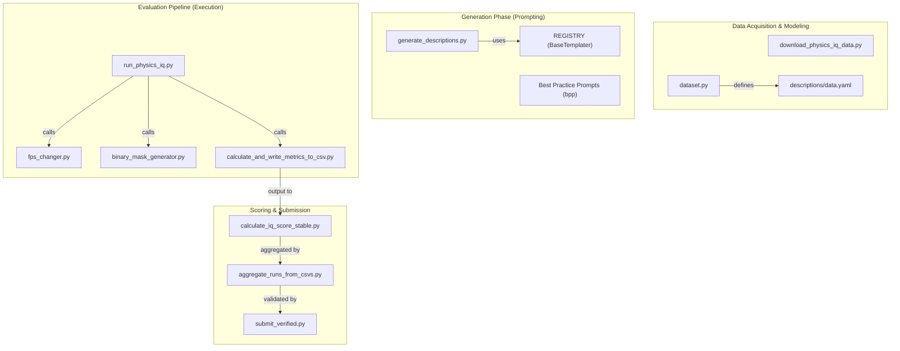
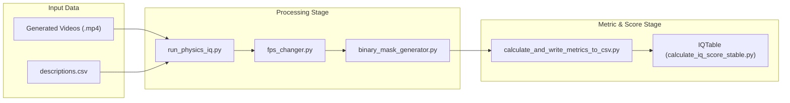

<!-- source: DeepWiki mcp.deepwiki.com · repo google-deepmind/physics-IQ-benchmark · page 1 Overview · fetched 2026-10-26 -->

# Overview

Relevant source files

The following files were used as context for generating this wiki page:

- [.gitignore](.gitignore)
- [LICENSE](LICENSE)
- [README.md](README.md)
- [physiq/__init__.py](physiq/__init__.py)
- [pyproject.toml](pyproject.toml)

This document provides a comprehensive introduction to the Physics-IQ benchmark system, explaining its purpose, architecture, and key components. Physics-IQ is a benchmark framework for evaluating whether generative video models understand real-world physics principles through a comparison of generated videos against high-quality ground truth recordings.

**Scope**: This overview covers the system's purpose, architecture, components, and workflow at a high level. For detailed information about specific subsystems, see:
- Core concepts and physics categories: [What is Physics-IQ?](#1.1)
- Pipeline stages and workflow: [System Architecture](#1.2)
- Rankings and score aggregation: [Leaderboard and Results](#1.3)

## Introduction

Physics-IQ is a high-quality benchmark dataset and evaluation framework that tests whether generative video models understand physical phenomena. Unlike synthetic benchmarks that use rendered videos, Physics-IQ consists of real-world videos captured at 3840×2160 resolution and 30 frames per second [README.md:18-22]().

The system offers two primary variants:
- **Physics-IQ (Original)**: The baseline benchmark using original text prompts and scoring logic.
- **Physics-IQ Verified**: An improved variant with higher-quality prompts (best-practice prompts) and refined metric calculations [README.md:9-12]().

The benchmark covers five physics domains: Solid Mechanics, Fluid Dynamics, Optics, Thermodynamics, and Magnetism [README.md:19-19](). It supports two model input types:
- **Image-to-video (i2v)**: Models generating video from a single static "switch-frame" [README.md:129-130]().
- **Multiframe-to-video (v2v)**: Models generating video from short "conditioning-clips" [README.md:127-128]().

**Sources**: [README.md:1-53](); [README.md:123-131]()

## System Architecture

The Physics-IQ system consists of two independent phases: video generation (external) and evaluation (internal). Users generate videos using their models based on provided prompts and conditioning data, then run the evaluation pipeline to compute Physics-IQ scores.

### Natural Language to Code Entity Mapping
The following diagram maps the logical stages of the benchmark to the specific scripts and data structures defined in the codebase.

Title: Physics-IQ Pipeline Entity Map

**Sources**: [physiq/dataset.py:1-50](); [physiq/run_physics_iq.py:1-100](); [physiq/generate_descriptions.py:1-40]()

### Evaluation Workflow
The evaluation pipeline is orchestrated by `run_physics_iq.py`, which sequentially invokes processing modules to transform raw generated videos into standardized metrics.

Title: Evaluation Data Flow

**Sources**: [README.md:156-168](); [physiq/run_physics_iq.py:463-535]()

## Core Components

The Physics-IQ codebase is organized into functional categories that handle the lifecycle of a benchmark run.

### Dataset and Metadata Layer
Managed primarily in `dataset.py`, this layer uses Pydantic models like `Benchmark` and `Scene` to represent the physical scenarios [physiq/dataset.py:34-118](). It handles filename inference and integrity checks for the 198 videos (66 scenarios × 3 perspectives) required for a complete run.

### Prompting Subsystem
The `generate_descriptions.py` script utilizes a `BaseTemplater` and a `REGISTRY` pattern to generate model-specific prompts [physiq/generate_descriptions.py:31-64](). This allows researchers to use "Best Practice Prompts" (bpp) tailored to their model's specific requirements.

### Evaluation Pipeline
The pipeline enforces strict validation:
- Exactly 198 videos must be present [physiq/run_physics_iq.py:145-146]().
- Each video must be exactly 5 seconds in duration [physiq/run_physics_iq.py:148-149]().
- Videos are normalized to a target FPS (e.g., 30, 24, 16, 8) using `fps_changer.py` [physiq/run_physics_iq.py:488-500]().

### Scoring and Aggregation
The final Physics-IQ score is a variance-normalized metric. The `IQTable` class in `calculate_iq_score_stable.py` computes scores by comparing generated videos to two separate "takes" of the ground truth to account for natural physical randomness [physiq/calculate_iq_score_stable.py:45-120]().

**Sources**: [physiq/dataset.py:34-118](); [physiq/run_physics_iq.py:140-160](); [physiq/calculate_iq_score_stable.py:45-120]()

## Leaderboard and Results

The benchmark maintains leaderboards for both the **Verified** and **Original** variants. The **Verified Score** (calculated via `compute_final_score_stable`) is the current standard for submissions, emphasizing stable variance normalization [physiq/calculate_iq_score_stable.py:168-200]().

Performance is tracked across:
- **Input Modality**: Image-to-Video (i2v) vs. Multiframe (v2v).
- **Metric Components**: Spatiotemporal IoU, Spatial IoU, and MSE [README.md:43-56]().

For detailed submission instructions and current rankings, see [Leaderboard and Results](#1.3).

**Sources**: [README.md:36-80](); [physiq/calculate_iq_score_stable.py:168-200]()

---

