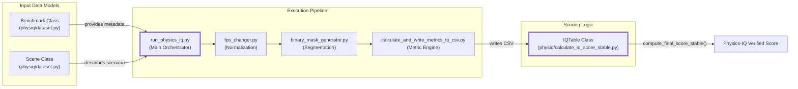

<!-- source: DeepWiki mcp.deepwiki.com · repo google-deepmind/physics-IQ-benchmark · page 1.1 What is Physics-IQ? · fetched 2026-10-26 -->

# 1.1 What is Physics-IQ?

<details>
<summary>Relevant source files</summary>

The following files were used as context for generating this wiki page:

- [README.md](README.md)
- [descriptions/best_practice/descriptions_base.csv](descriptions/best_practice/descriptions_base.csv)
- [physiq/generate_descriptions.py](physiq/generate_descriptions.py)

</details>


**Purpose**: This page explains the core concept of Physics-IQ as a benchmark system for evaluating physical understanding in generative video models. It describes the distinction between the Original and Verified variants, the variance-based scoring strategy, and the physical categories tested.

For details on the system's architecture and pipeline stages, see [System Architecture](1.2). For current model performance data, see [Leaderboard and Results](1.3).

---

## Core Concept

Physics-IQ is a benchmark dataset and evaluation system designed to quantify whether generative video models understand real-world physics. The benchmark tests models by having them generate videos of physical scenarios, then comparing those generated videos against high-quality ground truth recordings of actual physical experiments.

The central premise is that physically realistic video generation requires more than visual plausibility—it requires adherence to fundamental physics principles such as momentum conservation, gravity, material properties, fluid dynamics, and electromagnetic interactions [README.md:7-19]().

### Original vs. Verified Variants

The benchmark exists in two primary variants:
*   **Physics-IQ Original**: The initial release focusing on real-world video recordings and baseline metrics [README.md:65-77]().
*   **Physics-IQ Verified**: An improved version with refined prompt quality and metric robustness. It introduces "Best-Practice Prompts" (`bpp`) generated via model-specific templaters and a more stable scoring formula [README.md:10-15](), [README.md:58-63]().

### Data Flow and Code Entities

The following diagram bridges the logical evaluation flow to the specific Python classes and scripts responsible for execution.

**Diagram 1: Natural Language Space to Code Entity Space (Evaluation)**


**Sources**: [physiq/dataset.py:28-118](), [physiq/calculate_iq_score_stable.py:34-45](), [physiq/calculate_and_write_metrics_to_csv.py:33-40]()

---

## The Take-1/Take-2 Variance Strategy

A unique feature of Physics-IQ is the use of two independent recordings ("takes") for every scenario and perspective. This design addresses the inherent randomness in physical systems.

*   **Take-1 vs. Take-2**: Each scenario is recorded twice under identical conditions to capture natural physical variations (e.g., micro-vibrations, air currents) [README.md:21-21]().
*   **Variance Baseline**: The system calculates the difference between `take-1` and `take-2` to establish a baseline of "acceptable" divergence. A model is not penalized for differing from ground truth if that difference is within the range of natural physical randomness [README.md:37-37]().
*   **Implementation**: The `IQTable` class in [physiq/calculate_iq_score_stable.py:34-45]() handles this by storing metrics for both takes and using them to normalize the final score.

---

## Physics Categories

The benchmark covers 66 unique scenarios categorized into five physical domains. These categories are defined in the dataset metadata and used for sub-score reporting.

| Category | Description | Example Scenarios |
| :--- | :--- | :--- |
| **Solid Mechanics** | Rigid body dynamics, collisions, and gravity. | Ball and block fall, ball hitting duck [descriptions/best_practice/descriptions_base.csv:2-13]() |
| **Fluid Dynamics** | Liquid behavior, flow, and buoyancy. | Water pouring, objects floating |
| **Optics** | Light interaction, shadows, and reflections. | Shadow movement, mirror reflections |
| **Thermodynamics** | Heat-related physical changes. | Melting ice, steam patterns |
| **Magnetism** | Electromagnetic forces and attraction. | Magnets attracting metal objects |

**Sources**: [README.md:19-19](), [physiq/dataset.py:38-38](), [descriptions/best_practice/descriptions_base.csv:2-13]()

---

## Prompting System: Best-Practice vs. Original

Physics-IQ Verified introduces a structured prompting system to ensure models are evaluated fairly based on their specific instruction-following capabilities.

**Diagram 2: Prompt Generation Architecture**

```mermaid
graph TD
    subgraph "Metadata Source"
        YAML["data.yaml<br/>(Scenario Details)"]
    end
    
    subgraph "physiq/generate_descriptions.py"
        REG["REGISTRY<br/>(Templater Map)"]
        BASE["BaseTemplater<br/>(Abstract Class)"]
        MODEL["ModelTemplaters<br/>(e.g., Llama, Cosmos)"]
    end
    
    YAML -->|"Benchmark.from_yaml()"| REG
    REG -->|"instantiates"| MODEL
    MODEL --|> BASE
    MODEL -->|"generate_prompt()"| CSV["descriptions_model.csv"]
    
    style REG stroke-width:4px
    style BASE stroke-width:4px
```

*   **Original Prompts (op)**: Simple descriptions used in the initial benchmark release.
*   **Best-Practice Prompts (bpp)**: Verbose, high-quality prompts generated by model-specific classes inheriting from `BaseTemplater` in the `physiq.templater` registry [physiq/generate_descriptions.py:22-47]().
*   **Action Suffix**: Verified evaluation typically appends a subject-action postfix to prompts to clarify the intended physical evolution [physiq/generate_descriptions.py:36-39]().

**Sources**: [physiq/generate_descriptions.py:25-66](), [README.md:60-60]()

---

## Technical Specifications

To maintain integrity, all generated videos must adhere to strict requirements processed by the pipeline:

*   **Resolution**: 3840 × 2160 (4K) source [README.md:22-22]().
*   **Duration**: Exactly 5 seconds. The pipeline uses `trim_videos.py` (referenced in architecture) to enforce this.
*   **Frame Rate**: Canonical 30 FPS, with support for 24, 16, and 8 FPS via `fps_changer.py` [README.md:22-22]().
*   **Naming Convention**: A 4-digit zero-padded prefix (e.g., `0001_...`) mapping to `descriptions.csv` [descriptions/best_practice/descriptions_base.csv:2-13]().

**Sources**: [README.md:22-22](), [physiq/generate_descriptions.py:50-58](), [descriptions/best_practice/descriptions_base.csv:1-15]()

---

