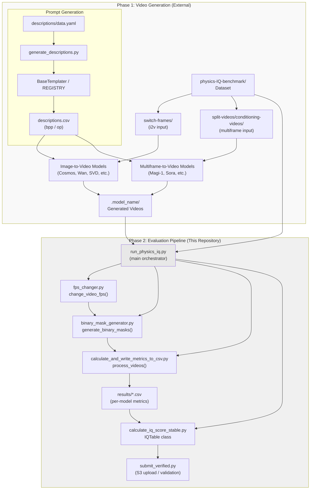
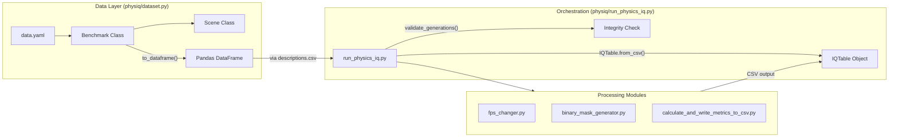
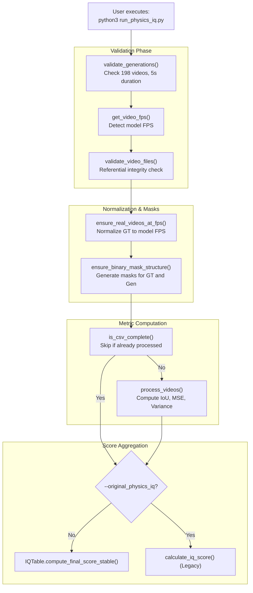
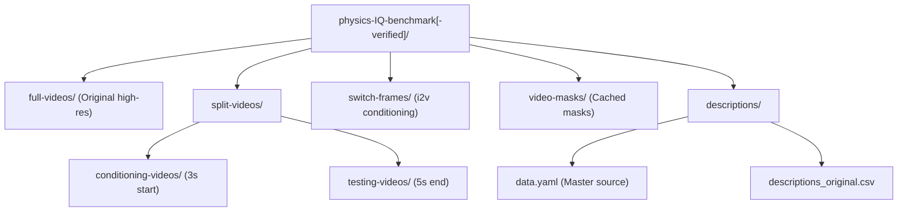

<!-- source: DeepWiki mcp.deepwiki.com · repo google-deepmind/physics-IQ-benchmark · page 1.2 System Architecture · fetched 2026-10-26 -->

# System Architecture

Relevant source files

The following files were used as context for generating this wiki page:

- [README.md](README.md)
- [physiq/dataset.py](physiq/dataset.py)
- [physiq/run_physics_iq.py](physiq/run_physics_iq.py)
- [physiq/tests/__init__.py](physiq/tests/__init__.py)

## Purpose and Scope

This document describes the high-level architecture of the Physics-IQ benchmark system, including the two-phase workflow (external video generation and internal evaluation), core component interactions, and data flow patterns. It covers both the **Original** and **Verified** workflow variants.

For detailed information about specific subsystems, see:
- Dataset structure and organization: [2. Dataset]()
- Evaluation pipeline execution: [4. Evaluation Pipeline]()
- Metric computation details: [5. Metrics and Scoring]()
- Submission process: [6. Submission Pipeline]()

---

## Two-Phase System Design

The Physics-IQ benchmark operates as a two-phase system with a clear separation between video generation (external to this repository) and evaluation (internal to this repository).

### Architecture Overview

**Phase 1: Video Generation (External)**
- Researchers generate prompts using `generate_descriptions.py` [physiq/generate_descriptions.py:1-70](), which uses a `BaseTemplater` [physiq/generate_descriptions.py:32-44]() to create model-specific Best Practice Prompts (`bpp`) or Original Prompts (`op`).
- Input modalities: single image (`switch-frames/`) for i2v models, or short video segments (`split-videos/conditioning-videos/`) for multiframe models.
- Output: 198 videos (exactly 5 seconds each) saved with 4-digit zero-padded prefixes [physiq/run_physics_iq.py:168-201]().

**Phase 2: Evaluation Pipeline (This Repository)**
- Automated evaluation via `run_physics_iq.py` [physiq/run_physics_iq.py:346-455]().
- Standardized pipeline: FPS normalization → mask generation → metric calculation → score aggregation via the `IQTable` class [physiq/calculate_iq_score_stable.py:43-62]().
- Output: CSV metrics and a submission-ready package validated by `submit_verified.py` [physiq/submit_verified.py:350-424]().

**Sources:** [README.md:12-22](), [physiq/run_physics_iq.py:28-34](), [physiq/generate_descriptions.py:1-70](), [physiq/calculate_iq_score_stable.py:43-62]()

---

## Core Components and Data Model

The system uses a structured data model to represent the benchmark scenarios and manages the pipeline through specialized modules.

### Data Model to Code Entity Mapping

**Component Responsibilities:**

| Component | Function | Input | Output | Location |
|-----------|----------|-------|--------|----------|
| `Benchmark` / `Scene` | Pydantic data models for scenario metadata | `descriptions/data.yaml` | DataFrame / Metadata | [physiq/dataset.py:29-132]() |
| `run_physics_iq.py` | Main orchestrator and validator | Generated videos, descriptions | Evaluation metrics | [physiq/run_physics_iq.py:346-455]() |
| `fps_changer.py` | FPS normalization via linear interpolation | Source video, target FPS | Normalized video | [physiq/fps_changer.py:22-68]() |
| `binary_mask_generator.py` | Adaptive background subtraction for object isolation | Video | Binary mask video | [physiq/binary_mask_generator.py:21-82]() |
| `IQTable` | Stable score aggregation and variance normalization | Metric CSVs | Physics-IQ Score | [physiq/calculate_iq_score_stable.py:43-238]() |

**Sources:** [physiq/dataset.py:29-132](), [physiq/run_physics_iq.py:28-34](), [physiq/calculate_iq_score_stable.py:43-62]()

---

## Evaluation Pipeline Data Flow

The evaluation pipeline processes videos through a sequential series of transformations. It supports two main modes: **Verified** (recommended, uses `IQTable` stable scoring) and **Original** (legacy).

### Sequential Processing Flow

**Key Features:**
1. **FPS Normalization:** The system automatically detects the frame rate of generated videos and downsamples the 30 FPS ground truth videos to match using `change_video_fps` [physiq/run_physics_iq.py:272-313]().
2. **Mask Generation:** Moving objects are isolated using `generate_binary_masks` which employs adaptive background subtraction [physiq/binary_mask_generator.py:21-82]().
3. **Stable Scoring:** The `IQTable` class in `calculate_iq_score_stable.py` performs variance normalization, comparing model performance against the natural variance between `take-1` and `take-2` of the ground truth [physiq/calculate_iq_score_stable.py:126-170]().

**Sources:** [physiq/run_physics_iq.py:272-344](), [physiq/calculate_iq_score_stable.py:126-170](), [physiq/binary_mask_generator.py:21-82]()

---

## File System Organization

The system maintains a strict directory structure for both the original dataset and the verified variant.

### Directory Structure

**Naming Conventions:**
- **Generated Videos:** Must use the `0001_...` prefix. The `rename_generated_videos` function standardizes these to `{ID}_{perspective}_{scenario_name}.mp4` for internal processing [physiq/run_physics_iq.py:71-104]().
- **Ground Truth:** Standardized as `{ID}_testing-videos_{FPS}FPS_{perspective}_{take}_{scenario_name}.mp4` [physiq/dataset.py:77-81]().

**Sources:** [physiq/dataset.py:69-91](), [physiq/run_physics_iq.py:71-104](), [README.md:123-156]()

---

## Submission Pipeline

For the **Physics-IQ Verified** leaderboard, a specific submission workflow is required.

1. **Generation:** Use `generate_descriptions.py` to get prompts [physiq/generate_descriptions.py:70]().
2. **Evaluation:** Run `run_physics_iq.py` to generate the results CSV [physiq/run_physics_iq.py:346-455]().
3. **Packaging:** Create a `submission.yaml` card and use `submit_verified.py` [physiq/submit_verified.py:350-424]().
4. **Validation:** `submit_verified.py` performs strict checks on video count (198), duration (5s), and metadata integrity before allowing upload [physiq/submit_verified.py:104-187]().

**Sources:** [physiq/submit_verified.py:104-187](), [physiq/submit_verified.py:350-424]()

---

