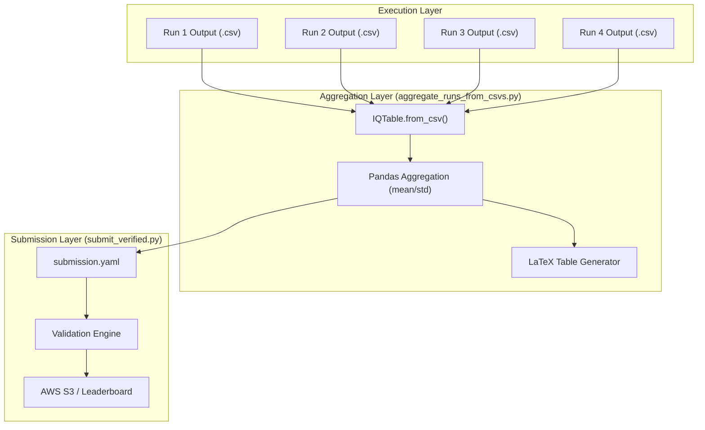
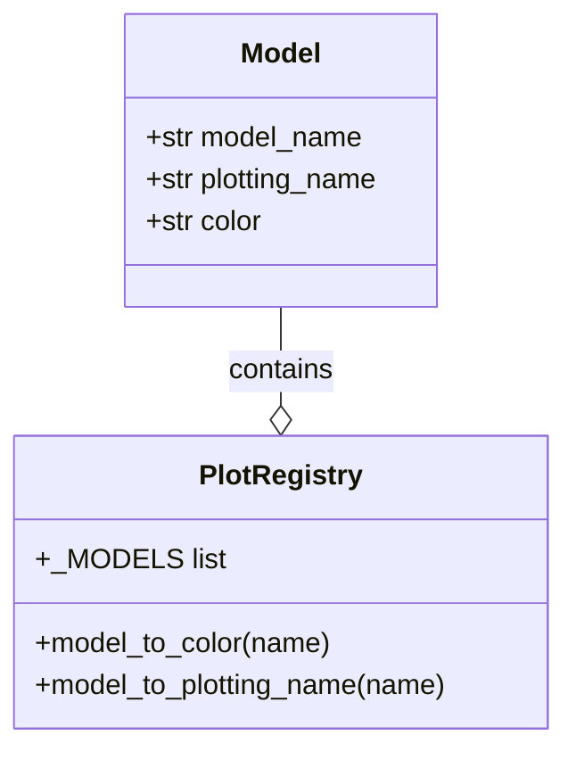

<!-- source: DeepWiki mcp.deepwiki.com · repo google-deepmind/physics-IQ-benchmark · page 1.3 Leaderboard and Results · fetched 2026-10-26 -->

# Leaderboard and Results

<details>
<summary>Relevant source files</summary>

The following files were used as context for generating this wiki page:

- [README.md](README.md)
- [physiq/aggregate_runs_from_csvs.py](physiq/aggregate_runs_from_csvs.py)
- [physiq/tests/test_descriptions.py](physiq/tests/test_descriptions.py)

</details>


## Purpose and Scope

This page presents the Physics-IQ benchmark leaderboard, showing how generative video models rank based on their physical understanding capabilities. The leaderboard compares models across two input modalities (image-to-video and multiframe-to-video) using a standardized 0-100% scoring system. 

The benchmark currently supports two scoring variants: **Original Physics-IQ** and **Physics-IQ Verified**. The Verified variant is the recommended benchmark, featuring improved prompt quality and more robust metric aggregation.

**Sources:** [README.md:5-15](), [README.md:36-58]()

---

## Score Interpretation: Original vs. Verified

The Physics-IQ score ranges from **0 to 100**, where 100 represents a model that perfectly adheres to physical principles, differing from ground truth only by natural physical randomness.

### The Verified Score
The **Verified Score** (`final_score_view`) is the primary metric for the Physics-IQ Verified leaderboard. It implements a "stable" calculation method that averages metrics across three camera views (Left, Center, Right) before final aggregation. This reduces noise and provides a more holistic assessment of 3D physical consistency.
*   **Metric Components**: Spatial IoU, Spatiotemporal IoU, Weighted Spatial IoU, and MSE.
*   **Implementation**: Handled by `IQTable.compute_final_score_stable()` in `physiq/calculate_iq_score_stable.py`.

### The Original Score
The **Original Score** (`final_score`) is maintained for backward compatibility with the initial Physics-IQ release. It aggregates metrics across all scenarios without the specific per-view averaging logic of the Verified variant.
*   **Implementation**: Handled by `IQTable.compute_final_score_orig()` in `physiq/calculate_iq_score_stable.py`.

**Sources:** [physiq/calculate_iq_score_stable.py:214-266](), [README.md:37-39]()

---

## Physics-IQ Verified Leaderboard

The leaderboard is ranked by the **Verified Score**. To claim State-of-the-Art (SOTA), reporting the mean and standard deviation across **4 independent runs** is required.

| # | Model | Input Type | Physics-IQ Verified | Date Added |
|---|---|---|---|---|
| 1 | [Magi-1 24B](https://arxiv.org/abs/2505.13211) + GeoPhys (BoN) | v2v | **58.2** ± 1.8 | 2026-06-19 |
| 2 | [Magi-1 24B](https://arxiv.org/abs/2505.13211) | v2v | **48.4** ± 1.1 | 2026-06-19 |
| 3 | [Cosmos3-Super-Image2Video](https://arxiv.org/abs/2606.02800) | i2v | **39.5** ± 0.8 | 2026-06-18 |
| 4 | [Grok Imagine Video](https://x.ai/news/grok-imagine-api) | i2v | **34.8** ± 0.6 | 2026-06-17 |
| 5 | [Hunyuan Video 1.5](https://arxiv.org/abs/2511.18870) | i2v | **33.4** ± 0.8 | 2026-06-17 |

*Note: `(op)` denotes Original Prompts; all others use Best Practice Prompts (`bpp`).*

**Sources:** [README.md:43-63]()

---

## Result Aggregation Pipeline

To produce a single leaderboard entry from multiple model runs, the system uses `aggregate_runs_from_csvs.py`. This script processes multiple evaluation outputs to compute statistical significance.

### Data Flow for Leaderboard Entry
The following diagram illustrates how raw model outputs are transformed into a validated leaderboard entry.



**Key Functions:**
*   `IQTable.from_csv(path)`: Loads individual run results [physiq/aggregate_runs_from_csvs.py:73-75]().
*   `scores_df.agg(["mean", "std"])`: Calculates the final leaderboard metrics [physiq/aggregate_runs_from_csvs.py:78-78]().
*   `_fmt(col)`: Formats scores into the LaTeX-ready `mean ± std` string used in papers [physiq/aggregate_runs_from_csvs.py:82-84]().

**Sources:** [physiq/aggregate_runs_from_csvs.py:43-109]()

---

## Submission Process

The submission process is strictly governed by `submit_verified.py` to ensure data integrity and comparability.

### 1. The Submission Card (`submission.yaml`)
Every submission must include a manifest containing:
*   **Public Info**: Organization name, model name, and paper links.
*   **Reported Scores**: The `physiq_mean` (Verified Score) and sub-metrics.
*   **Warranties**: Confirmation that the model was not trained on the benchmark test set.

### 2. Validation Requirements
The `submit_verified.py` script enforces the following before accepting a submission:
*   **File Count**: Exactly 198 MP4 files (66 scenarios × 3 views).
*   **Naming**: Files must use the 4-digit zero-padded prefix (e.g., `0001_*.mp4`).
*   **Duration**: Each video must be exactly 5 seconds long.
*   **Referential Integrity**: All generated filenames must match the entries in the benchmark's `descriptions.csv`.

### 3. Submission Command
Submissions are packaged and uploaded using:
```bash
python submit_verified.py --run_dir ./my_model_run/ --submission_card submission.yaml --validate-only
```
Using `--validate-only` allows local checking before final upload to the benchmark's S3 bucket.

**Sources:** [physiq/submit_verified.py:34-118](), [README.md:61-63]()

---

## Visualization and Plotting

The benchmark provides a `plot_settings.py` utility to standardize model appearances in results visualizations.



**Implementation Details:**
*   **Color Mapping**: `model_to_color` ensures that specific models (like Magi-1 or Cosmos) have consistent colors across different papers and reports [physiq/plot_settings.py:78-79]().
*   **Display Names**: `model_to_plotting_name` converts internal identifiers (e.g., `Magi-1_24B_v2v`) into human-readable labels for charts [physiq/plot_settings.py:81-82]().

**Sources:** [physiq/plot_settings.py:18-83]()

---

