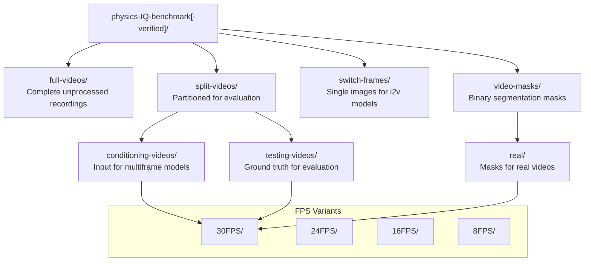
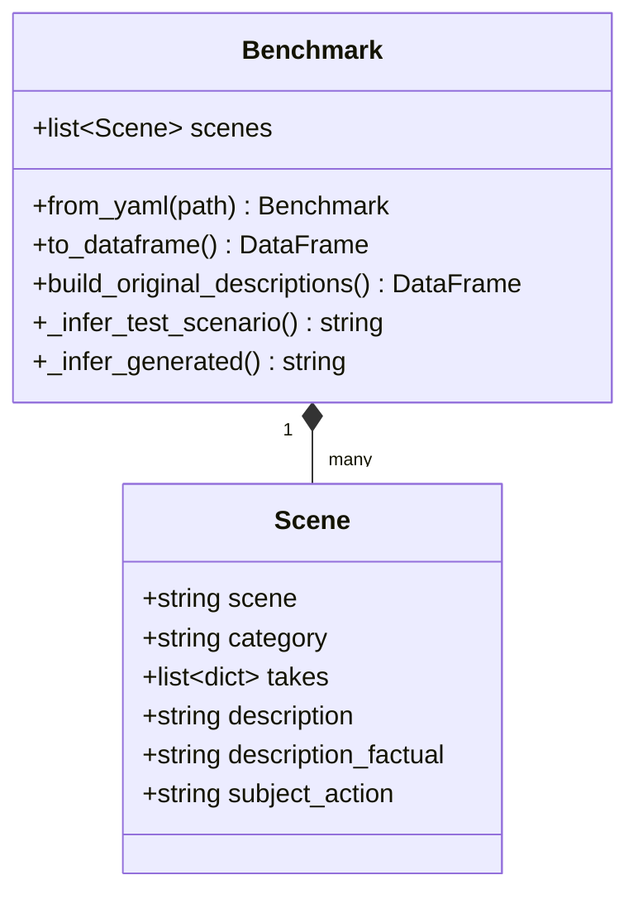
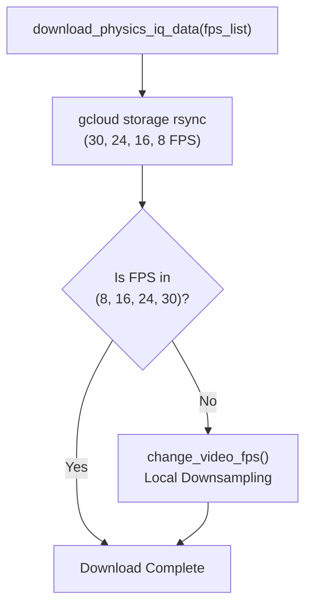

<!-- source: DeepWiki mcp.deepwiki.com · repo google-deepmind/physics-IQ-benchmark · page 2.1 Dataset Organization · fetched 2026-10-26 -->

# Dataset Organization

Relevant source files

The following files were used as context for generating this wiki page:

- [physiq/dataset.py](physiq/dataset.py)
- [physiq/download_physics_iq_data.py](physiq/download_physics_iq_data.py)
- [physiq/tests/__init__.py](physiq/tests/__init__.py)

This page documents the hierarchical directory structure and file organization of the Physics-IQ benchmark dataset. It explains the purpose of each directory, how files are named and linked together, and the role of the metadata registry defined in the `Benchmark` data model.

For information about downloading the dataset, see [Downloading the Dataset](#2.2). For details about the physics domains covered, see [Physics Categories](#2.3). For the recording strategy details, see [Multi-View and Multi-Take Structure](#2.4).

---

## Directory Structure Overview

The Physics-IQ benchmark dataset is organized into five primary directories. The dataset is typically stored in either `physics-IQ-benchmark/` (original) or `physics-IQ-benchmark-verified/` (verified variant) [physiq/download_physics_iq_data.py:66-70]().

**Directory Hierarchy**

**Sources:** [physiq/download_physics_iq_data.py:77-84](), [physiq/dataset.py:77-86]()

---

## File Types and Purposes

### full-videos/
Contains the complete, unprocessed video recordings of all physics scenarios. These are the raw source videos from which all other variants are derived. Organized by `take-1` and `take-2` subdirectories [physiq/download_physics_iq_data.py:78-79]().

### split-videos/
Partitioned videos that separate the temporal sequence into conditioning and testing phases.

#### conditioning-videos/
The initial portion of each video, used as input for multiframe-to-video models.
- **Organization**: Subdirectories by FPS (30FPS, 24FPS, 16FPS, 8FPS) [physiq/download_physics_iq_data.py:80]().

#### testing-videos/
The remaining portion of each video after conditioning frames, used as ground truth for evaluation.
- **Duration**: 5 seconds exactly.
- **Organization**: Subdirectories by FPS [physiq/download_physics_iq_data.py:81]().
- **Naming Pattern**: Inferred via `Benchmark._infer_gt_fn_video` [physiq/dataset.py:77-81]().

### switch-frames/
Single-frame images extracted from the boundary between conditioning and testing phases.
- **Purpose**: Initial frame input for image-to-video models.
- **FPS-Independence**: Labeled as `anyFPS` in naming conventions [physiq/dataset.py:73]().
- **Count**: 198 images (66 scenarios × 3 perspectives, take-1 only).

### video-masks/
Binary segmentation masks that isolate moving objects from static backgrounds.
- **real/**: Contains masks for the real ground truth videos [physiq/download_physics_iq_data.py:83]().
- **Naming Pattern**: Inferred via `Benchmark._infer_fn_mask` [physiq/dataset.py:83-87]().

---

## The Data Model and Metadata

Instead of a static CSV, the modern Physics-IQ pipeline uses a Pydantic-based data model defined in `physiq/dataset.py`. The source of truth is `descriptions/data.yaml` [physiq/dataset.py:24-26]().

**Data Model Structure**

**Metadata Fields in Scene:**
The `Scene` class handles mapping between YAML keys and Python attributes [physiq/dataset.py:30-56]():
- `description_factual`: The corrected, physics-accurate description used in the Verified benchmark.
- `subject_action`: Used by the prompt templater system.
- `takes`: A list of dictionaries mapping perspectives (`left`, `center`, `right`) to 4-digit IDs.

**Sources:** [physiq/dataset.py:29-60](), [physiq/dataset.py:92-124]()

---

## File Naming Conventions

The `Benchmark` class provides static methods to programmatically infer filenames based on ID, perspective, and scenario name.

| File Type | Inference Method | Example Format |
|-----------|------------------|----------------|
| **Testing Video** | `_infer_gt_fn_video` | `0001_testing-videos_30FPS_perspective-left_take-1_trimmed-ball-and-block-fall.mp4` |
| **Mask** | `_infer_fn_mask` | `0001_video-masks_30FPS_perspective-left_take-1_trimmed-ball-and-block-fall.mp4` |
| **Generated** | `_infer_generated` | `0001_perspective-left_trimmed-ball-and-block-fall.mp4` |
| **Scenario ID** | `_infer_test_scenario` | `0001_perspective-left_take-1_trimmed-ball-and-block-fall.mp4` |

**Sources:** [physiq/dataset.py:68-91]()

---

## FPS Handling and Downsampling

The dataset maintains multiple frame rate variants. The `download_physics_iq_data.py` script manages the acquisition and local generation of these variants.

**FPS Logic Flow**

- **Pre-computed**: 8, 16, 24, and 30 FPS are available on GCS [physiq/download_physics_iq_data.py:52-54]().
- **Local Downsampling**: Any other FPS in range [1, 30] is generated locally from the 30 FPS source using `change_video_fps` [physiq/download_physics_iq_data.py:97-112]().
- **Mask Exception**: Binary masks are *not* downsampled via linear interpolation to avoid non-binary pixels; they are regenerated during evaluation if needed [physiq/download_physics_iq_data.py:98-100]().

**Sources:** [physiq/download_physics_iq_data.py:46-65](), [physiq/download_physics_iq_data.py:101-112]()

---

## Cross-Variant Organization

The benchmark distinguishes between the **Original** and **Verified** layouts.

| Feature | Original (`physics-IQ-benchmark`) | Verified (`physics-IQ-benchmark-verified`) |
|---------|-----------------------------------|--------------------------------------------|
| **Source URL** | `gs://physics-iq-benchmark` | Link provided in README |
| **Descriptions** | `descriptions_original.csv` | `data.yaml` / `descriptions_updated.csv` |
| **Prompting** | Original Prompts (op) | Best Practice Prompts (bpp) |
| **Integrity** | Based on `descriptions_original.csv` | Based on `data.yaml` Pydantic model |

The `get_benchmark()` function in `physiq/dataset.py` is the entry point for loading the verified metadata, while `build_original_descriptions()` provides backward compatibility by generating the original CSV format from the new YAML source [physiq/dataset.py:126-132]().

**Sources:** [physiq/download_physics_iq_data.py:66-76](), [physiq/dataset.py:126-132]()

---

