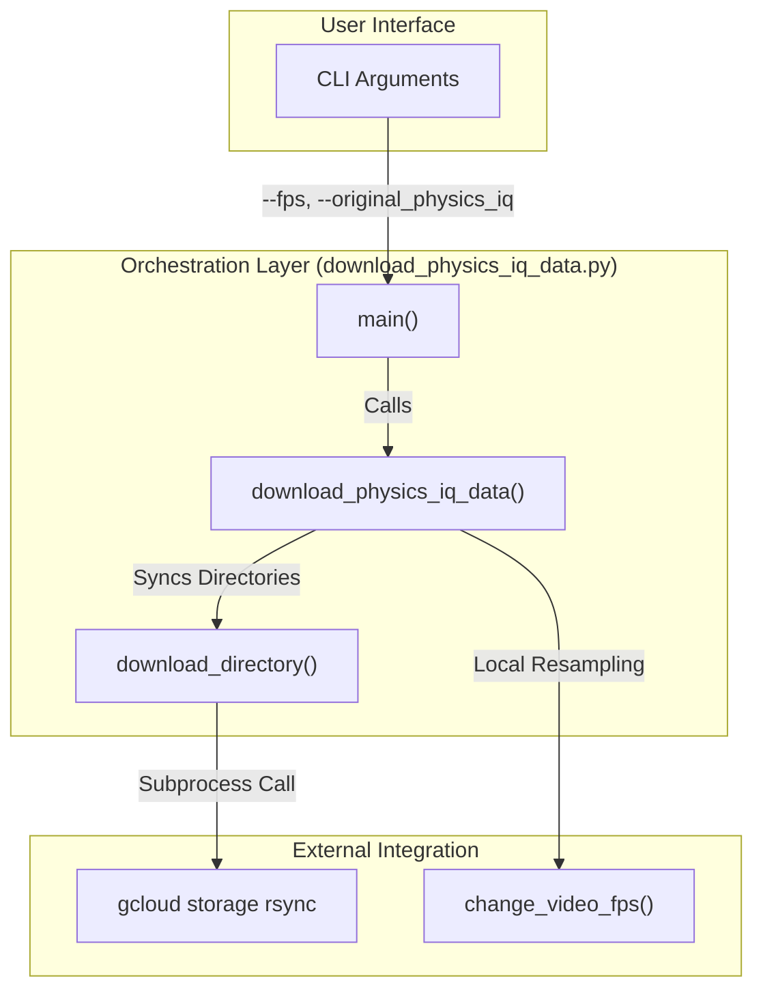
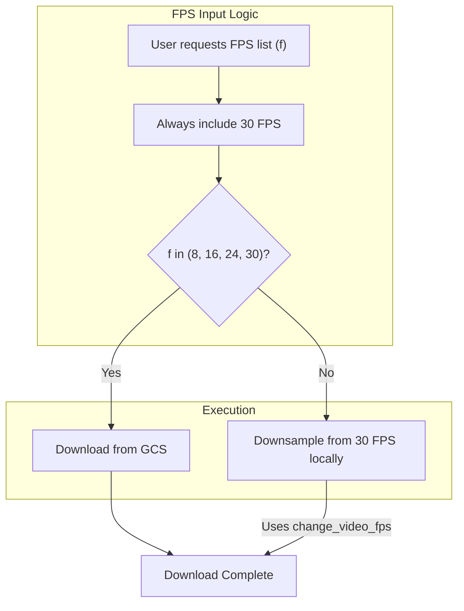

<!-- source: DeepWiki mcp.deepwiki.com · repo google-deepmind/physics-IQ-benchmark · page 2.2 Downloading the Dataset · fetched 2026-10-26 -->

# Downloading the Dataset

Relevant source files

The following files were used as context for generating this wiki page:

- [physiq/download_physics_iq_data.py](physiq/download_physics_iq_data.py)

This page explains how to use `download_physics_iq_data.py` to obtain the Physics-IQ benchmark dataset from Google Cloud Storage. The script handles directory synchronization, FPS-specific downloads, and local downsampling for non-standard frame rates.

---

## Overview

The Physics-IQ dataset is hosted on Google Cloud Storage. The download utility uses `gcloud storage rsync` to mirror remote directories to a local path. It supports two main dataset variants:
*   **Original Physics-IQ**: The baseline benchmark dataset.
*   **Verified Physics-IQ**: The curated version used for official leaderboard submissions.

**Sources:** [physiq/download_physics_iq_data.py:66-76](), [physiq/download_physics_iq_data.py:128-131]()

---

## Implementation Architecture

The download process is orchestrated by `download_physics_iq_data.py`, which manages the mapping between remote GCS paths and the local hierarchical structure.

### System Flow: Natural Language to Code Entity

This diagram maps the high-level download requirements to the specific functions and logic in the codebase.

**Sources:** [physiq/download_physics_iq_data.py:26-44](), [physiq/download_physics_iq_data.py:46-114](), [physiq/download_physics_iq_data.py:116-145]()

---

## Download Logic and FPS Selection

The script implements a strategy to minimize bandwidth by downloading pre-computed FPS variants when available, while falling back to local downsampling for custom frame rates.

### Data Flow: FPS Handling

The following diagram illustrates how the system decides between downloading a pre-computed variant or performing local processing.

**Sources:** [physiq/download_physics_iq_data.py:57-64](), [physiq/download_physics_iq_data.py:88-91](), [physiq/download_physics_iq_data.py:101-111]()

### Key Functions

*   **`download_directory(remote_path, local_path)`**: Wraps the `gcloud storage rsync --recursive` command. It ensures the local directory exists via `os.makedirs` before initiating the sync [physiq/download_physics_iq_data.py:26-44]().
*   **`download_physics_iq_data(fps, base_dir, verified)`**: The main entry point. It defines the directory structure for `full-videos`, `split-videos`, `switch-frames`, and `video-masks` [physiq/download_physics_iq_data.py:77-84]().
*   **`change_video_fps(...)`**: Imported from `physiq.fps_changer`, this is called when a user requests an FPS value that is not pre-computed on the server [physiq/download_physics_iq_data.py:109-111]().

---

## Dataset Variants: Original vs. Verified

The script supports two target datasets, controlled by the `--original_physics_iq` flag.

| Feature | Original Dataset (`--original_physics_iq`) | Verified Dataset (Default) |
| :--- | :--- | :--- |
| **GCS Bucket** | `gs://physics-iq-benchmark` | `gs://physics-iq-benchmark` |
| **Local Folder** | `physics-IQ-benchmark` | `physics-IQ-benchmark-verified` |
| **Verified Flag** | `False` | `True` |

**Note on Verified Dataset**: As of the current implementation, the verified dataset requires manual download from links provided in the project README if the GCS path is not yet public [physiq/download_physics_iq_data.py:71-73]().

**Sources:** [physiq/download_physics_iq_data.py:66-75](), [physiq/download_physics_iq_data.py:128-131]()

---

## Local Downsampling Implementation

For non-standard frame rates (values in `[1, 30]` excluding 8, 16, 24, and 30), the script performs the following steps:
1.  Downloads the **30 FPS** version of all required directories [physiq/download_physics_iq_data.py:58]().
2.  Iterates through the local 30 FPS files.
3.  Calls `change_video_fps` to create a new directory for the target FPS [physiq/download_physics_iq_data.py:101-111]().

**Exception for Masks**: The script explicitly skips downsampling `video-masks/real` locally. This is because linear frame interpolation on binary masks would produce non-binary (grayscale) pixels. Instead, the evaluation pipeline (`run_physics_iq.py`) is designed to regenerate binary masks from the downsampled real videos at runtime [physiq/download_physics_iq_data.py:97-100]().

**Sources:** [physiq/download_physics_iq_data.py:97-111]()

---

## Technical Configuration

### Multiprocessing
The script sets the multiprocessing start method to `"spawn"` at the top level [physiq/download_physics_iq_data.py:23](). This ensures consistent behavior across different operating systems when spawning subprocesses for `gcloud` or `ffmpeg`.

### CLI Arguments
| Argument | Type | Default | Description |
| :--- | :--- | :--- | :--- |
| `--fps` | `int` (list) | `[30]` | Desired FPS values. Pre-computed: 8, 16, 24, 30. |
| `--original_physics_iq` | `flag` | `False` | If set, downloads the original rather than verified dataset. |
| `--benchmark_base_folder` | `str` | `"."` | The parent directory for the downloaded data. |

**Sources:** [physiq/download_physics_iq_data.py:23](), [physiq/download_physics_iq_data.py:116-138]()

---

