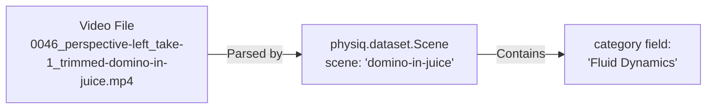
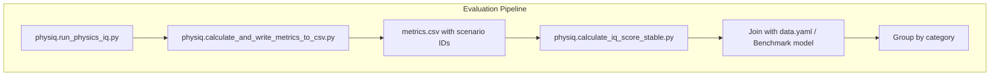

<!-- source: DeepWiki mcp.deepwiki.com · repo google-deepmind/physics-IQ-benchmark · page 2.3 Physics Categories · fetched 2026-10-26 -->

# Physics Categories

Relevant source files

The following files were used as context for generating this wiki page:

- [descriptions/best_practice/descriptions_base.csv](descriptions/best_practice/descriptions_base.csv)
- [descriptions/data.yaml](descriptions/data.yaml)
- [descriptions/descriptions_original.csv](descriptions/descriptions_original.csv)
- [physiq/generate_descriptions.py](physiq/generate_descriptions.py)
- [physiq/plot_settings.py](physiq/plot_settings.py)

This page describes the five physics domains covered in the Physics-IQ benchmark dataset. Each category tests generative video models on distinct physical principles through carefully designed real-world scenarios. For information about dataset structure and file organization, see [Dataset Organization](#2.1). For details on the metadata file that tags each scenario with its category, see [Dataset Metadata and Data Model](#2.5).

---

## Category Distribution

The Physics-IQ dataset comprises 66 unique physical scenarios. In the evaluation pipeline, each scenario is recorded from 3 perspectives with 2 takes, yielding 396 total videos (66 × 3 × 2) that form the ground truth comparison set.

**Category Breakdown:**

| Category | Scenarios | Key Physical Principles |
|----------|-----------|------------------------|
| Solid Mechanics | 42 | Collisions, gravity, friction, material deformation |
| Fluid Dynamics | 11 | Liquid behavior, displacement, absorption, mixing |
| Optics | 6 | Shadows, reflections, light propagation |
| Thermodynamics | 4 | Combustion, heat transfer, thermal expansion |
| Magnetism | 3 | Magnetic attraction, ferromagnetic materials |

**Sources:** [descriptions/data.yaml:1-558](), [descriptions/best_practice/descriptions_base.csv:1-200]()

---

## Category Distribution Diagram

```mermaid
graph TD
    subgraph "Physics-IQ Dataset: 66 Scenarios"
        ROOT["data.yaml<br/>category field"]
    end
    
    subgraph "Solid Mechanics: 42 scenarios"
        SM1["Collisions<br/>ball-hits-duck<br/>balls-collide<br/>ball-train"]
        SM2["Gravity & Falls<br/>ball-and-block-fall<br/>duck-falls-in-box<br/>ball-in-basket"]
        SM3["Material Properties<br/>mug-breaks<br/>cut-orange<br/>cut-paper"]
        SM4["Mechanical Systems<br/>single-cradle<br/>double-cradle<br/>dominos-with-space"]
    end
    
    subgraph "Fluid Dynamics: 11 scenarios"
        FD1["Liquid Pouring<br/>fill-glass-red-drink<br/>liquid-overfill<br/>juice-in-water"]
        FD2["Buoyancy & Displacement<br/>potato-in-water<br/>paper-in-water<br/>domino-in-juice"]
        FD3["Absorption<br/>napkin-soak<br/>paper-fall-water"]
    end
    
    subgraph "Optics: 6 scenarios"
        OP1["Shadows<br/>light-on-block<br/>light-on-mug<br/>light-on-statue"]
        OP2["Reflections<br/>mirror-ball-fall<br/>mirror-ball-rotate<br/>rolling-reflection"]
    end
    
    subgraph "Thermodynamics: 4 scenarios"
        TH1["Combustion<br/>lit-candle<br/>paper-smoke<br/>match-blows-balloon"]
    end
    
    subgraph "Magnetism: 3 scenarios"
        MAG1["Magnetic Attraction<br/>magnet-wrench<br/>magnet-domino"]
    end
    
    ROOT --> SM1 & SM2 & SM3 & SM4
    ROOT --> FD1 & FD2 & FD3
    ROOT --> OP1 & OP2
    ROOT --> TH1
    ROOT --> MAG1
```

**Sources:** [descriptions/data.yaml:6-557]()

---

## Solid Mechanics

Solid Mechanics is the dominant category, representing the majority of the dataset. These scenarios test understanding of classical mechanics principles including collision dynamics, gravitational motion, friction, elastic/inelastic deformation, and rigid body interactions.

### Key Subcategories

**Collision Dynamics:**
- `ball-hits-duck`: Tennis ball rolling into stationary rubber duck [descriptions/data.yaml:42]()
- `balls-collide`: Two tennis balls rolling toward each other [descriptions/data.yaml:184]()
- `ball-train`: Ball collision creating chain reaction [descriptions/data.yaml:175]()

**Gravitational Motion:**
- `ball-and-block-fall`: Simultaneous drop of ball and block onto pillows [descriptions/data.yaml:2]()
- `ball-in-basket`: Basketball dropped into crate [descriptions/data.yaml:83]()
- `ball-rolls-off`: Ball rolling off table edge [descriptions/data.yaml:138]()

**Material Deformation & Fracture:**
- `mug-breaks`: Ceramic mug dropped onto concrete brick [descriptions/data.yaml:374]()
- `cut-orange`: Knife slicing through tangerine [descriptions/data.yaml:206]()
- `cut-paper`: Paper tearing under tensile stress [descriptions/data.yaml:215]()

**Mechanical Systems:**
- `single-cradle`: Newton's cradle with one ball [descriptions/data.yaml:468]()
- `double-cradle`: Newton's cradle with two balls [descriptions/data.yaml:244]()
- `block-domino`: Rotating stick knocking domino chain [descriptions/data.yaml:194]()

### Example Scenario Detail

The `ball-ramp` scenario [descriptions/data.yaml:118]() illustrates multiple mechanical principles:
- **Initial condition:** Cardboard ramp propped by blue block, black pipe at left.
- **Physics tested:** Rolling motion, inclined plane dynamics, energy conversion.
- **Challenge for models:** Correctly predict ball trajectory up ramp, arc at peak, and descent.

**Sources:** [descriptions/data.yaml:2-198](), [descriptions/best_practice/descriptions_base.csv:2-20]()

---

## Fluid Dynamics

Fluid Dynamics scenarios test understanding of liquid behavior, including pouring, displacement, mixing, absorption, and surface tension.

### Key Subcategories

**Liquid Pouring & Filling:**
- `fill-glass-red-drink`: Beverage dispenser filling glass [descriptions/data.yaml:274]()
- `liquid-overfill`: Glass overflow onto tray [descriptions/data.yaml:344]()
- `liquid-on-duck`: Liquid pouring onto rubber duck in pan [descriptions/data.yaml:334]()

**Buoyancy & Displacement:**
- `potato-in-water`: Potato dropped into glass, water level rises [descriptions/data.yaml:423]()
- `paper-in-water`: Crumpled paper in colored liquid [descriptions/data.yaml:403]()
- `domino-in-juice`: White domino dropped into dark liquid in mug [descriptions/data.yaml:225]()

**Mixing & Diffusion:**
- `juice-in-water`: Grapefruit juice mixing with water [descriptions/data.yaml:284]()
- `water-in-juice`: Water dispensing into juice [descriptions/data.yaml:548]()

**Absorption & Capillary Action:**
- `napkin-soak`: Paper towel dropped onto blue liquid [descriptions/data.yaml:384]()
- `paper-fall-water`: Crumpled paper released into water bowl [descriptions/data.yaml:394]()

**Sources:** [descriptions/data.yaml:225-558]()

---

## Optics

Optics scenarios evaluate understanding of light behavior, including shadow formation, reflection, and geometric optics.

### Key Subcategories

**Shadow Dynamics:**
- `light-on-block`: Blue block on rotating turntable, spotlight casting shadow [descriptions/data.yaml:294]()
- `light-on-mug`: Yellow mug shadow on wall [descriptions/data.yaml:304]()
- `light-on-statue`: Porcelain statue shadow projection [descriptions/data.yaml:324]()

**Reflection & Mirrors:**
- `mirror-ball-fall`: Tennis ball lowered in front of mirror [descriptions/data.yaml:354]()
- `mirror-ball-rotate`: Smiley ball rotating, mirror shows unmarked side [descriptions/data.yaml:364]()
- `rolling-reflection`: Tennis ball rolling toward kettlebell near mirror [descriptions/data.yaml:458]()

**Sources:** [descriptions/data.yaml:294-467]()

---

## Thermodynamics

Thermodynamics scenarios test heat transfer, combustion, and thermal expansion principles.

### Scenarios

**Steady-State Combustion:**
- `lit-candle`: Two candles, one burning continuously [descriptions/data.yaml:334]()
- Tests: Flame shape, wax melting, smoke behavior.

**Thermal Destruction:**
- `match-blows-balloon`: Lit match on rotating platform touches balloon [descriptions/data.yaml:344]()
- Tests: Heat transfer, rubber rupture, sudden volume change.

**Combustion Products:**
- `paper-smoke`: Paper burning on glass cutting board [descriptions/data.yaml:413]()
- Tests: Smoke emission, flame propagation, material consumption.

**Sources:** [descriptions/data.yaml:334-422]()

---

## Magnetism

Magnetism scenarios test understanding of magnetic forces and ferromagnetic material interactions.

### Scenarios

**Ferromagnetic Attraction:**
- `magnet-wrench`: Metal wrench on rotating platform approaching powerful magnet [descriptions/data.yaml:314]()
- Tests: Magnetic force gradient, object acceleration, rotational dynamics.

**Non-Magnetic Materials:**
- `magnet-domino`: Plastic domino on rotating platform near magnet [descriptions/data.yaml:304]()
- Tests: Absence of magnetic response, continued rotation.

**Note:** The `magnet-transparent-peakaboo` scenario [descriptions/data.yaml:324]() is categorized as **Solid Mechanics** despite "magnet" in its name, as it primarily tests object permanence.

**Sources:** [descriptions/data.yaml:304-333]()

---

## Category Assignment in Code

### Metadata Storage

Categories are stored in the `category` column of `descriptions_base.csv` [descriptions/best_practice/descriptions_base.csv:1]() and defined in the `category` field of the `Scene` Pydantic model [physiq/dataset.py:44]().

### Example Lookup Pattern

**Sources:** [physiq/dataset.py:41-44](), [descriptions/best_practice/descriptions_base.csv:1-200]()

---

## Category-Based Evaluation

The Physics-IQ score is calculated across all scenarios, but the system allows for category-level analysis by filtering the output of the evaluation pipeline.

### Evaluation Data Flow

**Sources:** [physiq/run_physics_iq.py:25-50](), [physiq/calculate_iq_score_stable.py:38-45](), [physiq/dataset.py:80-100]()

---

