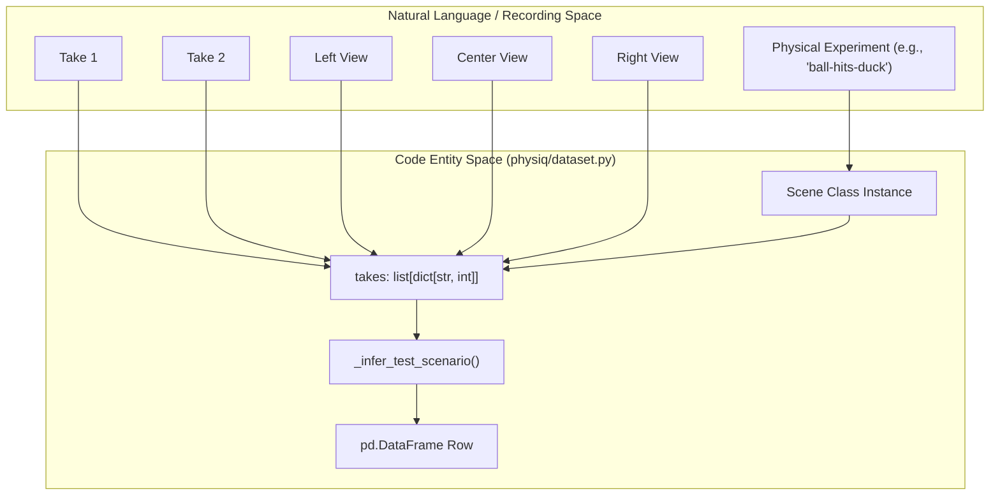
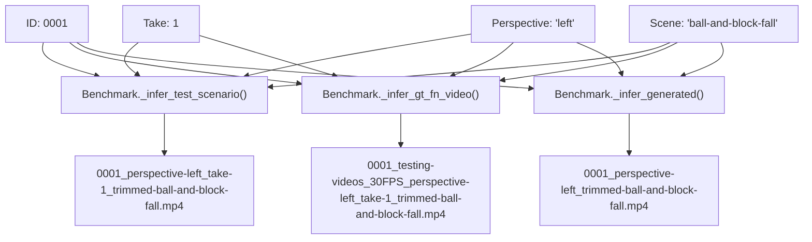

<!-- source: DeepWiki mcp.deepwiki.com · repo google-deepmind/physics-IQ-benchmark · page 2.4 Multi-View and Multi-Take Structure · fetched 2026-10-26 -->

# Multi-View and Multi-Take Structure

Relevant source files

The following files were used as context for generating this wiki page:

- [physiq/dataset.py](physiq/dataset.py)
- [physiq/tests/__init__.py](physiq/tests/__init__.py)

## Purpose and Scope

This document describes the multi-view and multi-take recording strategy used in the Physics-IQ benchmark dataset. Each physical scenario is captured from three camera perspectives (left, center, right) and recorded twice (take-1, take-2), resulting in a total of 396 videos from 66 unique scenarios. This redundant capture strategy enables both robust multi-perspective evaluation and quantification of natural physical variance.

The data model for this structure is implemented in `physiq/dataset.py`, which provides Pydantic-validated classes for managing scenes and their associated perspectives and takes.

---

## Data Model Implementation

The benchmark's structure is programmatically represented using the `Scene` and `Benchmark` classes.

### Scene Data Model
The `Scene` class [physiq/dataset.py:30-56]() represents a single physical scenario. It maps the hierarchical structure of takes and perspectives to unique video IDs.

- **`takes`**: A list of dictionaries where each entry corresponds to a recording session (take). Each dictionary maps perspective names (e.g., "left", "center") to their 4-digit ID [physiq/dataset.py:35]().
- **Metadata Aliases**: The model uses Pydantic aliases to map hyphenated YAML keys (e.g., `subject-action`) to Pythonic attributes [physiq/dataset.py:40-55]().

### Benchmark Orchestrator
The `Benchmark` class [physiq/dataset.py:59-132]() acts as the container for all scenes and provides logic for filename inference and data conversion.

- **`to_dataframe()`**: Flattens the nested structure into a tabular format, generating one row per video while calculating the `scenario` and `generated_video_name` strings [physiq/dataset.py:92-124]().
- **Filename Inference**: Static methods like `_infer_test_scenario` and `_infer_gt_fn_video` centralize the logic for constructing canonical filenames [physiq/dataset.py:69-90]().

**Sources:** [physiq/dataset.py:30-56](), [physiq/dataset.py:59-124]()

---

## Overview of Recording Strategy

The Physics-IQ benchmark employs a **2 × 3 recording matrix** for each of the 66 unique physical scenarios:

| Dimension | Values | Purpose |
|-----------|--------|---------|
| **Takes** | take-1, take-2 | Capture natural physical variation for variance quantification |
| **Perspectives** | left, center, right | Enable multi-view analysis and robustness testing |
| **Total Videos** | 66 scenarios × 2 takes × 3 views = **396 videos** | Comprehensive coverage with built-in variance baseline |

### Mapping Natural Structure to Code Entities

The following diagram bridges the conceptual recording strategy to the `physiq/dataset.py` data structures:

**Sources:** [physiq/dataset.py:30-35](), [physiq/dataset.py:69-74](), [physiq/dataset.py:92-124]()

---

## Filename Inference and Naming Conventions

The benchmark enforces strict naming conventions through the `Benchmark` class static methods. This ensures that generated videos, ground truth videos, and masks can be programmatically associated.

### Implementation Logic
The following diagram shows how `physiq/dataset.py` transforms a `Scene` ID into various file paths used by the evaluation pipeline:

**Key Observation**: The `_infer_generated` method [physiq/dataset.py:89-90]() specifically omits the `take` identifier. This is because models are expected to generate one video per perspective, which is then compared against both ground truth takes during evaluation.

**Sources:** [physiq/dataset.py:69-90]()

---

## Data Integrity and CSV Export

The dataset structure is verified through hash comparison between the YAML source and the legacy CSV format.

### CSV Generation
The `build_original_descriptions` method [physiq/dataset.py:126-129]() exports the data model into a format compatible with the evaluation pipeline's `descriptions.csv` requirements. It selects specific columns: `scenario`, `description`, `category`, and `generated_video_name`.

### Integrity Check
The `__main__` block in `physiq/dataset.py` demonstrates how the system ensures consistency:
1. Loads the benchmark from `data.yaml` [physiq/dataset.py:136]().
2. Generates a DataFrame via `build_original_descriptions()` [physiq/dataset.py:138]().
3. Compares the `joblib.hash` of the generated DataFrame against the existing `descriptions_original.csv` [physiq/dataset.py:144-148]().

**Sources:** [physiq/dataset.py:126-129](), [physiq/dataset.py:135-159]()

---

## Dual-Take Variance Rationale

### Variance as a Normalization Factor
The dual-take design serves a critical purpose in the evaluation methodology: **establishing a baseline for acceptable physical variation**. By recording each scenario twice, the benchmark can compute variance metrics that quantify natural differences.

These variance values are then used to normalize the evaluation of generated videos. A scenario with high natural variance (e.g., fluid dynamics with turbulence) receives more lenient scoring than one with low variance (e.g., a static object).

**Sources:** [physiq/dataset.py:35](), [physiq/dataset.py:112]()

---

## Summary of Structure Representation

| Entity | Code Representation | Location |
|--------|---------------------|----------|
| **Scenario** | `Scene` class | [physiq/dataset.py:30]() |
| **View/Take Mapping** | `Scene.takes` (List of Dicts) | [physiq/dataset.py:35]() |
| **Dataset Registry** | `Benchmark` class | [physiq/dataset.py:59]() |
| **Scenario ID** | `int` (converted to 4-digit string) | [physiq/dataset.py:114]() |
| **YAML Source** | `descriptions/data.yaml` | [physiq/dataset.py:24]() |

**Sources:** [physiq/dataset.py:24-60]()

---

