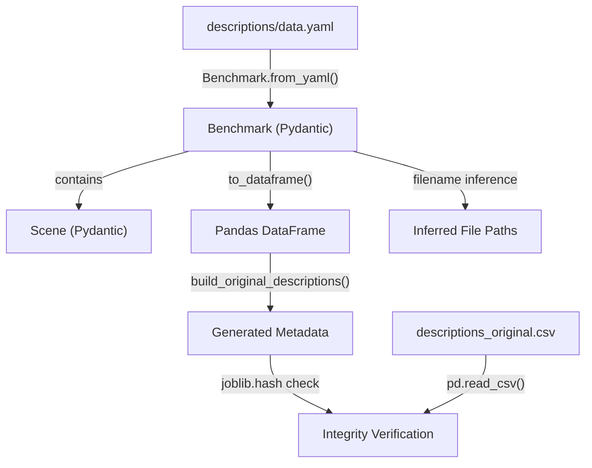

<!-- source: DeepWiki mcp.deepwiki.com · repo google-deepmind/physics-IQ-benchmark · page 2.5 Dataset Metadata and Data Model · fetched 2026-10-26 -->

# Dataset Metadata and Data Model

Relevant source files

The following files were used as context for generating this wiki page:

- [descriptions/data.yaml](descriptions/data.yaml)
- [descriptions/descriptions_original.csv](descriptions/descriptions_original.csv)
- [physiq/aggregate_runs_from_csvs.py](physiq/aggregate_runs_from_csvs.py)
- [physiq/dataset.py](physiq/dataset.py)
- [physiq/plot_settings.py](physiq/plot_settings.py)
- [physiq/tests/__init__.py](physiq/tests/__init__.py)
- [physiq/tests/test_descriptions.py](physiq/tests/test_descriptions.py)

The Physics-IQ benchmark utilizes a structured metadata layer to manage 66 unique physical scenarios across multiple perspectives and takes. This layer bridges raw video files with natural language descriptions and physics categories, providing the programmatic foundation for generation, evaluation, and scoring.

---

## Data Model Architecture

The data model is implemented using Pydantic in `physiq/dataset.py`. It provides a strictly typed representation of the benchmark hierarchy, enabling validation of the source YAML and consistent inference of filenames across the pipeline.

### Scene and Benchmark Models

The `Scene` class represents a single physical experiment (e.g., "ball-and-block-fall"), containing its metadata and the specific IDs assigned to every recording of that experiment. The `Benchmark` class acts as a container for the collection of scenes.

| Class | Role | Key Attributes |
| :--- | :--- | :--- |
| `Scene` | Represents one physical setup | `scene`, `category`, `description`, `takes` |
| `Benchmark` | Collection of all scenes | `scenes: list[Scene]` |

**Sources**: [physiq/dataset.py:29-60]()

### Data Flow Diagram

The following diagram illustrates how raw YAML metadata is transformed into the internal data model and then exported for different pipeline stages.

**Sources**: [physiq/dataset.py:62-66](), [physiq/dataset.py:92-129](), [physiq/dataset.py:135-149]()

---

## Metadata Source: data.yaml

The `descriptions/data.yaml` file is the primary source of truth for the benchmark. It contains rich metadata that is not present in the simplified CSV exports, including specific fields for the prompt templater and annotations for known errors in the original dataset.

### YAML Schema and Pydantic Mapping

The `Scene` model uses Pydantic aliases to map hyphenated YAML keys to valid Python attributes.

| YAML Key | Pydantic Attribute | Purpose |
| :--- | :--- | :--- |
| `description-factual` | `description_factual` | Refined description for Verified benchmark |
| `subject-action` | `subject_action` | Core action for templated prompts |
| `scene-description` | `scene_description` | Background context for templated prompts |
| `takes` | `takes` | List of dicts mapping perspectives to 4-digit IDs |

**Sources**: [physiq/dataset.py:30-55](), [descriptions/data.yaml:1-18]()

### Filename Inference Conventions

The `Benchmark` class provides static methods to ensure consistent filename construction across the codebase. This prevents "magic string" errors when the pipeline needs to locate ground truth videos, masks, or model outputs.

| Method | Target Directory | Format Pattern |
| :--- | :--- | :--- |
| `_infer_test_scenario` | `testing-videos/` | `{id:04}_perspective-{p}_take-{t}_trimmed-{s}.mp4` |
| `_infer_gt_fn_video` | `testing-videos/` (w/ FPS) | `{id:04}_testing-videos_{fps}FPS_perspective-{p}_take-{t}_trimmed-{s}.mp4` |
| `_infer_fn_mask` | `video-masks/` | `{id:04}_video-masks_{fps}FPS_perspective-{p}_take-{t}_trimmed-{s}.mp4` |
| `_infer_generated` | `model_output/` | `{id:04}_perspective-{p}_trimmed-{s}.mp4` |

**Sources**: [physiq/dataset.py:68-90]()

---

## Integrity Verification

To ensure the codebase remains synchronized with the published dataset, `dataset.py` includes an integrity check that compares the dynamically generated metadata against the static `descriptions_original.csv`.

### Verification Logic

1.  **Loading**: The benchmark is loaded from `data.yaml` via `get_benchmark()`.
2.  **Generation**: `build_original_descriptions()` produces a DataFrame containing only the four columns required for the original benchmark: `scenario`, `description`, `category`, and `generated_video_name`.
3.  **Hashing**: `joblib.hash` is used to compare the generated DataFrame against the disk-based CSV.
4.  **Testing**: The `physiq/tests/test_descriptions.py` module uses `pd.testing.assert_frame_equal` to enforce this check during CI.

**Sources**: [physiq/dataset.py:126-148](), [physiq/tests/test_descriptions.py:22-28]()

---

## Entrypoints and Utilities

### get_benchmark()
The primary entrypoint for other modules to access the data model. It resolves the path to `descriptions/data.yaml` relative to the file location.
**Sources**: [physiq/dataset.py:24-26](), [physiq/dataset.py:131-132]()

### Multi-View Mapping
The `to_dataframe()` method flattens the hierarchical YAML structure (Scene -> Takes -> Perspectives) into a tabular format. During this process, it prioritizes `description_factual` over the original `description` if available, supporting the "Verified" variant of the benchmark.
**Sources**: [physiq/dataset.py:92-124]()

### Result Aggregation
The `aggregate_runs_from_csvs.py` script uses the data model's outputs (via `IQTable`) to combine multiple evaluation runs. It supports two score types:
*   **Original**: Uses the standard Physics-IQ scoring formula.
*   **Verified**: Uses the variance-normalized scoring formula.

**Sources**: [physiq/aggregate_runs_from_csvs.py:24-40](), [physiq/aggregate_runs_from_csvs.py:73-78]()

---

## Plotting and Visualization Metadata

Model-specific metadata for plotting (colors and display names) is managed in `physiq/plot_settings.py`. This allows the leaderboard and visualization tools to maintain consistent aesthetics across different models (e.g., Lumiere, VideoPoet, Sora).

**Sources**: [physiq/plot_settings.py:21-32](), [physiq/plot_settings.py:91-100]()

---

