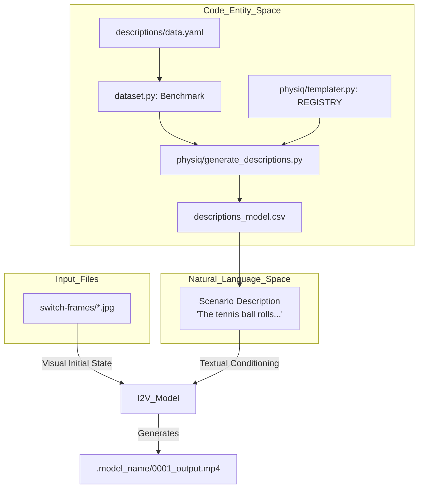
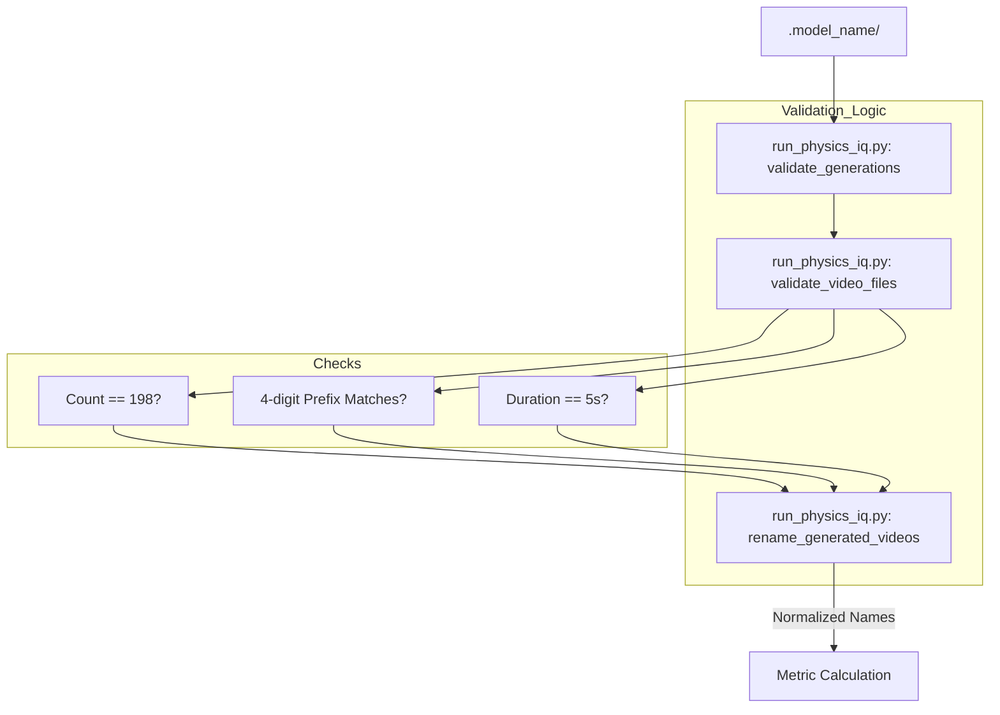

<!-- source: DeepWiki mcp.deepwiki.com · repo google-deepmind/physics-IQ-benchmark · page 3.1 Image-to-Video Models · fetched 2026-10-26 -->

# Image-to-Video Models

<details>
<summary>Relevant source files</summary>

The following files were used as context for generating this wiki page:

- [README.md](README.md)
- [descriptions/best_practice/descriptions_base.csv](descriptions/best_practice/descriptions_base.csv)
- [physiq/generate_descriptions.py](physiq/generate_descriptions.py)

</details>


## Purpose and Scope

This document specifies the input requirements and output format for **image-to-video (i2v) models** being evaluated on the Physics-IQ benchmark. Image-to-video models generate video sequences from a single static image frame, typically conditioned on text descriptions. 

In the Physics-IQ framework, i2v models are tested on their ability to predict physical outcomes (e.g., collisions, fluid flow) starting from a single "switch frame" that captures the state of a scene just before a physical action begins [README.md:79-80]().

For information about multiframe-to-video models that use video segments as input, see [Multiframe-to-Video Models](3.2). For details on how generated videos are evaluated, see [Evaluation Pipeline](4).

**Sources:** [README.md:76-89]()

---

## Input Requirements

Image-to-video models in Physics-IQ consume two types of inputs: a required initial frame and a text description.

### Switch Frames Directory

The primary input for i2v models is a single static image extracted from each physics scenario. These frames are located in the `switch-frames/` directory of the benchmark dataset [README.md:141-144]().

**Directory Structure:**
```
physics-IQ-benchmark/
└── switch-frames/
    ├── 0001_switch-frames_anyFPS_perspective-left_trimmed-ball-and-block-fall.jpg
    ├── 0002_switch-frames_anyFPS_perspective-center_trimmed-ball-and-block-fall.jpg
    ├── 0003_switch-frames_anyFPS_perspective-right_trimmed-ball-and-block-fall.jpg
    └── ...
```

**File Naming Convention:**
Each switch frame filename follows the pattern: `{ID}_switch-frames_anyFPS_{perspective}_{scenario-name}.jpg` [README.md:141-144]().

| Component | Description | Example Values |
|-----------|-------------|----------------|
| `{ID}` | Zero-padded 4-digit unique identifier | `0001`, `0002`, ..., `0198` |
| `switch-frames` | Fixed literal indicating frame type | `switch-frames` |
| `anyFPS` | Frame rate indicator | `anyFPS` |
| `{perspective}` | Camera angle | `perspective-left`, `perspective-center`, `perspective-right` |
| `{scenario-name}` | Descriptive name of physics scenario | `trimmed-ball-and-block-fall` |

**Sources:** [README.md:141-144]()

---

### Text Descriptions and Prompting

Models use text descriptions of the physics scenarios to guide video generation. These descriptions are provided in the `descriptions.csv` metadata file [physiq/generate_descriptions.py:49-60]().

**Prompt Variants:**
The benchmark supports two types of prompts:
1.  **Original Prompts (op):** The baseline descriptions used in the original Physics-IQ release.
2.  **Best Practice Prompts (bpp):** Model-specific prompts generated using the `physiq/generate_descriptions.py` tool. These prompts include a specific subject-action postfix to improve model adherence [physiq/generate_descriptions.py:35-39]().

**Templater System:**
Prompts are generated via the `REGISTRY` pattern in `physiq/generate_descriptions.py` [physiq/generate_descriptions.py:22-29](). Users should select the templater corresponding to their model to generate the appropriate `descriptions_{templater}.csv` file [physiq/generate_descriptions.py:61-65]().

**Sources:** [README.md:60-62](), [physiq/generate_descriptions.py:25-66](), [descriptions/best_practice/descriptions_base.csv:1-15]()

---

## Output Requirements

Generated videos must follow strict naming conventions and format specifications to be processed by the evaluation pipeline.

### Directory Structure and Naming

All generated videos from a single model must be placed in a model-specific directory. The evaluation script `run_physics_iq.py` expects a flat directory of MP4 files [README.md:84-88]().

**File Naming Convention:**
Each generated video filename must preserve the unique 4-digit ID from its corresponding switch frame input:
`{ID}_{custom-suffix}.mp4`

**Requirements:**
- **Must** start with the 4-digit zero-padded ID (e.g., `0001_`) [README.md:156]().
- **Must** use `.mp4` extension.
- **Must** result in exactly 198 videos (66 scenarios × 3 perspectives) [README.md:156]().

**Sources:** [README.md:84-88](), [README.md:154-156]()

---

### Video Duration and Format

**Duration:**
Generated videos **must be exactly 5 seconds long** [README.md:156](). The evaluation pipeline processes only the first 5 seconds. If a model generates longer videos, the `trim_videos.py` utility can be used to enforce the constraint.

**Format:**
- **Container:** MP4.
- **Frame Rate:** Any FPS is accepted; the pipeline uses `fps_changer.py` to normalize generated videos to the ground truth FPS (typically 30 FPS) [README.md:156]().

**Sources:** [README.md:156]()

---

## Data Flow: From Input to Generation

The following diagram bridges the natural language space (prompts) and the code entities used to prepare inputs for i2v models.



**Sources:** [physiq/generate_descriptions.py:25-66](), [dataset.py:20-43](), [README.md:141-144]()

---

## Validation and Integrity

Before evaluation, the system validates the generated outputs to ensure they match the dataset metadata.



**Sources:** [README.md:156](), [run_physics_iq.py: validation logic described in README]()

---

## Leaderboard Performance (i2v)

As of the current benchmark results, i2v models generally underperform compared to multiframe models. The following table highlights top i2v performers on the **Physics-IQ Verified** leaderboard [README.md:43-57]().

| Rank | Model | Physics-IQ Verified Score | Input Type |
|------|-------|---------------------------|------------|
| 3 | Cosmos3-Super-Image2Video | **39.5** ± 0.8 | i2v |
| 4 | Grok Imagine Video | **34.8** ± 0.6 | i2v |
| 5 | Magi-1 24B + GeoPhys (op) | **33.7** ± 1.4 | i2v |
| 6 | Hunyuan Video 1.5 | **33.4** ± 0.8 | i2v |

**Sources:** [README.md:43-57]()

---

