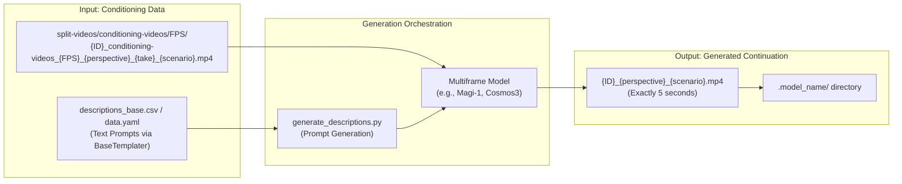
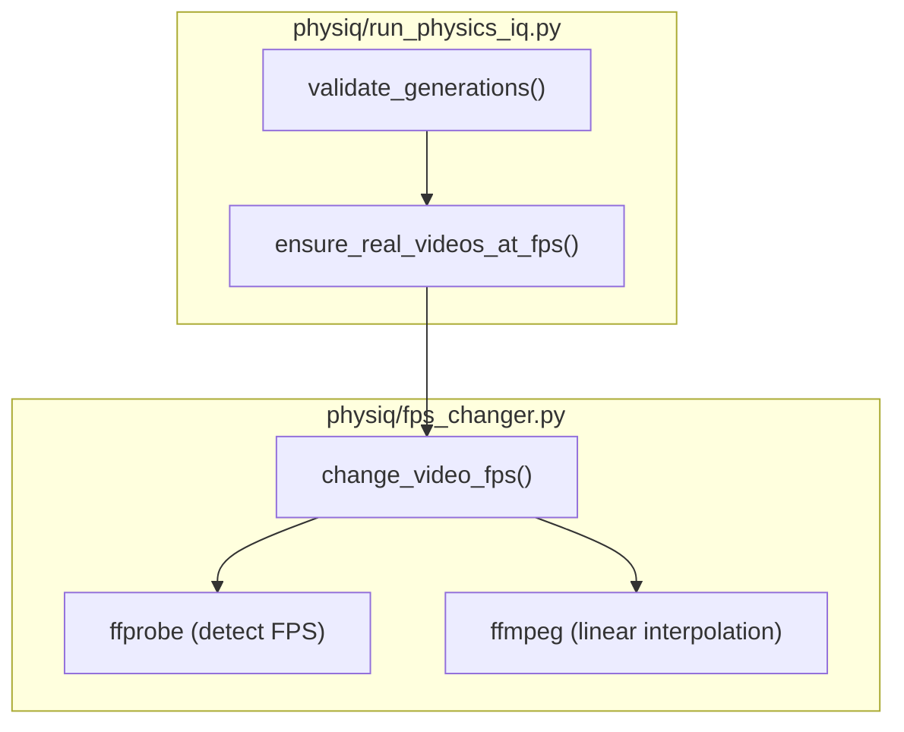

<!-- source: DeepWiki mcp.deepwiki.com · repo google-deepmind/physics-IQ-benchmark · page 3.2 Multiframe-to-Video Models · fetched 2026-10-26 -->

# Multiframe-to-Video Models

<details>
<summary>Relevant source files</summary>

The following files were used as context for generating this wiki page:

- [README.md](README.md)
- [physiq/trim_videos.py](physiq/trim_videos.py)

</details>


**Purpose**: This page specifies the requirements for running multiframe-to-video (also called video-to-video or v2v) models on the Physics-IQ benchmark. It covers input conditioning videos, FPS selection, text descriptions, output formatting, and naming conventions.

For image-to-video model requirements, see [Image-to-Video Models](#3.1). For general output requirements that apply to both model types, see [Output Requirements and Naming Conventions](#3.3).

---

## Overview

Multiframe-to-video models generate future video frames by conditioning on a short video segment that captures initial motion and scene dynamics. In Physics-IQ, these models receive conditioning frames showing the first portion of each physics scenario and must predict the continuation.

**Key Advantage**: Multiframe models significantly outperform image-to-video models on Physics-IQ. The top multiframe model (Magi-1 24B + GeoPhys) achieves **58.2** on Physics-IQ Verified, while the top i2v model (Cosmos3-Super) achieves **39.5** — a substantial gap. This demonstrates that temporal context from conditioning frames provides significant advantages for understanding physical dynamics.

### System Data Flow: Multiframe Generation
The following diagram maps the logical data flow to the specific scripts and data structures used in the Physics-IQ codebase.



**Sources**: [README.md:43-57](), [README.md:92-108]()

---

## Input Requirements

### Conditioning Video Frames

Multiframe models must use conditioning videos from the `split-videos/conditioning-videos/` directory. These videos contain the initial frames of each physics scenario before the key physical event occurs.

**Location Structure**:
```
physics-IQ-benchmark/split-videos/conditioning-videos/{FPS}/
```

**Available Frame Rates**:
- `30FPS` (always available)
- `24FPS` (optional)
- `16FPS` (optional)  
- `8FPS` (optional)

If your desired FPS does not exist, the `download_physics_iq_data.py` script will automatically generate it by downsampling from the 30 FPS version.

**File Naming Pattern**:
```
{ID}_conditioning-videos_{FPS}_{perspective}_{take}_{scenario-name}.mp4
```

**Example Files**:
```
0001_conditioning-videos_30FPS_perspective-left_take-1_trimmed-ball-and-block-fall.mp4
0001_conditioning-videos_30FPS_perspective-center_take-1_trimmed-ball-and-block-fall.mp4
0001_conditioning-videos_30FPS_perspective-right_take-1_trimmed-ball-and-block-fall.mp4
```

**Important Notes**:
- Only **take-1** videos are provided in `conditioning-videos/` (198 total files) [README.md:132-140]().
- Each scenario has 3 perspectives: `perspective-left`, `perspective-center`, `perspective-right` [README.md:20-20]().
- Total count: 66 scenarios × 3 perspectives × 1 take = 198 conditioning videos [README.md:156-156]().
- The conditioning segment duration varies by scenario but is typically the first 1-2 seconds.

**Sources**: [README.md:94-99](), [README.md:132-140]()

---

### Text Descriptions and Prompts

Models may optionally use text descriptions as additional conditioning input. The benchmark provides a templater system to generate model-specific prompts.

**Location**: `descriptions_base.csv` or `physiq/descriptions/data.yaml`.

**Prompt Generation**:
The script `generate_descriptions.py` uses the `BaseTemplater` class and model-specific subclasses (e.g., `HunyuanVideoTemplater` in `physiq/physiq_verified.py`) to generate "Best Practice Prompts" (`bpp`).

**Usage**:
```bash
python physiq/generate_descriptions.py --model_name your_model --output_file prompts.csv
```

**Relevant Columns in Output**:
- `unique_id`: Video identifier (0001-0198)
- `description`: The generated text prompt for the model.
- `generated_video_name`: The required filename for the output video.

**Sources**: [README.md:60-60](), [README.md:153-153](), [physiq/physiq_verified.py:34-40]()

---

## Output Requirements

### Directory Structure and Duration

Generated videos must be saved in a model-specific directory. The evaluation pipeline `run_physics_iq.py` expects exactly 198 videos, each exactly 5 seconds long.

**Requirement Summary**:
- **Format**: MP4 (H.264/AVC1 codec recommended).
- **Duration**: Exactly 5 seconds. Use `physiq/trim_videos.py` to enforce this if your model produces variable lengths [physiq/trim_videos.py:22-31]().
- **Resolution**: Typically 3840x2160 or downscaled, but must be consistent.
- **Naming**: Directory must be `.model_name/`.

**Sources**: [README.md:102-107](), [README.md:156-156](), [physiq/trim_videos.py:52-53]()

---

### Naming Conventions

Output filenames must follow the strict pattern defined in the benchmark metadata. This is validated by `validate_video_files` in `run_physics_iq.py`.

**Pattern**:
```
{ID}_{perspective}_{scenario-name}.mp4
```

**Mapping Table**:

| Input Component | Output Component | Example |
| :--- | :--- | :--- |
| ID | 4-digit ID | `0001` |
| Perspective | perspective-name | `perspective-left` |
| Scenario | scenario-slug | `trimmed-ball-and-block-fall` |

**Final Example**: `0001_perspective-left_trimmed-ball-and-block-fall.mp4`

**Sources**: [README.md:104-107](), [physiq/run_physics_iq.py:105-120]()

---

## The 3-Second Removal Requirement

For **Multiframe/V2V** evaluation, it is critical to understand how the generated video is processed. The conditioning video segment provided as input is **not** part of the evaluation.

1.  The model receives a conditioning segment (e.g., 2 seconds).
2.  The model generates a 5-second continuation.
3.  The benchmark evaluation script `run_physics_iq.py` compares the **entire 5-second generated file** against the corresponding 5-second segment of the ground truth (Testing Videos).

**Note**: Do not prepend the conditioning frames to your output file. The output file should be the 5-second prediction starting immediately after the conditioning segment.

**Sources**: [README.md:102-108](), [README.md:132-140]()

---

## FPS Handling and Normalization

Your generated videos should ideally match the FPS of the conditioning input. If there is a mismatch, the evaluation pipeline uses `physiq/fps_changer.py` to normalize the frame rates.

### Code Entity Space: FPS Normalization Logic
This diagram shows how the system handles FPS discrepancies between generated videos and ground truth.



**Key Functions**:
- `change_video_fps`: Uses `ffmpeg` with `minterpolate` or simple dropped/duplicated frames to match the target FPS [physiq/fps_changer.py:23-45]().
- `ensure_real_videos_at_fps`: Orchestrates the conversion of ground truth videos to match the model's output FPS [physiq/run_physics_iq.py:210-230]().

**Sources**: [physiq/fps_changer.py:23-80](), [physiq/run_physics_iq.py:210-235]()

---

## Validation Checklist

Before submitting or running evaluation, ensure:

1.  **Count**: Exactly 198 videos are present in the `.model_name/` folder [README.md:156-156]().
2.  **Duration**: Each video is exactly 5.0 seconds (use `trim_videos.py` if necessary) [physiq/trim_videos.py:52-53]().
3.  **Naming**: Filenames start with the 4-digit ID (e.g., `0001_...`) [README.md:104-107]().
4.  **Content**: The video contains the physical continuation of the conditioning segment, not the conditioning segment itself.
5.  **Metadata**: You have a `descriptions.csv` file generated by `generate_descriptions.py` that matches your output filenames.

**Sources**: [README.md:156-156](), [physiq/run_physics_iq.py:105-120](), [physiq/trim_videos.py:22-31]()

---

