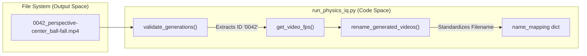
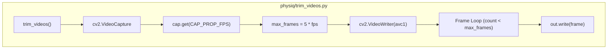

<!-- source: DeepWiki mcp.deepwiki.com · repo google-deepmind/physics-IQ-benchmark · page 3.3 Output Requirements and Naming Conventions · fetched 2026-10-26 -->

# Output Requirements and Naming Conventions

<details>
<summary>Relevant source files</summary>

The following files were used as context for generating this wiki page:

- [README.md](README.md)
- [generated_videos_5s/.gitkeep](generated_videos_5s/.gitkeep)
- [generated_videos_5s/README.md](generated_videos_5s/README.md)
- [physiq/trim_videos.py](physiq/trim_videos.py)

</details>


This page specifies the exact output format, naming conventions, directory structure, and validation requirements that generated videos must satisfy for Physics-IQ benchmark evaluation. These requirements ensure consistent processing across all models and enable automated metric computation.

For information about input data and conditioning frames, see [Image-to-Video Models](#3.1) and [Multiframe-to-Video Models](#3.2). For the evaluation process that validates these outputs, see [Validation and Setup](#4.2).

---

## Overview

All generative video models must produce outputs that conform to strict specifications:

- **Exactly 198 videos** corresponding to the 198 test cases (66 scenarios × 3 perspectives, excluding take-2).
- **Exactly 5 seconds duration** for each video.
- **MP4 file format** with consistent encoding.
- **Specific naming conventions** that preserve scenario ID prefixes.
- **Organized directory structure** following the `<model_name>-<prompt_setting>-run_01` pattern.

These requirements enable the evaluation pipeline in `run_physics_iq.py` to automatically process, validate, and score model outputs without manual intervention.

Sources: [README.md:43-57](), [generated_videos_5s/README.md:5-9](), [physiq/trim_videos.py:22-25]()

---

## File Naming Conventions

### 4-Digit Zero-Padded Prefix
Every generated video must begin with a 4-digit zero-padded identifier from `0001` to `0198`. This prefix is mandatory for the internal mapping logic to associate the generated file with the correct ground truth scenario and perspective metadata.

### Image-to-Video Models
Image-to-video models must use the following naming pattern:
`{ID}_{anything-you-like}.mp4`

**Components:**
- `{ID}`: 4-digit zero-padded identifier from `0001` to `0198`.
- `_`: Underscore separator (required).
- `{anything-you-like}`: Arbitrary string describing the model or scenario.
- `.mp4`: File extension (required).

### Multiframe-to-Video Models
Multiframe models must follow a more specific naming convention that preserves perspective and scenario information:
`{ID}_{perspective}_{scenario_name}.mp4`

**Components:**
- `{ID}`: 4-digit zero-padded identifier (0001-0198).
- `{perspective}`: Camera view - one of: `perspective-left`, `perspective-center`, `perspective-right`.
- `{scenario_name}`: Descriptive scenario name (e.g., `trimmed-ball-and-block-fall`).

Sources: [README.md:78-88](), [README.md:94-107]()

---

## Duration Requirements and Enforcement

### The 5-Second Constraint
**Critical Requirement:** All generated videos must be exactly **5.0 seconds** in duration. The evaluation pipeline only processes the first 5 seconds of each video, corresponding to the continuation of the conditioning frames.

### Using `trim_videos.py`
To assist developers in meeting this requirement, the codebase provides `physiq/trim_videos.py`. This utility automates the trimming process for an entire directory of generated videos.

**Implementation Details:**
- **Function:** `trim_videos(input_folder, output_folder)` [physiq/trim_videos.py:22-29]().
- **Logic:** It calculates the required frame count based on the video's FPS (`max_frames = int(5 * fps)`) [physiq/trim_videos.py:52-52]().
- **Codec:** It enforces the `avc1` (H.264) codec [physiq/trim_videos.py:57-57]().
- **Dimension Safety:** It ensures even dimensions (width/height) to maintain H.264 compatibility [physiq/trim_videos.py:49-50]().

**Execution:**
```bash
python3 physiq/trim_videos.py --input_folder ./raw_outputs --output_folder ./generated_videos_5s/my-model-run_01
```

Sources: [physiq/trim_videos.py:22-79](), [generated_videos_5s/README.md:1-11]()

---

## Directory Structure

Generated videos must be placed in a model-specific directory within the `generated_videos_5s` root. The structure follows a hierarchy that includes the model name and the specific run identifier.

### Output Folder Organization
```text
generated_videos_5s/
└── <model_name>-<prompt_setting>-run_01/
    ├── 0001_{...}.mp4
    ├── 0002_{...}.mp4
    ├── ...
    └── 0198_{...}.mp4
```

The directory name becomes the model identifier used in evaluation results and leaderboard plots.

Sources: [generated_videos_5s/README.md:5-11]()

---

## Data Flow: From Generation to Validation

The following diagrams bridge the gap between the file system (Output Space) and the evaluation code (Code Entity Space).

### File-to-Code Entity Mapping
This diagram shows how the file naming convention is consumed by the evaluation script `run_physics_iq.py`.


Sources: [physiq/trim_videos.py:33-40](), [generated_videos_5s/README.md:8-11]()

### Video Trimming Logic
This diagram details the implementation flow within `trim_videos.py`.


Sources: [physiq/trim_videos.py:44-68]()

---

## File Format and Compatibility

### Video Codec and Container
- **Required Format:** MP4 container (`.mp4` extension).
- **Codec:** While the pipeline uses `cv2.VideoCapture`, `avc1` (H.264) is the standard enforced by the trimming utility [physiq/trim_videos.py:57-57]().
- **Resolution:** Any resolution is accepted, but even-numbered dimensions are required for H.264 compatibility [physiq/trim_videos.py:49-50]().

### Frame Rate (FPS) Consistency
All 198 videos within a single run folder must have the **same frame rate**. The pipeline detects the FPS of the first video and expects all subsequent videos in that folder to match. If you generate at 24 FPS, all 198 files must be 24 FPS.

Sources: [physiq/trim_videos.py:45-58](), [generated_videos_5s/README.md:8-11]()

---

