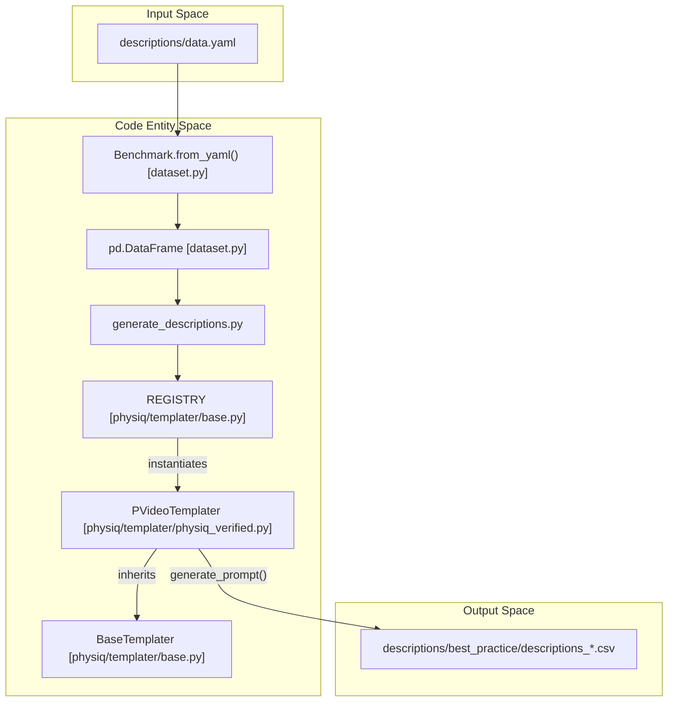

<!-- source: DeepWiki mcp.deepwiki.com · repo google-deepmind/physics-IQ-benchmark · page 3.4 Prompt Generation (Templater System) · fetched 2026-10-26 -->

# Prompt Generation (Templater System)

Relevant source files

The following files were used as context for generating this wiki page:

- [descriptions/best_practice/descriptions_base.csv](descriptions/best_practice/descriptions_base.csv)
- [physiq/generate_descriptions.py](physiq/generate_descriptions.py)
- [physiq/templater/__init__.py](physiq/templater/__init__.py)
- [physiq/templater/base.py](physiq/templater/base.py)
- [physiq/templater/physiq_verified.py](physiq/templater/physiq_verified.py)

The Physics-IQ benchmark utilizes a pluggable **Templater System** to generate text descriptions for video generation models. This system ensures that prompts are consistent across different physics scenarios while allowing for model-specific formatting requirements. The system supports "Best-Practice Prompts" (BPP), which are structured to provide optimal guidance to generative models, as well as "Original Prompts" (OP) for legacy comparisons.

### System Overview

The core of the prompt generation logic resides in the `physiq.templater` package. It uses a **Registry Pattern** to manage different templating strategies. The primary entry point for generating these prompts is the `generate_descriptions.py` script.

#### Data Flow: Prompt Generation

**Sources:**
- [physiq/generate_descriptions.py:25-66]()
- [physiq/templater/base.py:20-32]()
- [physiq/templater/physiq_verified.py:19-27]()

---

### The Templater Registry

The system uses a decorator-based registry to map string identifiers (e.g., `"pvideo"`, `"sora2"`) to specific class implementations.

*   **`REGISTRY`**: A dictionary defined in `physiq/templater/base.py` that stores the mapping of names to `BaseTemplater` subclasses [[physiq/templater/base.py:20]]().
*   **`@register(name)`**: A decorator function used to add new templaters to the system [[physiq/templater/base.py:23-28]]().

### BaseTemplater Class

The `BaseTemplater` serves as the foundation for all prompt generation logic. It defines the standard components of a Physics-IQ prompt:

| Property / Method | Description | Source |
| :--- | :--- | :--- |
| `camera_description` | Defines a static, locked-off camera shot. | [[physiq/templater/base.py:51-53]]() |
| `style_description` | Sets the tone as a realistic scientific demonstration. | [[physiq/templater/base.py:55-57]]() |
| `action_description` | Constraints the scene to only the described setup. | [[physiq/templater/base.py:59-61]]() |
| `get_subjectaction_description` | Combines the core action with an optional postfix. | [[physiq/templater/base.py:94-111]]() |
| `generate_prompt` | The default assembly logic for the final text string. | [[physiq/templater/base.py:128-147]]() |

**Sources:**
- [physiq/templater/base.py:32-147]()

---

### Model-Specific Implementations

Different video generation models respond better to specific prompt structures. The `physiq_verified.py` file contains specialized templaters for the Verified benchmark.

#### P-Video Templater (`pvideo`)
Implements the "subject, action, scene, camera, lighting, style, audio" guideline. It merges the scene setup and scene description into a single block [[physiq/templater/physiq_verified.py:20-51]]().

#### Sora Templater (`sora2`)
Follows the official Sora prompting guide, using specific headers for `Style:`, `Cinematography:`, and `Actions:` [[physiq/templater/physiq_verified.py:54-88]]().

**Sources:**
- [physiq/templater/physiq_verified.py:19-88]()

---

### Execution and Configuration

The `generate_descriptions.py` script orchestrates the generation process. It loads the benchmark metadata via `Benchmark.from_yaml(DESCRIPTIONS_PATH)` [[physiq/generate_descriptions.py:42]]() and iterates through every scenario to apply the selected templater.

#### Key CLI Arguments:
*   **`templater`**: Positional argument to select the registered templater [[physiq/generate_descriptions.py:29]]().
*   **`--no-action-suffix`**: Disables the appending of the `subject_action_postfix` [[physiq/generate_descriptions.py:36-39]](). Note: This should **not** be used for verified evaluations, as the suffix often contains critical physical context.
*   **`--output-dir`**: Specifies where the resulting CSV will be saved (defaulting to `descriptions/best_practice`) [[physiq/generate_descriptions.py:31-34]]().

#### Internal Mapping to CSV
The script produces a CSV file with the following columns required by the evaluation pipeline:
1.  `scenario`: The unique identifier for the video take.
2.  `description`: The fully rendered prompt string.
3.  `category`: The physics domain (e.g., Solid Mechanics).
4.  `generated_video_name`: The expected filename for the model's output.

**Sources:**
- [physiq/generate_descriptions.py:45-66]()
- [descriptions/best_practice/descriptions_base.csv:1-15]()

### Implementation Detail: Subject-Action Postfix

The `BaseTemplater` includes logic to handle the `subject_action_postfix`. If `use_action_suffix` is True (default), the templater fetches the postfix from the data source and appends it to the primary action description [[physiq/templater/base.py:104-110]](). This is critical for scenarios where the primary action (e.g., "The ball rolls") needs specific physical context (e.g., "and hits the duck") to be correctly generated.

**Sources:**
- [physiq/templater/base.py:94-111]()

---

