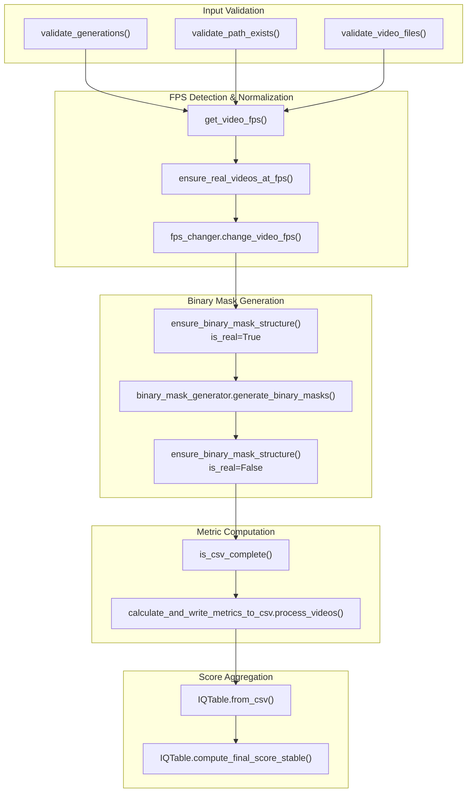

<!-- source: DeepWiki mcp.deepwiki.com · repo google-deepmind/physics-IQ-benchmark · page 4 Evaluation Pipeline · fetched 2026-10-26 -->

# Evaluation Pipeline

Relevant source files

The following files were used as context for generating this wiki page:

- [physiq/calculate_and_write_metrics_to_csv.py](physiq/calculate_and_write_metrics_to_csv.py)
- [physiq/run_physics_iq.py](physiq/run_physics_iq.py)

The evaluation pipeline is the core system for processing generated videos and computing Physics-IQ scores. Implemented in `physiq/run_physics_iq.py` [physiq/run_physics_iq.py:1-432](), it orchestrates FPS normalization, binary mask generation, metric calculation, and score aggregation. This document describes the pipeline's architecture, validation mechanisms, and execution flow.

For details on the specific metrics computed, see [Metric Calculation](#4.5). For information on generating videos to feed into this pipeline, see [Video Generation](#3). For the raw metric calculation algorithms, see [API Reference](#7).

---

## Pipeline Overview

The evaluation pipeline operates as a sequential workflow that transforms generated videos and ground truth data into quantitative Physics-IQ scores. It bridges the gap between raw video files and structured metric data.

### Natural Language to Code Entity Space

| System Component | Code Entity (File/Class/Function) | Role |
| :--- | :--- | :--- |
| **Input Validation** | `validate_generations` [physiq/run_physics_iq.py:168-202]() | Enforces 198 videos and 5s duration. |
| **FPS Matcher** | `ensure_real_videos_at_fps` [physiq/run_physics_iq.py:272-312]() | Orchestrates `fps_changer.py` to match real data to model FPS. |
| **Mask Manager** | `ensure_binary_mask_structure` [physiq/run_physics_iq.py:315-343]() | Caches and manages `binary_mask_generator.py` outputs. |
| **Metric Engine** | `process_videos` [physiq/calculate_and_write_metrics_to_csv.py:260-353]() | Parallel frame-by-frame comparison logic. |
| **Score Aggregator** | `IQTable` [physiq/calculate_iq_score_stable.py:38-344]() | Aggregates per-scenario metrics into final IQ scores. |

**Sources:** [physiq/run_physics_iq.py:1-432](), [physiq/calculate_and_write_metrics_to_csv.py:1-353](), [physiq/calculate_iq_score_stable.py:38-344]()

### Pipeline Execution Flow

**Sources:** [physiq/run_physics_iq.py:346-432](), [physiq/calculate_and_write_metrics_to_csv.py:260-353]()

---

## Child Pages

For detailed documentation on each stage, refer to the following pages:

### [Running Evaluation](#4.1)
Step-by-step instructions for executing `run_physics_iq.py`. Covers CLI arguments like `--input_folders`, `--output_folder`, and the `--original_physics_iq` flag for legacy scoring. Details the expected directory structure and output locations for CSV and JSON metrics.
**Sources:** [physiq/run_physics_iq.py:346-372]()

### [Validation and Setup](#4.2)
Explains the rigorous validation logic in `validate_generations` [physiq/run_physics_iq.py:168-202]() and `validate_video_files` [physiq/run_physics_iq.py:203-235](). Covers the 198-video requirement, 5-second duration enforcement via `ffprobe`, and the `rename_generated_videos` [physiq/run_physics_iq.py:71-103]() logic that maps 4-digit prefixes to canonical filenames.
**Sources:** [physiq/run_physics_iq.py:71-235]()

### [FPS Normalization](#4.3)
Describes how the system handles varying model frame rates. Details `get_video_fps` [physiq/run_physics_iq.py:237-269]() for detection and the orchestration of `fps_changer.py` to ensure ground truth videos are interpolated to match the model's output frequency.
**Sources:** [physiq/run_physics_iq.py:272-312](), [physiq/fps_changer.py:1-117]()

### [Binary Mask Generation](#4.4)
Explains the adaptive background subtraction technique (MOG2) used in `binary_mask_generator.py` to isolate moving objects. Describes the `ensure_binary_mask_structure` [physiq/run_physics_iq.py:315-343]() caching layer that stores masks in a dedicated hierarchy to avoid redundant computation.
**Sources:** [physiq/run_physics_iq.py:315-343](), [physiq/binary_mask_generator.py:1-150]()

### [Metric Calculation](#4.5)
Details the frame-by-frame computation process in `calculate_and_write_metrics_to_csv.py` [physiq/calculate_and_write_metrics_to_csv.py:260-353](). Explains how the pipeline compares generated videos to ground truth across Spatial IoU, Spatiotemporal IoU, Weighted Spatial IoU, and MSE dimensions.
**Sources:** [physiq/calculate_and_write_metrics_to_csv.py:118-257]()

### [Score Aggregation](#4.6)
Describes the final stage where raw metrics are converted into a single Physics-IQ score. Covers the `IQTable` class [physiq/calculate_iq_score_stable.py:38-344]() and the logic in `aggregate_runs_from_csvs.py` for producing Verified Scores across multiple views and takes.
**Sources:** [physiq/calculate_iq_score_stable.py:214-257](), [physiq/aggregate_runs_from_csvs.py:1-113]()

---

