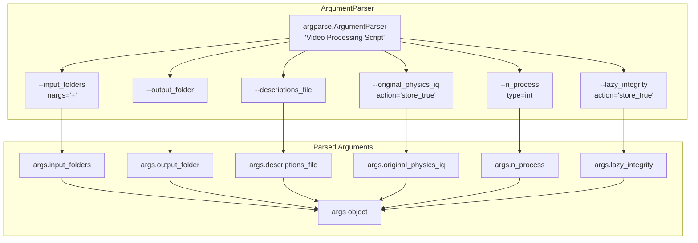
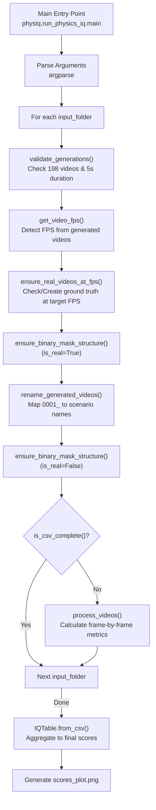

<!-- source: DeepWiki mcp.deepwiki.com · repo google-deepmind/physics-IQ-benchmark · page 4.1 Running Evaluation · fetched 2026-10-26 -->

# Running Evaluation

<details>
<summary>Relevant source files</summary>

The following files were used as context for generating this wiki page:

- [physiq/run_physics_iq.py](physiq/run_physics_iq.py)

</details>


This page provides step-by-step instructions for executing the Physics-IQ evaluation pipeline using `run_physics_iq.py`. It covers command-line arguments, directory structure requirements, and output locations. For detailed information about specific pipeline stages, see [Validation and Setup](#4.2), [FPS Normalization](#4.3), [Binary Mask Generation](#4.4), [Metric Calculation](#4.5), and [Score Aggregation](#4.6).

## Prerequisites

### Installation

Install required Python packages using the provided `pyproject.toml` or `requirements.txt`:

```bash
pip install .
```

**Sources:** [pyproject.toml:1-55]()

### Dataset Placement

The Physics-IQ benchmark dataset must be downloaded and placed in the working directory. The dataset must include at minimum 30FPS videos, as other frame rates can be automatically generated if needed.

**Required dataset structure:**

```
physics-IQ-benchmark/
├── split-videos/
│   ├── conditioning-videos/
│   │   └── 30FPS/
│   └── testing-videos/
│       └── 30FPS/
├── switch-frames/
└── video-masks/
    └── real/
        └── 30FPS/
```

The `descriptions.csv` metadata file must also be accessible. By default, the script looks for `descriptions_original.csv` if the `--original_physics_iq` flag is used.

**Sources:** [physiq/run_physics_iq.py:203-233](), [physiq/run_physics_iq.py:388-393]()

### Generated Videos Placement

Generated videos from your model must be organized in a dedicated directory following the naming convention:

```
./model_name/
├── 0001_{anything}.mp4
├── 0002_{anything}.mp4
├── ...
└── 0198_{anything}.mp4
```

**Critical Requirements:**
- Exactly **198 videos** must be present (one per test case) [physiq/run_physics_iq.py:168-181]()
- Each video must be exactly **5 seconds** long [physiq/run_physics_iq.py:193-199]()
- Filenames must start with 4-digit zero-padded IDs from `0001_` to `0198_` [physiq/run_physics_iq.py:183-189]()
- Only `.mp4` format is supported [physiq/run_physics_iq.py:101-102]()

**Sources:** [physiq/run_physics_iq.py:101-199]()

## Command-Line Usage

### Basic Command

```bash
python3 physiq/run_physics_iq.py \
  --input_folders <generated_videos_dir1> \
  --output_folder <output_dir> \
  --descriptions_file <path_to_descriptions.csv>
```

### Command-Line Arguments

| Argument | Type | Default | Description |
|----------|------|---------|-------------|
| `--input_folders` | `str` (list) | **Required** | Paths to directories containing generated videos. |
| `--output_folder` | `str` | **Required** | Path to directory where output CSV files and JSON metrics will be saved. |
| `--descriptions_file` | `str` | **Required** | Path to the `descriptions.csv` file containing scenario metadata. |
| `--original_physics_iq` | `bool` | `False` | If set, uses the original Physics-IQ scoring logic instead of the "Stable" (Verified) version. |
| `--n_process` | `int` | `1` | Number of parallel processes for metric calculation. |
| `--lazy_integrity` | `bool` | `False` | Skips expensive hash-based integrity checks for the dataset. |

**Sources:** [physiq/run_physics_iq.py:346-371]()

### Argument Parser Implementation



**Sources:** [physiq/run_physics_iq.py:346-371]()

## Execution Flow

The `run_physics_iq.py` script orchestrates the following flow:



**Sources:** [physiq/run_physics_iq.py:373-432]()

### Key Pipeline Components

The script integrates multiple specialized modules:

| Component | Code Entity | Role |
|----------|-------------|------|
| **FPS Sync** | `change_video_fps` | Normalizes ground truth to match model output FPS. [physiq/fps_changer.py:27-29]() |
| **Masking** | `generate_binary_masks` | Isolates moving objects via background subtraction. [physiq/binary_mask_generator.py:108-111]() |
| **Metrics** | `process_videos` | Computes IoU and MSE values across takes/views. [physiq/calculate_and_write_metrics_to_csv.py:252-254]() |
| **Scoring** | `IQTable` | Aggregates metrics and applies variance normalization. [physiq/calculate_iq_score_stable.py:31-33]() |

**Sources:** [physiq/run_physics_iq.py:28-32]()

## Output Locations

After execution, the results are organized in the specified `--output_folder`:

### 1. Metrics CSV and JSON
For each input folder, a CSV containing raw scenario metrics is created in `<output_folder>/results/`. Additionally, an `iq_score.json` file is saved containing the final aggregated scores.

**Sources:** [physiq/run_physics_iq.py:417-425](), [physiq/calculate_iq_score_stable.py:218-228]()

### 2. Comparative Visualizations
If multiple folders are processed, the script generates `scores_plot.png` in the results directory, mapping model names to colors defined in `plot_settings.py`.

**Sources:** [physiq/run_physics_iq.py:427-432](), [physiq/plot_settings.py:19-54]()

### 3. Intermediate Assets
- **Normalized Videos**: Stored in `physics-IQ-benchmark/split-videos/testing-videos/{FPS}FPS/`.
- **Binary Masks**: Stored in `physics-IQ-benchmark/video-masks/real/{FPS}FPS/` and `.../generated/{model_name}/{FPS}FPS/`.

**Sources:** [physiq/run_physics_iq.py:203-233](), [physiq/run_physics_iq.py:272-311]()

## Key Functions

### `validate_generations`
[physiq/run_physics_iq.py:168-202]()
Ensures the input folder contains exactly 198 videos, each starting with the correct 4-digit prefix and having a duration of exactly 5 seconds (verified via `ffprobe`).

### `rename_generated_videos`
[physiq/run_physics_iq.py:71-103]()
Standardizes generated filenames by mapping the 4-digit prefix to the ground truth scenario name (e.g., `0001_...mp4` becomes `0001_perspective-center_trimmed-lit-candle.mp4`).

### `is_csv_complete`
[physiq/run_physics_iq.py:36-68]()
Checks if a results CSV already exists and contains all required scenarios. If true, the script skips metric calculation for that folder, enabling easy resumption of interrupted runs.

**Sources:** [physiq/run_physics_iq.py:36-202]()

---

