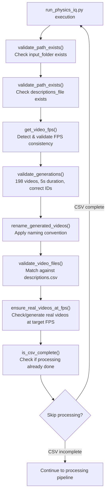
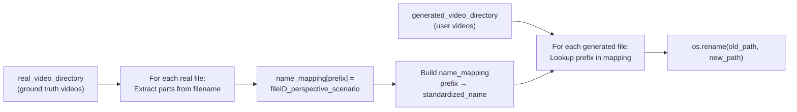
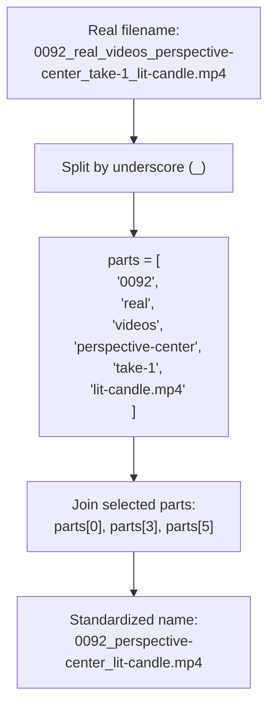
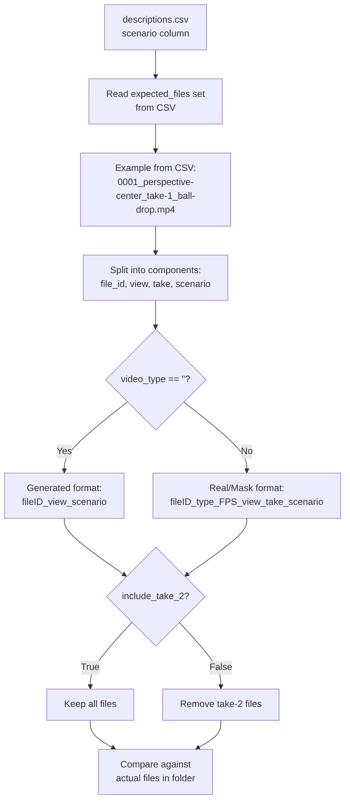
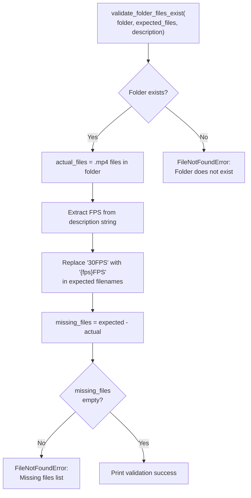
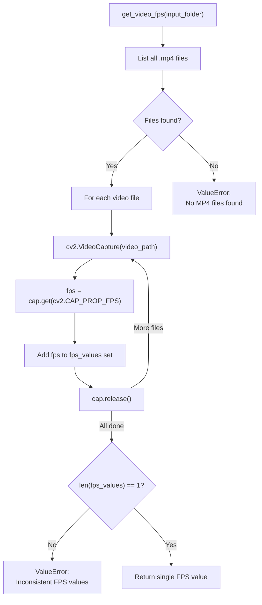
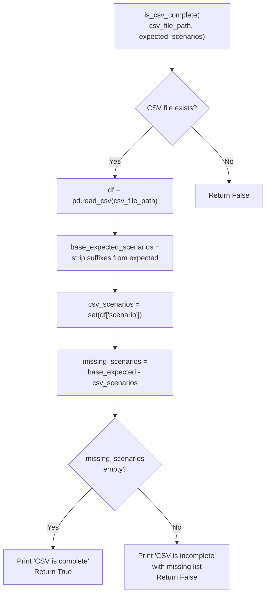
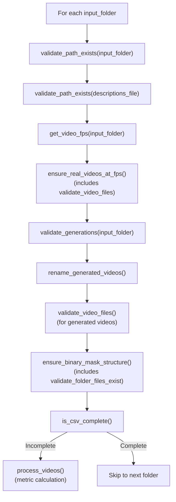

<!-- source: DeepWiki mcp.deepwiki.com · repo google-deepmind/physics-IQ-benchmark · page 4.2 Validation and Setup · fetched 2026-10-26 -->

# Validation and Setup

<details>
<summary>Relevant source files</summary>

The following files were used as context for generating this wiki page:

- [physiq/run_physics_iq.py](physiq/run_physics_iq.py)
- [physiq/tests/test_submit.py](physiq/tests/test_submit.py)

</details>


## Purpose and Scope

This page documents the validation and setup procedures that `run_physics_iq.py` performs before executing the evaluation pipeline. These validation steps ensure that generated videos meet benchmark requirements—specifically the 198-video count, 5-second duration, and 4-digit prefix naming convention—and that all necessary files exist in the correct structure. The validation phase occurs immediately after command-line argument parsing and before any processing begins.

For information about executing the evaluation pipeline after validation succeeds, see [Running Evaluation](#4.1). For details on the processing steps that follow validation, see [FPS Normalization](#4.3), [Binary Mask Generation](#4.4), and [Metric Calculation](#4.5).

---

## Validation Workflow

The validation process follows a strict sequence to verify data integrity before processing. The system validates generated videos first, then checks file structure consistency, and finally confirms CSV completeness to enable resumable processing.

**Validation Sequence Diagram**



**Sources:** [physiq/run_physics_iq.py:382-466]()

---

## Generated Video Validation

The `validate_generations()` function enforces strict requirements on the input video set. This validation occurs in [physiq/run_physics_iq.py:168-201]() and is called both directly and within the `rename_generated_videos()` function.

### Requirements Enforced

| Requirement | Value | Validation Method |
|-------------|-------|-------------------|
| Number of videos | 198 | Directory file count |
| Video duration | 5.0 seconds (±0.001s tolerance) | `ffprobe` duration query |
| Filename prefix | `0001_` through `0198_` | Sequential ID checking |
| File extension | `.mp4` | Extension filtering |

### Validation Algorithm

```mermaid
graph TD
    START["validate_generations(input_folder)"]
    
    CHECK_EXISTS["Assert folder exists and is directory"]
    
    LIST_FILES["files_in_folder = sorted .mp4 files"]
    
    CHECK_COUNT{len(files) == 198?}
    
    ITERATE["For each file (counter 1-198)"]
    
    CHECK_PREFIX{"Starts with<br/>{:04d}_?"}
    
    GET_DURATION["get_video_duration(video_path)<br/>using ffprobe"]
    
    CHECK_DURATION{"Duration ≈ 5.0s<br/>(±0.001s)?"}
    
    INCREMENT["counter += 1"]
    
    SUCCESS["Validation passed"]
    
    ERROR_COUNT["AssertionError:<br/>Wrong number of videos"]
    ERROR_PREFIX["AssertionError:<br/>Wrong video ID prefix"]
    ERROR_DURATION["AssertionError:<br/>Wrong video duration"]
    
    START --> CHECK_EXISTS
    CHECK_EXISTS --> LIST_FILES
    LIST_FILES --> CHECK_COUNT
    CHECK_COUNT -->|No| ERROR_COUNT
    CHECK_COUNT -->|Yes| ITERATE
    ITERATE --> CHECK_PREFIX
    CHECK_PREFIX -->|No| ERROR_PREFIX
    CHECK_PREFIX -->|Yes| GET_DURATION
    GET_DURATION --> CHECK_DURATION
    CHECK_DURATION -->|No| ERROR_DURATION
    CHECK_DURATION -->|Yes| INCREMENT
    INCREMENT -->|More files| CHECK_PREFIX
    INCREMENT -->|All done| SUCCESS
```

The duration check uses `ffprobe` via `subprocess` execution to query video metadata without loading the entire video into memory. The implementation is at [physiq/run_physics_iq.py:149-165]().

**Sources:** [physiq/run_physics_iq.py:168-201](), [physiq/run_physics_iq.py:149-165]()

---

## Video File Naming and Renaming

Generated videos must follow a specific naming convention to match ground truth videos. The `rename_generated_videos()` function transforms user-provided filenames into the standardized format.

### Naming Convention Transformation

**Before Renaming (User-provided format):**
```
0001_<arbitrary_name>.mp4
0002_<arbitrary_name>.mp4
...
0198_<arbitrary_name>.mp4
```

**After Renaming (Benchmark format):**
```
0001_perspective-center_<scenario-name>.mp4
0002_perspective-center_<scenario-name>.mp4
...
0198_perspective-center_<scenario-name>.mp4
```

### Renaming Process



The function extracts three components from real video filenames and reconstructs the standardized name:

**Filename Parsing Logic**



The implementation at [physiq/run_physics_iq.py:71-103]() uses a fixed prefix length of 4 characters to create the mapping dictionary, then iterates through generated videos to perform renaming.

**Sources:** [physiq/run_physics_iq.py:71-103]()

---

## File Structure Validation

The `validate_video_files()` function ensures that all expected videos exist by cross-referencing with `descriptions.csv`. This validation occurs at multiple stages for different video types (real testing videos, generated videos, masks).

### Validation Parameters

The function signature at [physiq/run_physics_iq.py:203-273]() accepts:

| Parameter | Type | Purpose |
|-----------|------|---------|
| `input_folder` | `str` | Directory containing videos to validate |
| `descriptions_file` | `str` | Path to `descriptions.csv` |
| `video_type` | `str` | One of: `"video-masks"`, `"testing-videos"`, `""` (generated) |
| `fps` | `int` | Frame rate for filename construction |
| `include_take_2` | `bool` | Whether to include both takes (default: `False`) |

### Filename Construction



The filename modification logic at [physiq/run_physics_iq.py:228-235]() transforms scenario entries from `descriptions.csv` into expected filenames based on the video type:

- **Generated videos** (`video_type == ""`): `{file_id}_{view}_{scenario}`
- **Real/mask videos** (`video_type != ""`): `{file_id}_{video_type}_{fps}FPS_{view}_{take}_{scenario}`

### Validation Outcomes

The function performs set operations to identify mismatches:

| Condition | Action |
|-----------|--------|
| `missing_files = expected - actual` | Raise `FileNotFoundError` with missing file list |
| `extra_files = actual - expected` | Print warning (non-fatal) |
| All files present | Print success message and return expected set |

**Sources:** [physiq/run_physics_iq.py:203-273]()

---

## Directory and Folder Validation

Two utility functions provide basic directory validation:

### validate_path_exists()

Located at [physiq/run_physics_iq.py:105-118](), this function checks for directory existence with descriptive error messages:

```python
def validate_path_exists(directory: str, description: str) -> None:
    if not os.path.exists(directory):
        raise FileNotFoundError(f"{description} not found: {directory}")
```

### validate_folder_files_exist()

Located at [physiq/run_physics_iq.py:120-147](), this function combines directory existence checking with file completeness validation:

**Folder Validation Process**



The FPS replacement at [physiq/run_physics_iq.py:138-139]() handles the fact that the dataset maintains videos at multiple frame rates (30, 24, 16, 8 FPS), and expected filenames must reflect the correct FPS variant.

**Sources:** [physiq/run_physics_iq.py:105-118](), [physiq/run_physics_iq.py:120-147]()

---

## FPS Consistency Validation

The `get_video_fps()` function ensures all videos in a directory have identical frame rates, which is critical for proper evaluation.

### FPS Detection Algorithm



The function at [physiq/run_physics_iq.py:275-307]() uses OpenCV's `CAP_PROP_FPS` property to extract frame rate metadata without decoding video frames. By storing FPS values in a set, it automatically detects inconsistencies when the set size exceeds 1.

**Sources:** [physiq/run_physics_iq.py:275-307]()

---

## CSV Completeness Checking

The `is_csv_complete()` function enables resumable processing by checking whether metric calculations have already been performed for all scenarios. This prevents redundant computation when re-running the pipeline.

### Completeness Criteria

A CSV file is considered complete if:
1. The file exists at the specified path
2. The file contains a row for every expected scenario
3. Scenario names match after suffix stripping

### Completeness Check Logic



### Suffix Stripping

The function at [physiq/run_physics_iq.py:36-69]() strips perspective and take suffixes to extract base scenario names:

**Expected scenario format:**
```
perspective-center_take-1
perspective-left_take-1
perspective-right_take-1
```

**Stripping operation** (line 54-56):
```python
base_expected_scenarios = {
    scenario.split("_")[-1] for scenario in expected_scenarios
}
```

This extracts the final component from filenames like `0001_perspective-center_take-1_ball-drop.mp4`, allowing comparison against the `scenario` column in the CSV.

The completeness check occurs at [physiq/run_physics_iq.py:452-453]() in the main processing loop, immediately before calling `process_videos()`.

**Sources:** [physiq/run_physics_iq.py:36-69](), [physiq/run_physics_iq.py:452-453]()

---

## Integration with Pipeline

The validation functions are invoked in a specific order within the main execution loop at [physiq/run_physics_iq.py:410-466]():

**Execution Order**



All validation failures raise exceptions (`FileNotFoundError`, `ValueError`, `AssertionError`) that halt execution immediately, ensuring invalid data never enters the processing pipeline.

**Sources:** [physiq/run_physics_iq.py:410-466]()

---

