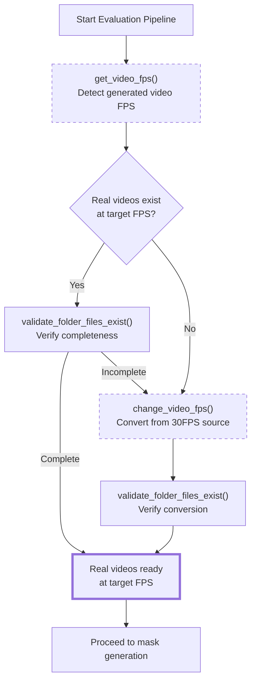
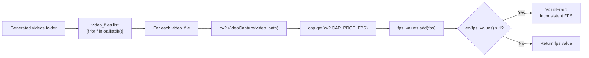
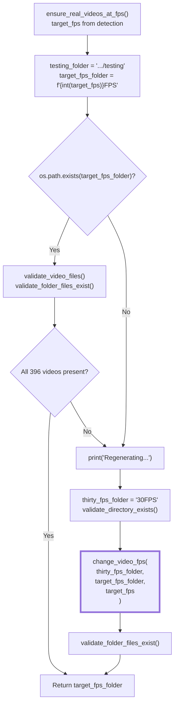
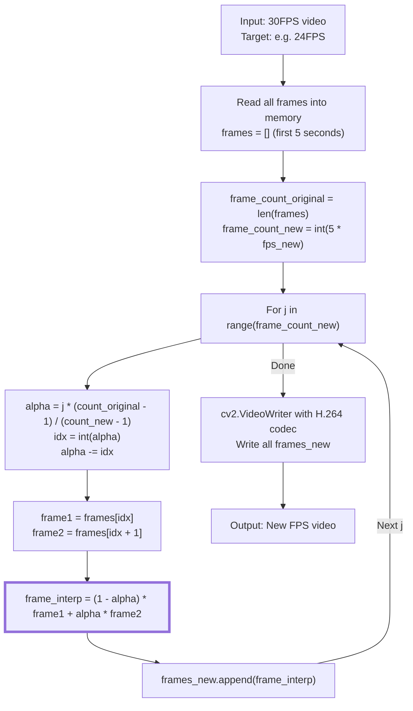
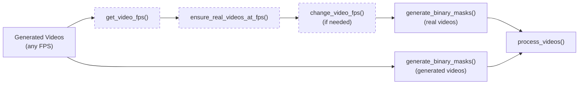

<!-- source: DeepWiki mcp.deepwiki.com · repo google-deepmind/physics-IQ-benchmark · page 4.3 FPS Normalization · fetched 2026-10-26 -->

# FPS Normalization

<details>
<summary>Relevant source files</summary>

The following files were used as context for generating this wiki page:

- [physiq/binary_mask_generator.py](physiq/binary_mask_generator.py)
- [physiq/calculate_iq_score.py](physiq/calculate_iq_score.py)
- [physiq/fps_changer.py](physiq/fps_changer.py)
- [physiq/run_physics_iq.py](physiq/run_physics_iq.py)

</details>


## Purpose and Scope

FPS (frames per second) normalization ensures that generated videos and their corresponding ground truth videos are evaluated at matching frame rates. This normalization step is critical for fair metric computation, as temporal alignment between videos is required for frame-by-frame comparison.

This document covers the FPS detection, conversion, and validation processes orchestrated by [physiq/run_physics_iq.py]() and implemented by [physiq/fps_changer.py](). For information about the binary mask generation that occurs after FPS normalization, see **4.4 Binary Mask Generation**. For details on the metrics calculated using these normalized videos, see **4.5 Metric Calculation**.

---

## FPS Normalization Workflow

The FPS normalization process follows a deterministic decision tree to ensure all videos are temporally aligned before evaluation.

**FPS Normalization Logic in `run_physics_iq.py`**


**Sources:** [physiq/run_physics_iq.py:237-312]()

The workflow ensures that:
1. Generated videos dictate the target FPS (not the other way around) [physiq/run_physics_iq.py:380-383]().
2. Real videos at non-standard FPS are generated on-demand from the canonical 30FPS source [physiq/run_physics_iq.py:302-306]().
3. All conversions are validated before proceeding to mask generation [physiq/run_physics_iq.py:311-312]().

---

## FPS Detection

The system detects the frame rate of generated videos using OpenCV's video capture properties. The `get_video_fps()` function [physiq/run_physics_iq.py:237-269]() enforces consistency across all videos in a folder.

### Detection Algorithm

| Step | Operation | Implementation |
|------|-----------|---------------|
| 1 | List all `.mp4` files | [physiq/run_physics_iq.py:251]() |
| 2 | Open each video with `cv2.VideoCapture` | [physiq/run_physics_iq.py:259]() |
| 3 | Query `cv2.CAP_PROP_FPS` property | [physiq/run_physics_iq.py:260]() |
| 4 | Collect FPS values in set | [physiq/run_physics_iq.py:256-261]() |
| 5 | Validate all videos have same FPS | [physiq/run_physics_iq.py:264-265]() |

**FPS Detection Logic Flow**


**Sources:** [physiq/run_physics_iq.py:237-269]()

The function raises a `ValueError` if videos have inconsistent FPS values [physiq/run_physics_iq.py:265](), ensuring the system never attempts to evaluate mixed-framerate datasets. The detected FPS is then used to determine the required real video FPS.

---

## Real Video FPS Matching

The `ensure_real_videos_at_fps()` function [physiq/run_physics_iq.py:272-312]() guarantees that real ground truth videos exist at the detected target FPS. The system maintains a canonical 30FPS source and generates other frame rates on-demand.

### Directory Structure

The system expects and maintains this structure:

```
physics-IQ-benchmark/split-videos/testing/
├── 30FPS/              # Always available (canonical source)
├── 24FPS/              # Generated on-demand if needed
├── 16FPS/              # Generated on-demand if needed
└── 8FPS/               # Generated on-demand if needed
```

**Sources:** [physiq/run_physics_iq.py:285-286]()

### Matching Logic Flow



**Sources:** [physiq/run_physics_iq.py:272-312]()

The function handles three scenarios:
1. **Target FPS folder exists and is complete**: Returns path immediately [physiq/run_physics_iq.py:292-293]().
2. **Target FPS folder exists but incomplete**: Regenerates from 30FPS [physiq/run_physics_iq.py:297-308]().
3. **Target FPS folder missing**: Creates folder and generates from 30FPS [physiq/run_physics_iq.py:302-308]().

---

## Frame Interpolation Algorithm

The `change_video_fps()` function [physiq/fps_changer.py:23-117]() implements linear frame interpolation to convert videos between frame rates while preserving temporal smoothness.

### Conversion Process



**Sources:** [physiq/fps_changer.py:47-113]()

### Mathematical Formulation

For each new frame at index `j`:

1. **Calculate fractional position**: `alpha = j * (frame_count_original - 1) / (frame_count_new - 1)` [physiq/fps_changer.py:81]()
2. **Extract integer and fractional parts**: `idx = int(alpha)`, `alpha -= idx` [physiq/fps_changer.py:82-83]()
3. **Linear blend**: `frame_interp_np = (1 - alpha) * frame1_np + alpha * frame2_np` [physiq/fps_changer.py:91]()

This ensures smooth temporal interpolation between keyframes.

### Implementation Details

| Component | Implementation | Location |
|-----------|---------------|----------|
| Video reading | `cv2.VideoCapture()` | [physiq/fps_changer.py:47]() |
| Frame extraction | Loop with `cap.read()` | [physiq/fps_changer.py:63-67]() |
| Color conversion | `cv2.cvtColor(frame, cv2.COLOR_BGR2RGB)` | [physiq/fps_changer.py:67]() |
| Interpolation | NumPy array blending | [physiq/fps_changer.py:88-91]() |
| Video writing | `cv2.VideoWriter()` with `avc1` codec | [physiq/fps_changer.py:103-108]() |
| Frame writing | `out.write()` with color reconversion | [physiq/fps_changer.py:110-111]() |

**Sources:** [physiq/fps_changer.py:40-113]()

---

## File Naming and Validation

The FPS normalization process maintains strict file naming conventions to ensure traceability.

### Filename Transformation

When converting from 30FPS to a target FPS, filenames are transformed according to this pattern:

```
Input:  0001_testing-videos_30FPS_perspective-center_take-1_scenario-name.mp4
Output: 0001_testing-videos_24FPS_perspective-center_take-1_scenario-name.mp4
         └─────────────────┬────────────────────────────────────────────────┘
                           └── Only FPS component changes
```

**Implementation:** [physiq/fps_changer.py:97-99]()

### Validation Requirements

After conversion, the system validates that:

| Validation | Method | Expected Count |
|------------|--------|---------------|
| All scenarios present | `validate_video_files()` | 396 files (66 scenarios × 2 takes × 3 views) |
| File naming correct | `validate_folder_files_exist()` | 100% match against directory expectations |
| FPS metadata accurate | `cv2.CAP_PROP_FPS` query | All match target FPS |

**Sources:** [physiq/run_physics_iq.py:203-234](), [physiq/run_physics_iq.py:120-147]()

---

## Integration with Evaluation Pipeline

The FPS normalization step is automatically invoked by the main orchestrator and feeds directly into subsequent pipeline stages.

**Evaluation Pipeline Integration**


**Sources:** [physiq/run_physics_iq.py:374-426]()

### Invocation in Main Loop

Normalization occurs within the main processing loop:

1. **Detect FPS**: `fps = get_video_fps(input_folder)` [physiq/run_physics_iq.py:380]().
2. **Ensure Real Videos**: `real_video_folder = ensure_real_videos_at_fps(...)` [physiq/run_physics_iq.py:383]().
3. **Mask Generation**: Binary masks are generated for both real and generated videos using the target FPS [physiq/run_physics_iq.py:388-407]().
4. **Metric Calculation**: `process_videos(...)` uses the matched video pairs [physiq/run_physics_iq.py:418-426]().

**Sources:** [physiq/run_physics_iq.py:374-426]()

---

