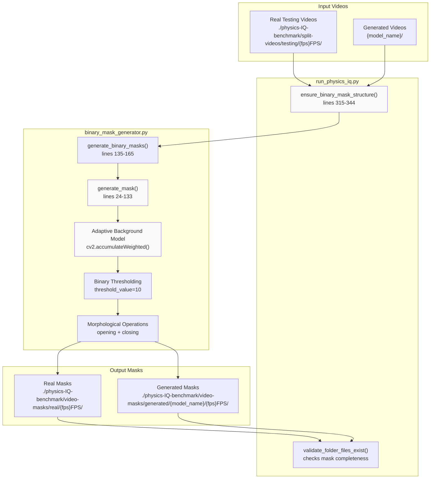
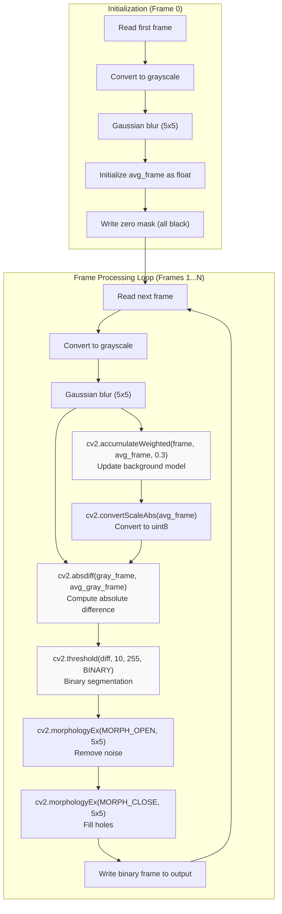
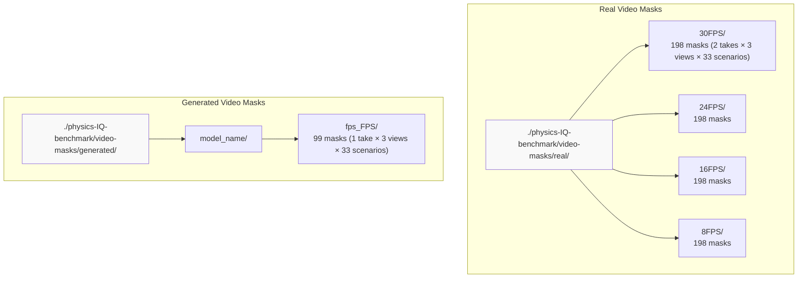

<!-- source: DeepWiki mcp.deepwiki.com · repo google-deepmind/physics-IQ-benchmark · page 4.4 Binary Mask Generation · fetched 2026-10-26 -->

# Binary Mask Generation

<details>
<summary>Relevant source files</summary>

The following files were used as context for generating this wiki page:

- [physiq/binary_mask_generator.py](physiq/binary_mask_generator.py)
- [physiq/calculate_iq_score.py](physiq/calculate_iq_score.py)
- [physiq/fps_changer.py](physiq/fps_changer.py)
- [physiq/run_physics_iq.py](physiq/run_physics_iq.py)

</details>


Binary mask generation is a critical preprocessing step in the Physics-IQ evaluation pipeline that isolates moving objects from static backgrounds using adaptive background subtraction. This process creates binary videos where white pixels represent regions of motion (objects of interest) and black pixels represent static backgrounds, enabling region-focused metric calculations.

This page covers the mask generation algorithms and file organization. For information about how these masks are used in metric computation, see [4.5 Metric Calculation](). For details on the evaluation metrics themselves, see [5.1 Spatiotemporal IOU Metrics](), [5.2 Spatial IOU Metrics](), and [5.3 Weighted Spatial IOU Metrics]().

## Purpose and Workflow

Binary masks serve two primary purposes in the Physics-IQ evaluation system:

1.  **Region-of-Interest Isolation**: Masks focus metric calculations on moving objects (bouncing balls, flowing liquids, rolling cylinders) rather than static backgrounds (tables, walls, lighting fixtures).
2.  **Fair Comparison**: By evaluating only regions where physical motion occurs, the system avoids penalizing models for background rendering differences.

The mask generation process operates on both real ground truth videos and generated model outputs, creating parallel mask video structures that mirror the source video organization.

**Sources**: [physiq/binary_mask_generator.py:1-196](), [physiq/run_physics_iq.py:315-344]()

## System Integration



**Workflow Description**:

1.  **Orchestration**: `run_physics_iq.py` calls `ensure_binary_mask_structure()` for both real and generated video sets [physiq/run_physics_iq.py:388-403]().
2.  **Directory Creation**: If mask folders don't exist, they are created with FPS-specific subfolders [physiq/run_physics_iq.py:334-337]().
3.  **Batch Processing**: `generate_binary_masks()` iterates through all MP4 files in the input directory [physiq/binary_mask_generator.py:154-165]().
4.  **Per-Video Masking**: `generate_mask()` applies the adaptive background subtraction algorithm [physiq/binary_mask_generator.py:24-133]().
5.  **Validation**: The system verifies all expected mask files were generated successfully using `validate_folder_files_exist()` [physiq/run_physics_iq.py:339-341]().

**Sources**: [physiq/run_physics_iq.py:315-344](), [physiq/run_physics_iq.py:388-403](), [physiq/binary_mask_generator.py:135-165]()

## Adaptive Background Subtraction Algorithm

The mask generation algorithm uses a running average background model that adapts to each video's specific scene:



**Algorithm Parameters**:

| Parameter | Value | Purpose |
| :--- | :--- | :--- |
| **Gaussian Blur Kernel** | 5×5 | Reduces high-frequency noise before processing [physiq/binary_mask_generator.py:93,109]() |
| **Accumulation Weight** | 0.3 | Controls background model adaptation speed (30% new frame) [physiq/binary_mask_generator.py:111]() |
| **Threshold Value** | 10 | Pixel intensity difference required to classify as foreground [physiq/binary_mask_generator.py:116-118]() |
| **Morphology Kernel** | 5×5 | Size of structuring element for opening/closing operations [physiq/binary_mask_generator.py:101]() |

**Key Algorithm Characteristics**:

1.  **First Frame Handling**: The initial frame outputs an all-black mask (no motion baseline) and initializes the background model [physiq/binary_mask_generator.py:86-98]().
2.  **Adaptive Learning**: `cv2.accumulateWeighted()` with alpha=0.3 means the background model gradually adapts to slow changes while detecting rapid motion [physiq/binary_mask_generator.py:111]().
3.  **Noise Reduction**: Gaussian blur (5×5 kernel) removes sensor noise before difference calculation [physiq/binary_mask_generator.py:93,109]().
4.  **Morphological Cleanup**: Opening operation removes isolated noise pixels, closing operation fills small holes in detected objects [physiq/binary_mask_generator.py:120-121]().

**Sources**: [physiq/binary_mask_generator.py:24-133]()

## File Organization and Naming Conventions

Binary masks maintain a parallel directory structure to source videos but with modified naming conventions to indicate they are masks:

### Real Video Masks

**Input**: `./physics-IQ-benchmark/split-videos/testing/{fps}FPS/XXXX_testing-videos_{fps}FPS_perspective-{view}_take-{N}_{scenario}.mp4`

**Output**: `./physics-IQ-benchmark/video-masks/real/{fps}FPS/XXXX_video-masks_{fps}FPS_perspective-{view}_take-{N}_{scenario}.mp4`

**Transformation**: The substring `testing-videos` is replaced with `video-masks` in the filename [physiq/binary_mask_generator.py:57-67]().

### Generated Video Masks

**Input**: `{model_name}/XXXX_perspective-{view}_{scenario}.mp4`

**Output**: `./physics-IQ-benchmark/video-masks/generated/{model_name}/{fps}FPS/XXXX_video-masks_{fps}FPS_perspective-{view}_take-1_{scenario}.mp4`

**Transformation**:
*   Inserts `video-masks_{fps}FPS` segment.
*   Adds `take-1` suffix (generated videos are treated as single-take equivalents) [physiq/binary_mask_generator.py:68-76]().

### FPS-Specific Organization



**Directory Rules**:

*   **Real masks** are organized by FPS only, as they correspond to ground truth recordings [physiq/run_physics_iq.py:331]().
*   **Generated masks** are organized by model name, then FPS, allowing multiple models to coexist [physiq/run_physics_iq.py:332]().
*   Each FPS folder contains all real videos (both takes) or 198 generated videos (single take).
*   The `is_real` boolean parameter controls which naming convention is applied [physiq/binary_mask_generator.py:57-76]().

**Sources**: [physiq/binary_mask_generator.py:53-79](), [physiq/run_physics_iq.py:331-343]()

## Function Reference

### `generate_binary_masks()`

Batch processes all videos in an input directory tree, generating corresponding mask videos.

**Signature**: [physiq/binary_mask_generator.py:135-140]()
```python
def generate_binary_masks(
    input_parent_directory: str,
    output_parent_directory: str,
    is_real: bool,
    threshold_value: int = 10,
) -> None
```

**Parameters**:
*   `input_parent_directory`: Root directory containing source MP4 files.
*   `output_parent_directory`: Root directory for output mask videos.
*   `is_real`: `True` for real videos, `False` for generated videos.
*   `threshold_value`: Binary threshold for foreground detection (default: 10).

**Behavior**:
1.  Walks directory tree starting from `input_parent_directory` [physiq/binary_mask_generator.py:154]().
2.  Recreates directory structure in `output_parent_directory` [physiq/binary_mask_generator.py:155-157]().
3.  Calls `generate_mask()` for each `.mp4` file found [physiq/binary_mask_generator.py:159-164]().

**Sources**: [physiq/binary_mask_generator.py:135-165]()

### `generate_mask()`

Processes a single video file to create a binary mask using adaptive background subtraction.

**Signature**: [physiq/binary_mask_generator.py:24-26]()
```python
def generate_mask(
    in_path: str, out_video_path: str, is_real: bool, threshold_value: int = 10
) -> None
```

**Algorithm Steps**:

| Step | Code Lines | Operation |
| :--- | :--- | :--- |
| **1. Video Initialization** | [38-49]() | Open capture, read properties (FPS, dimensions), ensure even dimensions. |
| **2. Codec Setup** | [52-83]() | Configure `mp4v` codec, transform output path based on `is_real` flag. |
| **3. First Frame** | [85-99]() | Initialize background model, write zero mask. |
| **4. Frame Loop** | [103-123]() | Apply background subtraction, morphology, write binary frames. |
| **5. Cleanup** | [125-129]() | Release capture/writer, print diagnostics. |

**Output Format**:
*   Codec: `mp4v` [physiq/binary_mask_generator.py:52]().
*   Color: Grayscale single-channel (`isColor=False`) [physiq/binary_mask_generator.py:82]().
*   FPS: Matches input video [physiq/binary_mask_generator.py:43]().
*   Dimensions: Even width/height (required for codec) [physiq/binary_mask_generator.py:49]().

**Sources**: [physiq/binary_mask_generator.py:24-133]()

### `ensure_binary_mask_structure()`

Orchestrates mask generation with validation, called by the main evaluation pipeline.

**Signature**: [physiq/run_physics_iq.py:315-317]()
```python
def ensure_binary_mask_structure(
    output_folder: str,
    input_folder: str,
    target_fps: float,
    expected_files: set[str],
    is_real: bool,
) -> str
```

**Behavior**:
1.  Constructs mask folder path: `./physics-IQ-benchmark/video-masks/{real|generated/model_name}/{fps}FPS` [physiq/run_physics_iq.py:331-332]().
2.  Checks if folder exists; if not, creates it and calls `generate_binary_masks()` [physiq/run_physics_iq.py:334-337]().
3.  Validates all expected files exist using `validate_folder_files_exist()` [physiq/run_physics_iq.py:339-341]().
4.  Returns path to the binary mask folder [physiq/run_physics_iq.py:343]().

**Sources**: [physiq/run_physics_iq.py:315-344](), [physiq/run_physics_iq.py:388-403]()

## Technical Considerations

### Background Model Adaptation

The adaptive background model uses exponential weighted averaging with alpha=0.3 [physiq/binary_mask_generator.py:111]():
`avg_frame_new = 0.7 × avg_frame_old + 0.3 × current_frame`

This design choice means:
*   **Fast-moving objects** (ball trajectories, liquid splashes) are detected as foreground.
*   **Slow environmental changes** (gradual lighting shifts) are absorbed into the background.
*   **Static objects** (experimental apparatus) remain classified as background.

### Morphological Operations

Two morphological operations clean the binary mask using a 5×5 kernel [physiq/binary_mask_generator.py:101]():
1.  **Opening** (erosion followed by dilation): Removes small noise artifacts like isolated bright pixels [physiq/binary_mask_generator.py:120]().
2.  **Closing** (dilation followed by erosion): Fills small holes within detected objects [physiq/binary_mask_generator.py:121]().

### Dimension Requirements

Video dimensions must be even numbers for codec compatibility:
`width, height = width - width % 2, height - height % 2` [physiq/binary_mask_generator.py:49]().

**Sources**: [physiq/binary_mask_generator.py:49,101,111,120-121]()

---

