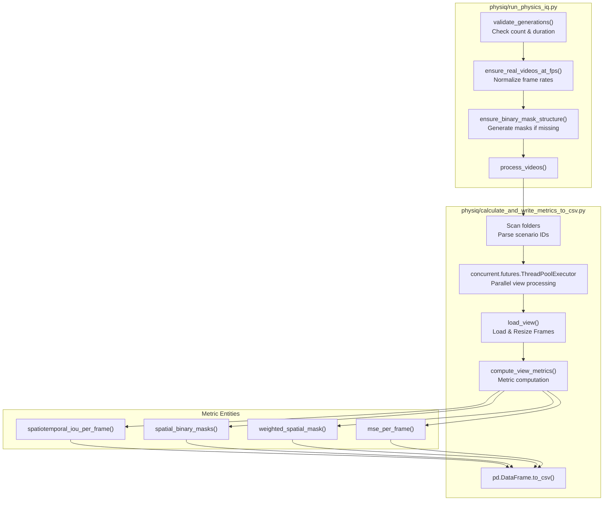
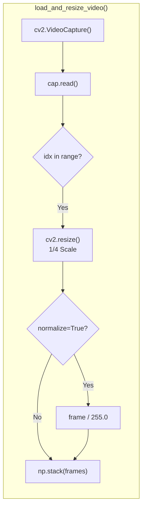
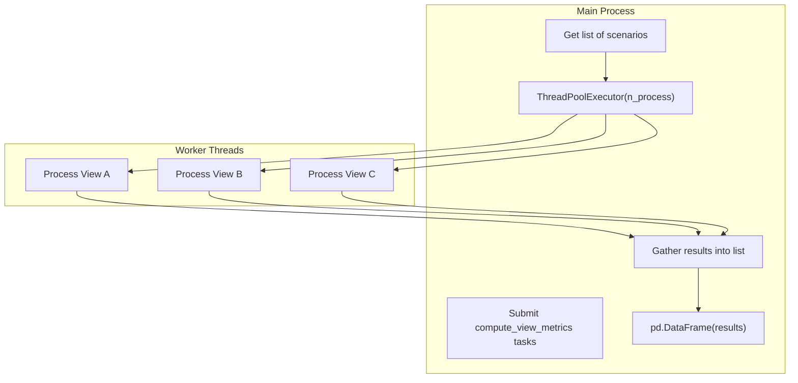

<!-- source: DeepWiki mcp.deepwiki.com · repo google-deepmind/physics-IQ-benchmark · page 4.5 Metric Calculation · fetched 2026-10-26 -->

# Metric Calculation

Relevant source files

The following files were used as context for generating this wiki page:

- [physiq/calculate_and_write_metrics_to_csv.py](physiq/calculate_and_write_metrics_to_csv.py)
- [physiq/run_physics_iq.py](physiq/run_physics_iq.py)

## Purpose and Scope

This document describes the metric calculation stage of the Physics-IQ evaluation pipeline, primarily implemented in [physiq/calculate_and_write_metrics_to_csv.py](). This stage performs frame-by-frame and aggregate comparisons between generated videos and ground truth recordings across multiple perspectives, computing four families of metrics that quantify physical accuracy.

**Scope**: This page covers the computational workflow, video/mask loading, parallel processing architecture, and CSV output format. For detailed explanations of the metric formulas themselves (spatiotemporal IOU, spatial IOU, weighted spatial IOU, MSE), see sections [5.1]() through [5.4](). For how these metrics are aggregated into the final Physics-IQ score, see [Score Aggregation (4.6)]().

---

## Overview

The `process_videos()` function [physiq/calculate_and_write_metrics_to_csv.py:218-348]() orchestrates metric calculation by:

1.  Loading real videos (take-1 and take-2) and generated videos at matching FPS.
2.  Loading corresponding binary masks for all videos.
3.  Processing each scenario across three camera perspectives in parallel.
4.  Computing per-frame and aggregate metrics for each view.
5.  Writing structured results to CSV files.

The system processes 66 unique scenarios, each with 3 views (left, center, right), resulting in 198 rows per model in the output CSV.

**Sources**: [physiq/calculate_and_write_metrics_to_csv.py:218-348](), [physiq/run_physics_iq.py:465-481]()

---

## Calculation Workflow

### Logic Flow Diagram
The following diagram bridges the high-level evaluation steps to the specific functions and classes used in the codebase.

**Sources**: [physiq/run_physics_iq.py:410-481](), [physiq/calculate_and_write_metrics_to_csv.py:218-348]()

---

## Video and Mask Loading

### Data Containers
The system uses Pydantic-like dataclasses to manage the complex set of paths and frame arrays required for a single (scenario, view) comparison.

*   `ViewPaths`: Stores resolved filesystem paths for `real_v1`, `real_v2`, `generated`, and their respective masks [physiq/calculate_and_write_metrics_to_csv.py:41-50]().
*   `ViewFrames`: Stores the loaded `np.ndarray` frames. RGB arrays are float64 in `[0, 1]`; mask arrays are boolean [physiq/calculate_and_write_metrics_to_csv.py:53-66]().

### Frame Loading and Resizing
The `load_and_resize_video()` function [physiq/calculate_and_write_metrics_to_csv.py:68-100]() performs several operations:
1.  **Frame selection**: Extracts frames in the range `[start_frame, end_frame)`.
2.  **Downsampling**: Resizes frames to 1/4 scale (1/16 pixel count) to reduce memory usage [physiq/calculate_and_write_metrics_to_csv.py:157]().
3.  **Normalization**: Converts pixel values to `[0, 1]` range for video frames (not for masks) [physiq/calculate_and_write_metrics_to_csv.py:95-96]().

**Sources**: [physiq/calculate_and_write_metrics_to_csv.py:68-100](), [physiq/calculate_and_write_metrics_to_csv.py:157-181]()

---

## Metric Computation Per View

For each view, `compute_view_metrics()` [physiq/calculate_and_write_metrics_to_csv.py:205-215]() computes values organized into four families:

### 1. Spatiotemporal IoU
Calculated frame-by-frame using `spatiotemporal_iou_per_frame()` [physiq/calculate_and_write_metrics_to_csv.py:126-133](). It computes the intersection over union of binary masks for every frame in the sequence.

### 2. Spatial IoU
Uses `spatial_binary_masks()` [physiq/calculate_and_write_metrics_to_csv.py:103-111]() to collapse the time dimension. It performs a logical `OR` (any) across all frames to create a single static mask representing the total area covered by the object during the video.

### 3. Weighted Spatial IoU
Uses `weighted_spatial_mask()` [physiq/calculate_and_write_metrics_to_csv.py:113-115]() to create a "motion intensity map" where each pixel value is the fraction of frames in which that pixel was masked. `compute_weighted_spatial_iou()` [physiq/calculate_and_write_metrics_to_csv.py:136-143]() then compares these maps.

### 4. Mean Squared Error (MSE)
Calculated frame-by-frame using `mse_per_frame()` [physiq/calculate_and_write_metrics_to_csv.py:118-123]() between the RGB frames of the generated video and the ground truth.

**Sources**: [physiq/calculate_and_write_metrics_to_csv.py:78-143](), [physiq/calculate_and_write_metrics_to_csv.py:205-215]()

---

## Parallel Execution and Memory Management

### Scenario Discovery
The system scans the `real_folders` to build a mapping of scenarios to their constituent views and takes [physiq/calculate_and_write_metrics_to_csv.py:245-274](). It uses the `0000_` prefix to group related files.

### Threading Architecture
To handle the 198 comparisons efficiently, the system uses `concurrent.futures.ThreadPoolExecutor` [physiq/calculate_and_write_metrics_to_csv.py:317-331]().

### Memory Efficiency
Because video frames are large, the system performs explicit cleanup:
*   `load_view` only loads the frames needed for one specific comparison [physiq/calculate_and_write_metrics_to_csv.py:146-202]().
*   `gc.collect()` is called frequently within the loop to release memory from processed `np.ndarray` objects [physiq/calculate_and_write_metrics_to_csv.py:333]().

**Sources**: [physiq/calculate_and_write_metrics_to_csv.py:317-333](), [physiq/calculate_and_write_metrics_to_csv.py:146-202]()

---

## CSV Output Format

The results are written to a CSV file specified by the `--output_folder` argument. Each row contains the metrics for one view of one scenario.

| Column Name | Type | Description |
| :--- | :--- | :--- |
| `scenario` | string | The base name of the scenario (e.g., `lit-candle.mp4`). |
| `view` | string | The perspective (`perspective-center`, `left`, or `right`). |
| `spatiotemporal_iou_v1` | list | Frame-by-frame IoU against Take 1. |
| `spatiotemporal_iou_v2` | list | Frame-by-frame IoU against Take 2. |
| `spatial_iou_v1` | float | Collapsed spatial IoU against Take 1. |
| `weighted_spatial_iou_v1` | float | Motion-weighted IoU against Take 1. |
| `v1_mse` | list | Frame-by-frame MSE against Take 1. |
| `variance_spatial` | float | Baseline IoU between Take 1 and Take 2. |

**Sources**: [physiq/calculate_and_write_metrics_to_csv.py:205-215](), [physiq/calculate_and_write_metrics_to_csv.py:343-348]()

---

