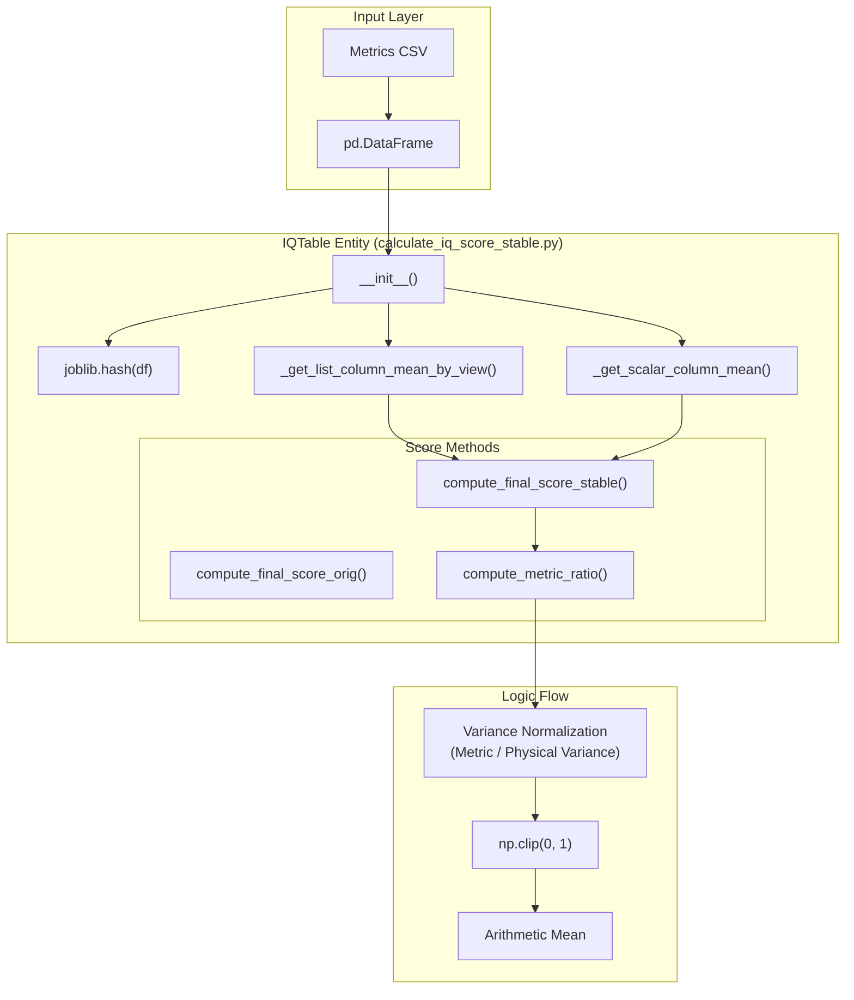
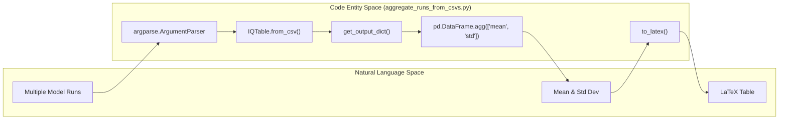

<!-- source: DeepWiki mcp.deepwiki.com · repo google-deepmind/physics-IQ-benchmark · page 4.6 Score Aggregation · fetched 2026-10-26 -->

# Score Aggregation

Relevant source files

The following files were used as context for generating this wiki page:

- [physiq/aggregate_runs_from_csvs.py](physiq/aggregate_runs_from_csvs.py)
- [physiq/calculate_iq_score_stable.py](physiq/calculate_iq_score_stable.py)
- [physiq/tests/test_descriptions.py](physiq/tests/test_descriptions.py)

This document describes the final stage of the Physics-IQ evaluation pipeline: aggregating per-scenario metrics into a unified Physics-IQ score. The system supports two primary aggregation workflows: single-run scoring via `calculate_iq_score_stable.py` (which introduces the **Verified Score**) and multi-run aggregation via `aggregate_runs_from_csvs.py`.

## Overview

The Physics-IQ benchmark normalizes model performance by the physical variance of each scenario—specifically, how much the ground-truth outcome varies across repeated real-world trials. The aggregation logic handles multi-view data (left, center, right perspectives) and applies clipping to ensure score stability.

### Key Scoring Variants
*   **Verified Score (Stable):** The primary metric for the Physics-IQ Verified leaderboard. It clips each metric component (IoU, MSE) to the [0, 1] range before averaging, preventing extreme outliers from skewing the total. [physiq/calculate_iq_score_stable.py:64-70]()
*   **Original Score:** The legacy variant where components are aggregated first, and the final total is clipped. [physiq/calculate_iq_score_stable.py:66-66]()

**Sources:** [physiq/calculate_iq_score_stable.py:15-25](), [physiq/calculate_iq_score_stable.py:57-71]()

## The IQTable Class

The `IQTable` class in `calculate_iq_score_stable.py` is the central entity for score computation. It wraps a pandas DataFrame containing raw metrics and provides methods to compute normalized scores.

### Data Flow and Initialization
When an `IQTable` is initialized, it performs several internal transformations to prepare the data:
1.  **View Averaging:** It collapses raw per-perspective columns (e.g., `spatial_iou_v1_perspective-left`) into cross-view means. [physiq/calculate_iq_score_stable.py:94-105]()
2.  **Integrity Hashing:** It generates a `joblib.hash` of the DataFrame to ensure data is not mutated after construction, which would invalidate cached scores. [physiq/calculate_iq_score_stable.py:111-122]()

**Sources:** [physiq/calculate_iq_score_stable.py:50-122](), [physiq/calculate_iq_score_stable.py:183-205]()

## Scoring Formula and Components

The Physics-IQ score is composed of four metric families, each normalized by a corresponding physical variance baseline.

### Metric Mapping
| Metric Component | Key in IQTable | Variance Key |
| :--- | :--- | :--- |
| **Spatial IoU** | `spatial_iou_v1` | `variance_spatial` |
| **Spatiotemporal IoU** | `spatiotemporal_iou_v1` | `variance_spatiotemporal_iou` |
| **Weighted Spatial IoU** | `weighted_spatial_iou_v1` | `variance_weighted_spatial` |
| **MSE** | `v1_mse` | `variance_mse` |

**Sources:** [physiq/calculate_iq_score_stable.py:73-80](), [physiq/calculate_iq_score_stable.py:183-205]()

### The Stable (Verified) Calculation
The `compute_final_score_stable()` method implements the following logic:
1.  **Ratio Calculation:** For each IoU metric, it calculates `Metric / (Physical_Variance + eps)`. [physiq/calculate_iq_score_stable.py:183-205]()
2.  **MSE Inversion:** For MSE, it calculates `1 - (MSE / (Physical_Variance + eps))`. [physiq/calculate_iq_score_stable.py:202-205]()
3.  **Component Clipping:** Each resulting ratio is clipped to `[0.0, 1.0]`. [physiq/calculate_iq_score_stable.py:222-226]()
4.  **Final Aggregation:** The final score is the mean of these four clipped components. [physiq/calculate_iq_score_stable.py:228-228]()

**Sources:** [physiq/calculate_iq_score_stable.py:207-230]()

## Multi-Run Aggregation

The `aggregate_runs_from_csvs.py` script is used to combine results from multiple evaluation runs (up to 4) to produce a single leaderboard entry with mean and standard deviation.

### Aggregation Workflow
1.  **Loading:** It loads multiple CSV files into `IQTable` instances. [physiq/aggregate_runs_from_csvs.py:73-75]()
2.  **Statistical Aggregation:** It aggregates the `final_score_view` (or `final_score_orig`) and component scores using `mean` and `std`. [physiq/aggregate_runs_from_csvs.py:77-78]()
3.  **Export:**
    *   **LaTeX:** Generates a formatted table for academic papers. [physiq/aggregate_runs_from_csvs.py:93-96]()
    *   **CSV:** Produces a single-row CSV containing the final aggregated scores for submission. [physiq/aggregate_runs_from_csvs.py:98-107]()

**Sources:** [physiq/aggregate_runs_from_csvs.py:43-109]()

## Integration in run_physics_iq.py

The main evaluation orchestrator, `run_physics_iq.py`, integrates `IQTable` to provide immediate feedback after processing a model.

1.  **Integrity Check:** Before processing, it checks if a complete CSV already exists using `is_csv_complete`. [physiq/run_physics_iq.py:30-58]()
2.  **Scoring:** Once `calculate_and_write_metrics_to_csv.py` finishes, `run_physics_iq.py` instantiates `IQTable` from the resulting CSV. [physiq/run_physics_iq.py:428-429]()
3.  **Lazy Integrity:** The orchestrator uses the `lazy_integrity=True` flag to skip expensive hashing during high-throughput evaluation. [physiq/run_physics_iq.py:428-428]()

**Sources:** [physiq/run_physics_iq.py:424-431](), [physiq/calculate_iq_score_stable.py:107-112]()

---

