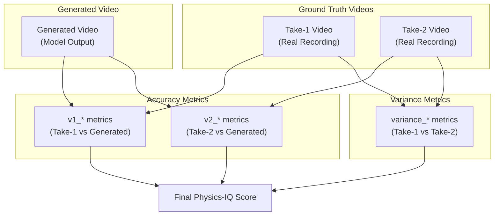

<!-- source: DeepWiki mcp.deepwiki.com · repo google-deepmind/physics-IQ-benchmark · page 5 Metrics and Scoring · fetched 2026-10-26 -->

# Metrics and Scoring

Relevant source files

The following files were used as context for generating this wiki page:

- [physiq/binary_mask_generator.py](physiq/binary_mask_generator.py)
- [physiq/calculate_iq_score.py](physiq/calculate_iq_score.py)
- [physiq/calculate_iq_score_stable.py](physiq/calculate_iq_score_stable.py)
- [physiq/fps_changer.py](physiq/fps_changer.py)

This document provides comprehensive technical documentation of the Physics-IQ benchmark's evaluation metrics and scoring system. The metrics quantify how accurately generated videos match real physical experiments, with particular emphasis on variance-normalized evaluation to distinguish between natural physical randomness and systematic physics violations.

For information about the broader evaluation pipeline that orchestrates metric computation, see [Evaluation Pipeline](#4).

## Dual-Take Evaluation Strategy

The Physics-IQ benchmark employs a dual-take recording strategy where each scenario is captured twice under nominally identical conditions (take-1 and take-2). This design enables the system to measure both **accuracy** (how well generated videos match ground truth) and **physical realism** (whether deviations match natural variation patterns).

### Comparison Architecture

**Sources:** [physiq/calculate_and_write_metrics_to_csv.py:306-370]()

Each metric is computed three times per scenario:
- **`v1_*` metrics**: Compare generated video against take-1.
- **`v2_*` metrics**: Compare generated video against take-2.
- **`variance_*` metrics**: Compare take-1 against take-2 to quantify natural physical variation.

The variance metrics establish a baseline for expected differences in real physics, which the scoring formula uses to normalize accuracy metrics.

## Metric Families

The system computes four families of metrics, each capturing different aspects of physical accuracy. All metrics are calculated per frame and per view (left, center, right), then aggregated.

### Spatiotemporal IOU Metrics
Spatiotemporal Intersection-over-Union (IOU) measures frame-by-frame mask overlap, capturing the accuracy of motion trajectories over time. For details, see [Spatiotemporal IOU Metrics](#5.1).

**Implementation:** The `spatiotemporal_iou_per_frame` function [physiq/calculate_and_write_metrics_to_csv.py:171-182]() computes IOU for each frame pair.

**Sources:** [physiq/calculate_and_write_metrics_to_csv.py:171-182](), [physiq/calculate_and_write_metrics_to_csv.py:306-308](), [physiq/calculate_and_write_metrics_to_csv.py:347-349]()

### Spatial IOU Metrics
Spatial IOU collapses the temporal dimension by taking the maximum mask value at each pixel across all frames. This focuses on whether the generated video covers the correct spatial extent. For details, see [Spatial IOU Metrics](#5.2).

**Implementation:** The `spatial_binary_masks` function [physiq/calculate_and_write_metrics_to_csv.py:78-90]() performs temporal collapse.

**Sources:** [physiq/calculate_and_write_metrics_to_csv.py:78-90](), [physiq/calculate_and_write_metrics_to_csv.py:311-318](), [physiq/calculate_and_write_metrics_to_csv.py:343-345]()

### Weighted Spatial IOU Metrics
Weighted spatial IOU creates motion intensity maps by averaging mask values across time, capturing not just spatial extent but also motion frequency. For details, see [Weighted Spatial IOU Metrics](#5.3).

**Implementation:** The `weighted_spatial_mask` function [physiq/calculate_and_write_metrics_to_csv.py:92-97]() creates intensity maps.

**Sources:** [physiq/calculate_and_write_metrics_to_csv.py:92-97](), [physiq/calculate_and_write_metrics_to_csv.py:154-168](), [physiq/calculate_and_write_metrics_to_csv.py:322-340]()

### MSE Metrics
Mean Squared Error (MSE) measures pixel-level differences between video frames, providing a low-level appearance similarity metric. For details, see [MSE Metrics](#5.4).

**Implementation:** The `mse_per_frame` function [physiq/calculate_and_write_metrics_to_csv.py:100-116]() computes MSE for each frame.

**Sources:** [physiq/calculate_and_write_metrics_to_csv.py:100-116](), [physiq/calculate_and_write_metrics_to_csv.py:358-359](), [physiq/calculate_and_write_metrics_to_csv.py:352-354]()

### Variance Metrics
Variance metrics establish the baseline for natural physical randomness by comparing take-1 and take-2. For details, see [Variance Metrics](#5.5).

**Sources:** [physiq/calculate_iq_score_stable.py:77-80](), [physiq/calculate_iq_score_stable.py:157-163]()

## Physics-IQ Score Formula

The final Physics-IQ score combines all metric families using variance normalization. The primary interface for this is the `IQTable` class [physiq/calculate_iq_score_stable.py:50]().

### Scoring Variants
- **Orig**: Aggregates the three IOU scores and MSE score, then clips the total result [physiq/calculate_iq_score_stable.py:66-67]().
- **Stable**: Clips each component to [0, 1] before aggregating, preventing extreme outliers from dominating the score [physiq/calculate_iq_score_stable.py:67-69](). This is the primary reported score.

### Formula Components
1. **Metric Ratios**: IOU-based metrics are divided by their physical variance (e.g., `spatial_iou / variance_spatial`) [physiq/calculate_iq_score_stable.py:183-205]().
2. **MSE Adjustment**: MSE is adjusted by subtracting the baseline physical MSE variance [physiq/calculate_iq_score_stable.py:186]().
3. **Aggregation**: The final score is the arithmetic mean of the three normalized IOU ratios minus the adjusted MSE score [physiq/calculate_iq_score_stable.py:207-217]().

For the full mathematical breakdown and implementation, see [Physics-IQ Score Formula](#5.6).

**Sources:** [physiq/calculate_iq_score_stable.py:50-71](), [physiq/calculate_iq_score_stable.py:183-217](), [physiq/calculate_iq_score.py:179-189]()

---

