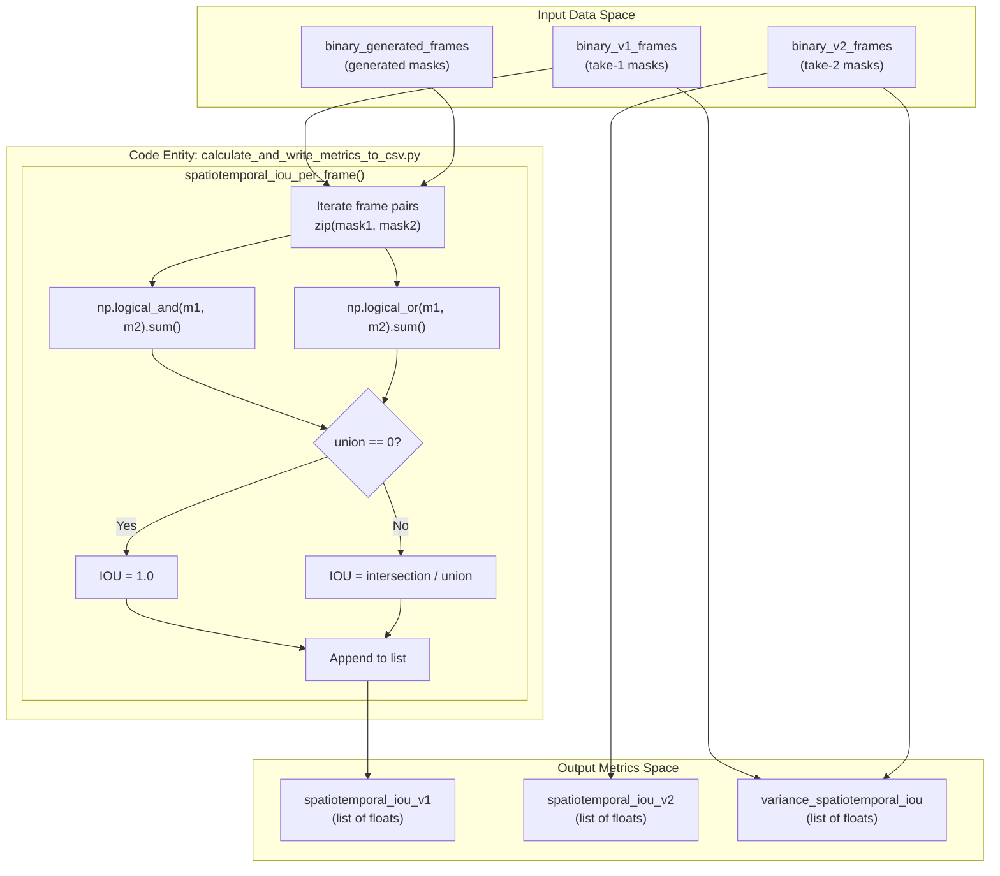
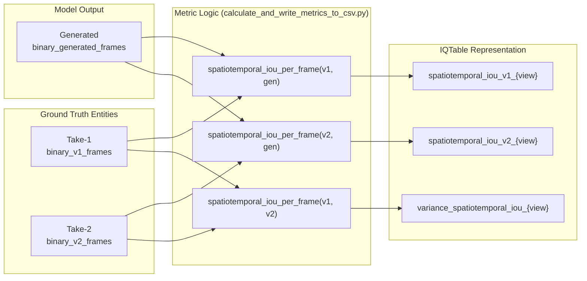

<!-- source: DeepWiki mcp.deepwiki.com · repo google-deepmind/physics-IQ-benchmark · page 5.1 Spatiotemporal IOU Metrics · fetched 2026-10-26 -->

# Spatiotemporal IOU Metrics

Relevant source files

The following files were used as context for generating this wiki page:

- [physiq/calculate_iq_score_stable.py](physiq/calculate_iq_score_stable.py)

## Purpose and Scope

This document details the **spatiotemporal IOU (Intersection over Union)** metric family, which measures frame-by-frame overlap between binary masks of generated and ground truth videos. Spatiotemporal IOU captures both the spatial accuracy and temporal consistency of object motion trajectories in generated videos.

In the Physics-IQ benchmark, this metric is computed using binary masks generated by `binary_mask_generator.py` [physiq/binary_mask_generator.py:1-125](). Unlike spatial IOU which collapses time, this metric maintains a per-frame granularity that is preserved in the `IQTable` data structure [physiq/calculate_iq_score_stable.py:50-112]().

---

## Metric Definition

**Spatiotemporal IOU** evaluates video generation quality by computing intersection-over-union independently for each frame, then averaging across the entire sequence. This preserves temporal information about object trajectories, unlike spatial IOU which collapses time into a single frame.

### Mathematical Formulation

For two videos represented as sequences of binary masks $M_1 = \{m_1^{(t)}\}$ and $M_2 = \{m_2^{(t)}\}$ where $t \in [0, T)$:

$$
\text{SpatiotemporalIOU}(M_1, M_2) = \frac{1}{T} \sum_{t=0}^{T-1} \frac{|m_1^{(t)} \cap m_2^{(t)}|}{|m_1^{(t)} \cup m_2^{(t)}|}
$$

For each frame $t$:
- **Intersection**: Pixel-wise logical AND between masks.
- **Union**: Pixel-wise logical OR between masks.
- **IOU**: Ratio of intersection area to union area.
- **Special case**: If both masks are empty ($union = 0$), IOU is defined as 1.0 (perfect match).

**Sources:** [physiq/calculate_and_write_metrics_to_csv.py:171-182]()

---

## Calculation Implementation

The implementation flow bridges raw video frames to per-frame metric lists stored in the final CSV output.

**Sources:** [physiq/calculate_and_write_metrics_to_csv.py:171-182](), [physiq/calculate_and_write_metrics_to_csv.py:306-308](), [physiq/calculate_and_write_metrics_to_csv.py:347-349]()

---

## Data Structure in IQTable

The `IQTable` class handles the transition from per-frame lists to aggregated scores. Unlike scalar metrics (Spatial IOU, MSE), Spatiotemporal IOU is stored as a list of floats for each scenario view [physiq/calculate_iq_score_stable.py:95-103]().

| Feature | Implementation Detail | Line Reference |
|:---|:---|:---|
| **Storage** | List of floats per CSV cell | [physiq/calculate_iq_score.py:46-51]() |
| **Parsing** | `parse_list_of_floats` converts string to `np.array` | [physiq/calculate_iq_score.py:46-51]() |
| **Aggregation** | Mean taken across frames within `IQTable.__init__` | [physiq/calculate_iq_score_stable.py:96-103]() |
| **Variance Key** | `variance_spatiotemporal_iou` | [physiq/calculate_iq_score_stable.py:79]() |

**Sources:** [physiq/calculate_iq_score_stable.py:75-103](), [physiq/calculate_iq_score.py:46-51]()

---

## Dual-Take Comparison Strategy

The benchmark records each scenario twice (`take-1` and `take-2`) to establish a variance baseline for natural physical randomness. Spatiotemporal IOU is computed twice for each generated video against these takes.

### Metric Variants

| Metric Name | Comparison | Purpose | Code Reference |
|:---|:---|:---|:---|
| `spatiotemporal_iou_v1_{view}` | Generated vs Take-1 | Primary accuracy score | [physiq/calculate_and_write_metrics_to_csv.py:306]() |
| `spatiotemporal_iou_v2_{view}` | Generated vs Take-2 | Secondary accuracy score | [physiq/calculate_and_write_metrics_to_csv.py:307]() |
| `variance_spatiotemporal_iou_{view}` | Take-1 vs Take-2 | Physical variance baseline | [physiq/calculate_and_write_metrics_to_csv.py:347-349]() |

**Sources:** [physiq/calculate_and_write_metrics_to_csv.py:306-308](), [physiq/calculate_and_write_metrics_to_csv.py:347-349](), [physiq/calculate_iq_score_stable.py:75-80]()

---

## Multi-View Aggregation

Each scenario is recorded from three camera perspectives: `perspective-left`, `perspective-center`, and `perspective-right` [physiq/calculate_iq_score.py:37](). The `IQTable` class collapses these views into a mean value during initialization [physiq/calculate_iq_score_stable.py:96-99]().

### View Processing Architecture

1. **Per-View Calculation**: `process_view` calculates metrics for a specific camera perspective [physiq/calculate_and_write_metrics_to_csv.py:214-374]().
2. **Merging**: Results from all three views are merged into a single dictionary per scenario [physiq/calculate_and_write_metrics_to_csv.py:423-437]().
3. **Cross-View Mean**: `IQTable` calculates `metric_mean_view` by averaging the scalar means of each perspective's frame-list [physiq/calculate_iq_score_stable.py:96-99]().

**Sources:** [physiq/calculate_and_write_metrics_to_csv.py:214-374](), [physiq/calculate_and_write_metrics_to_csv.py:423-437](), [physiq/calculate_iq_score_stable.py:96-99](), [physiq/calculate_iq_score.py:37]()

---

## Performance and Constraints

### Computational Complexity
- **Time Complexity**: $O(T \times H \times W)$ per view, where $T$ is the number of frames (typically 150 for 5 seconds at 30 FPS) and $H, W$ are the resized frame dimensions [physiq/calculate_and_write_metrics_to_csv.py:191, 242-250]().
- **Memory Optimization**: Binary masks are explicitly deleted after processing to free memory [physiq/calculate_and_write_metrics_to_csv.py:372-373]().

### Edge Case Handling
If both the ground truth and generated masks are empty for a specific frame (i.e., the object is not present in either), the `union` is 0. The code assigns an IOU of `1.0` in this case to reward the model for correctly predicting the absence of the object [physiq/calculate_and_write_metrics_to_csv.py:177-178]().

**Sources:** [physiq/calculate_and_write_metrics_to_csv.py:171-182](), [physiq/calculate_and_write_metrics_to_csv.py:191](), [physiq/calculate_and_write_metrics_to_csv.py:242-250](), [physiq/calculate_and_write_metrics_to_csv.py:372-373]()

---

