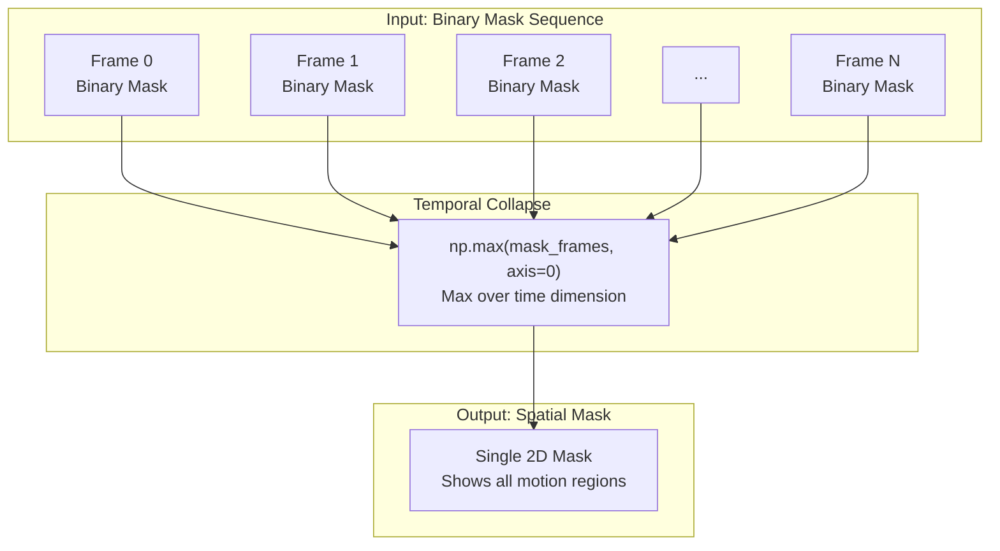
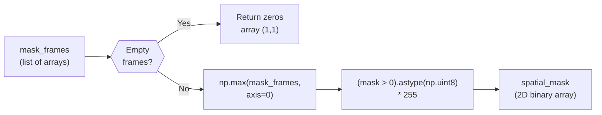
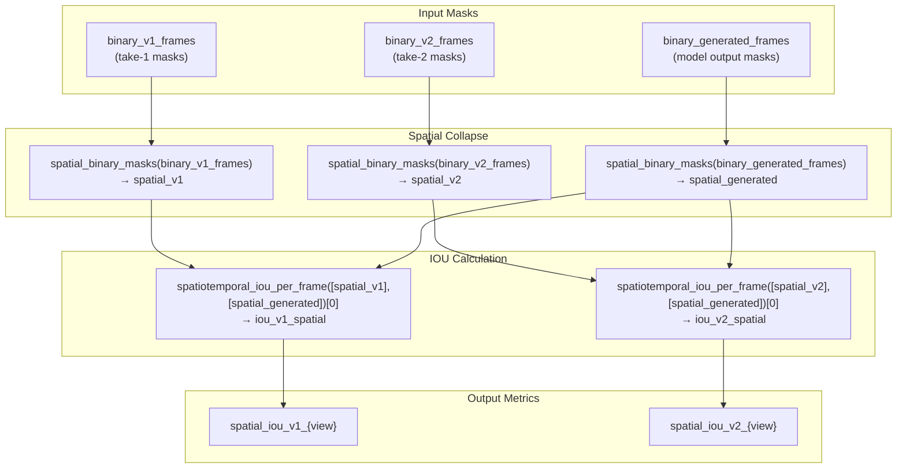
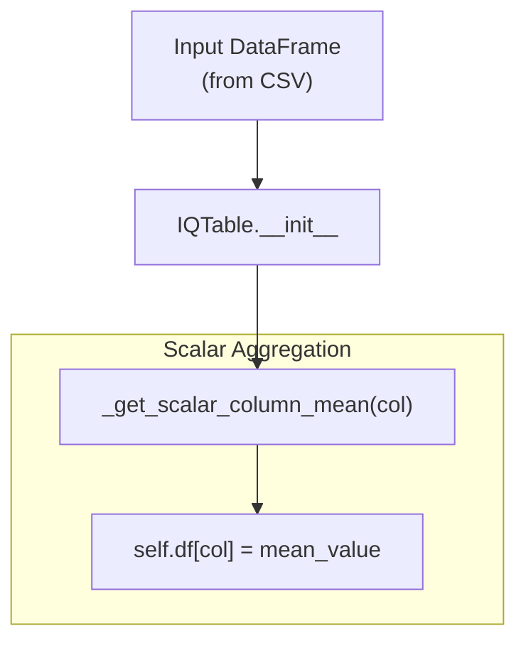
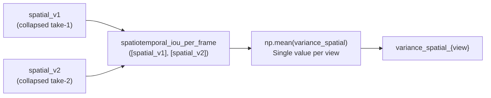
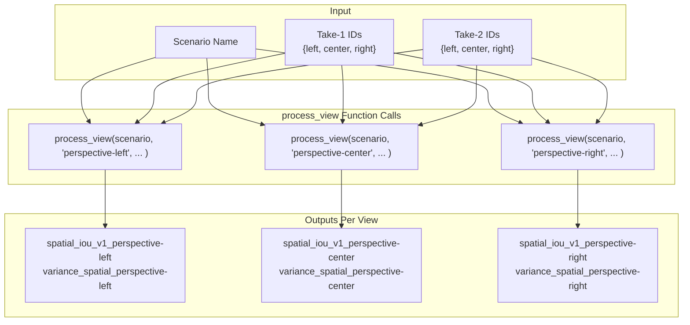
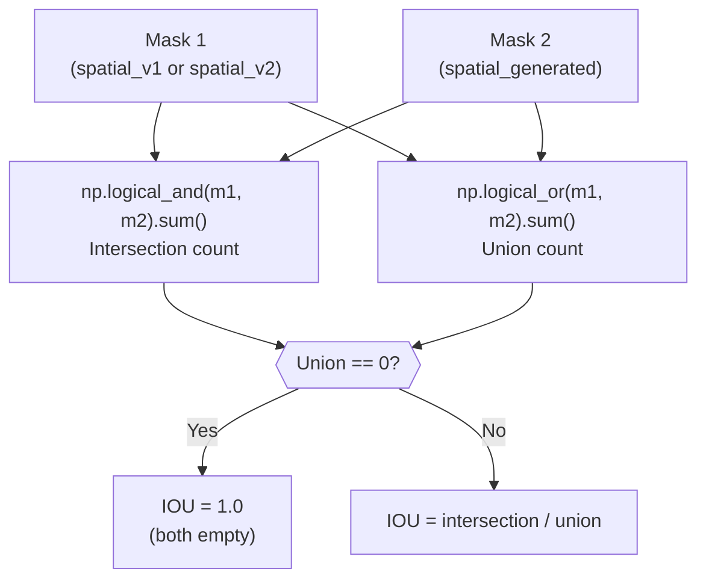
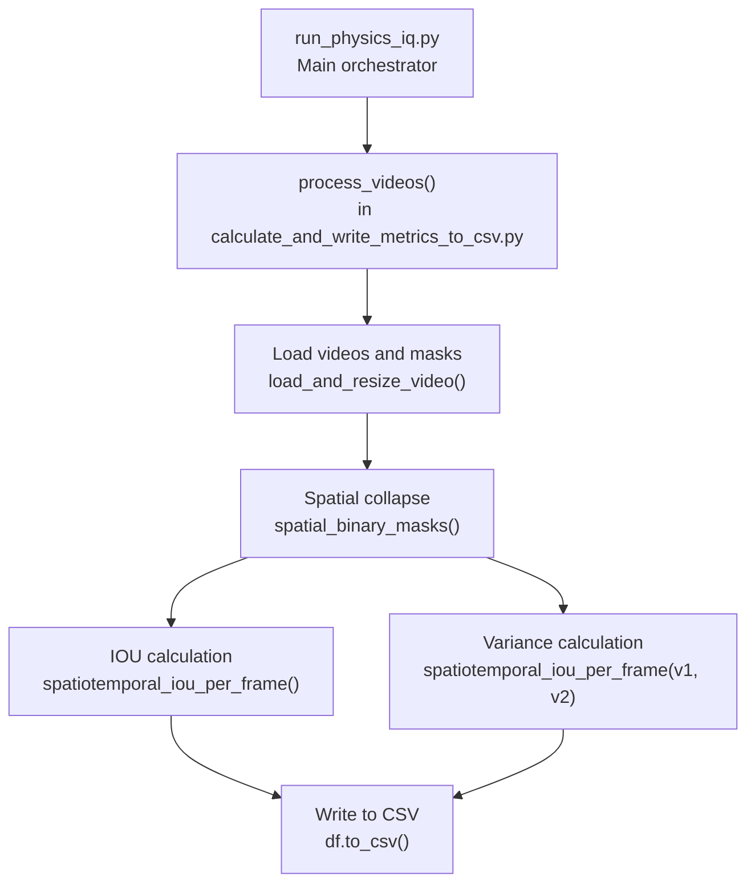

<!-- source: DeepWiki mcp.deepwiki.com · repo google-deepmind/physics-IQ-benchmark · page 5.2 Spatial IOU Metrics · fetched 2026-10-26 -->

# Spatial IOU Metrics

<details>
<summary>Relevant source files</summary>

The following files were used as context for generating this wiki page:

- [physiq/calculate_iq_score_stable.py](physiq/calculate_iq_score_stable.py)

</details>


## Purpose and Scope

This document describes the **spatial IOU metrics** used in the Physics-IQ benchmark evaluation pipeline. These metrics collapse the temporal dimension of binary masks to focus exclusively on the spatial extent of motion, answering the question: *"Does the generated video show motion in the same regions as the real video, regardless of timing?"*

Spatial IOU metrics differ from [Spatiotemporal IOU Metrics](#5.1), which evaluate frame-by-frame overlap, and [Weighted Spatial IOU Metrics](#5.3), which use motion intensity maps. For information about variance calculations, see [Variance Metrics](#5.5). The role of spatial IOU in the final score is documented in [Physics-IQ Score Formula](#5.6).

---

## Temporal Collapse Strategy

### Max Operation Over Time

The spatial IOU metric begins by collapsing binary mask sequences from 3D (frames × height × width) to 2D (height × width). This collapse uses a **max operation** over the temporal axis, which produces a single mask showing all pixels where motion occurred at any point during the video.



**Mathematical Definition:**

For binary mask sequence **M** with shape `(T, H, W)`:

```
spatial_mask[h, w] = max(M[0:T, h, w])
                   = 1 if any frame has motion at (h,w)
                   = 0 otherwise
```

The resulting spatial mask is then binarized to ensure pixel values are either 0 or 255 for consistency [physiq/calculate_and_write_metrics_to_csv.py:88-90]().

**Sources:** [physiq/calculate_and_write_metrics_to_csv.py:78-90]()

---

## Implementation: `spatial_binary_masks` Function

### Function Signature and Logic

The `spatial_binary_masks` function implements the temporal collapse operation:



**Error Handling:**

The function includes defensive programming for edge cases:
- **Empty input**: Returns a `(1, 1)` zero array to prevent downstream errors [physiq/calculate_and_write_metrics_to_csv.py:81-85]().
- **Warning message**: Prints diagnostic information when empty frames are detected [physiq/calculate_and_write_metrics_to_csv.py:82-84]().

**Type Conversion:**

The binarization step `(spatial_mask > 0).astype(np.uint8) * 255` ensures:
1. Any non-zero value becomes 1 (boolean conversion)
2. Cast to unsigned 8-bit integer
3. Scale to 255 for standard binary mask representation [physiq/calculate_and_write_metrics_to_csv.py:88-90]().

**Sources:** [physiq/calculate_and_write_metrics_to_csv.py:78-90]()

---

## Spatial IOU Computation Pipeline

### Processing Flow for Each Scenario

The spatial IOU calculation follows a multi-stage pipeline that processes both real and generated videos:



**Note on Reuse:** The spatial IOU calculation reuses the `spatiotemporal_iou_per_frame` function but applies it to single-frame inputs (the collapsed spatial masks) [physiq/calculate_and_write_metrics_to_csv.py:311-318](). This is why index `[0]` is used to extract the single IOU value from the returned list.

**Sources:** [physiq/calculate_and_write_metrics_to_csv.py:310-318]()

---

## Scalar-Key Aggregation in IQTable

The `IQTable` class handles the aggregation of these spatial metrics. Unlike spatiotemporal metrics which are stored as lists of per-frame values, spatial IOU metrics are **scalar keys** because they represent a single temporal collapse [physiq/calculate_iq_score_stable.py:104-105]().

### Data Flow in IQTable



**Key Mapping:**
- `spatial_iou_v1` is defined as a primary metric key [physiq/calculate_iq_score_stable.py:73]().
- During construction, `IQTable` iterates through all views (left, center, right) and computes a cross-view mean for these scalar keys [physiq/calculate_iq_score_stable.py:104-105]().

**Sources:** [physiq/calculate_iq_score_stable.py:50-112](), [physiq/calculate_iq_score_stable.py:104-105]()

---

## Dual-Take Comparison

### V1 and V2 Metrics

The spatial IOU is calculated against both takes of the real video to capture natural variation:

| Metric | Description | Calculation | Purpose |
|--------|-------------|-------------|---------|
| `spatial_iou_v1_{view}` | Spatial overlap with take-1 | IOU(spatial_v1, spatial_generated) | Primary accuracy measure |
| `spatial_iou_v2_{view}` | Spatial overlap with take-2 | IOU(spatial_v2, spatial_generated) | Secondary accuracy measure |
| `variance_spatial_{view}` | Natural variation baseline | IOU(spatial_v1, spatial_v2) | Physical randomness quantification |

**Interpretation:**

- **High v1 and v2 scores**: Generated video shows motion in correct spatial regions.
- **Low v1 and v2 scores**: Generated video's motion is spatially misaligned.
- **High variance**: Real physics exhibits significant spatial variation (more forgiving scoring).
- **Low variance**: Real physics is deterministic (stricter scoring requirements).

**Sources:** [physiq/calculate_and_write_metrics_to_csv.py:311-318](), [physiq/calculate_and_write_metrics_to_csv.py:343-345]()

---

## Variance Calculation

### Quantifying Physical Randomness

The spatial variance metric measures how much the spatial extent of motion differs between two takes of the same physical scenario:



**Implementation Details:**

The variance is computed as a single-element list from `spatiotemporal_iou_per_frame`, then averaged (which in this case is a no-op, but maintains consistency with other variance metrics) [physiq/calculate_and_write_metrics_to_csv.py:343-345]().

**Sources:** [physiq/calculate_and_write_metrics_to_csv.py:343-345](), [physiq/calculate_and_write_metrics_to_csv.py:360]()

---

## Multi-View Processing

### Perspective-Specific Metrics

Spatial IOU metrics are calculated independently for each of the three camera perspectives defined in `VIEWS` [physiq/calculate_iq_score.py:33]():



**Parallel Execution:**

The three views are processed using a thread pool with `processes=1` (effectively sequential but using async pattern) to manage resource usage [physiq/calculate_and_write_metrics_to_csv.py:423-436]().

**Sources:** [physiq/calculate_and_write_metrics_to_csv.py:423-436](), [physiq/calculate_iq_score.py:33]()

---

## Relationship to IOU Formula

### Intersection Over Union Computation

The spatial IOU relies on the `spatiotemporal_iou_per_frame` function, which implements the standard IOU formula [physiq/calculate_and_write_metrics_to_csv.py:171-182]():



**Edge Case Handling:**

When both masks are completely empty (no motion detected), the function returns `IOU = 1.0`, representing perfect agreement that no motion occurred [physiq/calculate_and_write_metrics_to_csv.py:179-180]().

**Sources:** [physiq/calculate_and_write_metrics_to_csv.py:171-182]()

---

## Integration in Evaluation Pipeline

### Execution Context

The spatial IOU metrics are computed as part of the `process_view` function within the main `process_videos` pipeline:



**Processing Order:**

1. FPS normalization (via `fps_changer.py`)
2. Binary mask generation (via `binary_mask_generator.py`)
3. **Spatial IOU calculation** (current step)
4. Score aggregation (via `calculate_iq_score_stable.py`)

**Sources:** [physiq/calculate_and_write_metrics_to_csv.py:42-76](), [physiq/calculate_and_write_metrics_to_csv.py:214-374]()

---

