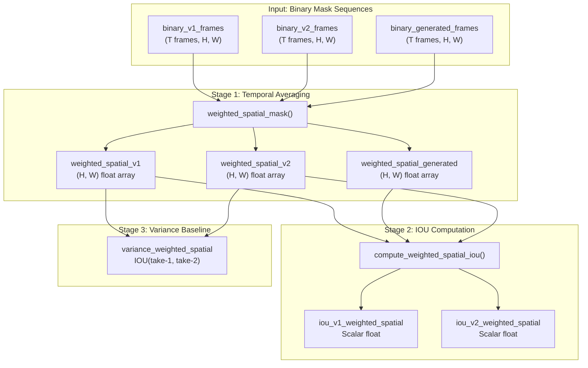
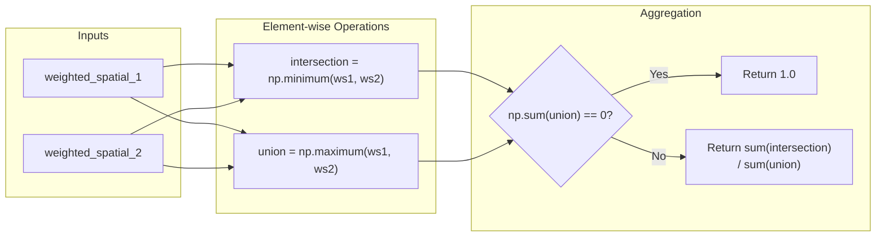

<!-- source: DeepWiki mcp.deepwiki.com · repo google-deepmind/physics-IQ-benchmark · page 5.3 Weighted Spatial IOU Metrics · fetched 2026-10-26 -->

# Weighted Spatial IOU Metrics

<details>
<summary>Relevant source files</summary>

The following files were used as context for generating this wiki page:

- [physiq/calculate_iq_score_stable.py](physiq/calculate_iq_score_stable.py)

</details>


## Purpose and Scope

This page documents the **weighted spatial IOU metrics** used in the Physics-IQ benchmark evaluation pipeline. These metrics measure the similarity of motion intensity patterns between generated and real videos by creating weighted spatial maps through temporal averaging of binary masks. Unlike regular spatial IOU metrics that use max-pooling over time (see [Spatial IOU Metrics](5.2)), weighted spatial IOU captures motion frequency and intensity, providing a more nuanced evaluation of where and how often objects move in the scene.

The weighted spatial IOU family consists of three metrics:
- `weighted_spatial_iou_v1`: Comparison against take-1 real videos [physiq/calculate_and_write_metrics_to_csv.py:358-358]()
- `weighted_spatial_iou_v2`: Comparison against take-2 real videos [physiq/calculate_and_write_metrics_to_csv.py:359-359]()
- `variance_weighted_spatial`: Baseline variation between take-1 and take-2 [physiq/calculate_and_write_metrics_to_csv.py:360-360]()

These metrics are computed per camera view and contribute to the final Physics-IQ score through variance normalization (see [Physics-IQ Score Formula](5.6)).

---

## Conceptual Overview

The weighted spatial IOU metric addresses a fundamental limitation of binary spatial IOU: it cannot distinguish between objects that move once versus objects that move repeatedly through the same space. By averaging binary masks over time instead of taking their maximum, the weighted spatial approach creates **motion intensity maps** where pixel values reflect how frequently motion occurs at each location.

### Motion Intensity Maps

A motion intensity map is computed by summing binary mask frames across the temporal dimension and normalizing by the number of frames. The resulting values range from 0 (no motion) to 1 (motion in every frame):

```
motion_intensity(x, y) = (Σ mask_t(x, y)) / T
```

Where:
- `mask_t(x, y)` is the binary mask value at pixel (x, y) in frame t
- `T` is the total number of frames
- Result is normalized to [0, 1] range [physiq/calculate_and_write_metrics_to_csv.py:96-96]()

This produces a grayscale image where brightness indicates motion frequency.

**Sources:** [physiq/calculate_and_write_metrics_to_csv.py:92-97]()

---

## Computation Pipeline

The weighted spatial IOU calculation follows a multi-stage pipeline that transforms binary mask sequences into scalar similarity scores:

### Pipeline Architecture: Data to Score



**Sources:** [physiq/calculate_and_write_metrics_to_csv.py:322-340]()

---

## Implementation Details

### Weighted Spatial Mask Generation

The `weighted_spatial_mask()` function creates motion intensity maps by averaging binary masks across time [physiq/calculate_and_write_metrics_to_csv.py:92-97]():

| Operation | Implementation | Purpose |
|-----------|---------------|---------|
| Summation | `np.sum(mask_frames, axis=0, dtype=np.uint16)` | Accumulate motion across all frames [physiq/calculate_and_write_metrics_to_csv.py:96-96]() |
| Normalization | Divide by `len(mask_frames)` | Convert counts to frequencies [0, 1] [physiq/calculate_and_write_metrics_to_csv.py:96-96]() |
| Data Type | `np.uint16` for sum | Prevent overflow during summation [physiq/calculate_and_write_metrics_to_csv.py:96-96]() |

**Key characteristics:**
- **Input:** List of binary masks (0 or 1 values), shape `(T, H, W)` [physiq/calculate_and_write_metrics_to_csv.py:92-93]()
- **Output:** Float array with values in `[0.0, 1.0]`, shape `(H, W)` [physiq/calculate_and_write_metrics_to_csv.py:97-97]()

**Sources:** [physiq/calculate_and_write_metrics_to_csv.py:92-97]()

### Weighted Spatial IOU Computation

The `compute_weighted_spatial_iou()` function extends traditional IOU to continuous-valued intensity maps [physiq/calculate_and_write_metrics_to_csv.py:154-168]():

### Weighted Spatial IOU Algorithm



**Mathematical Formulation:**
For continuous-valued intensity maps, the IOU is defined as:
`IOU_weighted = Σ min(I₁(x,y), I₂(x,y)) / Σ max(I₁(x,y), I₂(x,y))` [physiq/calculate_and_write_metrics_to_csv.py:168-168]()

**Sources:** [physiq/calculate_and_write_metrics_to_csv.py:154-168]()

---

## Per-View Calculation

The weighted spatial IOU is computed independently for each camera perspective (`perspective-left`, `perspective-center`, `perspective-right`) and compared against both real video takes [physiq/calculate_and_write_metrics_to_csv.py:357-370]().

### Multi-View Metrics Structure

| Metric Type | Code Identifier | Views |
|-------------|-----------------|-------|
| Comparison vs Take-1 | `weighted_spatial_iou_v1` | left, center, right |
| Comparison vs Take-2 | `weighted_spatial_iou_v2` | left, center, right |
| Ground Truth Variance | `variance_weighted_spatial` | left, center, right |

**Sources:** [physiq/calculate_and_write_metrics_to_csv.py:322-370](), [physiq/calculate_iq_score_stable.py:74-78]()

---

## Variance Calculation

The variance metric `variance_weighted_spatial` quantifies natural variation between two takes of the same physical experiment.

### Computation Process

The variance is calculated using the same `compute_weighted_spatial_iou()` function, but comparing take-1 against take-2 [physiq/calculate_and_write_metrics_to_csv.py:338-340]():

```python
# From physiq/calculate_and_write_metrics_to_csv.py:338-340
variance_weighted_spatial = compute_weighted_spatial_iou(
    weighted_spatial_v1, weighted_spatial_v2
)
```

The variance serves as a **normalization factor** in the final Physics-IQ score formula [physiq/calculate_iq_score_stable.py:186-189](). Scenarios with higher natural variation are judged more leniently.

**Sources:** [physiq/calculate_and_write_metrics_to_csv.py:338-340](), [physiq/calculate_iq_score_stable.py:59-62]()

---

## Differences from Spatial IOU

The weighted spatial IOU differs fundamentally from regular spatial IOU in how it collapses the temporal dimension:

| Aspect | Spatial IOU (Max) | Weighted Spatial IOU (Average) |
|--------|------------------|-------------------------------|
| **Temporal Operation** | `np.max(mask_frames, axis=0)` [physiq/calculate_and_write_metrics_to_csv.py:87-87]() | `np.sum(mask_frames, axis=0) / T` [physiq/calculate_and_write_metrics_to_csv.py:96-96]() |
| **Output Values** | Binary (0 or 1) | Continuous [0.0, 1.0] |
| **Captures** | Spatial extent of motion | Motion frequency/intensity |
| **IOU Algorithm** | Binary IOU on collapsed masks | Weighted IOU on intensity maps |

**Sources:** [physiq/calculate_and_write_metrics_to_csv.py:78-97](), [physiq/calculate_and_write_metrics_to_csv.py:310-329]()

---

## Use in Final Score Calculation

In `IQTable`, the weighted spatial IOU metrics are aggregated into a single ratio per scenario [physiq/calculate_iq_score_stable.py:186-189]():

```python
# Logic from compute_metric_ratio in IQTable
(self.weighted_spatial_iou_key, self.variance_weighted_spatial_key)
```

The ratio is computed as the average of `v1` and `v2` IOUs divided by the variance (plus `ratio_eps`) [physiq/calculate_iq_score_stable.py:202-205](). This component is then averaged with other metrics to produce the final Physics-IQ score [physiq/calculate_iq_score_stable.py:228-233]().

**Sources:** [physiq/calculate_iq_score_stable.py:74-82](), [physiq/calculate_iq_score_stable.py:183-206](), [physiq/calculate_iq_score_stable.py:228-233]()

---

