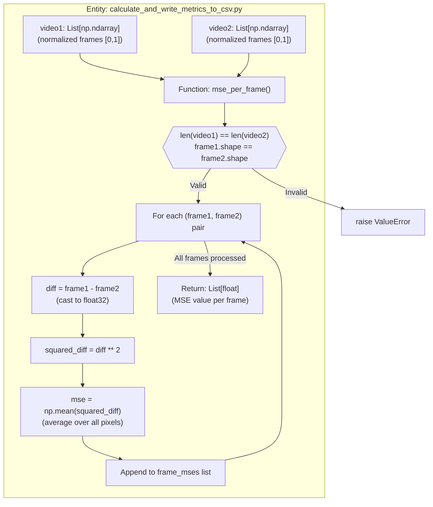
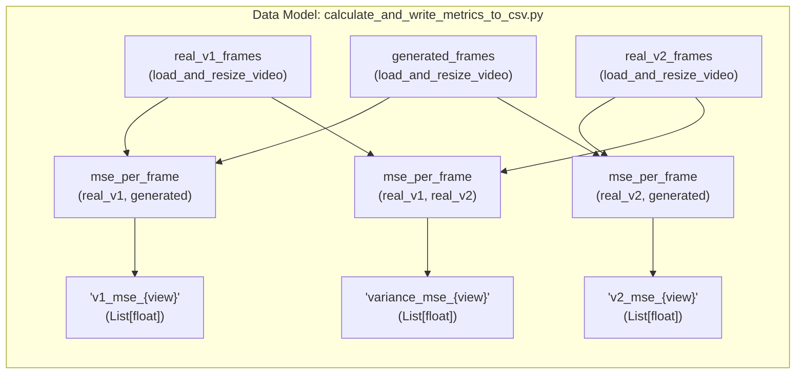
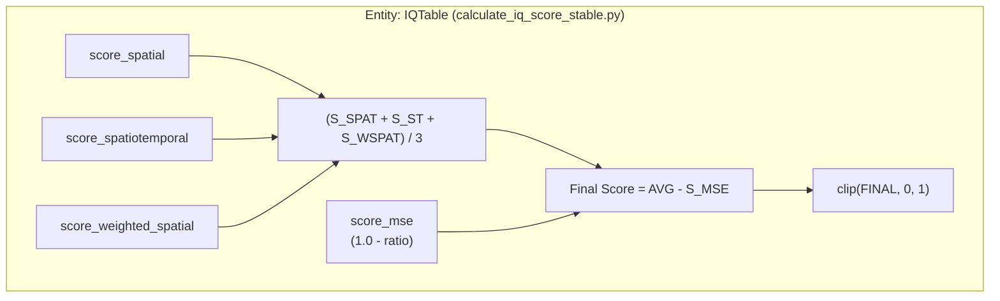

<!-- source: DeepWiki mcp.deepwiki.com · repo google-deepmind/physics-IQ-benchmark · page 5.4 MSE Metrics · fetched 2026-10-26 -->

# MSE Metrics

<details>
<summary>Relevant source files</summary>

The following files were used as context for generating this wiki page:

- [physiq/calculate_iq_score_stable.py](physiq/calculate_iq_score_stable.py)

</details>


## Purpose and Scope

This page documents the Mean Squared Error (MSE) metrics used in the Physics-IQ benchmark to evaluate pixel-level differences between generated and ground truth videos. MSE measures the average squared difference between corresponding pixels across video frames, providing a complementary perspective to the mask-based IOU metrics.

In the final Physics-IQ score formula, the MSE ratio is subtracted from the IoU-based components. This ensures that models are penalized for appearance artifacts and physical inaccuracies that might not be captured by object segmentation masks alone.

---

## Overview

MSE metrics operate directly on pixel intensities rather than binary masks, making them sensitive to appearance errors that may not be captured by structural overlap metrics. The Physics-IQ benchmark computes three distinct MSE values for each scenario and camera view:

| Metric Name | Description | Purpose |
|-------------|-------------|---------|
| `v1_mse` | MSE between generated video and take-1 of ground truth | Primary accuracy measurement against first take |
| `v2_mse` | MSE between generated video and take-2 of ground truth | Primary accuracy measurement against second take |
| `variance_mse` | MSE between take-1 and take-2 of ground truth | Baseline for natural physical variation |

Sources: [physiq/calculate_and_write_metrics_to_csv.py:358-363]()

---

## MSE Calculation Algorithm

### Frame-by-Frame Computation

The `mse_per_frame` function implements the core MSE calculation algorithm. It takes two lists of frames, validates their dimensions, and computes the mean squared difference for each frame pair.



**mse_per_frame Function Flow**

Sources: [physiq/calculate_and_write_metrics_to_csv.py:100-116]()

### Mathematical Formulation

For two video frames $F_1$ and $F_2$ with dimensions $(H, W, C)$:

$$\text{MSE} = \frac{1}{H \times W \times C} \sum_{h=1}^{H} \sum_{w=1}^{W} \sum_{c=1}^{C} (F_1[h,w,c] - F_2[h,w,c])^2$$

Where:
- $H$ = frame height (after resizing to 1/4 original) [physiq/calculate_and_write_metrics_to_csv.py:136-137]()
- $W$ = frame width (after resizing to 1/4 original) [physiq/calculate_and_write_metrics_to_csv.py:136-137]()
- $C$ = 3 (RGB channels)
- Pixel values are normalized to $[0, 1]$ range before computation [physiq/calculate_and_write_metrics_to_csv.py:146-147]()

---

## Three MSE Metric Types

### Metric Computation Workflow



**MSE Metric Computation Pipeline**

Sources: [physiq/calculate_and_write_metrics_to_csv.py:252-266](), [physiq/calculate_and_write_metrics_to_csv.py:352-359]()

### v1_mse and v2_mse

These metrics quantify pixel-level differences between the generated video and each take of the ground truth. They are stored as lists of floats representing the error at each frame.

Sources: [physiq/calculate_and_write_metrics_to_csv.py:358-359]()

### variance_mse

This metric establishes the baseline for natural variation between repeated physical experiments by calculating the MSE between `real_v1` and `real_v2`. In the final score calculation, this is used as a normalization factor to ensure that models are not penalized for differences that are inherent to the physical setup.

Sources: [physiq/calculate_and_write_metrics_to_csv.py:352-354]()

---

## Integration in Score Formula

In the `IQTable` class, MSE metrics are processed through a specific ratio and inversion logic to contribute to the final Physics-IQ score.

### MSE Inversion and Ratio

Unlike IoU metrics where higher is better, MSE represents an error (lower is better). The `IQTable.compute_metric_ratio` method handles this by subtracting the MSE ratio from 1.0.

```python
# Logic from IQTable.compute_metric_ratio for MSE
# (simplified representation)
mse_ratio = (v1_mse + v2_mse) / (2 * variance_mse + ratio_eps)
score_mse = 1.0 - mse_ratio
```

Sources: [physiq/calculate_iq_score_stable.py:202-205]()

### Final Score Aggregation

The final Physics-IQ score is calculated by averaging the three IoU-based scores and subtracting the MSE-based error component (which has been transformed into a similarity score).



Sources: [physiq/calculate_iq_score_stable.py:246-255](), [physiq/calculate_iq_score_stable.py:270-279]()

---

## Implementation Details

### Video Preprocessing
Before MSE calculation, all videos undergo standardized preprocessing via `load_and_resize_video`. This includes resizing to 1/4 resolution (to focus on structural rather than high-frequency texture errors) and normalizing pixel values to the `[0, 1]` range.

Sources: [physiq/calculate_and_write_metrics_to_csv.py:119-151]()

### Memory Management
Because processing high-resolution video frames is memory-intensive, the pipeline explicitly deletes frame arrays and triggers garbage collection after each view is processed.

Sources: [physiq/calculate_and_write_metrics_to_csv.py:372-373]()

### Multi-View Handling
The evaluation script processes all three camera perspectives (`perspective-left`, `perspective-center`, `perspective-right`) for every scenario. The MSE results for each view are recorded separately in the output CSV.

Sources: [physiq/calculate_and_write_metrics_to_csv.py:423-437]()

---

