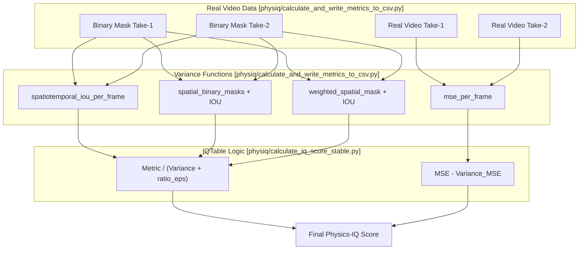
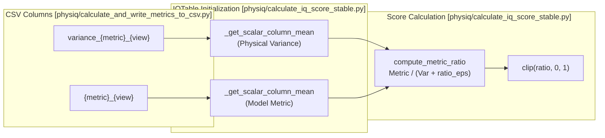

<!-- source: DeepWiki mcp.deepwiki.com · repo google-deepmind/physics-IQ-benchmark · page 5.5 Variance Metrics · fetched 2026-10-26 -->

# Variance Metrics

<details>
<summary>Relevant source files</summary>

The following files were used as context for generating this wiki page:

- [physiq/calculate_iq_score_stable.py](physiq/calculate_iq_score_stable.py)

</details>


Variance metrics quantify the natural physical variation between two identical experimental setups (take-1 and take-2), establishing a baseline for expected differences due to real-world randomness. These variance values are used to normalize evaluation scores, ensuring that generated videos are penalized for systematic physics violations rather than natural stochasticity.

In the `IQTable` implementation, these metrics are used to calculate the final Physics-IQ score by dividing IOU-based metrics by their physical variance [physiq/calculate_iq_score_stable.py:59-62]().

## Variance Computation Strategy

The Physics-IQ benchmark records each scenario twice (take-1 and take-2) under nominally identical conditions. Variance metrics compare these two takes to measure inherent unpredictability caused by factors like air currents or initial condition sensitivity.

The diagram below illustrates how the evaluation pipeline processes real video takes to generate these variance baselines.

### Natural Randomness Baseline Pipeline

**Sources:** [physiq/calculate_and_write_metrics_to_csv.py:343-354](), [physiq/calculate_iq_score_stable.py:59-62](), [physiq/calculate_iq_score_stable.py:183-205]()

## Variance Metric Families

The system computes variance for all four metric families. Each variance metric measures how much take-1 and take-2 differ from each other using the same calculation method applied to generated videos.

### Variance Spatiotemporal IOU
Computed by calling `spatiotemporal_iou_per_frame(binary_v1_frames, binary_v2_frames)` [physiq/calculate_and_write_metrics_to_csv.py:347-349](). This produces a per-frame list of IOU values measuring mask overlap between the two takes.

### Variance Spatial
Computed by collapsing binary masks over time via `np.max()` in `spatial_binary_masks()` [physiq/calculate_and_write_metrics_to_csv.py:89](), then calculating IOU between the collapsed masks [physiq/calculate_and_write_metrics_to_csv.py:343-345](). This measures spatial extent variation rather than trajectory variation.

### Variance Weighted Spatial
This uses motion intensity maps created through temporal averaging. The calculation computes the intersection-over-union of these intensity maps [physiq/calculate_and_write_metrics_to_csv.py:333-340]():
- `intersection = np.minimum(weighted_spatial_v1, weighted_spatial_v2)`
- `union = np.maximum(weighted_spatial_v1, weighted_spatial_v2)`
If both masks are empty, the variance is set to `1.0` [physiq/calculate_and_write_metrics_to_csv.py:338]().

### Variance MSE
Computed via `mse_per_frame(real_v1_frames, real_v2_frames)` [physiq/calculate_and_write_metrics_to_csv.py:352-354](). This measures pixel-level differences between the two takes.

**Sources:** [physiq/calculate_and_write_metrics_to_csv.py:78-116](), [physiq/calculate_and_write_metrics_to_csv.py:333-354]()

## Division by Zero Prevention (`ratio_eps`)

When computing the ratio between a model's performance and the physical variance, the `IQTable` class uses a small constant `ratio_eps = 1e-8` [physiq/calculate_iq_score_stable.py:82]().

This constant is added to the denominator in the `compute_metric_ratio` method [physiq/calculate_iq_score_stable.py:183-205]():

```python
# Implementation logic in IQTable.compute_metric_ratio
numerator = self.df[metric_key]
denominator = self.df[variance_key]
ratio = numerator / (denominator + self.ratio_eps)
```

This ensures that if a physical scenario has zero variance (e.g., a completely static scene where take-1 and take-2 are identical), the score remains finite and stable.

**Sources:** [physiq/calculate_iq_score_stable.py:82](), [physiq/calculate_iq_score_stable.py:205]()

## Aggregation and Normalization Flow

The `IQTable` class handles the aggregation of these metrics across views and their subsequent use in scoring.

### Data Flow from CSV to Score Components

**Sources:** [physiq/calculate_iq_score_stable.py:94-105](), [physiq/calculate_iq_score_stable.py:183-205](), [physiq/calculate_iq_score_stable.py:228-245]()

### Interpretation of Variance-Normalized Scores

The variance normalization implements **variance-aware scoring**:

1.  **High Variance Scenarios**: If take-1 and take-2 differ significantly (low IOU variance), the denominator in the ratio calculation is small. The model's performance is scaled relative to this baseline.
2.  **Low Variance Scenarios**: If take-1 and take-2 are nearly identical (high IOU variance), the model must match the ground truth very closely to achieve a high score.
3.  **MSE Adjustment**: Unlike IOUs, MSE variance is subtracted from the model's MSE [physiq/calculate_iq_score_stable.py:255](). This reduces the penalty for pixel-level differences that are naturally present in the physical setup.

| Metric Component | Formula in `IQTable` | Source |
| :--- | :--- | :--- |
| **IOU Ratios** | `metric / (physical_variance + 1e-8)` | [physiq/calculate_iq_score_stable.py:205]() |
| **MSE Score** | `1.0 - clip(mse - physical_variance_mse)` | [physiq/calculate_iq_score_stable.py:255]() |

**Sources:** [physiq/calculate_iq_score_stable.py:205](), [physiq/calculate_iq_score_stable.py:247-260]()

---

