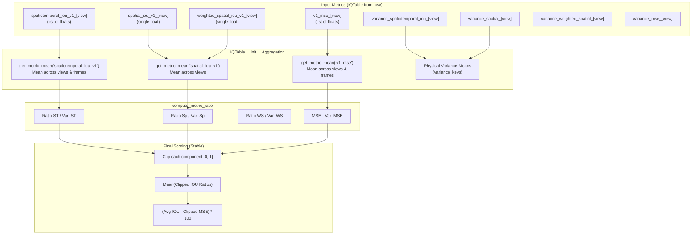
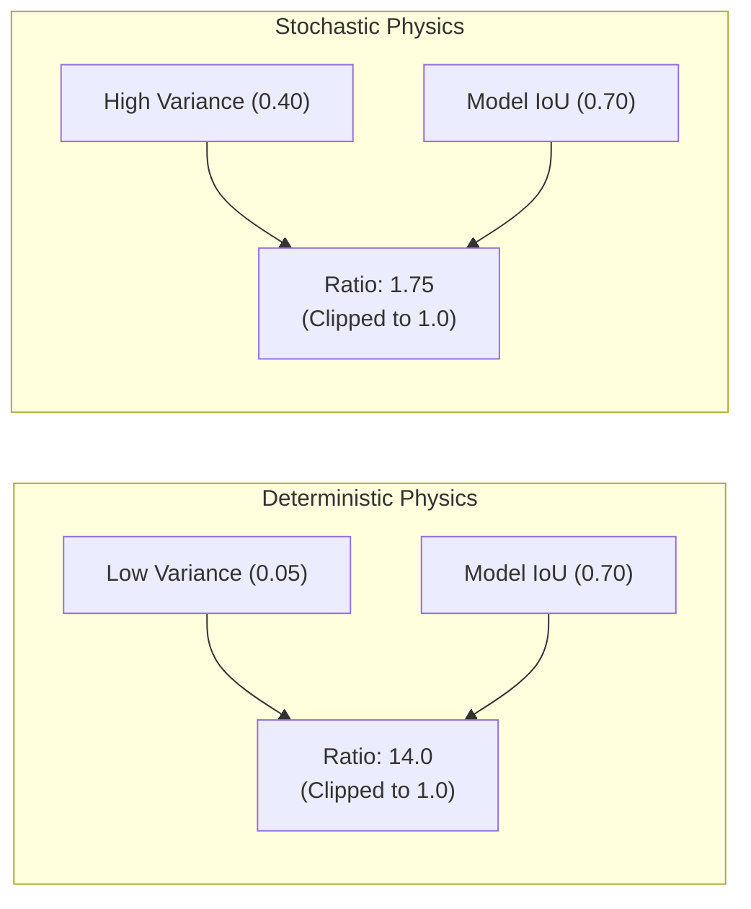

<!-- source: DeepWiki mcp.deepwiki.com · repo google-deepmind/physics-IQ-benchmark · page 5.6 Physics-IQ Score Formula · fetched 2026-10-26 -->

# Physics-IQ Score Formula

Relevant source files

The following files were used as context for generating this wiki page:

- [physiq/calculate_iq_score_stable.py](physiq/calculate_iq_score_stable.py)
- [physiq/tests/test_scoring_equivalence.py](physiq/tests/test_scoring_equivalence.py)

## Purpose and Scope

This page documents the final Physics-IQ score calculation formula, which aggregates individual metrics (spatiotemporal IOU, spatial IOU, weighted spatial IOU, and MSE) into a single 0-100% score that quantifies a generative video model's physical understanding. The formula implements variance normalization to ensure that models are rewarded for matching natural physical randomness rather than being penalized for unavoidable variation.

The Physics-IQ benchmark supports two scoring variants:
1.  **Stable Score (Verified):** The primary metric for the Physics-IQ Verified leaderboard. It clips component ratios to [0, 1] before aggregation to prevent extreme outliers from skewing the total.
2.  **Original Score:** The legacy metric that aggregates raw ratios and clips only the final result.

The primary interface for these calculations is the `IQTable` class located in [physiq/calculate_iq_score_stable.py:50-244]().

---

## Mathematical Formula

The Physics-IQ score is derived from four underlying metrics:
*   **IoU_ST:** Spatiotemporal IOU
*   **IoU_Sp:** Spatial IOU
*   **IoU_WS:** Weighted Spatial IOU
*   **MSE:** Mean Squared Error

### The Component Ratios
For each IOU metric $M$, a ratio is calculated against its physical variance $V$:
$$Ratio_M = \frac{M}{V + \epsilon}$$
Where $\epsilon$ (`ratio_eps`) is $1e-8$ to prevent division by zero [physiq/calculate_iq_score_stable.py:82]().

For MSE, the adjustment is subtractive:
$$Adj_{MSE} = MSE - V_{MSE}$$

### Stable vs. Original Aggregation
The difference lies in when clipping is applied:

**Stable (Verified) Score:**
$$Score_{stable} = \text{mean}(\text{clip}(Ratio_{ST}), \text{clip}(Ratio_{Sp}), \text{clip}(Ratio_{WS})) - \text{clip}(Adj_{MSE})$$
*Implementation:* [physiq/calculate_iq_score_stable.py:202-224]()

**Original Score:**
$$Score_{orig} = \text{clip}\left(\text{mean}(Ratio_{ST}, Ratio_{Sp}, Ratio_{WS}) - Adj_{MSE}\right)$$
*Implementation:* [physiq/calculate_iq_score_stable.py:226-244]()

**Sources:** [physiq/calculate_iq_score_stable.py:57-71](), [physiq/calculate_iq_score_stable.py:183-200]()

---

## Formula Components Data Flow

**Diagram: Physics-IQ Score Calculation Pipeline**

This diagram shows how `IQTable` processes metrics. Raw metrics from the CSV file are aggregated across camera views (`perspective-left`, `perspective-center`, `perspective-right`) during object initialization [physiq/calculate_iq_score_stable.py:94-105]().

**Sources:** [physiq/calculate_iq_score_stable.py:84-112](), [physiq/calculate_iq_score_stable.py:183-224]()

---

## Metric Aggregation and View Averaging

The system processes three camera perspectives independently, then averages results. The constant `VIEWS` is defined in [physiq/calculate_iq_score.py:25]().

### List vs. Scalar Aggregation
`IQTable` distinguishes between metrics that are per-frame lists and those that are per-scenario scalars:

| Metric Type | Keys | Aggregation Logic |
| :--- | :--- | :--- |
| **List-based** | `spatiotemporal`, `mse` | Concatenates all views' frame lists before computing the mean [physiq/calculate_iq_score_stable.py:278-285](). |
| **Scalar-based** | `spatial`, `weighted_spatial` | Computes the mean across the view columns [physiq/calculate_iq_score_stable.py:287-290](). |

### Per-View Averaging (Verified Score)
For the Verified leaderboard, scores are often calculated per-view first and then averaged. `IQTable` supports this via `compute_final_score_stable(per_view=True)`, which populates `final_score_view` [physiq/calculate_iq_score_stable.py:218-224]().

**Sources:** [physiq/calculate_iq_score_stable.py:94-105](), [physiq/calculate_iq_score_stable.py:273-290]()

---

## Variance Normalization Rationale

The variance normalization step is the key innovation that distinguishes Physics-IQ. By dividing each IOU by its corresponding variance, the formula answers: **"Is the model's deviation from ground truth within the range of natural physical randomness?"**

**Diagram: Variance Normalization Effect**

In the **Stable** formula, component-wise clipping ensures that even if a model performs "better" than the variance baseline (Ratio > 1.0), it is capped at a perfect component score of 1.0 [physiq/calculate_iq_score_stable.py:36-38]().

**Sources:** [physiq/calculate_iq_score_stable.py:58-71](), [physiq/calculate_iq_score_stable.py:205-212]()

---

## Implementation Details

### The `IQTable` Class
The `IQTable` class acts as the central hub for scoring. It ensures data integrity by hashing the underlying DataFrame on construction [physiq/calculate_iq_score_stable.py:108-112]() and verifying it before computation [physiq/calculate_iq_score_stable.py:114-122]().

### Score Equivalence
The `Original Score` variant is maintained for backwards compatibility. Tests verify that `IQTable.compute_final_score_orig()` matches the legacy `calculate_iq_score()` function output when scaled by 100 [physiq/tests/test_scoring_equivalence.py:16-38]().

### Summary of Keys
`IQTable` uses specific internal keys for the different metric families:
*   `spatial_iou_v1` [physiq/calculate_iq_score_stable.py:73]()
*   `weighted_spatial_iou_v1` [physiq/calculate_iq_score_stable.py:74]()
*   `spatiotemporal_iou_v1` [physiq/calculate_iq_score_stable.py:75]()
*   `v1_mse` [physiq/calculate_iq_score_stable.py:76]()

**Sources:** [physiq/calculate_iq_score_stable.py:73-82](), [physiq/tests/test_scoring_equivalence.py:66-70]()

---

## Interpretation Guidelines

The final Physics-IQ score (Verified) is reported on a **0-100%** scale.

| Score Range | Interpretation |
| :--- | :--- |
| **90-100%** | Near-perfect physical understanding; model variation matches real-world variance. |
| **50-69%** | Moderate understanding; typical of state-of-the-art multiframe models. |
| **10-29%** | Limited understanding; typical of baseline Image-to-Video models. |
| **0%** | Poor understanding; errors significantly exceed physical variance baselines. |

The final rounding to 2 decimal places is performed at the output stage [physiq/calculate_iq_score.py:152]().

**Sources:** [physiq/calculate_iq_score_stable.py:216](), [physiq/calculate_iq_score.py:151-152]()

---

