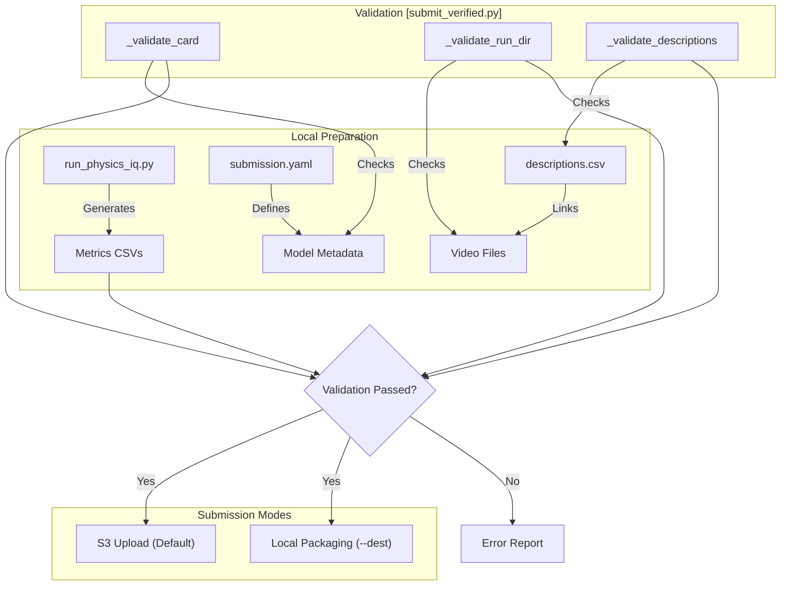
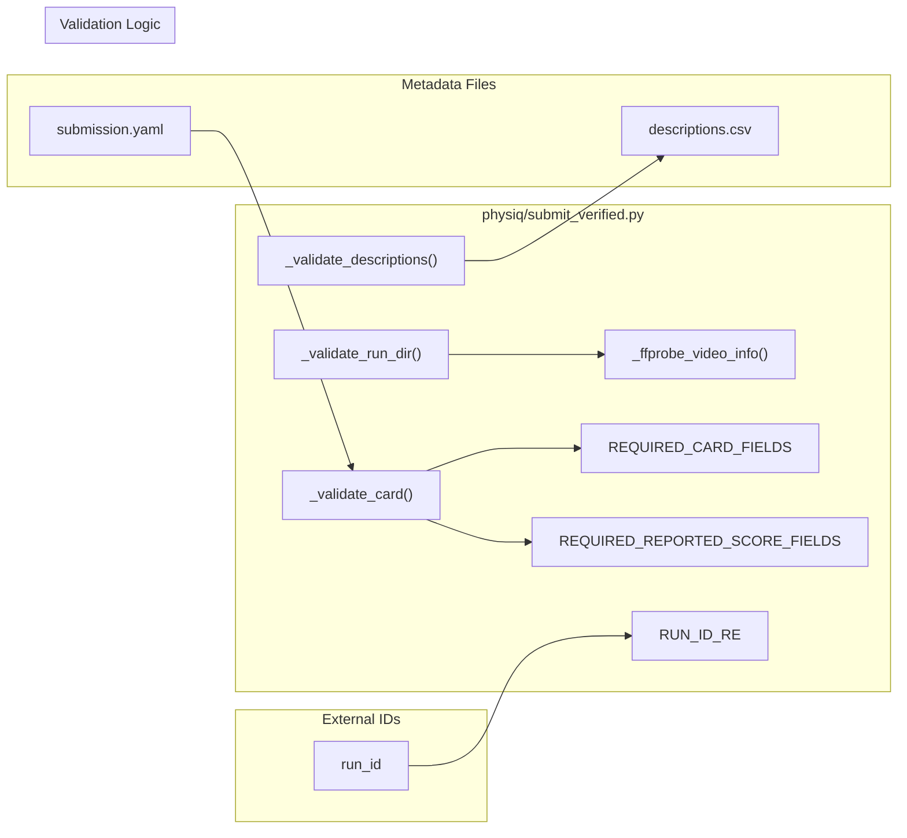

<!-- source: DeepWiki mcp.deepwiki.com · repo google-deepmind/physics-IQ-benchmark · page 6 Submission Pipeline · fetched 2026-10-26 -->

# Submission Pipeline

Relevant source files

The following files were used as context for generating this wiki page:

- [physiq/submit_verified.py](physiq/submit_verified.py)
- [physiq/tests/test_submit.py](physiq/tests/test_submit.py)
- [submission_verified/example/submission.yaml](submission_verified/example/submission.yaml)
- [submission_verified/submission.yaml](submission_verified/submission.yaml)

The **Physics-IQ Verified** submission pipeline is a standardized workflow for contributing model evaluation results to the official leaderboard. It enforces strict validation on video formats, metadata accuracy, and legal warranties to ensure the integrity and reproducibility of the benchmark results.

The process involves generating a `submission.yaml` manifest, validating the local run directory against the Physics-IQ Verified dataset requirements, and uploading the package to a secure S3 bucket or a local destination for manual sharing.

### Submission Workflow Overview

The submission process is orchestrated by `submit_verified.py`, which performs automated checks before any data transfer occurs.

**Sources:**
- `physiq/submit_verified.py` [15-49]()
- `physiq/tests/test_submit.py` [15-38]()

---

### 6.1 Submission Card (`submission.yaml`)
The submission card is the authoritative metadata file for a leaderboard entry. It contains:
*   **`public_info`**: Organization name, model version, `input_type` (t2v, i2v, v2v), and generation parameters.
*   **`reported_scores`**: The Physics-IQ scores (mean and std) computed by the evaluation pipeline.
*   **Conditional Fields**: Specific requirements for `generation_gpu` and `upsample_time` if the model is not accessed via API.
*   **Terms and Warranties**: Legal affirmations regarding IP rights and data privacy.

For details, see [Submission Card (submission.yaml)](#6.1).

**Sources:**
- `submission_verified/submission.yaml` [6-146]()
- `physiq/submit_verified.py` [125-179]()

---

### 6.2 Validation Requirements
To ensure fairness, `submit_verified.py` enforces a strict protocol:
*   **Video Count**: Exactly 198 MP4 files must be present [physiq/submit_verified.py:182]().
*   **Duration**: Every video must be exactly 5.0 seconds [physiq/submit_verified.py:183]().
*   **Naming**: Files must use 4-digit zero-padded prefixes (e.g., `0001_video.mp4`) [physiq/tests/test_submit.py:136-144]().
*   **Consistency**: Resolution and FPS must match the values declared in the `submission.yaml` card across all 198 videos.

For details, see [Validation Requirements](#6.2).

**Sources:**
- `physiq/submit_verified.py` [182-210]()
- `physiq/tests/test_submit.py` [105-189]()

---

### 6.3 Submitting to the Leaderboard
The submission tool supports two primary modes of operation:
1.  **S3 Upload**: Direct upload to `anates-physics-iq-submissions` using AWS session tokens [physiq/submit_verified.py:63-64]().
2.  **Local Packaging**: Using the `--dest` flag to assemble a validated submission folder locally for offline transfer [physiq/submit_verified.py:32-42]().

Submitters can use `--validate-only` to dry-run the checks without attempting an upload.

For details, see [Submitting to the Leaderboard](#6.3).

**Sources:**
- `physiq/submit_verified.py` [22-49]()

---

### 6.4 Aggregating Multiple Runs
For models that require multiple evaluation runs (e.g., to compute variance across different seeds), the `aggregate_runs_from_csvs.py` script is used. It combines up to four CSV files generated by `run_physics_iq.py` to produce the final `physiq_mean` and `physiq_std` values required for the submission card.

For details, see [Aggregating Multiple Runs](#6.4).

**Sources:**
- `physiq/submit_verified.py` [103-114]()
- `submission_verified/example/submission.yaml` [35-45]()

---

### Code Entity Map: Submission System

This diagram maps the high-level submission concepts to the specific Python functions and variables in the codebase.

**Sources:**
- `physiq/submit_verified.py` [65-122]()
- `physiq/submit_verified.py` [188-213]()
- `physiq/tests/test_submit.py` [29-38]()

---

