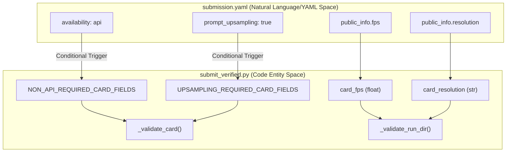
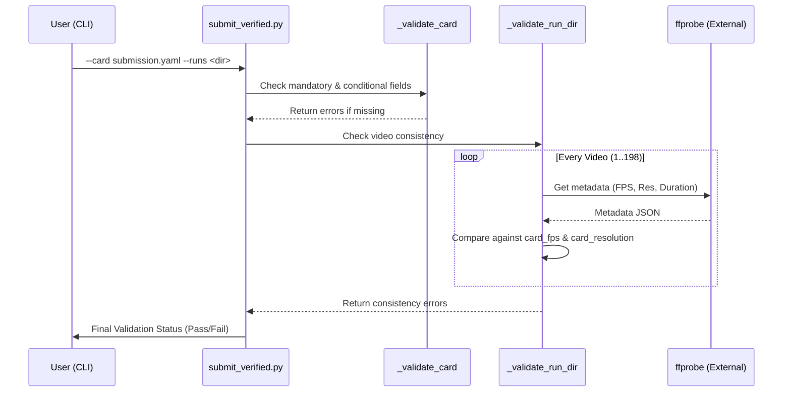

<!-- source: DeepWiki mcp.deepwiki.com · repo google-deepmind/physics-IQ-benchmark · page 6.1 Submission Card (submission.yaml) · fetched 2026-10-26 -->

# Submission Card (submission.yaml)

Relevant source files

The following files were used as context for generating this wiki page:

- [physiq/submit_verified.py](physiq/submit_verified.py)
- [physiq/tests/test_submit.py](physiq/tests/test_submit.py)
- [submission_verified/example/submission.yaml](submission_verified/example/submission.yaml)
- [submission_verified/submission.yaml](submission_verified/submission.yaml)

The `submission.yaml` file serves as the formal manifest for submitting evaluation results to the Physics-IQ Verified leaderboard. It contains model metadata, self-reported scores, and legal warranties required for a valid submission. This document details the schema, validation logic, and the conditional requirements for different model access tiers.

## Purpose and Scope

The submission card provides the necessary context for analyzing model performance across the five physics categories. It bridges the raw evaluation metrics produced by `run_physics_iq.py` with the metadata needed for the public leaderboard. The `submit_verified.py` script uses this card to validate that the submitted video files match the claimed performance and technical specifications [physiq/submit_verified.py:16-49]().

## Submission Card Structure

The YAML file is divided into four primary sections: `public_info`, `reported_scores`, `terms`, and `warranties`.

### 1. Public Info (`public_info`)
This section documents the technical specifications of the model and the generation process.

| Field | Type | Description |
| :--- | :--- | :--- |
| `organization` | string | Submitting entity name [submission_verified/submission.yaml:8](). |
| `model` | string | Display name for the leaderboard [submission_verified/submission.yaml:11](). |
| `input_type` | string | Modality: `t2v`, `i2v`, or `v2v` [submission_verified/submission.yaml:19](). |
| `fps` | float | The frame rate of the generated videos [submission_verified/submission.yaml:26](). |
| `resolution` | string | Output resolution (e.g., "1280x720") [submission_verified/submission.yaml:29](). |
| `availability` | string | Access tier: `public`, `api`, `research`, or `private` [submission_verified/submission.yaml:64](). |
| `prompt_upsampling`| bool | Whether prompts were rewritten by a LLM [submission_verified/submission.yaml:43](). |

### 2. Reported Scores (`reported_scores`)
Submitters must include the mean and standard deviation for the core metrics calculated during the evaluation phase [submission_verified/submission.yaml:108-127]().

*   `physiq_mean` / `physiq_std`: The aggregate Physics-IQ score (0-100%).
*   `spatial_iou_mean`: Temporal collapse overlap metric.
*   `mse_mean`: Pixel-level mean squared error.
*   `spatiotemporal_iou_mean`: Frame-by-frame 3D overlap.

### 3. Terms and Warranties
The `terms` section requires explicit acceptance of the Physics-IQ Verified Submission Terms (version 1.0) [physiq/submit_verified.py:66](). The `warranties` section consists of five boolean flags (e.g., `no_ip_infringement`, `metadata_accurate`) that must all be set to `true` for a valid submission [physiq/submit_verified.py:116-122]().

**Sources:** [submission_verified/submission.yaml:6-145](), [physiq/submit_verified.py:68-122]()

---

## Validation Logic

The `submit_verified.py` script performs strict validation of the card against the provided video directory.

### Conditional Requirements
Certain fields are only required based on the values of other fields to ensure transparency in compute costs:

*   **API vs. Local:** If `availability` is not `api`, fields like `generation_gpu`, `generation_ngpu`, and `generation_time` become mandatory [physiq/submit_verified.py:151-155]().
*   **Prompt Upsampling:** If `prompt_upsampling` is `true`, the `upsample_cost` must be provided [physiq/submit_verified.py:134-139](). If the model is also not an API model, GPU details for the upsampling must be included [physiq/submit_verified.py:141-149]().

### Technical Verification of Videos
The validator (`_validate_run_dir`) uses `ffprobe` to ensure the videos in the run directory actually match the claims in the `submission.yaml` [physiq/submit_verified.py:188-210]().

| Check | Requirement | Code Pointer |
| :--- | :--- | :--- |
| **Video Count** | Exactly 198 MP4 files | [physiq/submit_verified.py:182]() |
| **Duration** | Exactly 5.0 seconds (±0.001s) | [physiq/submit_verified.py:183-184]() |
| **FPS** | Matches `public_info.fps` (±0.01) | [physiq/submit_verified.py:185]() |
| **Resolution** | Matches `public_info.resolution` | [physiq/submit_verified.py:213]() |
| **Naming** | `0001_video.mp4` through `0198_video.mp4` | [physiq/submit_verified.py:221-224]() |

**Sources:** [physiq/submit_verified.py:125-230](), [physiq/tests/test_submit.py:104-188]()

---

## System Data Flow

The following diagrams illustrate how the `submission.yaml` metadata is validated against the physical video files.

### Metadata to Code Entity Mapping
This diagram shows how YAML fields are mapped to internal Python validation variables and constants.

**Sources:** [physiq/submit_verified.py:68-101](), [physiq/submit_verified.py:125-180]()

### Submission Validation Workflow
This diagram traces the flow from the submission manifest through the validation functions to the final upload or local package.

**Sources:** [physiq/submit_verified.py:125-179](), [physiq/submit_verified.py:213-250](), [physiq/tests/test_submit.py:47-59]()

## Example Manifest
A complete example of a valid `submission.yaml` can be found in the repository at `submission_verified/example/submission.yaml`. It demonstrates the correct formatting for scores (e.g., `physiq_mean: 0.812`) and the ISO 8601 timestamp for terms acceptance [submission_verified/example/submission.yaml:36-51]().

**Sources:** [submission_verified/example/submission.yaml:1-58]()

---

