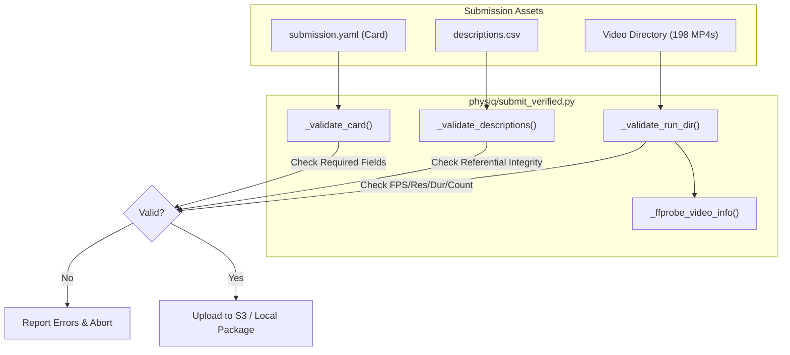

<!-- source: DeepWiki mcp.deepwiki.com · repo google-deepmind/physics-IQ-benchmark · page 6.2 Validation Requirements · fetched 2026-10-26 -->

# Validation Requirements

<details>
<summary>Relevant source files</summary>

The following files were used as context for generating this wiki page:

- [physiq/submit_verified.py](physiq/submit_verified.py)
- [physiq/tests/test_submit.py](physiq/tests/test_submit.py)
- [submission_verified/example/submission.yaml](submission_verified/example/submission.yaml)
- [submission_verified/submission.yaml](submission_verified/submission.yaml)

</details>


The Physics-IQ benchmark enforces a strict validation protocol for submissions to the **Verified Leaderboard**. This process ensures that all evaluated models are compared on a level playing field, with consistent video properties, naming conventions, and metadata integrity. Validation is primarily orchestrated by `submit_verified.py`, which performs automated checks before allowing a submission to be uploaded to the official repository or packaged for sharing.

## Submission ID Format

Every submission must be identified by a unique `run_id`. This ID is used as the directory name for the submission and the S3 prefix during upload.

The `run_id` must strictly follow the format: `<org>__<id>__<YYYY-MM-DD>` [physiq/submit_verified.py:65-65]().
*   **org**: The organization name (lowercase alphanumeric).
*   **id**: A unique identifier for the model or experiment (lowercase alphanumeric, dots, or hyphens).
*   **YYYY-MM-DD**: The date of the submission.

**Sources:**
* [physiq/submit_verified.py:65-65]()

---

## Technical Validation Logic

The `submit_verified.py` script performs deep inspection of the video files and metadata. It utilizes `ffprobe` to extract stream metadata and verify compliance with the submission card.

### Video Property Requirements
The benchmark requires exactly **198 MP4 files** per run [physiq/submit_verified.py:182-182](). Each file must adhere to the following technical specifications:

| Property | Requirement | Tolerance |
| :--- | :--- | :--- |
| **Duration** | Exactly 5.0 seconds [physiq/submit_verified.py:183-183]() | ±0.001s [physiq/submit_verified.py:184-184]() |
| **FPS** | Must match the `fps` field in `submission.yaml` [physiq/submit_verified.py:241-245]() | ±0.01 FPS [physiq/submit_verified.py:185-185]() |
| **Resolution** | Must match the `resolution` field in `submission.yaml` (e.g., "1280x720") [physiq/submit_verified.py:252-256]() | Exact match required |
| **Naming** | `XXXX_video.mp4` (4-digit zero-padded index) [physiq/submit_verified.py:225-230]() | Strict regex |

### Data Flow: Validation Pipeline
The following diagram illustrates how `submit_verified.py` processes a submission directory and validates it against the `submission.yaml` (the "Card").

**Submission Validation Data Flow**

**Sources:**
* [physiq/submit_verified.py:125-179]()
* [physiq/submit_verified.py:188-210]()
* [physiq/submit_verified.py:213-263]()
* [physiq/submit_verified.py:266-281]()

---

## Submission Card (submission.yaml)

The `submission.yaml` file acts as the manifest for the run. It contains metadata about the model, generation costs, and the scores reported by the submitter.

### Mandatory Fields
The validation logic in `_validate_card` checks for several mandatory fields [physiq/submit_verified.py:125-155]():
*   **Public Info**: `organization`, `model`, `model_version`, `input_type`, `fps`, `resolution`, `bon_sampling`, `prompt_upsampling`, `descriptions`, `availability`, `model_source`, `date`, `generation_cost`.
*   **Conditional Fields**: 
    *   If `prompt_upsampling` is true, `upsample_cost` is required [physiq/submit_verified.py:134-139]().
    *   If `availability` is not "api" (meaning the user ran the model locally), GPU details like `generation_gpu`, `generation_ngpu`, and `generation_time` are required [physiq/submit_verified.py:151-155]().

### Reported Scores
Submitters must include the scores calculated by the evaluation pipeline [physiq/submit_verified.py:103-114]():
*   `physiq_mean` and `physiq_std`
*   `spatial_iou_mean` and `spatial_iou_std`
*   `weighted_spatial_iou_mean` and `weighted_spatial_iou_std`
*   `spatiotemporal_iou_mean` and `spatiotemporal_iou_std`
*   `mse_mean` and `mse_std`

**Sources:**
* [submission_verified/submission.yaml:6-145]()
* [physiq/submit_verified.py:68-82]()
* [physiq/submit_verified.py:103-114]()

---

## Referential Integrity

The validation process ensures that the `descriptions.csv` file used for generation matches the videos provided.

1.  **Index Matching**: The `_validate_descriptions` function checks that every video file (0001 to 0198) has a corresponding entry in the `descriptions.csv` file [physiq/submit_verified.py:266-281]().
2.  **Naming Convention**: Videos must be named with a 4-digit prefix followed by `_video.mp4` (e.g., `0001_video.mp4`). If a file like `0005wrong_video.mp4` is found, the validator will flag a naming error [physiq/tests/test_submit.py:137-144]().

**Code-to-System Mapping**
```mermaid
classDiagram
    class "Submission Validator" {
        +_validate_card(card_data)
        +_validate_run_dir(run_dir, fps, res)
        +_validate_descriptions(csv_path, run_dir)
    }
    class "Video Metadata" {
        +fps: float
        +width: int
        +height: int
        +duration: float
    }
    class "submission.yaml" {
        +public_info
        +reported_scores
        +terms
        +warranties
    }

    "Submission Validator" ..> "Video Metadata" : extracted via _ffprobe_video_info()
    "Submission Validator" ..> "submission.yaml" : verifies fields
```

**Sources:**
* [physiq/submit_verified.py:213-263]()
* [physiq/submit_verified.py:266-281]()
* [physiq/tests/test_submit.py:137-144]()

---

## Verification Tests

The codebase includes a comprehensive test suite in `physiq/tests/test_submit.py` that simulates various failure modes to ensure the validator is robust.

| Test Class | Purpose |
| :--- | :--- |
| `TestVideoCount` | Verifies that exactly 198 videos are present; fails if 2 or 199 are found [physiq/tests/test_submit.py:112-127](). |
| `TestNaming` | Ensures files follow the `0000_` prefix format [physiq/tests/test_submit.py:136-149](). |
| `TestFPS` | Detects if videos deviate from the FPS declared in the submission card [physiq/tests/test_submit.py:152-165](). |
| `TestResolution` | Detects if any video resolution (e.g., 128x128) differs from the card (e.g., 64x36) [physiq/tests/test_submit.py:168-180](). |
| `TestDuration` | Flags videos that are not exactly 5.0 seconds long [physiq/tests/test_submit.py:182-189](). |

**Sources:**
* [physiq/tests/test_submit.py:104-189]()

---

