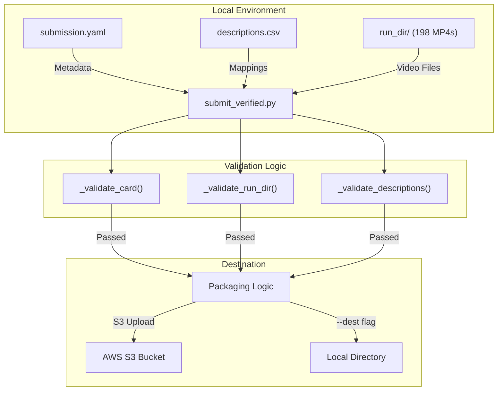

<!-- source: DeepWiki mcp.deepwiki.com · repo google-deepmind/physics-IQ-benchmark · page 6.3 Submitting to the Leaderboard · fetched 2026-10-26 -->

# Submitting to the Leaderboard

<details>
<summary>Relevant source files</summary>

The following files were used as context for generating this wiki page:

- [physiq/generate_verified_example_submission.py](physiq/generate_verified_example_submission.py)
- [physiq/submit_verified.py](physiq/submit_verified.py)
- [submission_verified/example/submission.yaml](submission_verified/example/submission.yaml)
- [submission_verified/submission.yaml](submission_verified/submission.yaml)

</details>


The Physics-IQ benchmark includes a standardized submission pipeline to ensure the integrity and reproducibility of leaderboard entries. Submissions are validated against strict criteria regarding video count, duration, resolution, and metadata accuracy before being uploaded to a centralized repository.

## Submission Workflow Overview

The submission process is orchestrated by `physiq/submit_verified.py`, which handles validation, packaging, and transmission of results. The system supports two primary modes: a cloud-based S3 upload (default) and a local packaging mode for manual transfers.

### Implementation and Data Flow

The data flow involves aggregating the submission card, the descriptions mapping, and the raw generated video files into a structured package.

**Submission Data Flow**



**Sources:**
- `physiq/submit_verified.py:15-49`
- `physiq/submit_verified.py:125-179`

---

## The Submission Card (`submission.yaml`)

The `submission.yaml` file is the authoritative source of metadata for the leaderboard. It bridges natural language descriptions of the model with technical parameters and reported scores.

### Key Sections
- **`public_info`**: Contains model identity (organization, model name, version), input modality (`t2v`, `i2v`, `v2v`), and generation parameters (FPS, resolution) `[submission_verified/submission.yaml:6-30]`.
- **`reported_scores`**: Contains the Physics-IQ Verified scores calculated by the evaluation pipeline, including means and standard deviations for all metric families `[submission_verified/submission.yaml:108-127]`.
- **`terms` and `warranties`**: Legal acknowledgments required for submission, including IP rights and data privacy confirmations `[submission_verified/submission.yaml:129-145]`.

### Conditional Field Requirements
The validator `_validate_card` enforces specific fields based on the model's access tier:
- If `availability` is not `api`, the submitter must provide `generation_gpu`, `generation_ngpu`, and `generation_time` `[physiq/submit_verified.py:151-155]`.
- If `prompt_upsampling` is `true`, `upsample_cost` becomes mandatory `[physiq/submit_verified.py:134-140]`.

**Sources:**
- `submission_verified/submission.yaml:1-146`
- `physiq/submit_verified.py:68-114`
- `physiq/submit_verified.py:125-179`

---

## Validation Requirements

The script `submit_verified.py` enforces strict structural and technical requirements to ensure all leaderboard entries are comparable.

### Technical Constraints
| Requirement | Value | Implementation |
| :--- | :--- | :--- |
| **Video Count** | 198 MP4 files | `EXPECTED_VIDEO_COUNT` `[physiq/submit_verified.py:182]` |
| **Duration** | 5.0 seconds | `EXPECTED_DURATION_S` `[physiq/submit_verified.py:183]` |
| **Naming** | 4-digit zero-padded prefix | `_validate_run_dir` `[physiq/submit_verified.py:213-216]` |
| **Run ID Format** | `<org>__<id>__<YYYY-MM-DD>` | `RUN_ID_RE` `[physiq/submit_verified.py:65]` |
| **Integrity** | CSV mapping matches files | `_validate_descriptions` `[physiq/submit_verified.py:236-250]` |

### Validation Logic (`_validate_run_dir`)
The script uses `ffprobe` via the `_ffprobe_video_info` helper to extract technical metadata from every generated video, ensuring they match the values declared in the `submission.yaml` card `[physiq/submit_verified.py:188-210]`.

**Sources:**
- `physiq/submit_verified.py:65-66`
- `physiq/submit_verified.py:182-185`
- `physiq/submit_verified.py:213-234`

---

## Running the Submission Tool

### 1. Local Validation (`--validate-only`)
Before attempting an upload, users should run the script in validation-only mode. This checks the card, the run directory, and the description mappings without requiring AWS credentials.
```bash
uv run physiq/submit_verified.py \
    --run <run_id> \
    --card submission.yaml \
    --descriptions descriptions.csv \
    --runs ./results/ \
    --validate-only
```
`[physiq/submit_verified.py:26-30]`

### 2. S3 Upload (Default Mode)
For official leaderboard entry, the tool uploads the package to `anates-physics-iq-submissions` in `eu-central-1`. This requires the `submission` extra dependencies and valid AWS session tokens `[physiq/submit_verified.py:18-25]`.

### 3. Local Packaging (`--dest`)
If a direct S3 upload is not possible (e.g., restricted network), the `--dest` flag assembles the submission into a local folder for manual transfer `[physiq/submit_verified.py:32-42]`.

**Sources:**
- `physiq/submit_verified.py:15-49`
- `physiq/submit_verified.py:63-64`

---

## End-to-End Testing with Example Tools

To help users verify their environment, the repository provides `physiq/generate_verified_example_submission.py`.

### Functional Role
This tool generates a "dummy" submission that satisfies all validation criteria:
1.  **Metadata**: Reads `submission_verified/example/submission.yaml` to determine required FPS and resolution `[physiq/generate_verified_example_submission.py:112-114]`.
2.  **Descriptions**: Creates a `descriptions.csv` mapping based on the first 198 entries of the original dataset `[physiq/generate_verified_example_submission.py:65-92]`.
3.  **Synthetic Videos**: Uses `ffmpeg` to generate 198 blank (black) MP4 clips that exactly match the required duration, FPS, and resolution `[physiq/generate_verified_example_submission.py:51-62]`.

### Testing Workflow
Users can run this script and then immediately point `submit_verified.py --validate-only` at the generated output to confirm their validation environment is correctly configured `[physiq/generate_verified_example_submission.py:19-20]`.

**Sources:**
- `physiq/generate_verified_example_submission.py:15-31`
- `physiq/generate_verified_example_submission.py:51-62`
- `physiq/generate_verified_example_submission.py:112-124`

---

