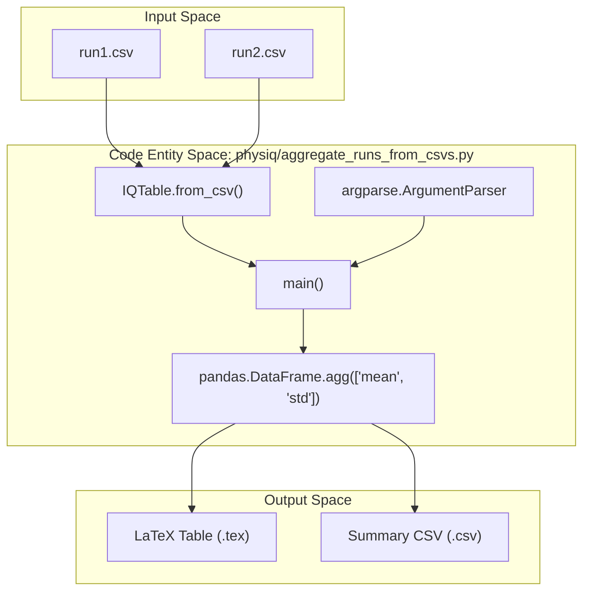
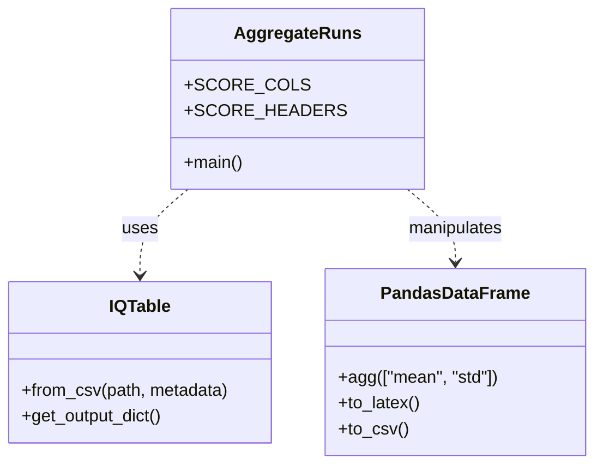

<!-- source: DeepWiki mcp.deepwiki.com · repo google-deepmind/physics-IQ-benchmark · page 6.4 Aggregating Multiple Runs · fetched 2026-10-26 -->

# Aggregating Multiple Runs

Relevant source files

The following files were used as context for generating this wiki page:

- [physiq/aggregate_runs_from_csvs.py](physiq/aggregate_runs_from_csvs.py)
- [physiq/tests/test_descriptions.py](physiq/tests/test_descriptions.py)

The `aggregate_runs_from_csvs.py` script is a utility designed to combine results from multiple evaluation runs (up to four) into a single set of metrics. It computes statistical measures (mean and standard deviation) across these runs and exports the results into formats suitable for leaderboard submission and academic publication, such as LaTeX tables and summary CSVs.

### Overview and Purpose
Physics-IQ evaluations can exhibit variance due to the stochastic nature of generative models. To ensure robust reporting, the benchmark supports aggregating multiple independent evaluation cycles. The script processes raw CSV outputs generated by the `IQTable` class and performs the following:
*   **Statistical Aggregation**: Computes the mean and standard deviation for all core Physics-IQ metrics.
*   **Score Type Selection**: Allows switching between "Original" (Physics-IQ 1.0) and "Verified" (Physics-IQ 2.0) scoring variants.
*   **Formatting**: Produces LaTeX-formatted strings (e.g., $75.2 \pm 1.4$) for scientific reporting.

**Sources:** [physiq/aggregate_runs_from_csvs.py:2-8](), [physiq/aggregate_runs_from_csvs.py:43-68]()

---

### System Architecture and Data Flow

The aggregation process acts as the final step in the evaluation pipeline, taking inputs from the `run_physics_iq.py` outputs. It utilizes the `IQTable` class to parse individual run data before performing cross-run calculations.

#### Code Entity Map: Natural Language to Code Symbols
The following diagram illustrates how the aggregation script interacts with the scoring components and data models.

**Diagram: Aggregation Data Flow**

**Sources:** [physiq/aggregate_runs_from_csvs.py:43-75](), [physiq/aggregate_runs_from_csvs.py:93-107]()

---

### Implementation Details

#### 1. Score Type Handling
The script distinguishes between two primary scoring methodologies via the `--score-type` flag:
*   **Original**: Uses `ORIG_SCORE_KEY` and the `SCORES_LIST` (Spatial, Spatiotemporal, Weighted Spatial, and MSE) [physiq/aggregate_runs_from_csvs.py:25]().
*   **Verified**: Uses `VERIFIED_SCORE_KEY` and the `VERIFIED_SCORES_LIST` (per-view variants of the metrics) [physiq/aggregate_runs_from_csvs.py:26]().

#### 2. Metric Mapping
Internal metric keys are mapped to human-readable headers for the final output:

| Internal Key | Display Header (LaTeX/CSV) |
| :--- | :--- |
| `physiq_score_stable` | Phys-IQ orig. |
| `final_score_view` | Phys-IQ verified |
| `score_spatial_view` | SP verified |
| `score_mse_view` | MSE verified |

**Sources:** [physiq/aggregate_runs_from_csvs.py:29-40](), [physiq/calculate_iq_score_stable.py:16-22]()

#### 3. Computation Logic
The script loads each CSV into an `IQTable` instance, extracts the result dictionary via `get_output_dict()`, and builds a consolidated `pandas.DataFrame` [physiq/aggregate_runs_from_csvs.py:73-75]().
*   **Scaling**: All scores are multiplied by 100 to convert them to percentages [physiq/aggregate_runs_from_csvs.py:78]().
*   **Formatting**: The `_fmt` helper function generates LaTeX strings. If only one run is provided (standard deviation is `NaN`), it returns only the mean [physiq/aggregate_runs_from_csvs.py:82-84]().

---

### Execution and Outputs

#### Command Line Arguments
| Argument | Type | Description |
| :--- | :--- | :--- |
| `csv_files` | Positional | Up to 4 paths to evaluation CSVs. |
| `--score-type` | Choice | `original` or `verified` (default). |
| `--save-latex` | Path | File path to write the LaTeX table. |
| `--save-csv` | Path | File path for the summary leaderboard row. |
| `--model-name` | String | Name of the model for the CSV 'Model' column. |

**Sources:** [physiq/aggregate_runs_from_csvs.py:44-68]()

#### Logic for Leaderboard Export
When `--save-csv` is invoked, the script creates a single-row CSV where every metric has a `mean` and `std` column (e.g., `Phys-IQ verified mean`, `Phys-IQ verified std`). This format is used to populate the official Physics-IQ leaderboard entries.

**Diagram: Entity Relationship to Scoring Logic**

**Sources:** [physiq/aggregate_runs_from_csvs.py:16-27](), [physiq/aggregate_runs_from_csvs.py:73-78]()

---

