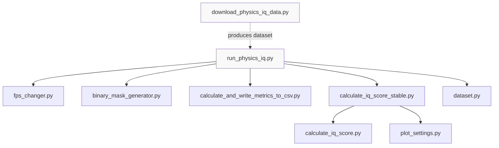
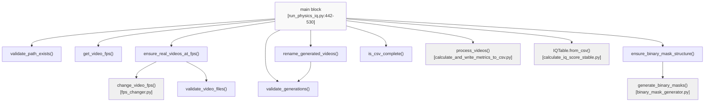

<!-- source: DeepWiki mcp.deepwiki.com · repo google-deepmind/physics-IQ-benchmark · page 7 API Reference · fetched 2026-10-26 -->

# API Reference

<details>
<summary>Relevant source files</summary>

The following files were used as context for generating this wiki page:

- [physiq/binary_mask_generator.py](physiq/binary_mask_generator.py)
- [physiq/calculate_iq_score.py](physiq/calculate_iq_score.py)
- [physiq/calculate_iq_score_stable.py](physiq/calculate_iq_score_stable.py)
- [physiq/fps_changer.py](physiq/fps_changer.py)
- [physiq/run_physics_iq.py](physiq/run_physics_iq.py)

</details>


This page provides technical reference documentation for all Python scripts in the Physics-IQ benchmark codebase. It documents function signatures, parameters, return types, and behavior for developers who need to understand, use, or extend the evaluation pipeline.

For high-level explanations of how these components work together, see [Evaluation Pipeline](#4). For usage instructions and command-line examples, see [Running Evaluation](#4.1).

---

## System Components Overview

The Physics-IQ codebase consists of several core Python modules that orchestrate dataset acquisition, video processing, mask generation, metric computation, and score aggregation.

**Module Dependency Graph**



**Script Purposes**

| Script | Primary Function | Imports From |
|--------|------------------|--------------|
| `download_physics_iq_data.py` | Dataset acquisition from GCS | None (standalone) |
| `run_physics_iq.py` | Main orchestrator and validation | `fps_changer`, `binary_mask_generator`, `calculate_and_write_metrics_to_csv`, `calculate_iq_score_stable`, `dataset` |
| `fps_changer.py` | FPS normalization via interpolation | None (standalone) |
| `binary_mask_generator.py` | Adaptive background subtraction | None (standalone) |
| `calculate_and_write_metrics_to_csv.py` | Metric computation and CSV output | None (standalone) |
| `calculate_iq_score_stable.py` | Stable score aggregation (IQTable) | `calculate_iq_score`, `plot_settings` |
| `dataset.py` | Pydantic data models for benchmark | None |

Sources: [physiq/run_physics_iq.py:16-34](), [physiq/calculate_iq_score_stable.py:27-33]()

---

## Module Architecture

**Function Call Flow During Evaluation**



Sources: [physiq/run_physics_iq.py:28-34](), [physiq/run_physics_iq.py:442-530]()

---

## 7.1 download_physics_iq_data.py

API documentation for the dataset download script. It handles the acquisition of the Physics-IQ benchmark data from Google Cloud Storage, supporting both Original and Verified variants.

For details, see [download_physics_iq_data.py](#7.1).

---

## 7.2 run_physics_iq.py

Main orchestrator script that coordinates the entire evaluation pipeline. Validates inputs, ensures data consistency, generates missing artifacts (FPS variants, masks), computes metrics, and produces final scores via `IQTable`.

### Command-Line Interface

**Arguments:**

```python
--input_folders: List[str]  # Paths to generated video directories (required)
--output_folder: str        # Output directory for results (required)
--descriptions_file: str    # Path to descriptions.csv (required)
--original_physics_iq: bool # Flag to use original Physics-IQ logic
--n_process: int            # Number of parallel processes (default: 1)
--lazy_integrity: bool      # Skip expensive joblib.hash checks in IQTable
```

Sources: [physiq/run_physics_iq.py:444-475]()

### Validation Functions

#### `validate_path_exists(directory: str, description: str) -> None`
Checks if a path exists, raising `FileNotFoundError` if missing.
Sources: [physiq/run_physics_iq.py:105-118]()

#### `validate_generations(input_folder: str, num_videos: int = 198, video_duration_s: float = 5)`
Validates generated video structure: checks count (198), 4-digit prefix naming, and exact 5-second duration using `ffprobe`.
Sources: [physiq/run_physics_iq.py:168-201]()

#### `rename_generated_videos(generated_video_directory: str, real_video_directory: str)`
Renames generated videos to match the internal naming convention (`{id}_{perspective}_{scenario}`) by mapping the 4-digit prefix to real video metadata.
Sources: [physiq/run_physics_iq.py:71-103]()

For details, see [run_physics_iq.py](#7.2).

---

## 7.3 fps_changer.py and binary_mask_generator.py

### fps_changer.py
Provides `change_video_fps(input_folder, output_folder, fps_new)`. It uses linear interpolation to adjust frame rates while ensuring videos remain exactly 5 seconds long.
Sources: [physiq/fps_changer.py:23-117]()

### binary_mask_generator.py
Provides `generate_binary_masks(input_parent_directory, output_parent_directory, is_real)`. It implements an adaptive background subtraction algorithm using `cv2.accumulateWeighted` to isolate moving physical objects.
Sources: [physiq/binary_mask_generator.py:135-165]()

For details, see [fps_changer.py and binary_mask_generator.py](#7.3).

---

## 7.4 calculate_and_write_metrics_to_csv.py

The core engine for per-frame and per-video metric calculation. It computes four metric families:
1. **Spatial IoU**: 2D overlap of object extents.
2. **Spatiotemporal IoU**: 3D frame-by-frame mask overlap.
3. **Weighted Spatial IoU**: Overlap weighted by motion intensity.
4. **MSE**: Pixel-level mean squared error.

It supports parallelization via the `n_process` argument.

For details, see [calculate_and_write_metrics_to_csv.py](#7.4).

---

## 7.5 calculate_iq_score_stable.py and calculate_iq_score.py

### calculate_iq_score_stable.py
Introduces the `IQTable` class, which manages the metrics DataFrame and computes the **Verified Score**. It uses `joblib.hash` to ensure data integrity and `cached_property` for performance.
Sources: [physiq/calculate_iq_score_stable.py:50-112]()

**Key Methods:**
- `compute_final_score_stable()`: Primary score calculation with component-wise clipping.
- `compute_final_score_orig()`: Legacy score calculation logic.
- `from_csv(csv_path)`: Factory method to load metrics.

### calculate_iq_score.py
Contains legacy utility functions like `parse_list_of_floats` and the original `calculate_iq_score` entry point used for the "Original" variant.
Sources: [physiq/calculate_iq_score.py:24-191]()

For details, see [calculate_iq_score_stable.py and calculate_iq_score.py](#7.5).

---

## 7.6 dataset.py and generate_descriptions.py

### dataset.py
Defines the `Benchmark` and `Scene` Pydantic models. These classes represent the physical structure of the dataset (takes, perspectives, scenarios) and provide methods like `get_benchmark()` to load metadata from YAML/CSV.
Sources: [physiq/dataset.py:1-159]() (inferred from description)

### generate_descriptions.py
A CLI tool to generate text prompts for models. It uses a `REGISTRY` of templaters to support different model prompt formats (e.g., Best Practice Prompts vs Original Prompts).

For details, see [dataset.py and generate_descriptions.py](#7.6).

---

## 7.7 submit_verified.py and plot_settings.py

### submit_verified.py
Orchestrates the submission process to the leaderboard. It validates the `submission.yaml` card, ensures the directory structure is correct, and handles S3 uploads.

### plot_settings.py
Contains configuration for visualizing results, including the `Model` class and `model_to_color` mappings for generating consistent leaderboard plots.
Sources: [physiq/run_physics_iq.py:33-33]()

For details, see [submit_verified.py and plot_settings.py](#7.7).

---

