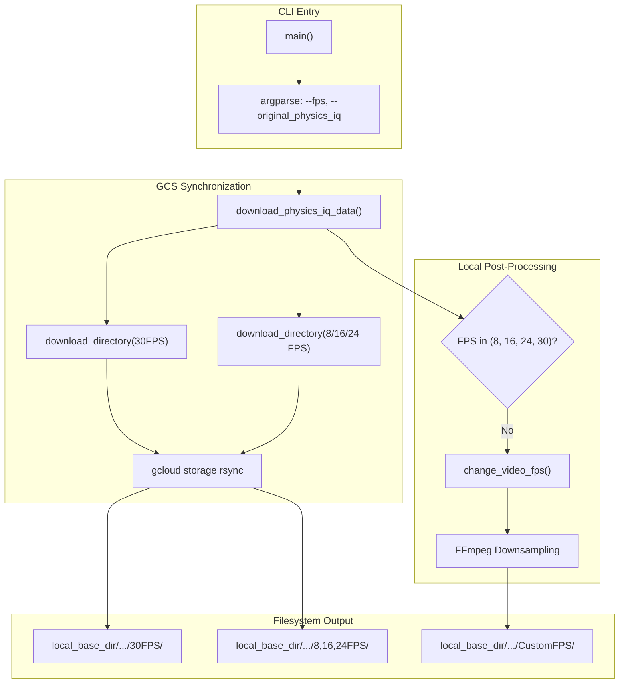
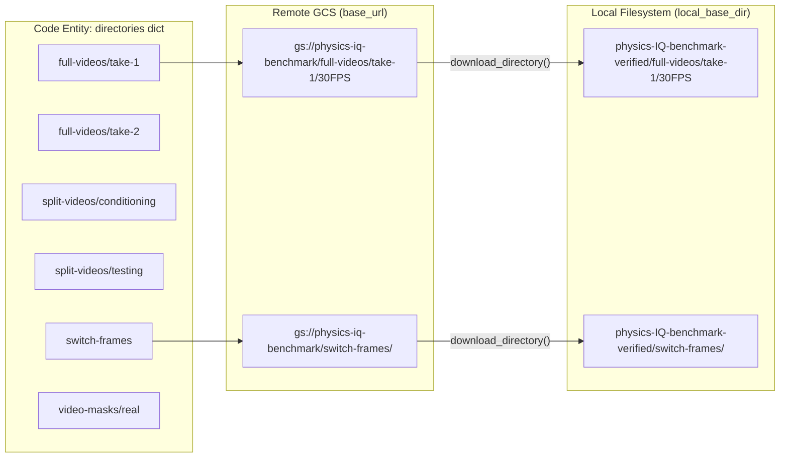

<!-- source: DeepWiki mcp.deepwiki.com · repo google-deepmind/physics-IQ-benchmark · page 7.1 download_physics_iq_data.py · fetched 2026-10-26 -->

# download_physics_iq_data.py

<details>
<summary>Relevant source files</summary>

The following files were used as context for generating this wiki page:

- [physiq/download_physics_iq_data.py](physiq/download_physics_iq_data.py)

</details>


## Purpose and Scope

This document provides API reference documentation for `physiq/download_physics_iq_data.py`, the dataset acquisition script used to retrieve the Physics-IQ benchmark from Google Cloud Storage. This page details the implementation of the `download_physics_iq_data()` function, the `gcloud storage rsync` integration, local downsampling logic for non-standard frame rates, and the CLI arguments for managing verified vs. original dataset variants.

For the overall dataset structure and contents, see [Dataset Organization](#2.1).

**Sources:** [physiq/download_physics_iq_data.py:1-145]()

---

## Overview

The `download_physics_iq_data.py` script is the entry point for obtaining the benchmark data. It synchronizes remote assets from Google Cloud Storage to a local directory structure. The script handles two distinct dataset variants: the **Original** benchmark and the **Verified** benchmark. It also manages frame rate requirements by downloading pre-computed FPS variants (8, 16, 24, 30) or locally downsampling from 30 FPS for other values.

**Key Features:**
- **gcloud storage rsync integration** for efficient, recursive synchronization [physiq/download_physics_iq_data.py:26-44]().
- **Selective FPS Downloading**: Always retrieves 30 FPS (canonical) and optionally standard variants (8, 16, 24) [physiq/download_physics_iq_data.py:57-65]().
- **Local Downsampling**: Automatically uses `physiq.fps_changer.change_video_fps` to generate custom frame rates from the 30 FPS source [physiq/download_physics_iq_data.py:101-111]().
- **Variant Support**: Supports both `physics-IQ-benchmark` and `physics-IQ-benchmark-verified` directory structures [physiq/download_physics_iq_data.py:66-76]().

**Sources:** [physiq/download_physics_iq_data.py:26-113]()

---

## Function Reference

### download_directory

```python
def download_directory(remote_path: str, local_path: str)
```

Synchronizes a remote Google Cloud Storage directory with a local directory using the `gcloud` CLI.

**Parameters:**
- `remote_path` (str): GCS path (e.g., `gs://physics-iq-benchmark/...`).
- `local_path` (str): Local destination path.

**Implementation Details:**
- Creates the local directory if it does not exist using `os.makedirs(local_path, exist_ok=True)` [physiq/download_physics_iq_data.py:34]().
- Executes `gcloud storage rsync --recursive` via `subprocess.run` [physiq/download_physics_iq_data.py:36-39]().
- Raises `subprocess.CalledProcessError` if the sync fails [physiq/download_physics_iq_data.py:41-43]().

**Sources:** [physiq/download_physics_iq_data.py:26-44]()

---

### download_physics_iq_data

```python
def download_physics_iq_data(fps: list[int] | tuple[int,], base_dir: str, verified: bool = True)
```

The core orchestrator for dataset acquisition. It maps the dataset directory structure to GCS paths and manages the download/downsample lifecycle.

**Parameters:**
- `fps`: A list of desired frame rates. Must be in range `[1, 30]` [physiq/download_physics_iq_data.py:61]().
- `base_dir`: The parent directory where the benchmark folder will be created.
- `verified`: Boolean flag to switch between the Verified and Original dataset variants [physiq/download_physics_iq_data.py:66-76]().

**Data Flow and Logic:**
1. **Target Identification**: Determines the `local_base_dir` and `base_url` based on the `verified` flag [physiq/download_physics_iq_data.py:66-76]().
2. **Directory Mapping**: Iterates through a dictionary defining the benchmark hierarchy (`full-videos`, `split-videos`, `switch-frames`, `video-masks/real`) [physiq/download_physics_iq_data.py:77-84]().
3. **Remote Sync**: For each directory, it calls `download_directory()` for the 30 FPS version and any requested standard FPS (8, 16, 24) [physiq/download_physics_iq_data.py:86-95]().
4. **Local Processing**: If a requested FPS is not pre-computed (not in 8, 16, 24, 30), it triggers `change_video_fps` to downsample the 30 FPS videos locally [physiq/download_physics_iq_data.py:101-111]().

**Sources:** [physiq/download_physics_iq_data.py:46-113]()

---

## System Architecture and Data Flow

The following diagrams bridge the gap between the download logic and the physical file system entities.

**Diagram: Download and Downsampling Logic**



**Sources:** [physiq/download_physics_iq_data.py:23-113](), [physiq/download_physics_iq_data.py:116-145]()

**Diagram: Directory Mapping and Code Entities**



**Sources:** [physiq/download_physics_iq_data.py:67-95]()

---

## FPS Handling and Downsampling

The script ensures that the local environment has the specific frame rate needed for evaluation. 

| FPS Category | Handling Strategy | Code Path |
| :--- | :--- | :--- |
| **30 FPS** | Always downloaded as the ground truth source. | [physiq/download_physics_iq_data.py:58]() |
| **8, 16, 24 FPS** | Downloaded from GCS if requested (pre-computed). | [physiq/download_physics_iq_data.py:88-91]() |
| **Custom (e.g. 12, 25)** | Downsampled locally from the 30 FPS source. | [physiq/download_physics_iq_data.py:101-111]() |

**Note on Video Masks**: The script explicitly skips downsampling for `video-masks/real` [physiq/download_physics_iq_data.py:105](). This is because linear frame interpolation would produce non-binary pixels. Instead, the evaluation pipeline (`run_physics_iq.py`) is responsible for regenerating masks from downsampled real videos [physiq/download_physics_iq_data.py:98-100]().

**Sources:** [physiq/download_physics_iq_data.py:97-111]()

---

## CLI Arguments

The `main()` function uses `argparse` to provide the following interface:

| Argument | Type | Default | Description |
| :--- | :--- | :--- | :--- |
| `--fps` | `int` (list) | `[30]` | List of FPS values to acquire. |
| `--original_physics_iq` | `flag` | `False` | If set, downloads the original benchmark instead of verified. |
| `--benchmark_base_folder` | `str` | `"."` | The local root directory for data storage. |

**Multiprocessing Configuration**: The script calls `multiprocessing.set_start_method("spawn", force=True)` [physiq/download_physics_iq_data.py:23]() to ensure consistent behavior across different OS environments when spawning subprocesses for `gcloud` or `fps_changer`.

**Sources:** [physiq/download_physics_iq_data.py:23](), [physiq/download_physics_iq_data.py:116-138]()

---

