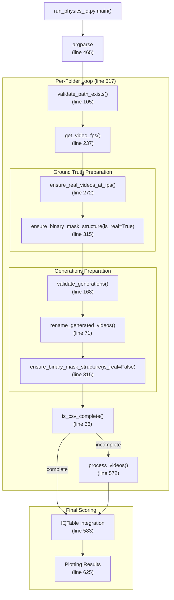
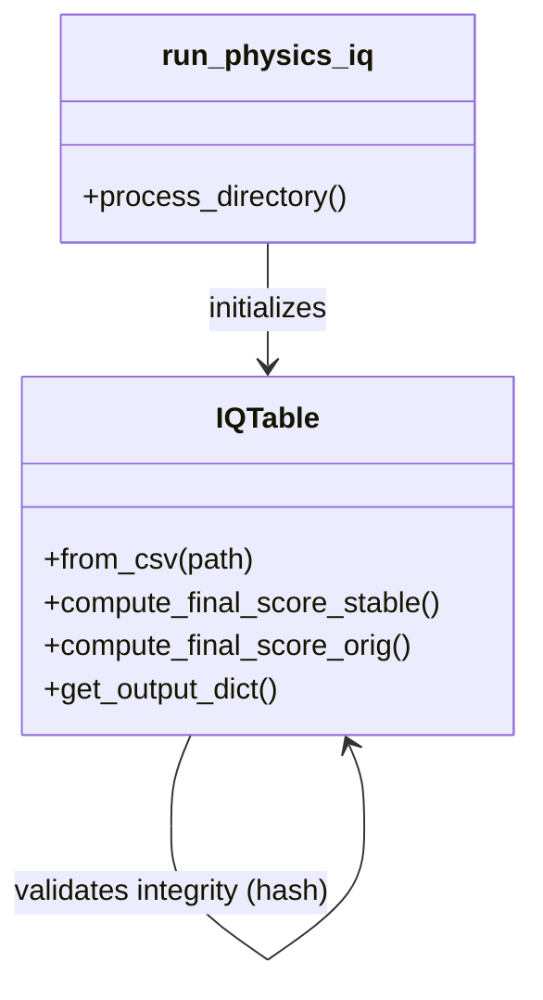

<!-- source: DeepWiki mcp.deepwiki.com · repo google-deepmind/physics-IQ-benchmark · page 7.2 run_physics_iq.py · fetched 2026-10-26 -->

# run_physics_iq.py

Relevant source files

The following files were used as context for generating this wiki page:

- [physiq/run_physics_iq.py](physiq/run_physics_iq.py)

## Purpose and Scope

`run_physics_iq.py` is the main orchestrator script for the Physics-IQ evaluation pipeline. It automates the end-to-end process of taking generated videos from external models and producing standardized Physics-IQ scores. The script manages data validation, FPS normalization, binary mask generation, and metric calculation.

For details on individual pipeline stages, see:
- FPS normalization: [physiq/fps_changer.py:1-117]()
- Binary mask generation: [physiq/binary_mask_generator.py:1-126]()
- Metric computation: [physiq/calculate_and_write_metrics_to_csv.py:1-218]()
- Score aggregation: [physiq/calculate_iq_score_stable.py:1-358]()

---

## Command-Line Interface

The script provides a CLI to process one or more model output folders.

| Argument | Type | Description |
|----------|------|-------------|
| `--input_folders` | `str` (list) | Paths to folders containing generated `.mp4` videos. |
| `--output_folder` | `str` | Directory where metrics, masks, and final scores will be saved. |
| `--descriptions_file` | `str` | Path to the benchmark metadata (e.g., `descriptions_base.csv`). |
| `--original_physics_iq` | `flag` | If set, uses the legacy `calculate_iq_score.py` instead of the stable version. |
| `--n_process` | `int` | Number of parallel processes for metric calculation (default: 1). |
| `--lazy_integrity` | `flag` | If set, skips expensive file hashing during IQTable integrity checks. |

**Sources:** [physiq/run_physics_iq.py:465-515]()

---

## Pipeline Architecture

### System Orchestration Flow

The following diagram maps the high-level system requirements to the specific functions in `run_physics_iq.py` that execute them.

**Sources:** [physiq/run_physics_iq.py:36-68](), [physiq/run_physics_iq.py:71-103](), [physiq/run_physics_iq.py:168-202](), [physiq/run_physics_iq.py:237-269](), [physiq/run_physics_iq.py:517-640]()

---

## Key Functions and Implementation

### Validation and Setup

The script enforces strict data integrity to ensure model comparisons are fair.

#### `validate_generations`
This function performs a "smoke test" on the model outputs before processing. It asserts:
1. Exactly 198 videos are present [physiq/run_physics_iq.py:181]().
2. Filenames start with sequential 4-digit prefixes (`0001_` to `0198_`) [physiq/run_physics_iq.py:185-188]().
3. Every video is exactly 5.0 seconds long (checked via `ffprobe` in `get_video_duration`) [physiq/run_physics_iq.py:191-199]().

#### `rename_generated_videos`
Generative models often output files with arbitrary names. This function uses the 4-digit prefix to map generated files to the descriptive naming convention used by the benchmark (e.g., `0092_perspective-center_lit-candle.mp4`).
**Sources:** [physiq/run_physics_iq.py:71-103]()

### Ground Truth Alignment

#### `ensure_real_videos_at_fps`
Since models can generate at various frame rates (e.g., 24, 25, 30 FPS), the evaluation must compare them against ground truth at the *same* frame rate.
- It checks if the requested FPS version of the real dataset exists in `split-videos/testing/{fps}FPS` [physiq/run_physics_iq.py:276-285]().
- If missing, it invokes `change_video_fps` to interpolate the 30 FPS source to the target FPS [physiq/run_physics_iq.py:302-308]().

#### `ensure_binary_mask_structure`
Orchestrates the creation of binary masks used for IoU calculations.
- Masks for real videos are cached in `video-masks/real/{fps}FPS` [physiq/run_physics_iq.py:321]().
- Masks for generated videos are stored per-model in `video-masks/generated/{model_name}/{fps}FPS` [physiq/run_physics_iq.py:323]().
- Actual generation is delegated to `generate_binary_masks` [physiq/run_physics_iq.py:333]().

---

## IQTable Integration and Scoring

After metrics are computed for each video, the script uses the `IQTable` class to aggregate results.

1. **Integrity Check**: `IQTable` calculates a hash of the input files to ensure the score is tied to a specific version of the generated data [physiq/calculate_iq_score_stable.py:90-101]().
2. **Aggregation**: It processes the per-frame metrics from the CSV and computes the final Physics-IQ score, applying variance normalization between Take-1 and Take-2 of the ground truth.
3. **Output**: The script writes a summary JSON and a detailed results CSV to the `results/` folder [physiq/run_physics_iq.py:603-623]().

**Sources:** [physiq/run_physics_iq.py:583-623](), [physiq/calculate_iq_score_stable.py:58-135]()

---

## Data Flow Summary

| Stage | Input | Tool/Function | Output |
|-------|-------|---------------|--------|
| **Validation** | Model MP4s | `validate_generations` | Validated File List |
| **FPS Sync** | Target FPS | `ensure_real_videos_at_fps` | Resampled Real Videos |
| **Masking** | MP4 Videos | `ensure_binary_mask_structure` | Binary Mask PNGs |
| **Metrics** | Masks + Videos | `process_videos` | `results/{model}.csv` |
| **Scoring** | Metric CSV | `IQTable` | Final Score JSON/CSV |

**Sources:** [physiq/run_physics_iq.py:517-640]()

---

