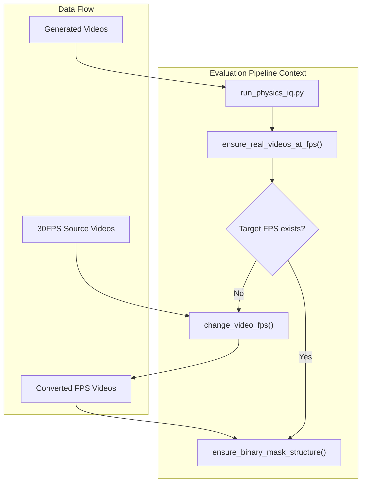
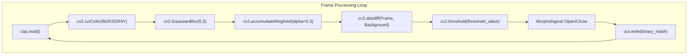

<!-- source: DeepWiki mcp.deepwiki.com · repo google-deepmind/physics-IQ-benchmark · page 7.3 fps_changer.py and binary_mask_generator.py · fetched 2026-10-26 -->

# fps_changer.py and binary_mask_generator.py

<details>
<summary>Relevant source files</summary>

The following files were used as context for generating this wiki page:

- [physiq/binary_mask_generator.py](physiq/binary_mask_generator.py)
- [physiq/calculate_iq_score.py](physiq/calculate_iq_score.py)
- [physiq/fps_changer.py](physiq/fps_changer.py)

</details>


## Purpose and Scope

This document provides technical API documentation for two critical components of the Physics-IQ evaluation pipeline: `fps_changer.py` and `binary_mask_generator.py`. 

*   `fps_changer.py` handles temporal normalization by converting video frame rates through linear interpolation, ensuring that generated videos and ground truth recordings are temporally aligned for comparison.
*   `binary_mask_generator.py` implements an adaptive background subtraction algorithm to isolate moving objects from static backgrounds, creating the binary masks required for Spatiotemporal and Spatial IoU metric calculations.

Sources: [physiq/fps_changer.py:1-14](), [physiq/binary_mask_generator.py:1-14]()

## 1. FPS Normalization (`fps_changer.py`)

The `fps_changer.py` module ensures that generated videos and corresponding ground truth videos operate at matching frame rates. When generative models produce videos at FPS values other than the dataset's standard options (30, 24, 16, 8 FPS), this module converts the 30 FPS source videos to match the target frame rate.

### System Integration


**Diagram: Integration of fps_changer.py in the Evaluation Pipeline**

Sources: [physiq/fps_changer.py:23-32](), [physiq/run_physics_iq.py:220-235]()

### Function: `change_video_fps`

```python
def change_video_fps(input_folder: str, output_folder: str, fps_new: float) -> None
```

This function converts all MP4 videos in a folder to a new frame rate. It strictly processes only the first 5 seconds of each video to align with the benchmark's duration requirements [physiq/fps_changer.py:25-31]().

**Key Implementation Details:**
*   **Codec:** Uses `avc1` (H.264) for output encoding [physiq/fps_changer.py:105]().
*   **Dimensions:** Enforces even width and height by subtracting the remainder of a division by 2 to satisfy H.264 macroblock requirements [physiq/fps_changer.py:55]().
*   **Interpolation:** Implements linear blending between frames. It calculates a fractional index `alpha` and blends `frame[idx]` and `frame[idx+1]` in float32 space before converting back to uint8 [physiq/fps_changer.py:81-92]().

Sources: [physiq/fps_changer.py:23-117]()

---

## 2. Binary Mask Generation (`binary_mask_generator.py`)

The `binary_mask_generator.py` module isolates moving physical objects from the static recording environment. This is necessary because raw pixel comparisons (MSE) are often dominated by static background details rather than the physical motion being evaluated.

### Algorithm: Adaptive Background Subtraction

The mask generator uses a weighted moving average to model the background and detects foreground objects through absolute difference thresholding.


**Diagram: Mask Generation Algorithm Logic**

Sources: [physiq/binary_mask_generator.py:92-123]()

### Function: `generate_mask`

```python
def generate_mask(in_path: str, out_video_path: str, is_real: bool, threshold_value: int = 10) -> None
```

Processes a single video file to produce a binary mask video.

**Processing Steps:**
1.  **Initialization:** Opens the video and extracts metadata (FPS, width, height) [physiq/binary_mask_generator.py:38-46]().
2.  **Background Modeling:** The first frame is used to initialize the `avg_frame` (background model) [physiq/binary_mask_generator.py:94-95]().
3.  **Accumulation:** For each subsequent frame, the background model is updated using `cv2.accumulateWeighted` with a factor of `0.3` [physiq/binary_mask_generator.py:111]().
4.  **Thresholding:** Pixels with an absolute difference greater than `threshold_value` (default: 10) are marked as foreground [physiq/binary_mask_generator.py:116-118]().
5.  **Noise Reduction:** Applies morphological `OPEN` and `CLOSE` operations using a 5x5 kernel to remove small noise and fill holes in the detected objects [physiq/binary_mask_generator.py:120-121]().

Sources: [physiq/binary_mask_generator.py:24-133]()

### Directory Structure and Naming

The `generate_mask` function automatically adjusts the output path based on whether the video is "real" (ground truth) or "generated" to maintain the benchmark's directory conventions.

*   **Real Videos:** Path includes `_video-masks_` and `{fps}FPS` [physiq/binary_mask_generator.py:58-67]().
*   **Generated Videos:** Path includes `_video-masks_`, `{fps}FPS`, and `_take-1_` [physiq/binary_mask_generator.py:69-76]().

The `generate_binary_masks` function acts as a batch processor, walking through an input directory tree and recreating the same structure in the output directory [physiq/binary_mask_generator.py:154-164]().

Sources: [physiq/binary_mask_generator.py:53-79](), [physiq/binary_mask_generator.py:135-165]()

## 3. Summary of Key Entities

| Code Entity | File | Role |
| :--- | :--- | :--- |
| `change_video_fps` | `fps_changer.py` | Main entry point for frame rate conversion. |
| `generate_mask` | `binary_mask_generator.py` | Core logic for background subtraction and thresholding. |
| `generate_binary_masks` | `binary_mask_generator.py` | Batch processing wrapper for entire directories. |
| `cv2.accumulateWeighted` | N/A (OpenCV) | Used with `alpha=0.3` to adapt the background model over time. |
| `cv2.VideoWriter_fourcc` | N/A (OpenCV) | Uses `mp4v` for masks and `avc1` for FPS-changed videos. |

Sources: [physiq/fps_changer.py:23-105](), [physiq/binary_mask_generator.py:24-111]()

---

