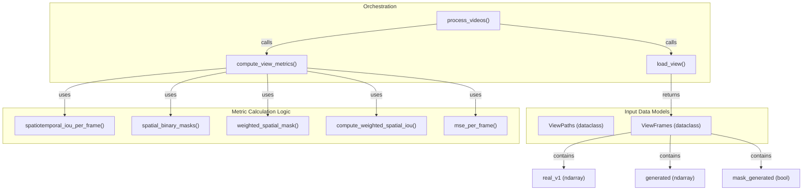
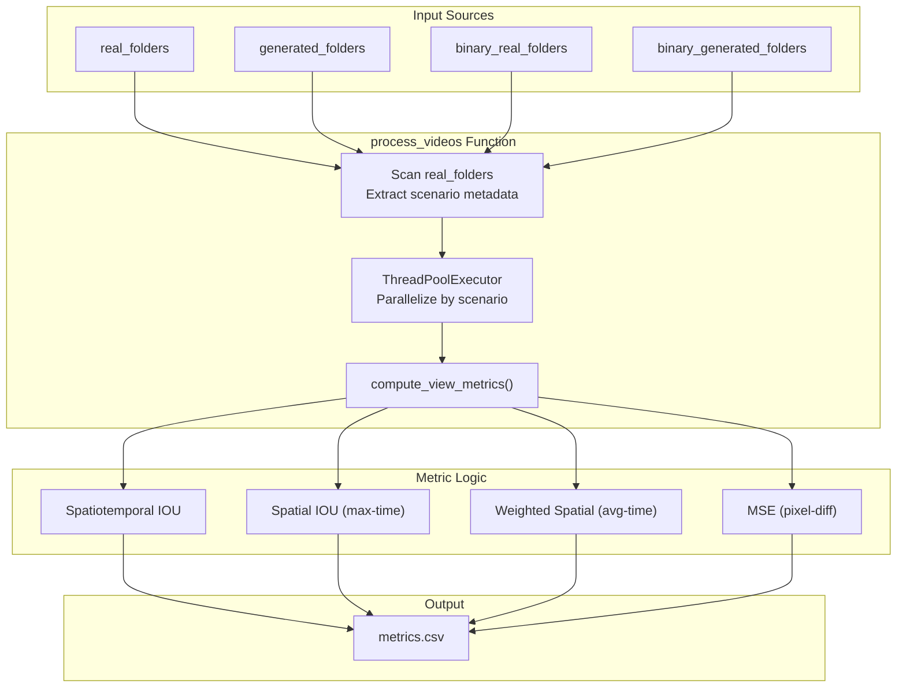

<!-- source: DeepWiki mcp.deepwiki.com · repo google-deepmind/physics-IQ-benchmark · page 7.4 calculate_and_write_metrics_to_csv.py · fetched 2026-10-26 -->

# calculate_and_write_metrics_to_csv.py

<details>
<summary>Relevant source files</summary>

The following files were used as context for generating this wiki page:

- [physiq/calculate_and_write_metrics_to_csv.py](physiq/calculate_and_write_metrics_to_csv.py)

</details>


## Purpose and Scope

This document provides technical reference documentation for `calculate_and_write_metrics_to_csv.py`, the script that computes evaluation metrics by comparing generated videos against ground truth recordings. This script processes videos frame-by-frame, calculates four metric families (spatiotemporal IOU, spatial IOU, weighted spatial IOU, and MSE), and outputs results to CSV files for subsequent score aggregation.

For information about how these metrics are aggregated into the final Physics-IQ score, see [calculate_iq_score_stable.py](7.5). For details about the metric formulas and their mathematical definitions, see [Metrics and Scoring](5).

**Sources:** [physiq/calculate_and_write_metrics_to_csv.py:16-28]()

## Overview

The `calculate_and_write_metrics_to_csv.py` script serves as the core metric computation engine in the Physics-IQ evaluation pipeline. It is invoked by `run_physics_iq.py` after FPS normalization and binary mask generation are complete.

The script performs three primary tasks:
1.  **Video Loading**: Reads real videos (take-1 and take-2), generated videos, and their corresponding binary masks into memory as `ViewFrames` dataclass instances.
2.  **Metric Calculation**: Computes 12 metric variants per scenario across 3 camera perspectives (left, center, right).
3.  **CSV Output**: Writes results to model-specific CSV files for downstream score computation.

**Sources:** [physiq/calculate_and_write_metrics_to_csv.py:40-66](), [physiq/calculate_and_write_metrics_to_csv.py:205-212]()

## Architecture and Data Flow

The following diagram illustrates the relationship between the natural language metric concepts and the code entities that implement them.


**Diagram: Entity Association Map**

### Data Flow Pipeline


**Diagram: Data Flow Through Metric Calculation Pipeline**

**Sources:** [physiq/calculate_and_write_metrics_to_csv.py:40-66](), [physiq/calculate_and_write_metrics_to_csv.py:205-316]()

## Core Data Structures

### ViewPaths
A dataclass used to resolve file paths for one (scenario, view) combination.
- `real_v1`, `real_v2`: Ground truth video paths.
- `generated`: Model output path.
- `mask_v1`, `mask_v2`, `mask_generated`: Corresponding binary mask paths.

**Sources:** [physiq/calculate_and_write_metrics_to_csv.py:40-49]()

### ViewFrames
A dataclass containing the loaded and resized frames for evaluation.
- RGB arrays (`real_v1`, `real_v2`, `generated`) are `float64` in `[0, 1]` with shape `(n_frames, h, w, c)`.
- Mask arrays (`mask_v1`, `mask_v2`, `mask_generated`) are `bool` with shape `(n_frames, h, w)`.

**Sources:** [physiq/calculate_and_write_metrics_to_csv.py:52-65]()

## Main Function: process_videos()

### Function Signature
```python
def process_videos(
    real_folders: str,
    generated_folders: str,
    binary_real_folders: str,
    binary_generated_folders: str,
    csv_file_path: str,
    fps: int,
    video_time_selection: str = 'first',
    n_process: int = 1,
)
```
**Sources:** [physiq/calculate_and_write_metrics_to_csv.py:270-279]()

### Behavior and Parallelization
The function iterates through all scenarios found in `real_folders`. It utilizes `concurrent.futures.ThreadPoolExecutor` to parallelize processing across scenarios based on the `n_process` argument [physiq/calculate_and_write_metrics_to_csv.py:339-354]().

For each scenario, it:
1.  Resolves paths for all three views (left, center, right) [physiq/calculate_and_write_metrics_to_csv.py:299-316]().
2.  Loads frames via `load_view()`, which downsamples videos to 1/4 resolution to manage memory [physiq/calculate_and_write_metrics_to_csv.py:157]().
3.  Computes metrics for each view using `compute_view_metrics()` [physiq/calculate_and_write_metrics_to_csv.py:205-268]().
4.  Aggregates the 36 resulting metrics (12 per view) into a single row for the output CSV [physiq/calculate_and_write_metrics_to_csv.py:356-368]().

## Metric Calculation Algorithms

### Spatiotemporal IOU
Calculated frame-by-frame between two sequences of binary masks.
- **Function**: `spatiotemporal_iou_per_frame(mask1, mask2)` [physiq/calculate_and_write_metrics_to_csv.py:126-133]().
- **Logic**: Returns a list of IOU values. If the union of masks is zero for a frame, the IOU is defined as `1.0` [physiq/calculate_and_write_metrics_to_csv.py:132]().

### Spatial IOU
Collapses the temporal dimension before calculating IOU.
- **Function**: `spatial_binary_masks(mask_frames)` [physiq/calculate_and_write_metrics_to_csv.py:103-111]().
- **Logic**: Uses `mask_frames.any(axis=0)` to create a binary mask where a pixel is `True` if it was active in *any* frame.

### Weighted Spatial IOU
Accounts for the frequency of motion at each pixel.
- **Functions**: `weighted_spatial_mask()` [physiq/calculate_and_write_metrics_to_csv.py:113-116]() and `compute_weighted_spatial_iou()` [physiq/calculate_and_write_metrics_to_csv.py:136-144]().
- **Logic**: Computes the fraction of frames each pixel is active. The IOU is then calculated as the sum of pixel-wise minimums divided by the sum of pixel-wise maximums.

### Mean Squared Error (MSE)
Calculated frame-by-frame between RGB videos.
- **Function**: `mse_per_frame(video1, video2)` [physiq/calculate_and_write_metrics_to_csv.py:118-123]().
- **Logic**: Computes `(diff**2).mean(axis=(1, 2, 3))` for each frame.

## CSV Output Format

The output CSV file contains one row per scenario. Columns are suffixed by the view name (`perspective-left`, `perspective-center`, `perspective-right`).

| Column Category | Metrics Included (per view) |
| :--- | :--- |
| **MSE** | `v1_mse`, `v2_mse`, `variance_mse` |
| **Spatiotemporal IOU** | `spatiotemporal_iou_v1`, `spatiotemporal_iou_v2`, `variance_spatiotemporal_iou` |
| **Spatial IOU** | `spatial_iou_v1`, `spatial_iou_v2`, `variance_spatial` |
| **Weighted Spatial** | `weighted_spatial_iou_v1`, `weighted_spatial_iou_v2`, `variance_weighted_spatial` |

**Sources:** [physiq/calculate_and_write_metrics_to_csv.py:252-265](), [physiq/calculate_and_write_metrics_to_csv.py:356-368]()

## Implementation Details

### Video Loading and Normalization
The `load_and_resize_video` function handles frame extraction using OpenCV.
- **Resizing**: If `target_size` is provided, frames are resized using `cv2.resize` [physiq/calculate_and_write_metrics_to_csv.py:94]().
- **Normalization**: RGB frames are normalized to `[0, 1]` by dividing by `255.0` [physiq/calculate_and_write_metrics_to_csv.py:96]().
- **Masks**: Masks are loaded as `uint8`, then converted to `bool` by thresholding values `> 127` [physiq/calculate_and_write_metrics_to_csv.py:168-181]().

### Memory Management
To prevent OOM (Out of Memory) errors when processing high-resolution videos:
1.  Videos are downsampled to 1/4 of their original dimensions [physiq/calculate_and_write_metrics_to_csv.py:157]().
2.  `gc.collect()` is explicitly called after processing each scenario to release memory from large NumPy arrays [physiq/calculate_and_write_metrics_to_csv.py:355]().

**Sources:** [physiq/calculate_and_write_metrics_to_csv.py:68-101](), [physiq/calculate_and_write_metrics_to_csv.py:157](), [physiq/calculate_and_write_metrics_to_csv.py:355]()

---

