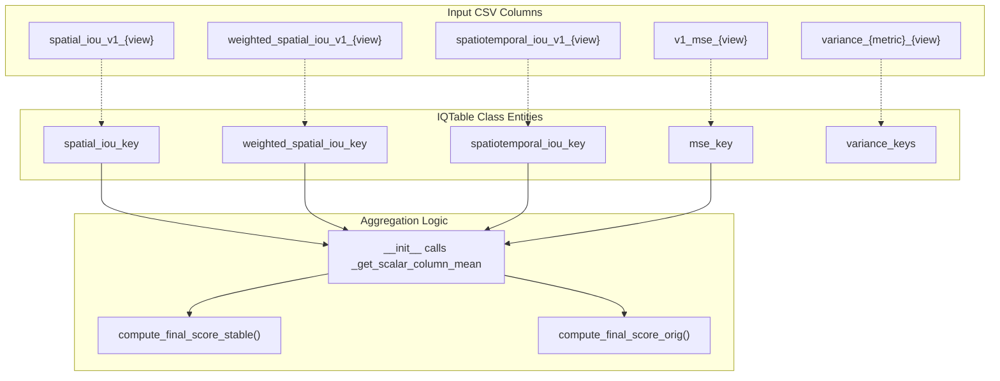
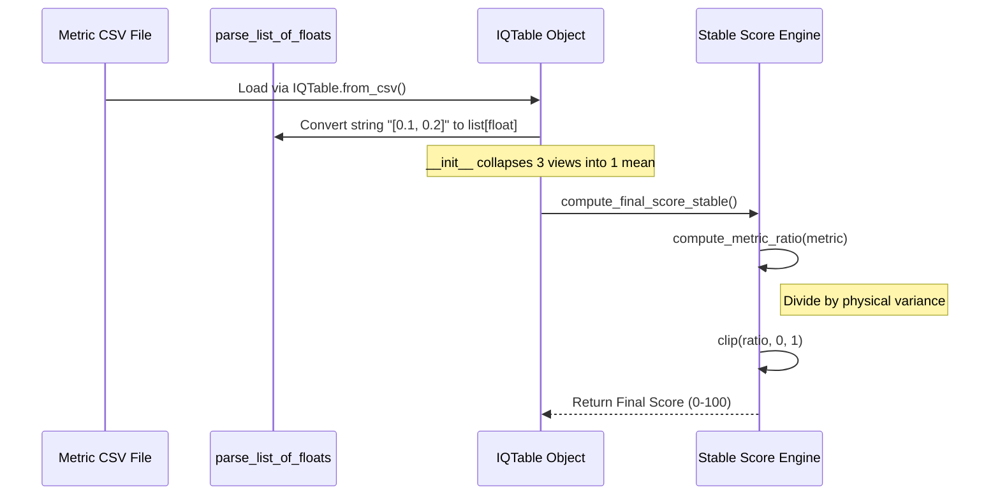

<!-- source: DeepWiki mcp.deepwiki.com · repo google-deepmind/physics-IQ-benchmark · page 7.5 calculate_iq_score_stable.py and calculate_iq_score.py · fetched 2026-10-26 -->

# calculate_iq_score_stable.py and calculate_iq_score.py

Relevant source files

The following files were used as context for generating this wiki page:

- [physiq/binary_mask_generator.py](physiq/binary_mask_generator.py)
- [physiq/calculate_iq_score.py](physiq/calculate_iq_score.py)
- [physiq/calculate_iq_score_stable.py](physiq/calculate_iq_score_stable.py)
- [physiq/fps_changer.py](physiq/fps_changer.py)

## Purpose and Scope

This document provides technical documentation for the scoring modules of the Physics-IQ benchmark. It covers `calculate_iq_score_stable.py`, which introduces the `IQTable` class for robust, variance-normalized score computation, and the legacy `calculate_iq_score.py` interface. These scripts represent the final stage of the evaluation pipeline, transforming raw per-frame metrics into a single Physics-IQ score (0-100%).

The "Stable" variant is the primary scoring mechanism for the benchmark, designed to prevent extreme outliers in a single metric component from disproportionately affecting the aggregate score.

**Sources:** [physiq/calculate_iq_score_stable.py:15-25](), [physiq/calculate_iq_score.py:61-70]()

---

## IQTable Class Architecture

The `IQTable` class is the central entity for score computation. It wraps a `pandas.DataFrame` containing per-scenario metrics and provides methods for calculating two distinct score variants: **Stable** and **Original**.

### Core Data Structures

Upon initialization, `IQTable` collapses per-perspective columns (left, center, right) into cross-view means. This ensures that subsequent scoring operations work on a single value per scenario row.

| Feature | Description |
| :--- | :--- |
| **Views** | Defined by `VIEWS` constant: `perspective-left`, `perspective-center`, `perspective-right`. [physiq/calculate_iq_score.py:21]() |
| **Integrity** | Uses `joblib.hash` to ensure the underlying DataFrame is not mutated after construction. [physiq/calculate_iq_score_stable.py:111-122]() |
| **Caching** | Utilizes `functools.cached_property` for column name lists and internal score dictionaries. [physiq/calculate_iq_score_stable.py:124-173]() |

### Mapping Code Entities to Scoring Concepts

The following diagram bridges the relationship between the raw CSV data columns and the `IQTable` internal logic.

**Sources:** [physiq/calculate_iq_score_stable.py:73-82](), [physiq/calculate_iq_score_stable.py:94-105]()

---

## Scoring Methodologies

### 1. Stable Physics-IQ Score
The `compute_final_score_stable` method implements the primary benchmark metric. It clips each individual metric component (Spatial, Weighted Spatial, Spatiotemporal) to the range [0, 1] after variance normalization, but before the final arithmetic mean.

**Mathematical Flow:**
1.  **Normalization**: $Ratio = Metric / (Variance + \epsilon)$
2.  **Clipping**: $Clipped = \text{clip}(Ratio, 0, 1)$
3.  **Aggregation**: $Score = \frac{1}{3} \sum Clipped_{IoU} - (MSE - Var_{MSE})$

**Sources:** [physiq/calculate_iq_score_stable.py:57-71](), [physiq/calculate_iq_score_stable.py:255-274]()

### 2. Original Physics-IQ Score
The `compute_final_score_orig` method (and the legacy `calculate_iq_score.py`) performs aggregation before clipping. This allows a very high score in one metric to potentially offset a low score in another, though the final aggregate is still clamped to [0, 100].

**Sources:** [physiq/calculate_iq_score_stable.py:276-292](), [physiq/calculate_iq_score.py:179-189]()

---

## Data Flow and Aggregation

The `IQTable` handles complex data types, specifically lists of floats stored as strings in CSVs (e.g., per-frame MSE).

### Processing Pipeline

**Sources:** [physiq/calculate_iq_score_stable.py:183-200](), [physiq/calculate_iq_score.py:24-58]()

### Key Functions

| Function | File | Description |
| :--- | :--- | :--- |
| `parse_list_of_floats` | `calculate_iq_score.py` | Uses regex `[-+]?[0-9]*\.?[0-9]+` to extract floats from CSV string representations. [physiq/calculate_iq_score.py:35-43]() |
| `from_csv` | `calculate_iq_score_stable.py` | Class method to instantiate `IQTable` directly from a file path. [physiq/calculate_iq_score_stable.py:321-326]() |
| `get_output_dict` | `calculate_iq_score_stable.py` | Generates a dictionary of all component scores and the final aggregate. [physiq/calculate_iq_score_stable.py:294-315]() |
| `compute_metric_ratio` | `calculate_iq_score_stable.py` | Logic for dividing a metric by its corresponding physical variance. [physiq/calculate_iq_score_stable.py:183-200]() |

---

## Legacy Interface: calculate_iq_score.py

While `calculate_iq_score_stable.py` provides the object-oriented `IQTable`, the legacy `calculate_iq_score.py` contains a standalone function `calculate_iq_score(file_path)` used for quick computations and compatibility.

### Implementation Details
- **List Parsing**: Manually identifies columns like `v1_mse_{view}` and `spatiotemporal_iou_v1_{view}` for parsing. [physiq/calculate_iq_score.py:74-79]()
- **View Concatenation**: Uses `np.concatenate` to merge per-frame lists across all perspectives before taking the mean. [physiq/calculate_iq_score.py:95-105]()
- **Variance Calculation**: Explodes variance lists to calculate a global mean baseline for normalization. [physiq/calculate_iq_score.py:125-148]()

**Sources:** [physiq/calculate_iq_score.py:61-191]()

---

## Integrity and Verification

To prevent accidental data corruption during the scoring process, `IQTable` implements a hash-based integrity check:
1.  **Hashing**: Upon construction, a hash of the internal `self.df` is generated using `joblib.hash`. [physiq/calculate_iq_score_stable.py:111]()
2.  **Verification**: The `_verify_df_integrity` method is called before any score computation. If the hash has changed (indicating mutation), a `RuntimeError` is raised. [physiq/calculate_iq_score_stable.py:114-122]()
3.  **Lazy Mode**: The `--lazy_integrity` flag in `run_physics_iq.py` can disable this check for performance in large datasets. [physiq/calculate_iq_score_stable.py:108]()

**Sources:** [physiq/calculate_iq_score_stable.py:85-122]()

---

