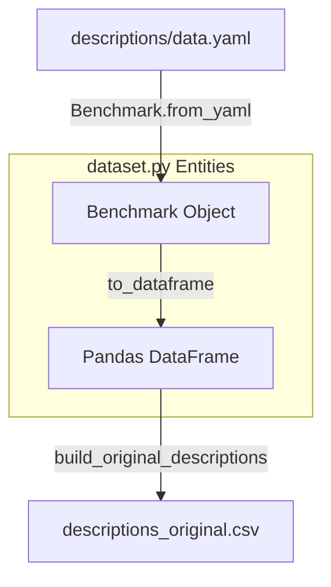
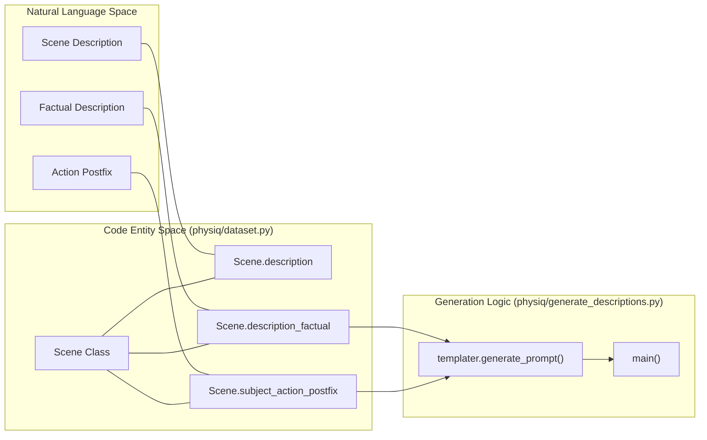

<!-- source: DeepWiki mcp.deepwiki.com · repo google-deepmind/physics-IQ-benchmark · page 7.6 dataset.py and generate_descriptions.py · fetched 2026-10-26 -->

# dataset.py and generate_descriptions.py

Relevant source files

The following files were used as context for generating this wiki page:

- [descriptions/best_practice/descriptions_base.csv](descriptions/best_practice/descriptions_base.csv)
- [physiq/dataset.py](physiq/dataset.py)
- [physiq/generate_descriptions.py](physiq/generate_descriptions.py)
- [physiq/tests/__init__.py](physiq/tests/__init__.py)

This page documents the data model layer and the description generation system of the Physics-IQ benchmark. These components handle the transition between raw YAML metadata and the structured CSV files used for video generation and evaluation.

## 1. Data Model Layer (`dataset.py`)

The data model layer provides a structured interface to the benchmark metadata stored in `descriptions/data.yaml`. It uses **Pydantic** for validation and **Pandas** for tabular data manipulation.

### 1.1 Key Data Structures

The system defines two primary data models to represent the hierarchical structure of the physics scenarios:

| Class | Description |
| :--- | :--- |
| `Scene` | Represents a specific physical setup (e.g., "ball-and-block-fall"). It contains metadata like category, textual descriptions, and references to specific recording takes and perspectives. |
| `Benchmark` | A container class for a list of `Scene` objects. It provides methods for loading data, generating filenames, and exporting to DataFrames. |

### 1.2 Filename Inference Logic

The `Benchmark` class contains static methods that enforce strict naming conventions for the different types of video files used in the pipeline. These methods ensure that generated videos, ground truth videos, and masks can be programmatically linked.

*   **Test Scenarios**: `_infer_test_scenario` creates the filename for ground truth videos in the dataset [physiq/dataset.py:68-74]().
*   **Ground Truth (GT)**: `_infer_gt_fn_video` creates the filename for testing videos at specific frame rates [physiq/dataset.py:76-80]().
*   **Video Masks**: `_infer_fn_mask` creates the filename for the binary masks used in evaluation [physiq/dataset.py:82-86]().
*   **Generated Videos**: `_infer_generated` defines the expected filename for videos produced by generative models [physiq/dataset.py:88-90]().

### 1.3 Data Flow: YAML to DataFrame

The `Benchmark.to_dataframe()` method is the central logic for flattening the hierarchical YAML structure into a row-based format suitable for CSV export and metric calculation.

**Sources:** [physiq/dataset.py:24-132]()

---

## 2. Description Generation (`generate_descriptions.py`)

The `generate_descriptions.py` script is a CLI tool used to create prompt files for generative models. It utilizes a pluggable "Templater" system to transform raw scene metadata into formatted natural language prompts.

### 2.1 The Templater Interface

The script relies on a `REGISTRY` pattern to select different prompt styles. It interfaces with a `BaseTemplater` (defined in `physiq/templater.py`) to generate prompts for every scenario in the benchmark.

*   **Best Practice Prompts (BPP)**: The default templater used for the "Verified" benchmark variant.
*   **Action Suffix**: By default, the script appends a `subject_action_postfix` to prompts to provide models with specific motion instructions. This can be disabled via the `--no-action-suffix` flag, though it is not recommended for verified evaluations [physiq/generate_descriptions.py:36-39]().

### 2.2 CLI Usage and Output

The script iterates through all scenes in the benchmark and writes a CSV containing the scenario ID, the generated prompt, the physics category, and the target generated video name.

| Argument | Description |
| :--- | :--- |
| `templater` | The name of the templater to use (e.g., `base`). |
| `--output-dir` | Where to save the resulting CSV. Defaults to `descriptions/best_practice` [physiq/generate_descriptions.py:31-34]().
| `--no-action-suffix` | Disables the motion-specific postfix in the prompts. |

**Sources:** [physiq/generate_descriptions.py:25-66]()

---

## 3. Mapping Natural Language to Code Entities

The following diagram illustrates how the textual descriptions defined in the data layer are mapped to the functional code entities that process them.

**Sources:** [physiq/dataset.py:30-57](), [physiq/generate_descriptions.py:45-58]()

## 4. Dataset Integrity and CSV Structure

The `dataset.py` module includes a main block used for verifying the integrity of the generated descriptions against the static `descriptions_original.csv` file. It uses `joblib.hash` to ensure that the logic for flattening the YAML remains consistent with the versioned CSVs [physiq/dataset.py:135-159]().

### 4.1 CSV Columns
The standard output for both `build_original_descriptions()` and `generate_descriptions.py` follows this schema:

| Column | Source Field | Description |
| :--- | :--- | :--- |
| `scenario` | `_infer_test_scenario` | The unique filename of the ground truth video. |
| `description` | `description_updated` | The text prompt for the model. |
| `category` | `category` | The physics domain (e.g., Fluid Dynamics). |
| `generated_video_name` | `_infer_generated` | The filename the model should output. |

**Sources:** [physiq/dataset.py:92-129](), [descriptions/best_practice/descriptions_base.csv:1-15]()

---

