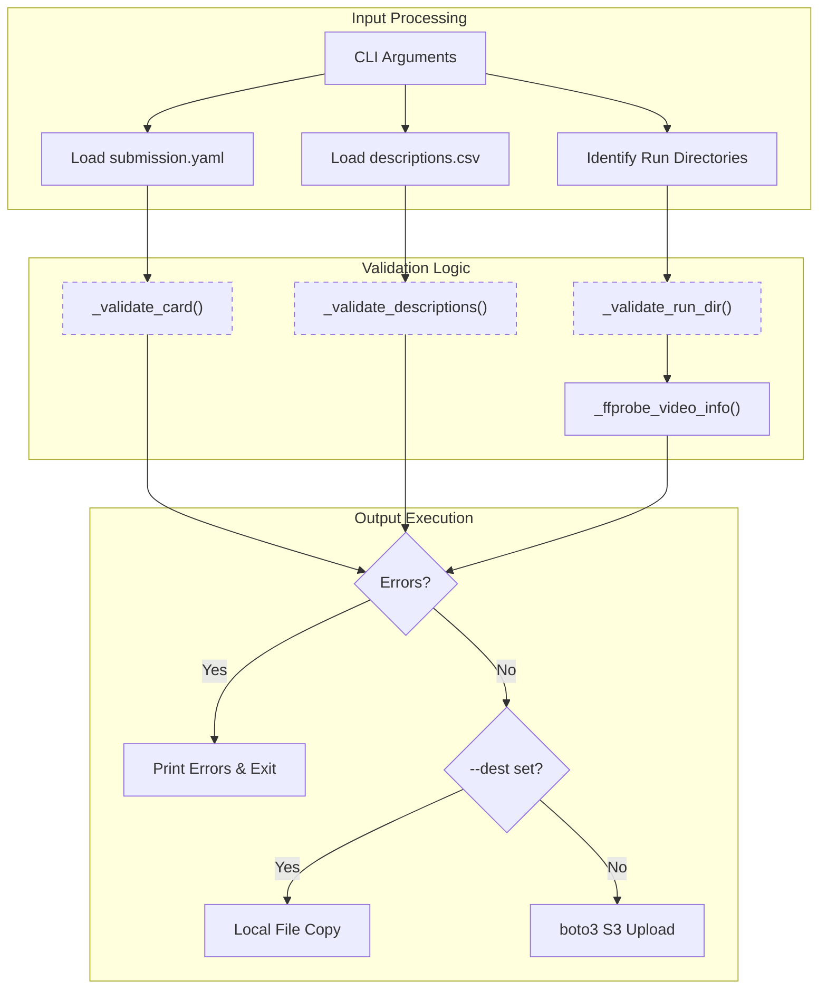
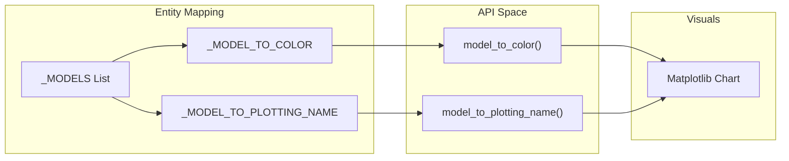

<!-- source: DeepWiki mcp.deepwiki.com · repo google-deepmind/physics-IQ-benchmark · page 7.7 submit_verified.py and plot_settings.py · fetched 2026-10-26 -->

# submit_verified.py and plot_settings.py

<details>
<summary>Relevant source files</summary>

The following files were used as context for generating this wiki page:

- [descriptions/data.yaml](descriptions/data.yaml)
- [descriptions/descriptions_original.csv](descriptions/descriptions_original.csv)
- [physiq/plot_settings.py](physiq/plot_settings.py)
- [physiq/submit_verified.py](physiq/submit_verified.py)
- [submission_verified/example/submission.yaml](submission_verified/example/submission.yaml)
- [submission_verified/submission.yaml](submission_verified/submission.yaml)

</details>


## Purpose and Scope

This page documents the technical implementation of the Physics-IQ submission system and its visualization configuration. 

`submit_verified.py` is the authoritative tool for validating and uploading evaluation results to the Physics-IQ Verified leaderboard. It enforces strict metadata requirements via a "submission card" (`submission.yaml`), verifies video integrity (duration, FPS, resolution), and handles both S3-based uploads and local packaging for offline submission.

`plot_settings.py` provides a centralized registry for generative video models, defining their display names and color mappings used during result visualization.

---

## Submission Uploader (submit_verified.py)

The `submit_verified.py` script ensures that all submissions meet the rigorous standards required for the Verified leaderboard. It operates in two primary modes: **S3 Upload** (default) and **Local Package** (via `--dest`).

### Data Flow and Validation Logic

The script follows a multi-stage validation pipeline before any data is transferred.



**Sources:** [physiq/submit_verified.py:15-49](), [physiq/submit_verified.py:125-180]()

### Key Functions

#### `_validate_card(card_data: dict)`
Performs schema validation on the `submission.yaml` file. It checks for:
*   **Mandatory Fields:** Organization, model, FPS, resolution, etc., defined in `REQUIRED_CARD_FIELDS` [physiq/submit_verified.py:68-82]().
*   **Conditional Logic:** If `prompt_upsampling` is true, it requires cost and GPU metadata [physiq/submit_verified.py:134-150](). If the model is not an API, it requires local generation hardware specs [physiq/submit_verified.py:151-155]().
*   **Legal Compliance:** Ensures all `warranties` and `terms` fields are explicitly set to `True` [physiq/submit_verified.py:161-178]().

#### `_validate_run_dir(run_dir, card_fps, card_resolution)`
Scans the evaluation output folder to ensure:
*   **File Count:** Exactly 198 MP4 files exist [physiq/submit_verified.py:182]().
*   **Naming:** Files follow the 4-digit zero-padded convention [physiq/submit_verified.py:223]().
*   **Integrity:** Uses `_ffprobe_video_info` to verify every video is exactly 5.0 seconds (±0.001s tolerance) and matches the FPS/resolution declared in the submission card [physiq/submit_verified.py:183-185](), [physiq/submit_verified.py:228-245]().

#### `_validate_descriptions(desc_path, run_dirs)`
Ensures referential integrity between the `descriptions.csv` file and the actual video files present in the provided run directories [physiq/submit_verified.py:255-276]().

**Sources:** [physiq/submit_verified.py:125-276]()

### Submission Manifest (submission.yaml)

The submission card provides the metadata layer for the benchmark. Key sections include:
*   **`public_info`**: Technical specs of the model (parameters, `input_type` like `t2v`/`i2v`), and generation details (BoN sampling, prompt upsampling) [submission_verified/submission.yaml:6-105]().
*   **`reported_scores`**: The self-reported metrics (e.g., `physiq_mean`, `spatial_iou_mean`) which are cross-verified against the uploaded CSVs [submission_verified/submission.yaml:108-128]().
*   **`terms` & `warranties`**: Legal attestations regarding IP rights and data privacy [submission_verified/submission.yaml:129-145]().

**Sources:** [submission_verified/submission.yaml:1-145]()

---

## Plotting Configuration (plot_settings.py)

`plot_settings.py` manages the visual representation of models in generated charts. It maps internal directory names to human-readable labels and specific colors.

### The Model Class
The `Model` class encapsulates the visual identity of a benchmarked system.

| Attribute | Description |
| :--- | :--- |
| `model_name` | The internal identifier (e.g., folder name) [physiq/plot_settings.py:26](). |
| `plotting_name` | The string displayed on axis labels (e.g., "Sora 2 (new)") [physiq/plot_settings.py:28-30](). |
| `color` | The hex code used for bar/line colors in plots [physiq/plot_settings.py:31](). |

**Sources:** [physiq/plot_settings.py:21-31]()

### Model Registry and Lookups

The module maintains a list `_MODELS` which is converted into lookup dictionaries for performance.



**Sources:** [physiq/plot_settings.py:91-100]()

### Pre-configured Models
The registry includes standard models such as:
*   **VideoPoet**: Differentiated by `_multiframe` vs `_i2v` [physiq/plot_settings.py:40-49]().
*   **Lumiere**: Blue-toned color scheme [physiq/plot_settings.py:51-59]().
*   **Sora**: Red-toned color scheme [physiq/plot_settings.py:71-77]().
*   **Hunyuan/Wan/Cosmos**: Modern open-weights and API models [physiq/plot_settings.py:72-86]().

**Sources:** [physiq/plot_settings.py:40-86]()

---

## Integration and Usage

### Submission Workflow
1.  Generate videos and run evaluation to produce a results directory.
2.  Fill out `submission.yaml` using the template in `submission_verified/`.
3.  Execute `submit_verified.py`:
    ```bash
    uv run physiq/submit_verified.py \
        --run my-org__my-model__2026-01-01 \
        --card submission.yaml \
        --descriptions descriptions.csv \
        --runs ./results_dir
    ```
    *Note: The `--run` ID must follow the pattern `[a-z0-9]+__[a-z0-9.-]+__\d{4}-\d{2}-\d{2}` [physiq/submit_verified.py:65]().*

### Customizing Plots
To add a new model to your local plots, append a `Model` instance to `_MODELS` in `plot_settings.py`:
```python
_MODELS.append(Model(model_name="my_model", plotting_name="My Research Model", color="#00FF00"))
```
If a model is not found in the registry, `model_to_color` defaults to `"grey"` and `model_to_plotting_name` returns the raw `model_name` [physiq/plot_settings.py:18](), [physiq/plot_settings.py:95-100]().

**Sources:** [physiq/submit_verified.py:22-49](), [physiq/plot_settings.py:95-100]()

---

