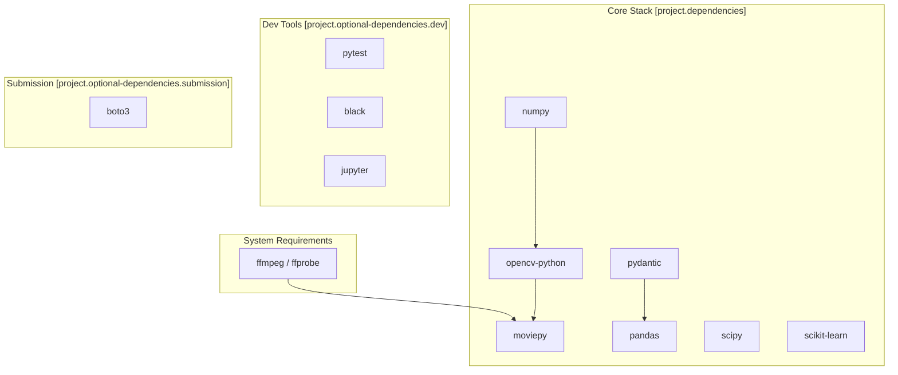
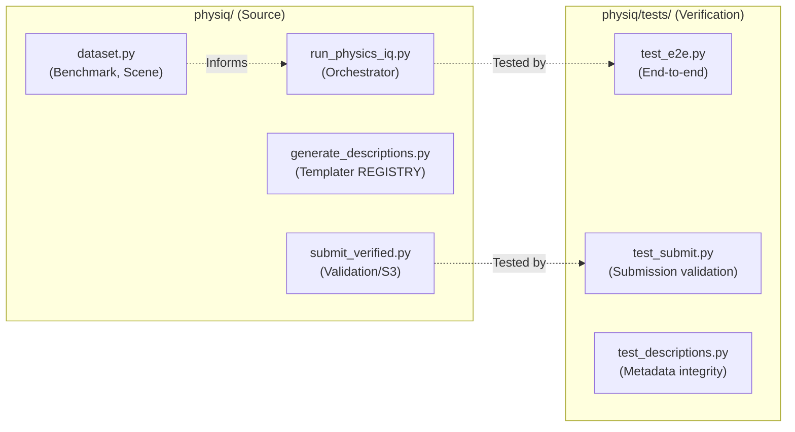

<!-- source: DeepWiki mcp.deepwiki.com · repo google-deepmind/physics-IQ-benchmark · page 8 Development · fetched 2026-10-26 -->

# Development

<details>
<summary>Relevant source files</summary>

The following files were used as context for generating this wiki page:

- [.github/workflows/ci.yml](.github/workflows/ci.yml)
- [CONTRIBUTING.md](CONTRIBUTING.md)
- [pyproject.toml](pyproject.toml)

</details>


**Purpose**: Information for developers who want to contribute to or extend the Physics-IQ benchmark system. This page covers the development environment, dependency stack, and high-level contribution workflows.

For detailed technical guides, see the following child pages:
- [Dependencies and Environment Setup](#8.1) — Detailed list of Python dependencies, the `uv` package manager, and external requirements like `ffmpeg`.
- [Testing](#8.2) — Documentation on the `pytest` infrastructure, test markers, and validation suites.
- [Contributing Guidelines and License](#8.3) — Information on CLA requirements, code reviews, and dual-licensing (Apache 2.0 and CC-BY 4.0).

## Development Environment Setup

The Physics-IQ benchmark is a Python-based evaluation suite designed for modern environments. It utilizes the `hatchling` build system and supports both `pip` and `uv` for dependency management [[pyproject.toml:57-62](), [.github/workflows/ci.yml:9-18]()].

### Installation Quickstart
1. **Clone the repository**:
   ```bash
   git clone https://github.com/google-deepmind/physics-IQ-benchmark
   cd physics-IQ-benchmark
   ```
2. **Install with development dependencies**:
   Using `uv` (recommended):
   ```bash
   uv sync --group dev
   ```
   Using `pip`:
   ```bash
   pip install -e ".[dev]"
   ```
3. **External Dependencies**: Ensure `ffmpeg` and `ffprobe` are installed on your system path, as they are required for FPS normalization and validation [[pyproject.toml:70-71]()].

**Sources**: [pyproject.toml:1-71](), [.github/workflows/ci.yml:1-44]()

## Dependencies

The project maintains a lean core stack for video processing and numerical analysis, with optional extras for development and leaderboard submission.

### Dependency Architecture



**Sources**: [pyproject.toml:7-36]()

## Code Organization

The codebase is structured into the `physiq` package, containing the core logic, and a dedicated `tests` directory.

### Code Entity Mapping



**Sources**: [pyproject.toml:62-66](), [.github/workflows/ci.yml:16-17]()

## Contributing Guidelines

We welcome contributions via GitHub Pull Requests. All contributors must sign a Contributor License Agreement (CLA) [[CONTRIBUTING.md:5-9]()].

### Workflow Overview
1. **Sign the CLA**: Required for all new contributors [[CONTRIBUTING.md:11-14]()].
2. **Code Style**: We use `black` for formatting and `isort` for import sorting [[pyproject.toml:28-30]()].
3. **Review**: All submissions require a review by project members [[CONTRIBUTING.md:17-20]()].
4. **Community**: We adhere to [Google's Open Source Community Guidelines](https://opensource.google/conduct/) [[CONTRIBUTING.md:24-25]()].

For details on the process and licensing, see [Contributing Guidelines and License](#8.3).

**Sources**: [CONTRIBUTING.md:1-25](), [pyproject.toml:27-33]()

## Testing and CI

The project uses `pytest` for automated testing. Continuous Integration (CI) is handled via GitHub Actions, testing across multiple Python versions (3.10, 3.12) and installation modes (editable vs. non-editable) [[.github/workflows/ci.yml:19-44]()].

### Test Categories
- **Standard Tests**: Unit tests for logic and metadata [[pyproject.toml:65]()].
- **FFmpeg Tests**: Tests requiring external `ffmpeg` binaries, marked with `@pytest.mark.ffmpeg` [[pyproject.toml:70]()].
- **E2E Tests**: Full pipeline tests requiring benchmark data, marked with `@pytest.mark.e2e` [[pyproject.toml:69]()].

For details on running tests and adding new ones, see [Testing](#8.2).

**Sources**: [pyproject.toml:64-71](), [.github/workflows/ci.yml:1-44]()

---

