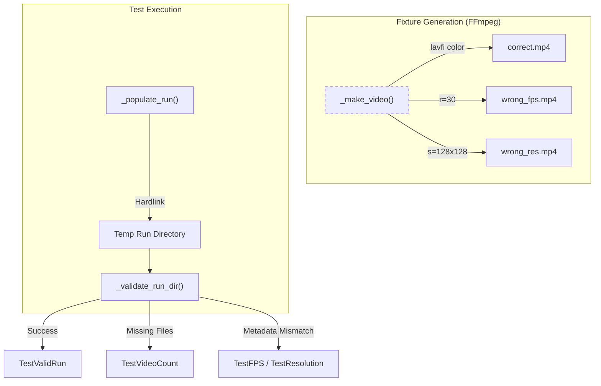

<!-- source: DeepWiki mcp.deepwiki.com · repo google-deepmind/physics-IQ-benchmark · page 8.2 Testing · fetched 2026-10-26 -->

# Testing

Relevant source files

The following files were used as context for generating this wiki page:

- [.github/workflows/ci.yml](.github/workflows/ci.yml)
- [physiq/aggregate_runs_from_csvs.py](physiq/aggregate_runs_from_csvs.py)
- [physiq/tests/conftest.py](physiq/tests/conftest.py)
- [physiq/tests/test_descriptions.py](physiq/tests/test_descriptions.py)
- [physiq/tests/test_e2e.py](physiq/tests/test_e2e.py)
- [physiq/tests/test_scoring_equivalence.py](physiq/tests/test_scoring_equivalence.py)
- [physiq/tests/test_submit.py](physiq/tests/test_submit.py)

The Physics-IQ benchmark includes a comprehensive test suite designed to ensure metric accuracy, metadata consistency, and the integrity of the submission validation pipeline. The infrastructure utilizes `pytest` with custom markers to separate fast unit tests from heavy end-to-end (e2e) and FFmpeg-dependent tests.

## Test Infrastructure and Configuration

The test suite is managed via `pytest` and configured in `physiq/tests/conftest.py` [physiq/tests/conftest.py:1-107](). It includes custom command-line options to control the execution of resource-intensive tests.

### Test Markers
To prevent slow tests from running during routine development, two primary markers are defined:
*   `--run-e2e`: Executes end-to-end tests that require the full benchmark dataset [physiq/tests/conftest.py:88-90]().
*   `--run-ffmpeg`: Executes tests that shell out to `ffmpeg` or `ffprobe` to generate or validate video files [physiq/tests/conftest.py:91-94]().

### CI Integration
The benchmark uses GitHub Actions for Continuous Integration. The workflow [`.github/workflows/ci.yml`]() tests the codebase across multiple Python versions (3.10, 3.12) and installation modes (editable vs. non-editable) [`.github/workflows/ci.yml:19-45`]().

Sources: [physiq/tests/conftest.py:87-107](), [`.github/workflows/ci.yml:1-45`]()

---

## Metadata and Consistency Tests

The `test_descriptions.py` suite ensures that the source of truth for the dataset metadata remains consistent across different formats.

### Description Consistency
The benchmark metadata is primarily defined in a YAML file. `test_yaml_generates_matching_descriptions_csv` verifies that the `Benchmark.build_original_descriptions()` method produces a DataFrame that matches the `descriptions_original.csv` file stored on disk [physiq/tests/test_descriptions.py:22-28]().

Sources: [physiq/tests/test_descriptions.py:16-28](), [physiq/dataset.py:17-20]()

---

## Submission Validation Suite

The `test_submit.py` file contains the validation logic for the leaderboard submission process. It ensures that `submit_verified.py` correctly identifies malformed submissions.

### FFmpeg-Generated Fixtures
To test video validation without bundling large assets, the suite uses `session-scoped` fixtures that call `ffmpeg` to create minimal test videos with specific properties [physiq/tests/test_submit.py:74-101]():
*   `correct_video`: 5.0s, 24fps, 64x36 resolution.
*   `wrong_fps_video`: 30fps.
*   `wrong_res_video`: 128x128 resolution.
*   `wrong_dur_video`: 3.0s duration.

### Validation Logic Tests
The suite tests the internal validation functions of the submission pipeline:
*   **`_validate_run_dir`**: Checks for exactly 198 videos, correct 4-digit zero-padded naming, and consistent FPS/resolution [physiq/tests/test_submit.py:105-188]().
*   **`_validate_card`**: Ensures `submission.yaml` contains all required fields, including terms acceptance and model metadata [physiq/submit_verified.py:35-37]().

### Video Validation Data Flow
The following diagram illustrates how the test suite uses FFmpeg to simulate various failure modes in the submission validator.

**Submission Validation Test Flow**

Sources: [physiq/tests/test_submit.py:47-59](), [physiq/tests/test_submit.py:61-70](), [physiq/tests/test_submit.py:105-188]()

---

## Scoring Equivalence Tests

`test_scoring_equivalence.py` ensures that the modern `IQTable` implementation (used for Verified scores) remains backward compatible with the original `calculate_iq_score()` logic for the `final_score_orig` metric [physiq/tests/test_scoring_equivalence.py:16-22]().

### Equivalence Checks
*   **Metric Means**: Verifies that cross-view means for MSE and IoU families match between the NumPy-based `IQTable` and the original implementation [physiq/tests/test_scoring_equivalence.py:119-156]().
*   **Clipping Logic**: Confirms that scores are correctly clipped to `[0, 100]` (Original) or `[0, 1]` (Stable) when raw physical calculations fall outside these bounds [physiq/tests/test_scoring_equivalence.py:162-195]().
*   **Variance Handling**: Validates that the variance components used for normalization are calculated identically [physiq/tests/test_scoring_equivalence.py:102-111]().

Sources: [physiq/tests/test_scoring_equivalence.py:51-195](), [physiq/calculate_iq_score_stable.py:21-22]()

---

## End-to-End (e2e) Tests

The `test_e2e.py` suite performs a full system integration test using the actual benchmark dataset.

### Real-to-Real Validation
The `test_real2real_scores_are_one` test performs the following steps [physiq/tests/test_e2e.py:30-67]():
1.  Locates the `physics-IQ-benchmark` data folder.
2.  Creates a temporary directory of "generated" videos by symlinking Take-1 of the ground truth videos.
3.  Renames the symlinks to follow the model output convention (`{id}_{view}_{scene}.mp4`) using `Benchmark._infer_generated` [physiq/tests/test_e2e.py:46-49]().
4.  Executes `process_videos` from `calculate_and_write_metrics_to_csv.py`.
5.  Asserts that the resulting `final_score_orig`, `final_score_stable`, and `final_score_view` are all exactly `1.0` (100%) [physiq/tests/test_e2e.py:65-67]().

### System Entity Mapping
This diagram maps the natural language concepts of the evaluation to the specific code entities involved in the e2e test.

**E2E Evaluation Entity Mapping**

Sources: [physiq/tests/test_e2e.py:30-67](), [physiq/calculate_and_write_metrics_to_csv.py:18-19](), [physiq/dataset.py:43-49]()

---

